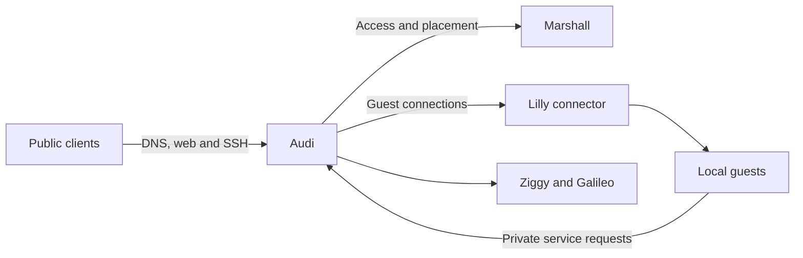

# Audi

Audi is Overalls' Elixir DNS and ingress service. It provides authoritative DNS,
public HTTP/HTTPS and guest SSH gateways, plus a private frontend for guest
services; Marshall supplies access and placement authority, and Lilly verifies
local guest execution.

See [Audi operations](../docs/services/audi.md).
