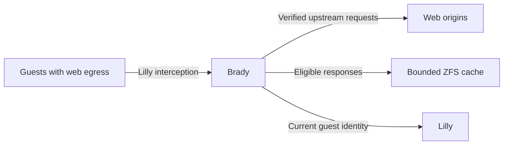

# Brady

Brady is Overalls' Elixir proxy and cache for permitted guest HTTP/HTTPS egress.
It verifies upstream destinations and caches only eligible public, anonymous
responses in bounded ZFS storage, while Lilly supplies network interception and
current guest identity.

See the [Brady design](../docs/services/brady-design.md).
