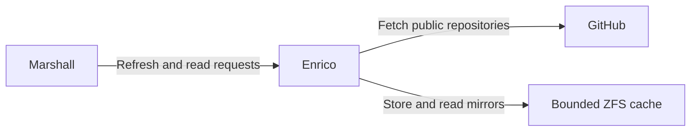

# Enrico

Enrico is Overalls' private Elixir GitHub mirror service. It refreshes registered
repositories in a bounded ZFS cache and serves read-only Git queries to Marshall,
which owns registration, authorization and the repository browser.

See the [mirror decision](../docs/architecture/decisions/0097-enrico-git-mirrors.md).
