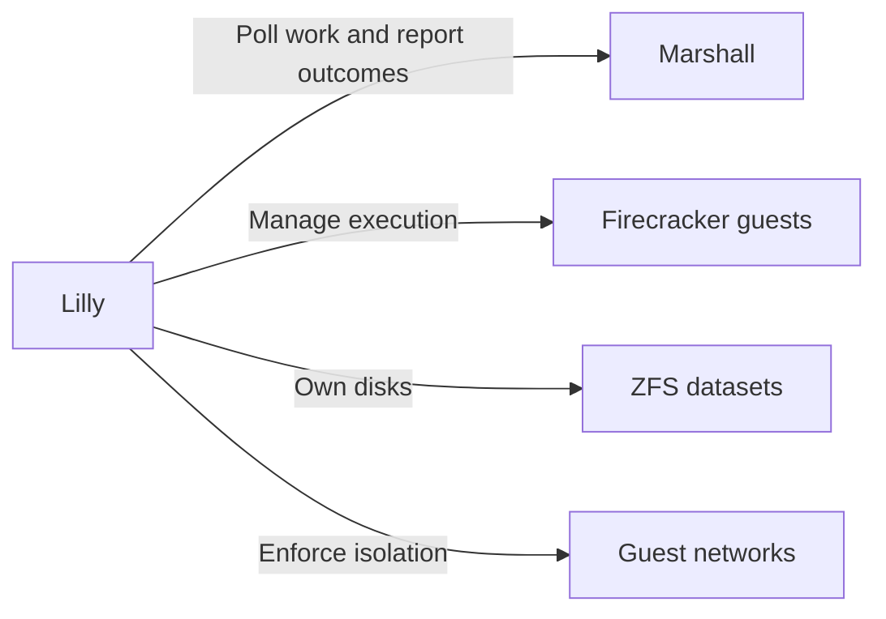

# Lilly

Lilly is Overalls' Elixir provisioner on each execution host. It polls Marshall
for authorized work, manages Firecracker microVMs, ZFS storage and guest networks,
and reports physical outcomes; running guests survive Lilly restarts.

See the [deployment guide](../docs/operations/deployment.md).
