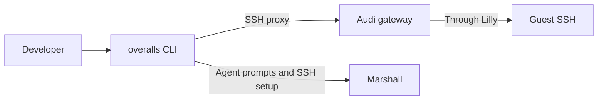

# Lyra

Lyra is the Rust package behind the `overalls` CLI. It configures developer SSH
access through Audi and submits browser-approved agent prompts to Marshall; in
guests, it also provides the agent tool executor and SSH account helper.

## Repository launch

`overalls open https://github.com/OWNER/REPO[/tree/BRANCH|/commit/SHA|/pull/N] [-- COMMAND...]`
validates the URL with the shared `WorkspaceSource` grammar
(`src/workspace_source.rs`, vectors in `tests/fixtures/workspace_sources.json`),
asks Porsche on the configured origin host for an OSS machine with
`new --source URL --profile oss --request-id ID --json`, and then runs
`ssh -t v-NAME-ID.ZONE` through the managed `Host *.ZONE` profile. A fixed remote
script waits for `/run/overalls-workspace/status` to become `done` and starts a
login shell (or the quoted command) in `/workspace/REPO`.

Inside NixOS and Ubuntu guests, the standalone `overalls-workspaced` receiver
listens on vsock port 1031 for Lilly's boot-bound delivery, stores the source once
in `/var/lib/overalls-workspace/source.json` and runs plain `git` (never a shell)
into `/workspace/.REPO.partial` before renaming it to `/workspace/REPO`. The
checkout is shared by every guest login account; see
[ADR-0128](../docs/architecture/decisions/0128-repository-launch-links.md).
