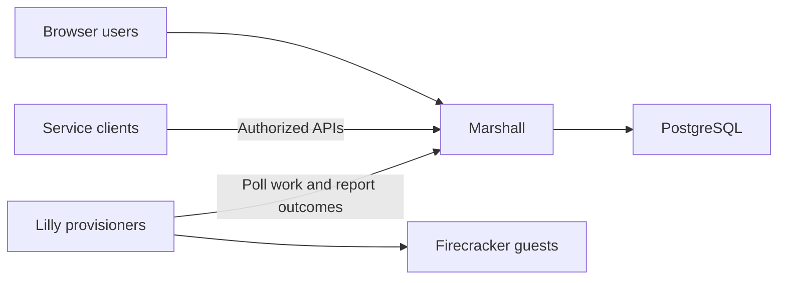

# Marshall

Marshall is Overalls' Elixir/Phoenix control plane and web interface. It owns
accounts, authorization, machine lifecycle, scheduling and agent workflows,
keeping durable state in PostgreSQL while Lilly performs host operations.

See the [architecture overview](../docs/architecture/README.md).
