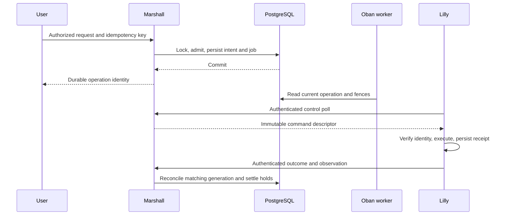

# Control plane and durable authority

Marshall instances share PostgreSQL. Local processes and PubSub improve delivery;
they do not replace durable authority. Ash resources define domain actions and
policy boundaries. Oban performs retryable background work.

The signed-in sidebar in Workspace and Control room places **Source code**
directly below **HLDD**. It opens the
[Overalls repository](https://github.com/ghuntley/overalls) on GitHub.

Workspace labels `/usage` **AI usage**; its page shows **Your AI usage**.
Control room labels `/admin/usage` **Fleet AI usage**. These names describe
inference request and token accounting; they do not change reader authority,
owner attribution or the treatment of incomplete reports as unknown.

## Browser presentation

Marshall renders The Monospace Web (ADR-0161). Every page sits on a character
grid one `ch` wide and one line height (1.2rem) tall; borders are 2px and are
subtracted from padding so boxes stay on the grid. The stylesheet is
hand-written in `marshall/assets/css` and bundled by esbuild beside the
application JavaScript; no CSS framework, component generator or icon set is
involved. Icons are text glyphs and diagrams are box drawing or Mermaid.

| Token | Light | Dark | Role |
| --- | --- | --- | --- |
| `--text-color` | `#000` | `#fff` | text, borders, inverse-video fills |
| `--text-color-alt` | `#666` | `#aaa` | secondary text and placeholders |
| `--background-color` | `#fff` | `#000` | page, controls and dialogs |
| `--background-color-alt` | `#eee` | `#111` | hover, code blocks and terminal selection |

These four tokens are the only colours. The appearance select offers
System, Light and Dark; the browser stores an explicit choice in local storage
(`phx:theme`), applies `data-theme` on the document and falls back to the
system preference when storage is unavailable. Public documentation and the
sign-in pages honour the same preference without a session. State is written
as text (`[running]`, `[failed]`), weight or inverse video, never colour alone.
The terminal renderer, Mermaid diagrams and the loading bar read the same
tokens, so switching appearance redraws them; terminal bytes, geometry and
clipboard consent follow [interactive access](#interactive) unchanged.

JetBrains Mono (500, 600, 800 and 500 italic) is served from this origin under
`/fonts/` with its OFL licence; no stylesheet, script, font or image loads from
another host. The signed-in shell places navigation trees in a sticky sidebar
beside the main column and collapses to a focus-contained drawer below 800
pixels; the sign-in, launch and error pages use a header table, and the public
documentation page has no header: its sidebar tree carries the home, sign-in and
source links, the page list and the appearance selector. No page content sits in
a scroll container except the terminal renderer, its boot log and its session
list: tables, preformatted text, the sidebar, the phone drawer and the handbook
contents flow with the page, and below 800 pixels a table with four or more
columns becomes one block per row (labelled on the machine list). Control room pages share one structure: a heading with the refresh
cadence, summary key/value lines, one bordered panel per record set with an
explicit empty state, filter forms on a character grid, and bracketed status
labels; the Users page lists one account card per user with its role, machine
and MFA facts and, for an elevated administrator, the role, session, MFA and
typed-retirement controls. Element identifiers, data attributes and hook names
consumed by tests and browser probes are stable across presentation changes.

Verification: `mix monospace.check` rejects utility classes, colour literals
outside the token file, external resource references and JavaScript utility
toggles; `mix workspace.check` type-checks the presentation JavaScript; the
Playwright probe (`marshall/scripts/monospace_browser_probe.py`) drives every
route in both themes at desktop and mobile widths and asserts contrast, font
availability, grid alignment, drawer focus, draft identity, session-free public
pages and that no request leaves the application origin. A development grid
overlay (`window.overallsGrid`) marks off-grid elements. The probe uses
synthetic accounts and machines: it establishes rendering and interaction, not
guest execution, assistive-technology compliance or production delivery.

A mutation validates the actor, locks relevant rows, checks current authority,
records intent and work, and commits. Outcome diagnostics follow commit. Retry
with the original idempotency key after an uncertain response. A new key denotes
a new request and may create a second resource.

Generated admission histories withhold the reply after a real commit, then kill
the exact caller or its owned BEAM before nine concurrent retries across three
surviving nodes. Live and archived results retain the original VM and complete
allocation inventory; changed-shape retries refuse. The
[lost admission reply review](repo:docs/architecture/reviews/2026-10-05-admission-lost-reply.md)
records passing distributed-file evidence and full1452-check Marshall precommit
with zero-error forced Dialyzer. HTTP reply loss, pre-commit ambiguity
and native dispatch remain separate verification gaps.

Delivery may repeat. Execution must remain fenced and idempotent. Losing a reply,
restarting a worker, or disconnecting a host does not establish physical failure.
Stale observations cannot release reservations or authorize replacement execution.
Each report carries one entry per enrolled pool: an observation, `unavailable`
(revokes that pool's capacity freshness) or `busy` (transient lock or usage
contention; Marshall keeps the previous observation, which ages out like a late
report). Busy and unavailable entries carry identity only, never credit.
Generated [host report histories](repo:marshall/test/marshall/compute/host_reports_test.exs)
check that accepted snapshots advance within the current epoch, reconnects
revoke freshness, and rejected stale, wrong-epoch or partial snapshots leave
host and pool capacity rows unchanged. These database fixture checks do not
establish native host telemetry or authenticated transport behavior.

Host liveness has one classification (`HostLiveness`, ADR-0140), derived from
the shared host row.
- **States:**
  - `disconnected`: no session;
  - `live`: report no older than `capacity_freshness_ms`, five seconds;
  - `late`: no older than `host_authority_ms`, sixty seconds;
  - `lost`: older, missing or future-dated.
- **Capacity decisions** (admission, start, resize, clone, relocation, drains
  and evacuation) require `live`.
- **Authority decisions** (terminal viewers and tickets, ingress, DNS
  publication, inference, Galileo and SSH guest access) accept `live` or `late`,
  so a slow report no longer disconnects viewers or drops DNS records.
  The sixty-second window covers a Marshall-side outage: while Marshall cannot
  write to its database it rejects every host's report, so a shorter window
  would mark healthy hosts lost. A reset or replaced connection session still
  ends authority at once.
- A new or reset session, a credential change or retirement still ends
  authority immediately.
- Ingest accepts a sample up to the authority window, keeping its sample time,
  instead of rolling back the whole exchange and losing its outcomes. A late
  sample therefore keeps the host authoritative but never makes its capacity
  fresh.

The provisioner protocol validates closed schemas and authenticated host sessions.
Generated authenticated takeover histories require each fresh host session to
advance its durable epoch once. A current nonce retries idempotently; every
superseded nonce keeps returning 409 on open and exchange, with the host row
unchanged. The [local ratchet property](repo:marshall/test/marshall_web/provisioner_api_test.exs)
checks two to five takeovers and the exact consumed-nonce map. It does not
exercise competing Marshall processes, lost replies or cloned host identity.
Every v4 action, including clone, uses the bounded protocol decoder. The clone
effect exchange is version 5: an unconfirmed effect result MUST name exactly one
reason from the closed host set (storage busy, execution unavailable, source
authority, snapshot, copy, stream, lease, receive, key, SSH, permit, revocation,
import cleanup, mount, disk or effect unconfirmed); a bare or unknown reason is
invalid and peer strings never create atoms. Malformed
JSON returns the permanent `invalid_message` 400 class before a control
transaction; an unexpected internal transaction error retains the fixed 503
class. A generated action matrix verifies the classification and unchanged host
state locally. It does not measure the Lilly retry loop under fleet failure.
Generated wrong-version session and exchange requests also return 426 without
changing host or operation rows; the next valid session advances one epoch.
The local property does not exercise a skewed Lilly release over TLS.

Provisioner control documents are version 4. The control WebSocket transport
remains `/api/control/v1` with envelope version 1; terminal streams retain their
independent `/api/provisioners/v4/stream` contract. This coordinated cut requires
current Marshall and Lilly releases. Version-3 application documents are refused;
there is no diagnostic compatibility shim. The cut's migration revoked live session
freshness while retaining consumed nonce identities and their original versions.

Admission reports carry effective CPU/memory limits, measured capacity headroom,
verified image IDs, execution and terminal capability, the Inception image ID,
and each pool's current GUID-bound physical accounting. Report inventory keys
are strings only; any other key refuses the report. Arbitrary inventory,
utilization, logical-used/compression observations and native I/O diagnostics do
not travel to Marshall. Busy retains the previous pool observation and its age;
unavailable revokes freshness and credit. Collector, Grafana and Tempo outages
cannot create capacity or revoke live control authority.

Application diagnostics use the independent observability path described in
[observability](#monitoring), under
[ADR-0149](repo:docs/architecture/decisions/0149-independent-observability.md).
The earlier fleet envelope corpus was baseline evidence for the retired routes;
it was retained as
`marshall/test/marshall_web/fleet_version_history_test.exs` at overalls revision `a99f74f0` (repository deleted).
It does not verify the version-4 rollout.

An authenticated exchange also rolls back a valid capacity report when a
pending command cannot be reconciled. Generated retries with a corrupted
durable command snapshot leave the host's report stale and the operation
pending. A current owner stop cancels that ordinary operation without requiring
fresh host telemetry, after which the next exchange accepts a new report and
stop command. This local test does not cover Lilly's retry delay, retained
relocation-cleanup obligations or native host effects. Whether one bad command
should withhold all host reports remains a recovery-policy gap.
Lilly classifies transport and temporary exchange failures as retryable, keeps
its durable commands and session identity, and reports not ready while backing
off. The retry delay starts at one second, doubles, and is capped at four
seconds (plus jitter). A longer delay would barely reduce load on Marshall,
since hosts normally report every second, but after Marshall recovers it would
stretch a healthy host's report gap past the host authority window
(ADR-0140). A generated [Runtime history](repo:lilly/test/lilly/control/historical_fence_test.exs)
checks bounded backoff and restored status readiness after a completed exchange
with a new report timestamp. It injects handler results locally; a real network
partition, client retry and Marshall host-freshness recovery still need a
cross-service fault test.
Since ADR-0142 these exchanges travel over Lilly's control WebSocket. A
dropped socket resolves an in-flight exchange as unproven, which Lilly treats
as a transport error with the same backoff; the socket itself reconnects with
full jitter capped at four seconds, so a restarted Marshall is reached inside
the report windows. Marshall's refusal names map
to the same error classes the HTTPS statuses produced.
Terminal exchange errors fence Lilly's actor supervisor instead of retrying.
Generated [actor-roster histories](repo:lilly/test/lilly/control/historical_fence_test.exs)
drive one to four actors across the six terminal classes, then require every
actor to stop, every durable command to remain and a later tick to stay fenced.
This local control test does not establish native VMM survival, Marshall hold
retention or external-restart outcome drain.
A generated [readiness boundary property](repo:lilly/test/lilly/control/readiness_test.exs)
varies report age at the fifteen-second limit and one to four durable actor
authorities. A missing or stale actor denies readiness even with a fresh report.
This direct predicate test does not establish a new runtime incarnation or
status-socket behavior after restart.
A generated [terminal version history](repo:lilly/test/lilly/control/historical_fence_test.exs)
varies transient errors before an `unsupported_version` result. It checks that
Lilly fences, retains Store intent and refuses another tick; HTTP decoding and
the terminal WebSocket's separate 404 retry path remain outside that test.
Image identities, storage GUIDs, placement identity, and execution generations
travel with commands. Marshall rejects observations that no longer match durable
ownership. Lilly retains physical receipts independently of the control connection.
Transactional business and security audit rows remain in Marshall and commit
with the action they describe. Lilly lifecycle transitions and transfer byte
progress do not enter Marshall's audit or diagnostic tables. Physical outcomes,
readiness facts, operational receipts, billing and live authorization stay on
the control protocol because they establish durable domain facts.

Production database connections require verified TLS and synchronous commit.
Budget the total connections across all Marshall replicas and maintenance clients.
Declare the actual replica count and connection budget. A single-instance
deployment is supported explicitly; it provides no control-plane redundancy.

Before a schema or protocol rollout, verify compatibility with every serving
replica and retained host journal. Never downgrade by deleting journals or undoing
a migration whose rows establish ownership. See [deployment](#deployment) and
[recovery](#recovery).

The protocol library also provides the shared primitives for liveness and
authority under ADR-0140:
- closed transition-table state machines that fail compilation when malformed and
  refuse undeclared transitions;
- a single-flight cadence. Periodic ticks that arrive during a run are dropped,
  so periodic work always rests between runs and cannot hold shared locks back
  to back. An explicit request during a run starts exactly one follow-up;
- a single-writer, versioned in-memory view that readers consult without locks.

Lilly's VM actors and host sampler run on the cadence. The execution view backs
attribution, ingress, private services and the roster, and Audi subscribes to
revocations. Marshall's host liveness, and Porsche and the remaining edge
services, adopt them in later phases.

Evidence: [coordination decision](repo:docs/architecture/decisions/0003-control-plane-coordination.md),
[control transport](repo:docs/operations/provisioner-transport.md), [runtime configuration](repo:marshall/config/runtime.exs),
[protocol library](repo:protocol/mix.exs),
[liveness primitives decision](repo:docs/architecture/decisions/0140-event-driven-liveness-and-single-writer-views.md).

## Control WebSocket

Services connect to Marshall over one WebSocket each (ADR-0142):
`GET /api/control/v1` on the IPv4 fleet listener, with `overalls-control: 1`,
`overalls-service` and a bearer credential.
- **Refusals before any socket:** a wrong version gets HTTP 426 and a failed
  credential 401.
- **Session:** the first frame is a `hello`, which the service binds. Then
  come correlated `req`/`res` messages, pushed `hint` and `resync` messages,
  and heartbeats both ways.
- **Requests:** each runs in a supervised task against the unchanged domain
  functions, so transactions, idempotency and fencing are those of the domain.
  A request whose connection drops resolves as unproven and is never
  replayed.
- **Changing a message:** codecs accept exactly the current shape. A field or
  operation changes through ordered pushes, each converged on both hosts:
  the receiver tolerates absence, the sender stops, then the decoder becomes
  strict (ADR-0159). No compatibility reader outlives that sequence.
- **Hints:** they come from ADR-0141 control hints and are only prompts to
  re-read. Every connect re-reads durable state.
- **Close codes:** these are closed (4000–4008). Each code maps to one client
  reaction: stop on an unsupported version, fence when fenced, reload the
  credential when refused, reconnect at once when draining, otherwise back
  off with jitter.
- **Clients:** Galileo, Audi's gateway and DNS roles, Lilly's control
  exchanges, Ziggy and Porsche. Lilly's terminal stream and the Marshall peer
  hop keep their own binary-framed WebSocket on the shared active-once
  connection (chapter 8). Galileo's and Ziggy's HTTPS routes are deleted; the
  socket is their only path to Marshall.
  - Audi's ops (`audi.<route>`) carry the versioned documents of its former
    HTTPS routes, through one shared request module. Only `identity`,
    `dns-snapshot`, `host-key`, `host-certificate` and public known-hosts
    remain HTTPS, for Inception publication and lyra.
  - The hello binds the credential's role and host.
  - Audi's socket allows 8 MiB frames (DNS snapshot) and 64 concurrent
    requests (stream renewals); the defaults are 1 MiB and 8.
  - Lilly's 18 control routes travel as `lilly.<route>` through one shared
    request module. The hello binds the host credential's `host_id`, each
    exchange still fences session and epoch under the host lock, and the
    socket allows 1 MiB + 4 KiB frames and 64 concurrent requests.
    The host lock is a `FOR NO KEY UPDATE` row lock: it serializes every host
    mutation (exchanges, rotation, placement), while foreign-key checks from
    model calls, operations and placements (`FOR KEY SHARE`) neither queue
    behind it nor deadlock with it. Guest-credential authentication
    (inference, Galileo, Peach) takes `FOR KEY SHARE`, which never waits for an
    exchange; host enable, drain and retire, and those credentials' issue,
    rotation and revocation take `FOR UPDATE`, which waits for and excludes
    every in-flight guest reader. A `FOR UPDATE` host lock exhausted the
    database pool on 2026-10-23
    ([review](repo:docs/architecture/reviews/2026-10-23-host-row-lock-convoy.md)).
    The Threads and Machines pages degrade to their unavailable state on a
    database or authorization failure during refresh, clearing details,
    permissions and grants instead of crashing.
  - Ziggy (`ziggy.<route>`, host-bound, 256 in flight, 1.1 MB inbound frames
    for agent results) and Porsche's gateway routes (`porsche.<route>`,
    gateway-bound, 256 in flight) use shared request modules. Porsche's
    session, close and command routes exist only on the socket; its
    `host-certificate` and `ready` stay reachable over HTTPS for lyra and the
    Inception publication probe.
  - Every client opens its connection outside its own process, so requests
    answer `:disconnected` at once while a connect hangs.
- **Request metrics:** Lilly's and Porsche's socket requests emit the same
  request telemetry their HTTPS plugs did, so the `control_*` and `ssh_*`
  aggregates keep counting them. Each event carries a duration and a status
  class (200, 400 for a named refusal, 503 when unavailable).
- **Diagnostics privacy:** each request runs in its own task, which sets the
  same authentication redaction metadata the upgrade does, so debug query logs
  never carry credentials, session tokens or command arguments.
- **Host command hints:** dispatching an operation or relocation step emits a
  `host_commands` hint for its host inside the dispatch. Lilly's socket is
  subscribed, and its runtime exchanges at once instead of at the next
  one-second tick; a lost hint only costs that latency.
- **Route catalog hints:** VM run-state, placement and archive actions and
  endpoint recording or policy changes emit a `gateway_catalog` hint for the
  VM's host. That host's Audi gateway subscribes and refreshes its catalog at
  once; the one-second refresh and the catalog's five-second lease remain.
- **DNS zone hints:** route record and replace, the VM transitions above and
  endpoint changes emit a `dns_snapshot` hint. Every Audi DNS replica
  subscribes kind-wide and reads a fresh snapshot at once, coalescing a burst
  into one read; route lease refreshes do not hint, and the one-second
  refresh and five-second snapshot lease remain the backstop. A recorded
  ACME proof hints the zone too.
- **Host transition hints:** connecting, disconnecting, maintenance and
  configuration of a host hint its own gateway catalog and the DNS zone, so a
  disconnected host's routes are withdrawn at once. Authority lost only by
  report age (60 s, ADR-0140) is caught by the one-second backstop read; the
  five-second catalog and DNS leases bound an Audi that cannot reach Marshall.
- **Certificate hints:** activating a fleet wildcard generation emits a
  `fleet_certificate` hint; every gateway fetches, installs and acknowledges
  it at once rather than at its next 30-second delivery check.
- **Agent work hints:** queuing a model call emits a `ziggy_work` hint for its
  host; that host's Ziggy claims once at once, leaving its one-second poll and
  version fence unchanged.
- **Revocation hints renew streams:** Audi gateways hear every user and VM
  hint; a stream whose VM or user is hinted renews its lease at once, so a
  refused renewal ends it immediately. Web streams and SSH sessions hold
  30-second leases renewed at half their remaining time (about every 15 s);
  SSH grants carry the key owner's user so user hints reach them. Nested
  streams keep their environment publication's five-second bound. A renewal
  blocked only because Lilly is reconnecting is `unavailable`, not a
  refusal: Audi keeps the lease and retries until its deadline
  ([ADR-0192](repo:docs/architecture/decisions/0192-staged-detached-ingress.md)).
- **Refusals stay refusals:** while disconnected after a refused upgrade or a
  refused/unsupported-version close, the shared client answers requests with
  that refusal, and each service reports it as unauthorized (or a version
  refusal) rather than a transport error.
- **Unavailable credential checks:** a check that cannot complete (for
  example Lilly's undecryptable stored secret) answers the upgrade with 503,
  so the client backs off instead of treating its credential as refused.
- **Fault gate (native tests only):** a configured file of ops is refused as
  `temporarily_unavailable` before dispatch, since proxy path rules cannot
  see ops inside the socket; production configures none.
- **Production path:** on overalls, the fleet relay is `systemd-socket-proxyd`,
  a byte relay with no idle timeout, so sockets stay open with TLS end to end.
  Its default cap is 256 concurrent connections. A Marshall restart drops
  every socket, and clients reconnect and resynchronize.

## SSH host certificate authority

Marshall's SSH domain stores public certificate generations in pending, issued,
failed and superseded states. Issuance holds service or VM authority locks and an
advisory subject lock through local signing and commit. A partial unique index
permits one current generation per subject. Matching valid retries reuse it;
failed signing publishes no certificate. Principals come from server policy and
VM endpoints, never caller-supplied names. The CA private key stays in a Marshall
systemd credential, outside PostgreSQL and release artifacts.
Subjects retain stable service or VM identities across credential rotations and
boots. New keys supersede earlier generations. Hourly cleanup retains seven days
of superseded or expired public history, deletes at most 500 rows per transaction,
and queues continuation batches. Deleting history does not revoke certificates.

A failed SSH signing attempt retains its public generation. Matching retries
transition it back to pending, so an unavailable private signer does not append
a history row on every guest synchronization attempt. Changed keys and renewal
windows still allocate a new generation.
