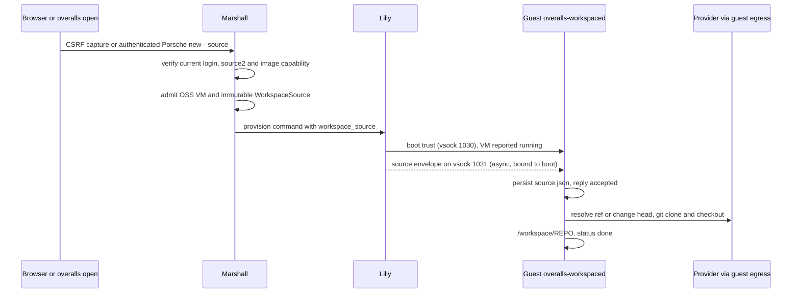

# Guest systems and images

## Snapshot continuation

A full Firecracker snapshot resumes the original guest boot identity in a fresh
VMM. Restored listeners must accept new connections after a valid vsock transport
reset; established and unbound sockets are fenced. Malformed events, foreign CID
and fatal queue/configuration changes still fail closed. The FreeBSD and OmniOS
wrappers retain distinct native qualification requirements. Earlier reset receipts
below describe the former permanently fenced behavior and do not qualify the
new source. Exact-source machine results belong in the suspension review.

## Agent project context

The accepted guest-context operations read the creator's permanent guest account
home and the thread's selected working directory. On Windows, roster activation
creates a missing profile using the account SID and native profile API; context
reads use that SID's registered `ProfileImagePath`, never the SYSTEM profile or
an inferred home. Failed activation disables the account. Image setup creates
`C:\workspace` for threads without a source checkout. Linux resolves the durable
login through the guest account database. These operations retain existing
executor leases and placement fences and add no listener.

Machine/creator/project instruction precedence, bounded file reads, managed
skill storage and explicit upgrade-required failures are described in
[agent context](#agents). Linux/Windows native execution and rollout evidence
remain separate in the [context review](repo:docs/architecture/reviews/2026-10-16-agent-context-and-planning.md).

## Native coding CLI defaults

Both standard images install pinned Codex 0.149.0 (`codex`) and Claude Code
2.1.238 (`claude`) using their native system configuration. The
[shared package/settings source](repo:nix/domains/artifacts/guest/coding-clis.nix) selects
Ziggy's verified private endpoint without provider credentials or custom
launchers. Their package archive remains hash-pinned independently of host
Nixpkgs updates so the reviewed application versions remain fixed. Automatic
client updates are disabled. No model catalog synchronizer
is installed; ordinary native model choices/catalogs may differ from Ziggy's
available models.

| Client | Native configuration and request family |
| --- | --- |
| Codex | `/etc/codex/config.toml` selects `https://llm.internal/openai/v1`, HTTP Responses, no OpenAI login or WebSockets, `approval_policy = "never"` and `sandbox_mode = "danger-full-access"`. |
| Claude Code | `/etc/claude-code/managed-settings.json` supplies the Anthropic URL, nonsecret sentinel, verified guest CA trust, `permissions.defaultMode = "bypassPermissions"`, `sandbox.enabled = false` and `skipDangerousModePermissionPrompt = true`. |

NixOS installs the packages and system settings declaratively. Ubuntu copies
their complete pinned runtime closure into its existing development-tools
environment, registers it in the Nix database and retains a GC root; commands
are exposed at `/usr/local/bin`. This is the scoped offline application exception
in [ADR-0167](repo:docs/architecture/decisions/0167-native-guest-coding-clis.md).
The ordinary authenticated Ubuntu package lock remains authoritative.

The exported default builds measured a 4,311,171,072-byte NixOS rootfs with a
7 GiB minimum disk and a 2,818,572,288-byte Ubuntu rootfs with a 5 GiB minimum.
Ubuntu's exact same-derivation rebuild reproduced identical bytes. The separate
enrolled-host graph with platform roots also built: NixOS measured
4,311,261,184 bytes and Ubuntu 2,818,572,288 bytes, with the same 7/5 GiB minima.
The integrated enrolled-host artifacts retain these sizes and minima; exact
manifest validation and a 72-second byte-identical Ubuntu rebuild passed.
Published `8930a70f` activated these artifacts healthy on both hosts, with fresh
matching image offers. Activation is separate from successful client acceptance.
Provisioning and fixture sizing must read the
actual manifest minima rather than assume these historical sizes. The existing
editor capability already requires at least 2 GiB RAM; idle tool installation
does not create an independent new memory floor.

Both clients verify `/etc/ssl/certs/ca-certificates.crt`. Their client approval
prompts and command sandboxes are intentionally disabled by the managed defaults;
guest OS/VM/network/Marshall boundaries remain in force. NixOS exports native CA
variables globally; Ubuntu supplies them through profile/Bash startup and PAM's
`/etc/environment` for browser terminal and SSH accounts. Homes and saved model
choices are not seeded or rewritten. Users keep ordinary guest permissions and
root capability; native configuration defaults are not a new enforcement layer.

These are user-run processes with guest-local state, separate from
[Marshall-owned agents](#agents). Customer still refuses private inference.
Production Ziggy enables only OpenAI; Claude is configured and its beta URL is
supported, but returns `provider_unavailable` until Anthropic is separately
enabled with Ziggy-owned credentials. New image identities affect future
provisioning and do not migrate retained writable disks. Actual client execution,
TLS/provider routing and GC retention remain scoped evidence in
[coverage](#coverage) and the
[review](repo:docs/architecture/reviews/2026-10-13-native-guest-coding-clis.md).
Both native image probes executed client version/help, configuration and root/plain
user trust before and after GC. Both complete integrated coding-client fleets
passed: native personal-account terminal inference, separate curl beta counting,
limited trust refusal, root GC, registered verified SSH inference from both
clients after GC, and Customer no-effects refusal. These fleets use editor-free
fixture images with the shared client packages/settings and isolated verified-TLS
providers; their identities differ from the production artifacts above. The
current plugin-update assertion passed in both native client/GC probes. The
complete packaged NixOS lifecycle and current Marshall/static/Nix handbook gates
passed at the reviewed `c5747868` checkpoint. Ubuntu's broad lifecycle failed on
a quarantined template when starting a fresh neighbour after its client, source,
initial confinement and host-loss checks passed; an unchanged full rerun failed
there again. Two diagnostic slices did not reproduce the failure. Separate
retained-state inspection after another import demonstrated strict device-identity
refusal without proving the historical cause. A limited test-only post-import
cache action now covers exact reuse or device-only refusal, fenced deletion and a
fully verified distinct incarnation. It changes no production guard or launch
authority. The complete corrected Ubuntu suite passed in 2,203.23 seconds of
driver execution, including exact reuse in the new action and final clone/receive
cleanup. Device-only replacement remains unexecuted, and the original failure
cause remains unknown. Focused current NixOS exact reuse and original neighbour
cleanup passed in the current packaged prefix; later omitted cases retain only
the earlier complete NixOS scope. The corrected/refrozen packaged handbook browser
check passed at its captured source. Both hosts activated published `8930a70f`,
but the first production NixOS Codex canary timed out before any inference
admission; guest deletion, reservation release and dataset absence were confirmed,
and Ubuntu creation was not issued. Separate pinned public-chain validation
rejects the legacy leaf. Same-root preparation and both independent encrypted
host replacements passed; commit/push, live replacement and a successful
production client journey remain separate. The GC helper
runs as root; the subsequent SSH journey separately establishes personal-account
inference after GC.

## Experimental local guest emulation

The Antithesis [local QEMU TCG boot record](repo:antithesis/verification/guest-boot.md)
uses the production NixOS guest services in a q35-adapted image. Exact port
1024 readiness succeeded at epochs 3, 4 and 5; epoch 4 reused the same qcow2
overlay. After stopping the guest, an offline read found retained
`/etc/machine-id` bytes matching the first ready boot, and `qemu-img check`
found no errors. The initial image had reached multi-user and port 1026 flush
but missed readiness because q35 named its NIC `enp0s3`; `net.ifnames=0`
repaired that fixture mismatch. The runner stopped its owned QEMU/backend
processes and removed its TAP. This local software-emulator result does not
exercise hosted Lilly's unavailable guest executor, workspace delivery,
Firecracker/KVM, ZFS or physical host isolation.

## Browser editor capability

NixOS and Ubuntu embed the source-built `vscode-web` package and its Rust broker.
The Arch/Alma shared builder now carries the same optional pinned package pair,
offline registered closure, GC roots, account broker and exact descriptor. Their
earlier selected images omitted that payload and correctly display an unsupported
editor explanation. Final evaluation and actual-filesystem closure/configuration/
service checks pass for editor-bearing Arch `0b3da3e8` and Alma `65e7700b`.
The actual Alma nine-node browser suite passed all twelve provisioning, editor,
policy, recovery, restart and current-authority subtests. Arch's equivalent
native suite passed all twelve stages on the captured same-image diagnostic
replay; its earlier broker-restart 502 remains unexplained. Neither native result
qualifies the later trunk merge or a production browser session.
Both production replacement images passed fresh strict personal CLI SSH,
stop/checkpoint/restart, repeat SSH, PAM/sudo checks and completed deletion.
The seven-family CLI milestone retains its earlier exact image IDs; neither
the isolated native browser fixture nor CLI access claims a production browser
session or physical isolation.
Existing writable disks retain their original manifest and require a new machine
from an editor-bearing image. See the
[foreign Linux editor review](repo:docs/architecture/reviews/2026-10-18-foreign-linux-browser-editor.md).

This capability remains an explicitly Linux-only v4 contract. At the current
revision there is no recorded native browser sign-in, edit/save/readback or
recovery receipt against the current NixOS or Ubuntu image; the historical and
captured Alma/Arch results retain their source, image and fixture scope. Package
closure, descriptor, broker, CLI, terminal or SSH evidence cannot be promoted
to current browser acceptance. Windows `windows-v1`, FreeBSD `freebsd-v1` and
OmniOS/illumos `illumos-v1` rows keep `editor: false`; their readiness, agent,
terminal or SSH evidence does not create an editor capability. A future
non-Linux editor requires a separately reviewed image, agent/protocol contract,
broker and browser journey.

The evaluated `editor-target-boundaries` check independently asserts that the
editor and broker package metadata target `x86_64-linux`, while the reviewed
Windows v5 and native v6 package metadata has no editor field or capability.
This is an artifact-boundary check only; it does not establish a booted guest or
browser journey.

The same closure carries four reviewed Open VSX builtin extensions, immutable AI
policy and project language adapters. No global language toolchain or server is
added by the editor. Extension pins, verified extraction recipe, adapters and
policy contribute to the release identity; see [browser behavior](#interactive).
Ubuntu copies, registers and GC-roots their complete Nix closure during offline
assembly; this is an explicit application exception under
[ADR-0153](repo:docs/architecture/decisions/0153-official-source-browser-editor.md).
Image manifests are version 4 only. An editor-bearing manifest includes the exact
editor protocol, official source commit and release hash in image identity; a v4
manifest without the editor descriptor remains a valid image that cannot open an
editor. [Image manifest validation](repo:protocol/lib/overalls_protocol/image_manifest.ex)
refuses every other version and never infers the capability from package presence,
so new host software cannot add it to a retained disk.

The broker binds the current boot's exact eth0 IPv4 address at TCP 4444 and admits
only the derived profile gateway. It verifies the typed execution/release/account
preface and reconciles the current roster before starting a personal systemd
worker. Root-owned systemd launch identity binds the exact personal UID/name,
protocol, commit, release and origin through a digest. Unchanged identity preserves
the worker; a legitimate changed origin/release requires successful stop before
replacement, keeping personal files. Metadata or foreign socket custody failure
refuses without stopping the worker. The native worker owns its home, server data, extension directory and
mode-0600 Unix socket; there is no root editor fallback. Passwordless sudo remains
available to existing guest writers, so these personal directories do not establish
confidentiality against another writer or root.

The [package procedure](repo:nix/domains/artifacts/vscode-web/README.md) explains source and
signing-key updates. Compiled policy and 19 extension-maintenance checks passed
with actual source-bundled validation. The final specialized Nix package passed
its complete build and installed Chromium/PTY checks; fresh native
NixOS/Ubuntu extension acceptance remains unrecorded. Historical results below
retain their earlier package scope. The installed-validator maintenance derivation
also passed all 19 tests and Ruff/ty in nine seconds. The final standalone attempt
passed its first browser terminal proof, then failed the new Native Policy stage.
Replay observed the policy marker/EditorConfig result and no visible AI UI; the
exact failing browser assertion remains unknown. A corrected per-action run
later passed the cold browser journey and Alice's outside-HOME policy stage,
then failed before invoking Bob's HOME command because its palette row was
absent for 30 seconds. Complete two-account controls/language execution and a
passing rerun remain required. The
[native fixture](repo:nix/verification/tests/machines/vscode-web/default.nix)
uses the actual package and broker with a synthetic roster/bridge. The complete
NixOS service/Firecracker journey passed creation, tools, personal custody,
broker/worker loss, stop/start and revocation. Ubuntu provisioned and reached the
correct editor origin but failed initial workbench visibility; its complete
journey remains unresolved. Source inspection later identified malformed closure
copying without an existing `/nix/store` and retained build-user configuration
ownership. Assembly now creates the destination, preserves complete store paths
and root custody, and asserts broker/editor/configuration placement.
The post-fix Ubuntu `058f13d8` run subsequently passed the initial cold editor/
terminal/custody journey, then failed its real-guest policy phase; the NixOS run
passed the same initial stage and also failed policy. At that historical stage
complete native acceptance remained required. Recorded outcomes and broader gaps remain in
[scenario coverage](#coverage).

The corrected startup-release frozen snapshot subsequently passed both complete
Firecracker fleet scripts: NixOS in 805 seconds and Ubuntu in 829 seconds total
build plus native execution. Actual Marshall/Audi/Lilly opening, native policy
and personal controls, broker/worker recovery, saved-data stop/start, current
physical readiness and Origin/sign-out refusal passed. This snapshot predates
later template changes; periodic sweeps are not validated by these results.
Final release 7d2415 complete standalone acceptance subsequently passed in
342 seconds total build/execution, including lower/core/System refusals, newer
personal install/reversion, independent controls, real Rust/Elixir and
broker/worker recovery. Its local authorizer and TLS relay are fixture adapters;
final-release Firecracker family runtime remains separate from passing image
builds. Initial standalone/language failures and older scoped successes retain
their original scope. Historical lower/equal scanner state remains unexecuted.
Both hosts later activated exact 63a1443c/release 73ad with matching new guest
manifests; that activation does not upgrade retained disks or establish a
production browser journey. The current 13:06 existence-only check confirmed
recurring fixture files absent; production browser and recurring history remain
unestablished.

Overalls builds NixOS and Ubuntu guest images with Nix. Each immutable manifest
binds the kernel, initrd, drives, architecture, and minimum resources. Register the
manifest in Marshall and install matching artifacts on Lilly before admission.
Rebuilding an image changes future provisioning; existing writable disks remain.
The browser creation form and Porsche SSH `new` command select OSS when the
profile is omitted. Users may select Customer explicitly for its restricted
network and agent policy. Existing machines keep their persisted profile.
Customer owner lifecycle controls, their entry-specific refusals and receipt
pinning are verified through generated histories and a native journey; see
[Machine lifecycle](#lifecycle) and [scenario coverage](#coverage).

| Image/profile | Configuration model |
| --- | --- |
| Standard NixOS | Nix-built kernel and root; additional modules extend the guest builder |
| Ubuntu | Ubuntu Base and locked APT packages installed offline by a Nix build |
| Inception | One nested Overalls development deployment with a separate data disk |
| Customer | Restricted network and agent capability policy; image choice does not override it |

```sh
nix build .#guest .#ubuntu-guest
nix build .#inception-guest
```

Build hosts need the repository's pinned toolchain and, for native image creation,
working KVM. Inspect the resulting `manifest.json`; use its canonical image
identity rather than inventing an ID from a filename. Fleet image declarations
select installed artifacts and Marshall's default image.

Lilly starts its control runtime, Audi ingress and private connectors and the
Brady attribution socket immediately; configured images are only structurally
staged at startup (safe ancestry, modes, sizes, manifest). A background image
catalog then publishes each image to the host's `inventory.images` only after
SHA-256 verification, and launch re-verifies the bytes. The first verification
of an image hashes it in full and records the result in a private cache
(`<state>/images/digests.json`, mode 0600, directory 0700), keyed by the
resolved path, the manifest ID and the native identity of every file (device,
inode, size, nanosecond mtime and ctime). The result is recorded only if those
identities were the same before and after hashing. After a restart, an image
whose identities still match exactly is advertised without hashing again; any
change hashes it again. A cache that is unreadable, not private or malformed is
ignored (ADR-0176). A Lilly restart therefore restores guest attribution,
ingress, adoption and unchanged images within seconds. A changed or new image
waits for its hash: minutes for multi-GB images on slow storage, and about a
minute for the 64 GiB Windows image before the cache. A digest mismatch leaves
the image unadvertised and is counted in `lilly.images_verified`.
The Ubuntu builder also registers a pinned Nix development closure inside the
guest. Its SQLite path registry must preserve paths and references while
excluding build-time registration timestamps and transient WAL/SHM bytes from
the immutable rootfs. An Oct 2 read-only comparison found those bytes differed
between enrolled hosts at the same derivation path, producing different Ubuntu
image IDs. The sandboxed normalization passes local unit checks, but full
rebuilt rootfs and cross-host equality have not been recorded. Until matching
installed manifests and fresh image offers are observed on both hosts, refuse
a matched baseline rather than reusing either image ID by filename.
The exported `ubuntu-guest-unit` Nix check now enforces the normalization
invocation in the actual builder and runs the three database unit cases. Its
passing execution cannot establish the full native image or fleet rollout.
A present but unexecuted Ubuntu native SSH journey additionally asks the
guest's Nix CLI to resolve the installed pinned development-tools closure
from that guest-local registry. The command returns only a fixed verdict; a
new image must still build, boot and pass this check before runtime usability
can be claimed.

Local guest authority comes from one in-memory execution view (ADR-0140), with
a single writer for each kind of row:
- The control runtime publishes "connected" and each durable command right
  after storing it.
- Each VM actor publishes a boot row once its own observation proves the
  current boot's confined VMM, and a live row after a running observation. The
  boot row grants roster bootstrap only. Rows stay valid for 30 seconds while
  the exit watcher is armed on that VMM, otherwise for two seconds, unless
  renewed.

Brady attribution, Audi ingress and private-service lookups read that view
without calling the runtime or the actor. A request therefore needs a connected
runtime, a live command identical to the durable command, and an unexpired
observation:
- A superseding command, a disconnected runtime or the actor's exit revokes at
  once.
- A slow or retried observation does not, and neither does placement-lock
  contention while gathering boot proof: the proof lapses only when its
  deadline passes. Definite negative evidence does revoke.
- A Lilly restart starts with no rows, so authority waits for the next running
  observation.

The actor runs at most one observation at a time and never loses a request.
A request that arrives mid-observation starts the next one as soon as it ends,
except that a newer command preempts a create that has not reached its launch
commit (ADR-0176).

Just before `launch-attempt.bin` is persisted, `Driver.launch` asks the actor
whether the attempt may commit. The actor grants that once, only to its
in-flight task, and only while that task's command is still the newest
stored command. After that the task runs to the end.

A newer stop or delete that arrives earlier kills the task and starts at once.
Killing the task closes its native lock owners, which kill and reap their
utilities before releasing their locks, as on any caller death. The
preempted attempt persists no launch attempt and leaves only the
crash-recoverable claims that a crash at the same point would leave. Each
preemption is recorded as `vm.execution_preempted`.

After a running observation, the actor also starts `lilly-vm-watch` on the
verified Firecracker process. The watcher holds a pidfd for that process and
watches its unit cgroup. When the process dies or the cgroup empties, it
reports the exit within milliseconds, and the actor deletes the live row at
once and logs `vm.watch_ended`. A crashed or confused watcher also revokes,
which fails closed. Without the helper, the two-second deadline alone applies.

A running VM in steady state is not reconciled every second (ADR-0176). An actor
counts as steady when all of the following hold:

- its last three reconciles of the unchanged command each recorded the same
  running outcome;
- an armed watcher holds the exact VMM behind the current proof.

A steady actor skips per-second ticks and reconciles on a 10-second backstop,
well inside the 30-second watched deadline. Before this, each running VM took
the placement, intent and network locks and ran `systemctl show` once a second.
Any of these ends steadiness at once:

- a changed command;
- a deferral;
- any other outcome;
- any watcher report other than armed.

Both guest builders use an uncompressed kernel with debug sections removed.
The build verifies its entry point, load addresses, permissions and loaded bytes
against the original kernel. Debug symbols are retained in a separate output.
The manifest hashes the resulting smaller artifact; existing disks retain their
portable boot bundle. This changes image identity without removing guest tools
or kernel features. Real-kernel load-image comparison has passed; native boot
acceptance for this change is still pending.

The default NixOS guest package list declares both Git and the GitHub CLI (`gh`);
see the [guest configuration](repo:nix/domains/artifacts/guest/configuration.nix).

For NixOS customization, pass `extraModules` to the guest builder and select
packages with `environment.systemPackages`. For Ubuntu, use `lib.mkUbuntuGuest`
with `imageName`, `packages`, `packageLock`, optional public CA certificates, and
allowed file additions. Ubuntu package names are APT names, not Nixpkgs attributes.
Generate and review a new package lock when changing the package list:

```sh
nix run .#ubuntu-lock -- --snapshot 20260918T000000Z \
  --packages git build-essential python3 postgresql-client \
  --output ./ubuntu-development.lock.json
```

Platform boot, networking, identity, terminal, and access paths are protected.
Keep credentials out of image inputs and the Nix store. Public platform roots are
delivered at boot over bound vsock before networking and SSH. Guest accounts and
terminals use the current per-user account model, including NixOS and Ubuntu.

Personal account reconciliation obtains a fresh boot-bound roster. Lilly may wait
up to one second for definite contention on the placement lock, then verifies the
same owned boot and confinement and renews its route and command checks. The guest
request retains its three-second deadline. Exhausted contention or unconfirmed
authority denies creation; an existing account never bypasses this proof.

Rebuilt NixOS and Ubuntu images default to Bash with Starship's standard
interactive prompt for root and ordinary users, including accounts created after
boot. NixOS enables its global Starship module. Ubuntu installs Bash and Starship
from its signed snapshot lock, sets the ordinary `useradd` shell default and
sources one initializer through `/etc/bash.bashrc` and
`/etc/profile.d/overalls-starship.sh`. Both login and non-login interactive Bash
initialize the prompt once per shell; nested Bash gets its own hooks. The native
NixOS module skips initialization when `TERM=dumb`; normal browser and SSH
terminals advertise a capable terminal. Ubuntu initializes interactive Bash
through its guarded initializer, including `TERM=dumb`.
Noninteractive commands retain exact output without prompt initialization noise.
Users may configure Starship through `~/.config/starship.toml`; personal dotfiles
are not rewritten. Service accounts keep their non-login shells.

The shared personal-account reconciler requires executable
`/run/current-system/sw/bin/bash` on NixOS or `/bin/bash` on Ubuntu before changing
accounts or its state. Creation and every successful active-account refresh apply
that shell, so a manual shell change on a managed account is reverted. Missing
Bash fails closed without choosing another shell. Allocated identity, home
ownership, retained homes and sudo policy continue to use the existing roster
rules. Browser and SSH shells obtain the same account defaults. Existing writable
guest disks are not migrated by rebuilding an image.

[ADR-0150](repo:docs/architecture/decisions/0150-default-guest-starship.md) records
the additive prompt decision. Both managed SSH/browser journeys passed after
integrating independent-observability revision `a2d9e6e` with feature `63214e60`:
stock startup, nested Bash, exact noninteractive stdout, two successful bounded
real roster refreshes, relocation and reboot. Integrated Lyra, image evaluations
and all-files static hooks passed separately. Root/manual-account prompts and
checked account/home cleanup passed both complete root suites before integration
at `63214e60`/`1cd8be40`; no merged root-suite rerun is claimed. Historical managed
journeys, Marshall precommit and the evaluated Nix handbook gate retain their
recorded revisions. The guest image and account-helper source is unchanged across
integration. The
[review](repo:docs/architecture/reviews/2026-10-10-guest-starship.md) preserves exact
artifacts, earlier failures and property/custom-configuration gaps;
[scenario coverage](#coverage) remains partial.

Standard guests include development and diagnostic tools, Podman with Docker
compatibility, and the guest agent executor. Network policy still applies to APT,
containers, tools, and nested workloads. The private CLI update path uses a seed
supervisor, boot checks and periodic checks; it obtains Marshall-authorized
artifacts rather than accepting arbitrary download locations. An activated CLI
that fails to start or does not register within ninety seconds is replaced by
its saved predecessor. Both normal handoff and boot after interrupted activation
use this recovery path. Current registration still requires a new Marshall
executor fence before tool work. A registered but semantically faulty executable
has no automatic rollback.

The [supervisor recovery review](repo:docs/architecture/reviews/2026-09-26-guest-cli-recovery.md)
records generated actual-supervisor process histories with synthetic registration
receipts. Its dedicated native NixOS failure journey passed invalid-format and
registration-timeout recovery, exact prior inode/digest restoration and real
shared-operator tool work under fresh Marshall fences. The
[update failure matrix review](repo:docs/architecture/reviews/2026-09-26-update-failure-matrix.md)
adds the same strict recovery journey on the Ubuntu guest and an interrupted-fetch
journey through the real console seam on both distributions: a staged digest without
verified persisted bytes never activates, one real check against the private manifest
reconverges durable state, and a failed or closed-denial check never poisons the
rejection cooldown, preserved executable identity or the Marshall executor fence.
Direct candidate injection still bypasses artifact delivery. First boot without the
private artifact service available, power-loss and I/O faults, and real guest-command
drain during replacement remain separate evidence.
Earlier NixOS/Ubuntu periodic private update and tool-work results retain their
original scope; they do not establish failed-candidate recovery.

Inception requires nested KVM, its registered image, and a private SMTP bundle.
Its minimum shape is 16 vCPUs, 32 GiB RAM, a 64 GiB root, and a separate sparse
256 GiB data drive. Both drives count toward admission. The inner deployment
retains its database, keys, and ZFS identity; initialization must not format an
already initialized but mismatched disk. It does not offer another Inception layer.

Evidence: [guest builder](repo:nix/domains/artifacts/guest/default.nix),
[Ubuntu builder guide](repo:docs/guests/ubuntu-guests.md), [Inception](repo:docs/guests/inception.md),
[boot trust decision](repo:docs/architecture/decisions/0113-guest-trust-at-boot.md),
[fleet images](repo:fleet/guest-images.nix).

## Durable guest accounts

SSH, browser personal terminals and editor workers use the same automatically
allocated `u<uid>` login and `/home/u<uid>` home on both guest distributions.
The guest UID and account UUID are durable reservations owned by a Marshall User
UUID, independently of its email address. Same-user email changes preserve the
account and home; a fresh same-email registration after retirement gets another
identity. Current boot-bound roster and Cedar write authority still gate guest
access. SSH also requires a currently registered key; browser terminals and
editors use current browser login authority. Existing email-derived writable disks
are outside this development cutover and require compatible new images/recreation; PostgreSQL
migration does not convert their accounts or files. See [access](#access) and
[deployment](#deployment).

On base `63a1443c` plus the durable feature before main integration, the complete
NixOS SSH journey passed canonical account/home checks,
same-User email continuity, relocation, reboot and cloning. Ubuntu passed the
email-continuity subtest before a later agent-authentication failure. Complete
Ubuntu SSH and editor recovery remain gaps.
Both complete retirement journeys passed shared storage/process retention,
old-home reservation and explicit fresh re-sharing. Separate integration with
incoming `d4499c4c` passed Protocol/Lilly/Marshall gates and both eight-subtest
lifecycles (NixOS 438.33 seconds, Ubuntu 574.18 seconds). Those captures do not
establish later browser-launcher/shared-observability source; see the scoped
[execution record](repo:docs/architecture/reviews/2026-10-10-durable-guest-identities.md).

## Repository launch workspaces

Open `https://ghuntley.dev/launch/entry#https://github.com/OWNER/REPO`, or the
corresponding public GitLab, Codeberg or Bitbucket URL, to create an OSS machine
after complete sign-in. The root fragment form still reaches this capture page.
The browser launcher uses the same path. Ordinary sign-in and a magic link opened
in another tab resume through the shared signed session cookie; passkeys do not
gate ordinary provisioning. `overalls open
URL [-- COMMAND]` uses Porsche `new --source URL`, then SSH into the checkout.
Only the guest contacts providers and runs git; Marshall and Lilly carry a closed
source2 identity ([ADR-0157](repo:docs/architecture/decisions/0157-multi-provider-authenticated-repository-launch.md)).



| Stage | Behavior | Refusal or failure |
| --- | --- | --- |
| Entry | Extension launch sends only provider origin/path. Public capture removes the outer fragment and source query/fragment before browser storage/POST, retains a per-tab 128-bit nonce and CSRF-posts source/visit into a thirty-minute signed cookie | URL user information refuses before storage/POST; raw authority/path remains unchanged for backend port/traversal/escape refusal. Invalid/expired input creates nothing. A current ordinary login precedes admission; a different-tab magic link in the same browser can resume |
| Grammar | Source2 binds provider, namespace list, repository and tagged revision. GitLab supports nested namespaces; reviewed ref/tag/commit/change routes preserve immutable source identity. Bitbucket `/src/NAME` can select an advertised branch or tag | Other origins, percent encoding, ports, userinfo, traversal, unsupported routes and option-shaped components refuse. Bitbucket has no distinct tag route |
| Admission | Account launch preset (initially OSS), durable image minima and actor/source/visit idempotency. Manifest4/catalog identity must match and explicitly declare source protocol2 | Replays return the same VM; changed source conflicts. Non-egress profiles and absent/obsolete/mismatched source capability refuse before allocation |
| Completion | Successful admission signs an actor/VM/source/visit receipt. A CSRF HTTP clear checks current completed login and owner/read authority, clears only matching input and navigates to the VM | A failed clear cannot authorize navigation; an older completion preserves a newer observed capture. The cookie is a singleton, not a concurrent-tab queue |
| Delivery | After guest trust and required readiness, every successful running path hands the source to supervised boot-bound delivery with a fresh nonce; retries transport failures for 120 seconds | Stale boots, mismatched echoes and conflicts stop delivery; delivery never delays running, readiness or fencing, and the completed observation including guest_ready is unchanged |
| Clone | The guest resolves the longest advertised matching branch/tag, preferring a branch on ties, including hexadecimal names. Without a matching advertised ref, a 7–64-hex first `tree`/`src` component selects a commit and ignores a following file path. Dedicated GitHub/GitLab change refs or bounded Codeberg/Bitbucket API heads select change checkouts. Plain git uses argument vectors, shallow fetches and a partial directory renamed only after success | Foreign API clone origins, redirects, unbounded bodies and unresolved refs fail. An abbreviated commit uses a blobless partial clone; a done marker prevents re-cloning only after validating the stored current source |

`/run/overalls-workspace/status` shows `waiting`, `cloning`, `done` or `failed` to
login users. The unit runs in both NixOS and Ubuntu images and is not a readiness
dependency. Clones of a machine copy the checkout and receive no new source.

The Ubuntu diagnostic capture reached a guest shell but clone status remained
`waiting`: provisioning-readiness and Inception success paths had bypassed the
supervised source handoff. The correction routes them through the existing
handoff while retaining their exact running/readiness observation. Component and
current native rerun results are recorded separately in the
[review](repo:docs/architecture/reviews/2026-10-10-browser-launcher.md); the failed
capture does not establish provider checkout.
Diagnostics carry only VM, placement and reason identifiers; URLs and refs are
never logged. Advertised-ref capture is bounded to thirty seconds and 1 MiB;
timeout/overflow cancels its owned git helpers, and malformed listings refuse
without falling back to a commit. Checkout uses the advertised/full-object SHA1
or SHA256 format; mixed listings refuse, and abbreviated objects negotiate the
format through a clone. The source2 identity acquires no object-format field.
Any web page can navigate a signed-in user to a launch link; the
result is at most one machine per fresh visit, owned by that user and initially selected from their launch preset (OSS until changed). Admitted replay retains its original request.
Current images use manifest4 with `workspace_source_version: 2` only for a boot-enabled
receiver, otherwise null. Installed binaries alone do not grant capability. Obsolete
images are disabled for new creation; source-v1 receiver records and execution
snapshots are never rewritten or decoded as source2. Recreate sourced machines
requiring the current service. Retained restart/adoption keeps its portable boot
bundle and does not recreate images. A new sourced start command still validates
the durable image record's identity/capability before committing or dispatching;
an obsolete receiver refuses and requires recreation. A disabled current capable
image remains usable for retained starts; unsourced starts do not acquire this
capability requirement. The earlier corrected Ubuntu capture passed cross-tab sign-in/MFA,
four exact initial GitHub checkouts and retained stop/start without re-clone.
Ten additional GitHub/GitLab/Codeberg cases passed before Codeberg change remained
`cloning` and the run failed. Bitbucket, public downloads and CLI were not reached;
historical GitHub results retain their earlier revision in
[scenario coverage](#coverage).
The Codeberg change timeout was reproduced with exact dnsmasq 2.93 and the
production-code musl API client: the fixture returned AAAA REFUSED alongside its
successful A answer. Declaring the fixed provider domains authoritative locally
returns an empty NOERROR AAAA answer and repairs the focused API probe without
changing guest trust or production resolution. The native fixture now checks
fixed provider TLS, API shape and fork transport before the unchanged guest-owned
done/HEAD assertions. Only fixed stages, indices, exit codes and clone-status
values leave those diagnostics. The repaired NixOS native family passed all twenty
provider/revision combinations, cross-tab sign-in/required MFA, retained restart,
public downloads and packaged CLI, with all twelve subtests successful. Exact
guest-owned done/HEAD/shallow assertions and Codeberg/Bitbucket API probes passed
under installed guest trust. The latest frozen-source Ubuntu run passed browser
sign-in/MFA/deduplication but failed initial guest startup before any checkout;
its runtime cause remains under diagnosis and complete family acceptance is
unresolved. Local
provider fixtures do not establish live-provider or production acceptance.
These incoming frozen browser-feature captures precede ADR-0158 integration.
They do not establish the latest combined source2/generated-identity native
source; its component and lifecycle validation is recorded separately.

## Certified SSH boot identity

Each new NixOS or Ubuntu boot generates an Ed25519 host key in
`/run/overalls-ssh-host`. A clone therefore never inherits a private SSH host key.
The private certificate POST has a separate bootstrap purpose: Audi obtains
Lilly's physically verified operation/generation binding and Ziggy relays it to
Marshall. Foreign, stale and cancelled boots cannot obtain another VM's identity.
Certificate and account-roster installation precede sshd and readiness. Renewal
retains a valid installed generation during an authority outage; expiry rejects
new connections. OpenSSH reloads atomic certificate replacements. Existing disks
are outside this development migration and require new provisioning.
Guest SSH from a managed client traverses the installed Audi `ProxyCommand` and
still validates the per-boot host certificate against the pinned host CA. The
selected registered account key and Marshall's durable guest username must
match the current Porsche proof; bypassing the proxy cannot establish a valid
client path even if guest sshd is ready. The two one-off readers-off production
canaries passed NixOS and Ubuntu SSH `ls` and confirmed cleanup over that path.
They do not test restart, clone, relocation or template-enabled readiness.
On the reader revision, the existing NixOS Porsche lifecycle fragment passed
real guest restart, cross-host relocation, independent clone and cleanup.
Its combined fleet run still failed later at an unrelated terminal/browser
stage under database checkout timeouts. Focused NixOS and Ubuntu variants
retain that lifecycle fragment and prerequisites but have not yet run to
completion; no Ubuntu or template-enabled result follows from the NixOS pass.
The reader-revision Ubuntu SSH journey independently passed real client login,
key revocation and renewal, Porsche relocation, reboot, clone, and VM-test
cleanup. Its disposable hosts enable boot-bound readiness and templates;
the journey does not assert a native template hit, exact-boot readiness journal
or delayed refusal; production template use is evidenced only by the
post-release `vm.image_materialized` source. It is not the complete
Ubuntu Porsche lifecycle variant.
A revised disposable NixOS/Ubuntu journey is present to read the production-
validated host journal after guest SSH and after restart, compare the current
host/placement/epoch/generation/boot challenge and guest boot digest, and
refuse stale-boot or foreign-host evidence. It has not yet run; its presence
does not upgrade the recorded Ubuntu result or prove a warm template hit.
A controlled readers-off attempt obtained ten sequential authenticated SSH
samples for each distribution; the exploratory medians were 19.458s for NixOS
and 12.825s for Ubuntu. Two of four concurrent creations failed execution;
their persisted identities were reconciled and their run-owned VMs deleted
with released reservations and absent datasets. That failed campaign is not
an accepted matched baseline or evidence of an enabled speedup.
The benchmark runner now reads the original terminal request after a failed
create. Only a bound VM ID, matching Porsche name and current owner may use
the manifest-planned deletion identity; a missing or running request leaves
cleanup unconfirmed for manual reconciliation. This is a runner custody rule,
not a change to host cleanup authority or a native recovery result.
The same custody check now covers a terminally succeeded create whose client
reply lacks a valid VM identity: current Porsche ownership and the original
request must still bind before deletion, and the malformed reply cannot count
as a performance sample.
Before persisting a new campaign manifest, the runner now requires both
enrolled hosts to advertise the selected enabled catalog IDs, name identical
Nix-store paths **and NAR hashes**, report fresh image offers and low physical
load, match installed manifest digests/sizes to selected enabled catalog images,
and expose the matching readiness/template-budget mode. Missing baseline
summary, changed baseline NARs or different host bytes refuse the enabled
comparison. This is read-only benchmark admission; it cannot authorize VM
effects or certify a template hit.

An Inception deployment generates its own persistent SSH CA beside its existing
private instance identities. It never receives the parent's CA private key.
Its public policy follows the accepted nested namespace, and inner gateways use
the shared certificate installer and renewal units. Each deployment is a separate
SSH trust domain.

## Physical guest readiness receipts

A provision/start outcome may include `guest_ready: true` only after current
boot readiness succeeds. The flag is a coherent running physical receipt tied
to the admitted operation, VM, placement, execution epoch, generation and host.
Marshall rejects a readiness flag on a stop, delete or resize operation. Readiness
arrival uses the committed physical-outcome timestamp for service-level deadlines.
Retained outcomes lacking the flag stay unknown; lifecycle diagnostics do not
supply physical authority. Independent trace/log outages cannot delay receipt
acknowledgement or guest lifetime. Native control-plus-collector outage execution
remains required to verify this coordinated version-4 rollout.

## Native fleet trust verification

Adoption of an already running, proven confined VM preserves its physical boot
challenge and execution epoch while updating the durable boot generation to the
exact current running intent. This permits the same physical boot's trust receipt
to be reused; it does not reuse a previous generation's readiness acknowledgement.
A new physical boot cannot use that receipt. Metadata properties and native
repeated-start guest readiness with unchanged process identity passed. The
complete native clone matrix also passed; physical foreign/corrupt ownership
refusal is not established by this scoped result.

The shared fleet fixture enables boot-trust receivers, private DNS and current
SSH roster prerequisites for every feature variant. The selected feature
scenario remains independent of those prerequisites. Both Ubuntu's primary
image and its alternate NixOS image receive the current host's public roots.
The bounded [native trust journey](repo:nix/verification/tests/machines/fleet-guest-trust/driver.py)
checks current durable receipts, actual service order, wrong-boot refusal with
positive delivery controls, and a new receipt with retained data after restart.
The wrong-boot request carries a different valid root set and must finish with
receiver EOF and no response bytes. Timeout is a failed probe. Installed guest
trust and retained data are checked before a final valid delivery can repair them.
Python's installed SSL implementation must load the actual guest CA file and
contain each expected root as DER, alongside exact bundle and unprivileged-read
checks. This establishes installed trust contents; the local HTTP control does
not establish a live TLS handshake. Failures report only a fixed probe stage.
Bundle reconstruction uses separate bounded commands before the complete byte
comparison; every shell input including result markers is limited to 3,072 bytes
to stay below the Linux canonical PTY line limit. The rejected oversized command
did not establish a guest bundle mismatch; bounded reconstruction subsequently
passed on both actual guest distributions.
The SSH roster timer removes its ready marker before refreshing and recreates it
after success. The existing 60-second service observation therefore requires the
real marker, successful sync result and active required units together. Persistent
absence still fails; the fixture never creates the marker or restarts a service.
The [execution review](repo:docs/architecture/reviews/2026-09-25-fleet-guest-trust-verification.md)
distinguishes test presence from passing execution. It does not rerun the seven
legacy feature matrices or establish independent physical failure domains.
The follow-up [evidence review](repo:docs/architecture/reviews/2026-09-26-guest-trust-evidence.md)
adds a bounded trust-failure exhaustion stage to the same probe: after the
wrong-boot refusal, seven mutations each violating exactly one receiver check
(legacy protocol version, foreign placement, stale execution epoch, malformed
nonce, forged digest claim, duplicated root, private-key-bearing certificate)
must each end in the same completed refusal before the receipt-unchanged check;
the exact guest bundle, service state and a final accepted same-boot delivery
bound the sweep. Sender-side terminal trust-retry exhaustion and independent
physical hosts remain separate acceptance.

The repaired legacy fixture uses real 16 GiB mirrored disks and matching enrollment
descriptors for conservative startup headroom. Each 4 GiB root carries another
1 GiB portable WorkloadBundle ownership reservation. Admission uses measured
physical headroom and pending startup holds; settled virtual promises do not cap
admission. No component carries a logical budget: Lilly refuses one in its
configuration, session pools and ownership record, the Nix module and host tool
omit it, and Marshall enrollment refuses a pool that supplies one; its column is
dropped (ADR-0159).
The existing race starts with one settled guest and two intended successful
pending starts, plus 512 MiB pool overhead. Its physical gate derives each startup
cost from the actual image manifest and portable bundle. The requirement depends
on measured physical use and pending holds, not three settled virtual promises.

A sequential native control verifies three usable NixOS guests and exactly 15 GiB
of disk ownership on one actual pool. An earlier rejected candidate incorrectly
expected another 4 GiB-root request to refuse. The corrected control passed:
it read the actual 16 GiB quota, requested a valid 17 GiB root through the same
authorized action, and observed refusal without another VM or changed ownership.
The recorded `n99x4` native execution on `0cfa6302` passed all four subtests. It
also passed both guest distributions' certificate-gated readiness, completed
wrong-boot refusal and retained-data restart. The control
does not establish the historical concurrent capacity race or a three-guest cap.
All fleet variants retain the 16 GiB disks and matching enrollment descriptors
introduced by the unified SSH CA integration. Actual private-service enablement
also supplies its synthetic SSH CA signer regardless of the selected feature.
Subsequent `aaba77ee` integration preserves its separately verified gateway
startup retry policy; the native and full application results retain their
`0cfa6302` provenance. The seven evaluated variants are configuration evidence,
not seven rerun feature suites.

## Guest boot profile

Every guest boot leaves its own timing record in the bounded host boot log
(`<state_dir>/<placement>/boot.log`, ADR-0154). Operators read it to see where a
create spends its boot and trust time; it is observation only and never gates
readiness.

The host log is read separately from guest terminal admission. Current Cedar
read authority, a fresh authenticated host stream and Lilly's exact current
placement/execution fences still apply when bootstrap is pending or failed.
This read neither requires nor enables a guest terminal capability, and sparse
serial bytes cannot establish native kernel, agent, readiness or service support.
Each page is bounded to 16 KiB; guest socket and boot-challenge authority remain
private. See [the diagnostic read boundary](#interactive).

| Layer | Source | What it shows |
| --- | --- | --- |
| Host line offsets | `lilly-boot-log` writer | `[+S.mmm] ` host monotonic time since the writer started, on every console line |
| Kernel timestamps | `printk.time=1` in both images | Guest kernel time on kernel lines that reach the console |
| Boot report | `lilly-boot-report` unit in both images | `systemd-analyze time`, manager phase instants, critical chain, a unit start/active timeline, trust receiver events and top service blame |

The writer is a line-start state machine: carriage return and line feed both
end a line, empty lines stay bare and output does not depend on pipe chunking.
The 1 MiB cap applies to the stamped stream; bytes past it are drained and
discarded, so a noisy guest can neither block the VMM nor grow the file.

`lilly-boot-report` starts after `lilly-readiness`, is required by nothing and
uses `Type=exec`, so the boot transaction can finish during its 30 s completion
polling window. An in-flight completion probe can add its 20 s tool timeout;
later report queries each have that timeout too. This does not meet ADR-0154's
accepted at-most-30-second completion wait; correcting that bound remains open.
A guest that never finishes booting (for
example an isolated fixture whose roster sync has no authority) still reports
the manager instants and timeline with `Bootup is not yet finished`. Every
report line carries the `lilly-boot-report: ` marker and up to 200 printable
payload characters, and each section is line-bounded; the report holds unit names
and times only, never credentials or payloads.

```sh
grep -a 'lilly-boot-report: ' /var/lib/lilly/vms/<placement>/boot.log | tr -d '\r'
```

The `guest-boot-profile` and `ubuntu-guest-boot-profile` NixOS machine checks
boot the trust-enabled images through Lilly's real trust delivery three times:
with the image roots, with an added root and with that root retired. Each boot
prints the report. After each boot the guest bundle must hold exactly the
delivered roots. On Ubuntu, OpenSSL CApath verification must accept every
present root and refuse the retired one. `zfs-guest` and `ubuntu-guest` assert
the offsets and report on their first boot. Property tests in
`lilly/native/boot-log` cover chunking independence and bounded retention.
Absolute numbers from these nested-KVM fixtures are slower than fleet hardware,
so compare runs of the same check.

### Measured boot reductions

ADR-0154 keeps only changes whose effect was measured with the boot profile
(1-vCPU fixture; seconds since guest kernel start):

| Change | Image | Measured effect |
| --- | --- | --- |
| Closure registered in the guest Nix database at image build | NixOS | Removes the 1.7–1.85 s `register-nix-paths` unit that blocked `sysinit.target`; the rootfs still rebuilds byte-identically |
| Platform roots pre-installed in the receiver's layout with the digest marker | Ubuntu | A delivered set equal to the image's installs in about 26 ms instead of 3.0–3.5 s; readiness 9.3 s to 5.5 s with a quiet console |
| Lean initrd: no default PC module set, LVM, TPM2 or virtual console | NixOS | Initrd 29.2 MB to 23.1 MB; kernel phase about 0.3 s shorter |
| Quiet serial console (`quiet`, `loglevel=3`, `systemd.show_status=error`) | Both | Console bytes before readiness from 20–43 KB to under 1 KB; 0.5–1.5 s faster in the fixture |

The Ubuntu receiver skips `update-ca-certificates` only when all of these hold:
- the installed marker equals the delivered digest;
- the managed `overalls-platform/overalls-I.crt` files are byte-equal to the
  delivered roots, in order;
- the system bundle carries every root;
- every `/etc/ssl/certs/overalls-I.pem` link resolves to its managed file.

The no-op predicate does not independently inspect OpenSSL subject-hash links
or hook outputs. Native rotation verifies CApath after actual rebuilds; isolated
drift of those uninspected outputs remains outside that predicate's proven scope.

Any other delivery withdraws the marker, replaces the roots and runs
`update-ca-certificates --fresh`, which rebuilds the bundle, the hash links and
the hooks. The marker is written only after that rebuild verifies. Trust still
completes before guest networking, DNS, roster sync and sshd on every boot
(ADR-0113).

Measured and reverted, with no gain on a 1-vCPU guest:
- starting the trust receiver before `basic.target`;
- replacing udev-settle with an `eth0` device dependency;
- skipping root fsck.

Merging Lilly's pending and delivering trust journal writes (about 6 ms each)
was not worth the change.

Because the console is quiet, routine `Starting`/`Started` lines no longer
appear in `boot.log`. Unit failures still print, and the boot report timeline
covers ordering. Existing writable disks keep their old image layout; the first
boot after an image change takes the full trust path.

## Multi-OS image families

The shared fleet declaration names seven families: NixOS, Ubuntu, Arch Linux,
AlmaLinux, FreeBSD, OmniOS and Windows. Its native admission filter currently
yields seven source-selected catalog rows, including the exact OmniOS promotion. The
[current OS matrix](repo:docs/guests/os-matrix.md) records package selection,
boot/agent contracts and evidence limits for each family; a catalog row or an OS
display label does not prove a successful guest boot or lifecycle.

All seven selected exact immutable images now have separate recorded successful
create/readiness, strict personal-account CLI SSH, stop with an independent
current-owner stopped checkpoint, same-VM restart, repeated strict SSH and
completed deletion. The matrix review's typed aggregate binds all 49 stage
receipts and four additional Arch/Alma read-only sudo/helper checks at distinct
times and recorded revision contexts. Fresh OmniOS `122228` supplies the owner
checkpoint missing from its earlier `091638` journey. This scoped milestone
does not establish a simultaneous same-revision run, broader enabled-capability
acceptance, revocation, native isolation or physical recovery; native interrupted
growth is covered separately by ADR-0243 fixtures, not by this milestone.

Windows fleet staging/registration selects `windowsGuestPublished`, a
recursive-hash fixed-output copy of the reviewed 64 GiB Desktop Experience
`windows-v1` installation. The separate source builder remains available for
development. Exactly three regular files (`disk.raw`, `firmware`,
`manifest.json`) with no references bind both hosts to the same bytes through
ordinary signed-cache substitution. Missing publication fails with operator
instructions; it cannot rebuild a different installation or select host-local
bytes. The [Windows guide](repo:docs/guests/windows-guests.md) records the exact
NAR/artifact pins and update workflow. Package/file-custody and refusal checks
and both-host verification of the public cache signature passed. These checks
do not establish a new Windows lifecycle or capability result.

The opt-in [Porsche matrix runner](repo:scripts/porsche_acceptance.py) collects
separate live evidence using explicit immutable image IDs and exact expected
catalog names. Its default selection requires all seven families; missing or
unadmitted OmniOS fails preflight before any creation. Explicit `--os` subsets
retain their narrower scope. It binds each fixture to durable create receipts,
rechecks current UUID/name/image/profile/owner/SSH endpoint before new mutations
or guest access, and reconciles uncertain lifecycle work with its original
bounded request ID. Accepted UUIDs persist before create polling, and failed
terminal receipts remain available for owned cleanup without another creation.
Guest probes use the installed Overalls CLI, strict pinned
SSH trust and the authenticated personal account. Exact Linux distribution,
FreeBSD release, OmniOS release or Windows edition/build output is required;
raw probe output is not written to evidence. Stop/start/delete receipts and a
second SSH stage retain separate outcomes. Configuration and resume procedures
are in the [acceptance guide](repo:docs/acceptance/porsche-acceptance.md).
Windows alone may emit the exact stock three-line OpenSSH post-quantum
key-exchange warning with LF or CRLF endings. Attempts record the closed stderr
classification and digest; the runner changes no trust or algorithm settings.
Extra, modified or repeated stderr, another guest family, nonzero exit,
timeout or a wrong edition/build still fails. This classification does not
establish post-quantum transport or promote a prior failed attempt.
Implementation and host-side tests do not establish a live seven-OS pass,
native attestation, physical isolation, storage growth or multi-host recovery.
The 2026-10-18 live subset created NixOS, Ubuntu and exact promoted FreeBSD
fixtures, passed their initial exact OS oracle through CLI SSH and orderly-stopped
all three at generation 2, then passed restart and repeat exact-OS CLI SSH.
Final cleanup returned deleted receipts for all three owned fixtures. Earlier quarantined create fixtures were reconciled and cleaned
with their original bound identities; those failed creates prove no guest boot.

The later `075200` six-image run independently passed the complete CLI lifecycle
and terminal deleted cleanup receipts for NixOS and Ubuntu. FreeBSD passed
through restart and repeated exact-OS SSH; its original delete first remained
`cleanup_failed` with unconfirmed ZFS namespace absence and a management
transport error. After fresh proof of no active unrelated containers, normal
idle rootless Podman context retirement released the retained namespace.
The unchanged helper then completed the original request with a terminal
deleted receipt. No force, migration, database repair or replacement intent
was used. This fixture recovery is separate from independent physical cleanup
and from the earlier `072900` cleanup result.
Original Arch/Alma creates failed before init on stripped executable modes;
their corrected artifacts have separate passing offline/cross-host evidence.
The later source repair restores root-owned `/tmp` and `/var/tmp` as real
01777 directories and explicitly selects `lsm=landlock,yama,bpf` rather than
activating distro SELinux policy on a root assembled without its labels.
Actual final-image manifest/mode checks and old-input negative controls pass;
these offline checks do not establish repaired-image readiness or a live
lifecycle. Host isolation and current execution authority remain unchanged.
Windows created and reported ready, but actual CLI SSH failed before a banner;
read-only inspection found stopped sshd, no TCP/22 listener and SSH-sync
`pass_failed`. The retained fixture's ready flag is no SSH success evidence.
A later manual `CreateProfile` diagnostic found the original 4,096-unit
buffer failed with Win32 1783; a 260-unit call registered the SID-bound profile,
after which the old agent enabled the account, installed a key and started
sshd. The diagnostic mutated the disposable fixture and does not establish
unchanged-image SSH or lifecycle acceptance.
The repaired exact `8ca0a11f` image subsequently passed actual installation and
immutable readback of all three repaired executables. Its sealed recursive NAR
has no references. Signed cache publication and exact NAR-fingerprint Ed25519
verification passed. Independent fresh Dungarees substitution, full NAR contents
and whole-artifact hashes passed, and source selection pins the reviewed bytes.
These publication records alone do not verify a clean CLI lifecycle. The later
fresh `103842` fixture passed the exact repaired image's strict personal-account
SSH, stop with an independent current-owner checkpoint, restart, repeated SSH
and completed deletion. The old mutated fixture does not verify those new bytes.
The [matrix review](repo:docs/architecture/reviews/2026-10-18-guest-os-matrix.md)
records exact run identities, historical failures and later lifecycle stages.
The separate exact-promoted OmniOS fixture then completed creation. Its first
CLI transport succeeded but the OS probe omitted the real `v11` release label
and failed the oracle. After narrowly normalizing that label while retaining
the exact revision, the same 16 GiB VM passed initial CLI identity, orderly stop,
restart, repeated strict CLI identity and terminal deleted cleanup. Stop has a
terminal stopped receipt; no separate pre-restart show-state or physical
checkpoint was recorded in that original `091638` journey. Fresh `122228`
separately adds an independent current-owner stopped-state checkpoint before
restart and completes deletion, without establishing physical absence. The
original failed oracle receipt is retained.
The final `101111` custody proof retains Ubuntu's unchanged exact image and
earlier full lifecycle. The changed NixOS image passed its complete fresh CLI
lifecycle, including a separate stopped-state checkpoint and deleted cleanup.
Final Arch/Alma creates still failed. Their actual-image and independent
rebuild results establish artifact custody separately from runtime acceptance.
Arch's exact same-boot diagnosis found vendor tmpfiles changed root from
immutable 0755 to live 0555, refusing capability-free readiness writes. The
Arch-only higher-priority root policy now retains 0755; actual artifact gates,
the old-image negative and pinned tmpfiles scratch execution passed. These
checks preceded the later helper-fixed lifecycle recorded below. Alma's exact
failed fixture had no `systemd-resolved.service`, leaving dependent
DNS/readiness/SSH inactive;
its original create failure remains unchanged. The private Alma repair installs
the pinned resolver service, two sockets, D-Bus activation/policy and a scoped
identity bootstrap before sysinit/D-Bus/resolver startup. Actual artifact,
exact-config sysusers and native unit-parser checks pass; the later helper-fixed
runtime journey supplies separate boot/CLI evidence below.
The final historical cleanup census records all 15 known fixtures deleted
after strict idle rootless-namespace retirement. Both service and pause scope
received guarded normal SIGTERM with no force, migration, unmount, storage
removal or database writes. Current foreign diagnostic fixtures are separate.
This manual operational recovery does not establish arbitrary automatic or
independent physical cleanup.

The catalog now includes Arch Linux and AlmaLinux as foreign Linux variants.
Their builders reuse the version-4 kernel image contract and the reviewed shared
foreign-Linux root assembly, but add deterministic `arch` and `almalinux` markers so
their image IDs remain distinct. The [`foreign-linux-guests` evaluation](repo:nix/verification/tests/evaluation/foreign-linux-guests.nix)
checks the marker, version-4 command shape and kernel/root artifact bounds. It
does not boot either distribution or establish distribution-native package,
network, isolation or recovery behavior. Both entries use the normal Linux
guest agent row and are catalogued without standby metadata in [`fleet/guest-images.nix`](repo:fleet/guest-images.nix).
Their offline image assembly now carries the pinned Lyra/terminald binaries,
Python, Git, OpenSSH, CA bundle and generic systemd service units; evaluation
checks verify those closures and service references. The later helper-fixed
Arch/Alma runtime results below are separate from evaluation evidence.

SSH uses a complete owned key-only policy and pinned PAM modules, with a
requisite private login receipt before a session opens. Locked `sshd` and
`overalls-ssh` system identities receive collision-checked distinct UID/GIDs;
account lookup uses local files and reconciliation resolves pinned account tools
through an explicit PATH. The image contains a regular root-owned setuid sudo
copy; only current reconciler-managed per-user policies grant access. Vendor
sshd enablement resolves to the same readiness-gated listener. These assembly
contracts and account-allocator tests alone do not establish a working
distro-native SSH/PAM or sudo session; the later exact-image results below
record that scope.

The shared foreign root now recreates pinned PAM's compiled account helper at
`/run/wrappers/bin/unix_chkpwd` on every boot. The root oneshot
`overalls-pam-helpers.service` installs only the immutable pinned 0555 source
as a regular root-owned 04755 runtime copy; SSH requires its successful
completion. The installer accepts no arguments and refuses symlink, foreign
ownership or unsafe parent paths. Existing nosuid runtime mounts remain in
place: pinned PAM's root account caller sets UID 0 before invoking the helper.
The isolated VM gate records missing-helper PAM9, repaired account success0,
and expired13/password-change12/unknown10 refusals, exact bytes, repeat
installation and twelve unsafe-input refusals. It uses a byte-identical
root-owned source overlay inside its disposable chroot because vmTools projects
store ownership to nobody; actual images separately verify root-owned 0555
source custody. This does not establish unprivileged setuid elevation or a
foreign guest SSH/sudo session. Exact rebuilt Arch `99fa9876` and Alma
`473f9589` artifacts passed offline and independent rebuild checks. Their fresh
`114223` journeys then separately passed readiness, strict personal-account SSH,
read-only sudo/helper checks, stop with independent current-owner stopped
checkpoints, restart with repeated SSH/checks and completed deletion. Both
observed exact helper/source custody and nosuid runtime mounts. These checks
establish the recorded root PAM/sudo paths; they do not prove helper setuid
elevation, terminal/executor/workspace, revocation, isolation or physical
recovery. The matrix review preserves the historical failed images and receipts.

Foreign-Linux ext4 construction derives filesystem sizing from regular-file and
symlink content, fixes source timestamps and the filesystem hash seed, and fixes
mkfs/resize clocks. This corrects inputs that previously allowed different bytes
at the same declared Nix paths on two hosts. Historical image builds, evaluation
and same-builder rootfs `--check` comparisons passed. A subsequent cross-host Arch
comparison found different hardlink topology from store optimisation; both root
and closure copying now discard those incidental links. Final fleet-context roots
then passed actual cross-host `--check` rebuild comparisons after signed cache
substitution. Distribution-native runtime acceptance remains separate, as recorded in the
[matrix review](repo:docs/architecture/reviews/2026-10-18-guest-os-matrix.md).

Later live Arch and Alma creates both reached `/sbin/init: Permission denied`:
the upstream-root staging copy had discarded executable modes, including init,
its ELF loader and bash. The corrected copy preserves those modes and adds
write permission only for the staging owner. The new
[`foreign-linux-guest-filesystem` gate](repo:nix/verification/tests/evaluation/foreign-linux-filesystem.nix)
inspects actual private-fleet ext4 images: both init/bash/loaders are 0755,
release data is 0644, sudo is 04755, shadow/gshadow are 0600 and ownership is
root. Both corrected images passed, while each original image independently
failed at bash mode 0644. Exact corrected identities and root hashes are in the
matrix review. This offline regression establishes inode modes separately from
a successful boot, PAM/sudo session or live lifecycle. Corrected images then
passed complete offline policy/file audits and independent forced Dungarees
`--check` rebuilds with actual remote hashes matching local outputs. Those
corrected-byte results do not upgrade the retained original failed boots.

The shared protocol also defines native FreeBSD and OmniOS contracts. Both use
version-6 firmware/raw-GPT manifests; FreeBSD uses `os = freebsd` and OmniOS is
represented as `os = illumos`. The FreeBSD disk retains its complete GPT layout
with EFI and UFS partitions. Bundle version 3 carries the OS, matching agent set,
firmware, bounded artifact sizes and kernel provenance: positive bytes, digest,
source revision, patch/configuration hashes and compiler. Lilly requires a
boot-bound probe response with the expected native OS and kernel digest before
credentials or readiness; the file digest alone does not prove which kernel
booted. Linux kernel bundles emit `initrd_path` only
when an initrd is declared; native FreeBSD and illumos bundles are firmware-only.
Lilly retains the jail-local vsock transport shape for the native wire sets and
applies the Hyper-V CPU template only to Windows firmware. Unqualified native
capability rows remain all-false. A separate complete-image qualification enables
only the reviewed FreeBSD image's readiness, trust, terminal, workspace, flush,
SSH and agent control; editor and Inception stay false. Unapproved native images
cannot enter new Marshall admission or Lilly launch. FreeBSD and OmniOS
builder and conditional catalog declarations exist; only the separately
promoted FreeBSD package passes the fleet admission filter. The OmniOS
declaration consumes the explicit `illumosGuest` constructor while retaining
its downstream display name, but contributes no evaluated catalog row. OmniOS
and retained stock FreeBSD identities retain
false capabilities; the host-only transport alone grants no guest operation. The
rolling FreeBSD 14.3 source endpoint is retired and replaced by a checksum-pinned
archive capture; Nix evaluates the pinned receipts, but the placeholder kernel
artifacts make image construction stop before a stock disk is copied. The separate FreeBSD candidate now cross-builds a complete GENERIC kernel;
the recorded native Lyra package linked eighteen production target executables using the pinned
FreeBSD libraries and official OmniOS SDK. The illumos sources include a modern
virtio backport, public socket ABI and bounded transport/socket wrappers.
Both native terminal daemons now cross-link as separate outputs. Experimental
outputs do not replace the sealed promoted FreeBSD image or grant admission.
FreeBSD's separate two-boot QEMU candidate assembly and scoped nested-KVM
transport gate have passed.
OmniOS full-kit pool import/clone/install/export and diagnostic Firecracker
file/token/host-CID transport checks have passed. Earlier source-qualified OmniOS
receipts record complete services over two clean boots, three-boot/two-expansion
growth and separate process-SIGKILL/same-disk recovery. Reproducible full-image
assembly, formal policy gates, supervised daemon recovery, reset/DMA, broader isolation and
fleet acceptance remain open; admission stays false.

### Current OmniOS accept ordering

The illumos socket downcall waits for connection RESPONSE submission before
returning an accepted child. An immediate application close cannot overtake the
pending handshake; reset, listener closure and interruption refuse. The actual
extracted downcall passed 256 forced host pthread schedules under ASan/UBSan,
and a forced old-code mutant failed. This establishes bounded host control-flow
evidence, with no native interrupt/DMA or admission claim.

The exact handshake-fixed test image `aa669e51` passed ordinary transport,
API pause/full-snapshot/resume reset and two-boot Lilly-policy isolation through
direct host-KVM maintained runners. Complete 25-service-check receipts remain
bound to those boots and image. These manual fixtures are separate from formal
NixOS nested-KVM gates. Supervised daemon recovery still fails after daemon
replacement. Separate complete services, three-boot/two-expansion growth and
same-disk process-crash runners passed on these exact bytes, including all 25
service and eight crash checks. The [matrix review](repo:docs/architecture/reviews/2026-10-18-guest-os-matrix.md)
records full identities, test scope and remaining native/physical gaps.
`native_admission=false` remains unchanged.

The follow-up OmniOS agent manifest keeps SMF's contract service model and
ignores only signal failures so the shell supervisor can replace an individually
killed daemon without SMF replacing all listeners. Core dumps, hardware errors
and an empty contract retain the outer service restart boundary. Assembly and
boot verification require this exact policy and refuse duplicate, broader or
instance-overriding settings. Listener close also wakes pending-handshake
children on its port under the socket lock, letting accept refuse without a
completed callback or another interrupt. The host sanitizer regression caught
a missing-wake mutant. The combined payload passed fresh native assembly,
including native SMF validation, nine modules, 764 payload records and clean
export; the matrix review binds its sealed `45983bb7` disk and receipt.
That exact disk subsequently passed all five maintained direct host-KVM service,
growth, Lilly-policy, same-boot daemon-replacement and process-SIGKILL scenarios,
plus ordinary transport and one API pause/full-snapshot/resume reset event.
The reset receipt establishes pending-socket refusal and current-CID
revalidation, without service-restoration or DMA-safety claims. Final services
and reset replays use explicit owned VMM log files, separate startup stderr and
serial stdout, newline-complete JSON events and independent authenticated
terminal-control deadlines. The fixture regression suite passed 87 checks;
additional controlled-clock and old-helper/parser mutants retain refusal.
These fixture corrections change no guest bytes or classify the retained
earlier PTY incident. A killed shell supervisor while children survive
can leave a nonempty contract without a supervisor; recovery of that case is
unverified; the later passing daemon-replacement history covers the individual
child-death boundary only.

### Reviewed native admission and publication

The approved FreeBSD image ID is
`sha256:d141e4266c29da00a1378157b1d39369b1d48e577bca4ce7375e8ff6d399557b`,
with disk SHA-256
`5022d714b94032253bc44b706b37426f8a247debd155fbe223fde28000228f55`.
The [compiled registry](repo:protocol/lib/overalls_protocol/native_admission.ex)
compares a complete validated manifest or portable boot descriptor with that
reviewed identity. Marshall also binds the manifest-derived image ID to the
durable catalog row; Lilly repeats admission before launching. Missing identity,
an altered artifact/provenance field, a row-ID mismatch or an unapproved native
family refuses. The ordinary capacity, current-boot kernel attestation, trust
and readiness gates still apply after image qualification.

The [promotion constructor](repo:nix/domains/artifacts/guest/native-promotion/freebsd.nix)
verifies disk/firmware sizes and hashes plus hash-bound assembly and five native
scenario evidence sets before publishing exactly `disk.raw`, `firmware` and
`manifest.json`. Each service receipt must name the exact reviewed oracles,
including the scenario's clean or abrupt shutdown checks. FreeBSD retains its
22 approved checks; OmniOS requires 25, adding workspace ownership/unrelated-root
refusal, executor heartbeat withdrawal and whole-process-group cancellation.
Missing, extra or substituted names refuse even at the expected count. The
promotion unit gate and current sealed FreeBSD package build passed without
granting new native execution or OmniOS admission. Candidate receipts retain
false admission flags. The sealed
candidate enters Nix with a reviewed recursive NAR hash through ordinary signed
Overalls Cachix substitution. A cache miss fails with publication instructions;
there is no temporary-path fallback, signing secret in evaluation or automatic
stock-image reconstruction. See the
[publication procedure](repo:nix/domains/artifacts/guest/native-promotion/README.md).

This activates the previously tested sealed image. Rebuilding current native
userland after local MAC normalization yields a different FreeBSD candidate,
which remains unadmitted; it does not replace the sealed closure. The
[activation review](repo:docs/architecture/reviews/2026-10-17-native-image-admission.md)
separates artifact verification, cache publication, SQL/host refusal tests and
native scenario evidence. Reproducible native assembly, direct native peer-VM
isolation, physical recovery, relocation and broader Marshall-driven capability
acceptance remain gaps. The current source-qualified OmniOS service, growth and
crash receipts are recorded separately. The final OmniOS disk `45983bb7` now has all
five exact-image scenario receipts, a verified
[promotion constructor](repo:nix/domains/artifacts/guest/native-promotion/omnios.nix)
and compiled registry identity
`sha256:98b23b7931bc52d55b3c5b38cc20c97c1c967be96cf301940f88b01c715530d8`.
Its complete immutable manifest/descriptor enables the same reviewed native
subset; unqualified rows, editor and Inception remain false. Candidate runtime
receipts remain false and do not transfer to other images. The candidate NAR
passed exact local comparison, signed-cache verification and independent
Dungarees substitution; the promoted closed three-file package passed its
artifact/evidence verifier. `omniosGuest` and `illumosGuest` now select that
exact immutable promotion, producing seven source-selected catalog rows while
the candidate kits retain false admission flags. The separately recorded
selected-release deployment and exact-image live CLI journeys do not transfer
to unrelated candidate builds.
Catalog evaluation, the promotion gate and the actual promoted package build
passed after alias selection; exact `98b23b79` identity/flags and alias equality
are checked while candidate-kit admission/runtime flags stay false.
A later promotion selects Nix-assembled disk `a96f291b`, image
`sha256:6dc1a0840e50e508c964c2890e805c919b78c2cddb3e1e8e9d379e001c28617d`,
through its [constructor](repo:nix/domains/artifacts/guest/native-promotion/omnios-r151050-a96f291b.nix).
It carries the `vioif` receive budget and growth disk-link fixes. All five
scenario receipts come from the Nix machine checks on the exact candidate bytes
with one VMM. The `45983bb7` promotion remains in reviewed history and fleet
staging for retained machines; its live CLI journeys do not transfer.
The [matrix review](repo:docs/architecture/reviews/2026-10-18-guest-os-matrix.md)
records exact disk/manifest/NAR/receipt pins. Declared minimums are 2 GiB memory
and 16 GiB disk; the scoped growth history is 8-to-10-to-12 GiB, while the
separate ordinary OmniOS fleet lifecycle uses the selected 16 GiB minimum.

Native bootstrap canonicalizes only local `ifconfig` MAC output: exactly six
one- or two-digit ASCII hexadecimal octets become lowercase two-digit octets
before comparison. External MMDS remains strictly canonical, and malformed or
foreign values refuse. The regression/type/build gates and corrected `sis8`
native clean-export assembly passed, sealing disk `1e095659`. Complete service
replay remains pending and grants no admission. Later executor lease/stop
callback changes require another kit and exact-image replay.

See [ADR-0190](repo:docs/architecture/decisions/0190-native-kernel-provenance-and-admission.md),
the [multi-OS architecture review](repo:docs/architecture/reviews/2026-10-16-multi-os-guest-images.md)
and the [native kernel attestation review](repo:docs/architecture/reviews/2026-10-17-native-kernel-attestation.md).

### Native kernel candidates and socket ABI

[Native kernel inputs](repo:nix/domains/artifacts/guest/native-kernels/README.md)
pin the exact release sources. FreeBSD uses vendor family 45 with BSD length and
family bytes; illumos uses private family 40 with a 16-bit family. Both publish
`sys/vsock.h`, a 16-byte `sockaddr_vm`, port/CID at offsets 4/8 and the standard
CID/port constants. Only passive host-initiated streams are implemented.
Binding/creation requires root authority (global-zone system configuration on
illumos), guest CID 3 or ANY, and accepted peer CID 2. Invalid CIDs, reserved
bytes, port zero, frame lengths, flags, transition/credit state and resource
exhaustion refuse. Each wrapper caps sockets at 128 and receive windows at
64 KiB; queue pools are fixed and control traffic retains transmit capacity.
FreeBSD also refuses buffer/low-watermark setters so generic socket options
cannot enlarge that budget. Test-only native assertions check four option
refusals, exact buffer size, socket-129 refusal and full capacity reuse; their
final-candidate machine execution remains separate from test presence.

The FreeBSD static driver retains interrupt-visible resources until VM disposal,
refuses runtime detach/unload. Valid transport resets preserve listeners;
fatal configuration changes still fence the device. Illumos has separate `drv/viosock` and `socketmod/sockvsock` modules plus
a sockfs reset path: valid reset preserves listeners while fencing connected
and unbound sockets. Earlier receipts below describe the previous behavior. Its modern virtio ABI requires rebuilding
all five consumers with the framework. Cross-compiled objects do not establish
native module linkage, native boot or reset safety. The native
[link/install helper](repo:nix/domains/artifacts/guest/native-kernels/illumos/native_candidate.py)
subsequently linked all nine modules in the matching OmniOS guest, verified them
before installing into a separate scratch ZFS boot environment and rebuilt its
boot archive. The original boot environment was preserved and the guest shut
down cleanly. Its actual linked-hash and installation receipts retain runtime
validation and native admission false. Reproducible full-disk assembly and
loaded-module acceptance remain open. Native loading exposed Clang's default
userland syscall renaming; the corrected build undefines `_XOPEN_SOURCE`, checks
actual ordinary syscall exports and binds the build recipe into its token. The
corrected clone boots QEMU and passes a native TCP bind and seven helper tests.
The common C frame/credit
properties and sanitizers execute on Linux and do not execute these wrappers.

The current illumos driver allocates fallible worker/queue resources before
`DRIVER_OK` and refuses runtime detach. Activated DMA, queue, interrupt and worker
storage remains until VM disposal; a late activation failure withholds readiness
and retains a bounded unavailable attachment. Firecracker's refused device reset
cannot authorize reclaiming backend-visible storage. This is an independently
reviewed source correction to the existing lifetime contract. The corrected
`76b8c1ad` 26-object cross-build and all four host-test gates passed; native replay
is still required.
This does not establish the cause of the earlier ZFS I/O errors.
Host extraction/fault injection covers 236 preactivation failures, both late
activated failures and three rejected lifetime mutants, retaining all 65 DMA/
chain pairs after activation. The block driver separately reserves worst-case
data plus two metadata descriptors per concurrent direct request, with 265,596
generated helper vectors passing sanitizers. These remain host/source evidence;
native DMA safety and the original ZFS EIO cause are not established.
Completion recycles its bounded request/descriptors before blkdev can
synchronously resubmit, preserves the original callback error and never touches
the old request after callback entry. Completed external transfers return
submission success after one callback, including polled errors; internal
transfers retain direct errors. The five-function host regression passed 161
sanitized histories and rejected four actual-source mutants; this remains mock
ownership evidence.

The [FreeBSD transport machine gate](repo:nix/verification/tests/machines/native-transport/default.nix)
now exists: it boots the source-built candidate under patched Firecracker in
nested KVM, checks the executing build token and CID2/3, rejects oversized
length/disconnected histories, reconnects and compares nine payload sizes from
zero through 1 MiB across the credit-window boundary. It records exact disk,
firmware and VMM digests while keeping admission false. The newer recorded
139-second execution passed token/CID, native ABI and immutable buffer/capacity
refusals. The final ordinary catalog gate subsequently passed in 246 seconds
with exact image `19658a4a`, token, firmware and VMM receipts in the review.
It does not test the complete native
services, device reset, physical isolation or recovery. Wrong-CID refusal is
covered separately by `native-freebsd-wrong-cid`. That test boots a test-only
FreeBSD fault kernel, whose distinct build identity keeps it out of every
promoted image. Before its probe listens, it requires the kernel decoder to
refuse injected wrong-CID and length-mismatched frames, and requires a correctly
addressed control frame to reach the listener. The same test then streams
traffic into a guest socket while the probe injects 64 racing invalid resets
through the driver's configuration-change path; the blocked reader must wake,
new sockets must fail with `ENXIO`, and the host must find the probe port
closed. Production kernels carry neither test OID.
A separate test-only FreeBSD image passed one actual Firecracker pause,
full-snapshot and resume transport event: idle socket identity refused with
`ECONNRESET`, pending accept/read/write calls woke with errors and fresh sockets
refused until a new VM. Exact test image/token/firmware/VMM evidence is in the
native review. This is separate from the final service image and does not
establish reset-race stress, DMA reclamation, physical or OmniOS behavior.
The persisted `native-freebsd-reset` nested-KVM gate subsequently passed in
232 seconds with the same socket outcomes and exact image/kernel/probe/firmware/
VMM receipts in the review. Both native test probes cross-compile. Its private
fixture Unix API adds no production control or ordinary guest TCP surface.

OmniOS module assembly also runs as a Nix derivation,
[`omnios-image-candidate`](repo:nix/domains/artifacts/guest/omnios/assembly.nix).
It needs the `kvm` system feature and boots the pinned stock image offline in
QEMU twice. The guest's Solaris `ld` links the nine modules, and
`native_image.py assemble` installs them into a separate scratch copy. Both
copies share ZFS vdev GUIDs, so only the administration disk is bootable and the
scratch slice is selected by its ZFS label. The receipt checker binds the build
ID, pool GUID, stock `unix` digest and raw disk. Every module built from
unchanged objects must match the promoted `45983bb7` digest. Two executions
produced the identical assembly receipt; the raw disks differ in ZFS GUIDs,
transaction groups, timestamps, the SMF repository and the boot archive. The
output keeps `native_admission=false` and replaces no promotion.

The formal `native-omnios-transport` and `native-omnios-reset` nested-KVM gates
consume that candidate. Reset passed in 721.76 seconds: three 204 API responses,
idle/read/write refusals, original listener reuse and current-CID revalidation.
Transport passed both clean boots in 761.59 seconds with the complete service
oracle, the nine echo sizes through 1 MiB, same-boot production restoration and
loaded viosock/sockvsock file digests equal to the assembly receipt. An earlier
transport run on the same inputs timed out sending SSH `poweroff`; that
intermittent shutdown failure is undiagnosed. Wrong-CID injection, DMA/race
stress, bit-reproducible disks and admission remain open.

Native boot now includes a root-only mounted-root growth helper before MMDS
identity and network. It verifies both GPT copies/CRCs, exact disk/partition
identities and actual capacity before native resize commands, then requires a
fresh volatile success receipt. OmniOS read-only pool discovery searches fixed
device labels with its userland cache disabled; no persisted early-boot cache is
required. Assembly pool GUID, one canonical whole-disk vdev and raw-device
custody remain mandatory. Because the kernel keeps the assembly vdev path, the
helper first creates disk links (`devfsadm -c disk`) so discovery on a first
boot at a new device path cannot race link creation; the candidate image carries
this fix, as does the selected `a96f291b` promotion; the retained `45983bb7`
image does not. A disposable missing-cache diagnostic passed the
revised helper's preflight, expansion, post-GPT preservation and success receipt
where the old query refused. This same-boot fault case is separate from new-image
growth/recovery qualification. Twelve pure checks and three native FreeBSD
QEMU boots passed one unchanged root and two expansions, retaining home bytes,
nonroot GPT entries and a foreign disk. The later exact canonical-roots/SSH
FreeBSD image passed 334-second Firecracker composition through three clean
boots/two expansions with complete service oracles, preserved data and strict
EFI inventories (only bounded root `NvVars` mutable). The final reviewed
blocking-flush image passed all five services/growth/policy/daemon-recovery/
same-disk SIGKILL-recovery variants, with exact image and immutable receipt paths
in the native review. The recorded source-qualified OmniOS growth replay separately covers three clean boots and two expansions.
[ADR-0243](repo:docs/architecture/decisions/0243-native-guest-durability-verification.md)
native durability tests then SIGKILL Firecracker at traced growth writes past
the old disk end in two stages. Each following boot must pass UFS fsck or a
zero-error ZFS scrub, report the old or new root size and complete growth.
The same tests replay a dm-log-writes host journal prefix to model power loss.
They also move a stopped disk between two nested hosts with ZFS send/receive
and boot it under a new placement. The corrected FreeBSD candidate and the
promoted OmniOS image passed all three under production Writeback drive
caching. FreeBSD flush receipts now require a `DIOCGFLUSH` device cache flush
after UFS resume; the promoted FreeBSD image predates that fix.
This adds a tenth production executable
per OS beyond the recorded eighteen-executable package. OmniOS's offline SMF
profile disables all four stock cloud-init instances and stock SSH; only
Overalls bootstrap and the roster supervisor own those startup authorities.
Seed-fixed native assembly and fresh-boot resolver/disabled-service checks
passed. A diagnostic Firecracker boot also passed the complete AF40/file
verifier and nine transport echo sizes through 1 MiB after a debugger-only stock
`pseudo_isa` override. The assembler now preserves stock files and binds
persistent pseudo ISA plus loader/kernel serial settings; final exact-image
replay remains required. No diagnostic override grants production authority.
The first formal persistent-console boot reached ordinary login but refused
services: the remaining plumb-only stock vioif0 file blocked physical networking,
and all three Overalls manifests used an invalid stability enum. The correction
removes only the four fixed stock vioif0 address/DHCP files, preserves unrelated
interfaces and binds their absence into assembly and boot verification.
The corrected manifests pass actual native `svccfg validate`; the old-enum mutant
is rejected. Assembly and verification now require that native schema check.
Actual service import/methods and the separate ZFS I/O failure require replay;
decoded FMD errors precede the later reset attempts.
The final corrected token `985301b4` kit passed native clean-export assembly
with nine linked modules, 764 exact payload entries, all three native manifest
validations and the four recorded network removals. A read-only receipt import
and clean administration shutdown sealed disk `24318238`; its exact hashes and
test-only artifact are in the native review. Normal boot and complete services
for that disk remain separate machine gates. Native assembly is recorded manual
execution, not a reproducibly Nix-built disk or admitted fleet artifact.
Its first service, ordinary-transport and reset attempts all failed early with
blank serial and Firecracker `Shutdown(GenericError)` before fixtures or probes.
The cause remains under investigation; none establishes native runtime success.
The later completion-corrected `76b8c1ad` kit passed a separate pristine native
assembly with the same nine-module/764-entry/schema/network checks, read-only
receipt extraction and clean shutdown. Sealed disk `a49255bd` and its exact
receipt are recorded in the native review. A paired direct-only QEMU diagnostic
reaches console login on `76b8` under the same no-vsock settings where `9853`
panics mounting root. Its growth service enters maintenance; corrected
Firecracker service/transport/reset acceptance remains a separate gate. The
earlier failed `9853` disk remains preserved. The first corrected-image
Firecracker service run stays alive and reaches login but misses its 240-second
first-boot deadline because growth enters maintenance and bootstrap withholds
network/identity. Retained serial corrects an earlier wrapper-rendered
blank-output impression; the sliced expansion operand is separately diagnosed.
The corrected growth-operand kit `d0rd` passed a fresh native assembly with
nine modules, 764 payload entries, native schema checks, clean export and
shutdown. Sealed disk `bea32fe6` retains token `76b8c1ad`; that historical kit remains separate from the later source-qualified service and growth receipts. Transport/reset replay and supervised daemon recovery remain open.

The final `wz4r` kit includes current executor lease cancellation and the
corrected `/usr/sbin/sshd` path/OmniOS always-on PAM config. Fresh native
assembly passed nine modules, 764 payload records, all three SMF validations,
the safe native SSH executable guard, stock startup/network removals, read-only
receipt extraction/export and clean administration shutdown. The sealed
8,589,934,592-byte disk SHA256 is
`e7fc0c04bccb4b443dd4bea2edcdabfa2d1481fee6b683891f4338b399625a41`,
at `/tmp/overalls-omnios-native-ssh-config-final-artifact/`; exact kit/receipt
identities and logs are in the native review. Clone this read-only baseline
before runtime checks. The historical `wz4r` baseline remains outside runtime
qualification and admission; current source-qualified service, growth and
process-crash receipts are recorded separately. Exact-image lease withdrawal,
transport/reset, isolation and image qualification remain pending. Native `sshd -t/-T` separately passed with
synthetic volatile host-key prerequisites, preserving PAM and public-key-only
authentication; parser acceptance proves no running SSH session or readiness.

Native trust composes the current host roots with the separate pinned vendor
snapshot `/etc/overalls/system-ca.pem`, then durably replaces the effective
bundle at the standard FreeBSD/OmniOS trust path. Reusing that managed path as
the next boot's vendor base is refused by the reviewed contract: previous host
roots must be removable. A real second boot exposed the earlier accumulation;
the corrected filesystem regressions are separate from final two-boot service
acceptance.

OmniOS runtime image verification permits the effective CA file to become only
the designated root-owned managed link, with a regular mode0644 target containing
the exact immutable vendor prefix and one to 32 bounded public PEM roots. Static
payload hashes/modes and the regular vendor snapshot remain exact. The final 21
helper boundary tests include foreign/traversal links, writable or nested-link
targets, vendor substitution, unrelated payload changes and malformed/oversized
roots. This structural verification grants no current-boot trust authority;
the trust protocol receipt must still match the current boot.
The assembler also removes an inherited standalone `-s` from the cloned
`/boot/transient.conf` while preserving its ZFS root, boot path and console
arguments; second-boot verification rejects any remaining single-user token.
This fixes loader selection only. The current source-qualified OmniOS image
later passed two complete native service boots; the runner required status zero
and the bounded `syncing file systems... done` serial marker before recording
clean shutdown. The later exact disk `45983bb7` separately passed policy and
supervised daemon recovery; physical isolation remains open. The separate OmniOS
abrupt-crash receipt covers process SIGKILL and same-disk recovery; physical stable-media and host recovery
remain unverified.

The illumos candidate also carries a network receive budget
(`0005-vioif-receive-budget.patch`, contract `illumos-net-receive-budget`).
Firecracker offers no indirect descriptors, so each `vioif` receive buffer
costs its header plus every data cookie in the 256-entry ring, and a buffer
lent to the network stack keeps those descriptors. The stock driver used 64 KiB
buffers, about 18 descriptors each, while allowing 128 loans. A socket that
stopped reading could hold every ring descriptor and stop all inbound traffic
for the guest until it closed. Without guest receive offload, buffers are now one
page-aligned cookie sized to the MTU plus headers. Loans are capped at half the
buffers the ring can hold. The extracted helper's ASan/UBSan test covers the
regression vectors. The patched Nix KVM candidate passed `native-omnios-transport`
and `native-omnios-reset` on 2026-10-22. The `a96f291b` promotion selects it;
the retained `45983bb7` image still has the stall.

## Windows guests (experimental)

[ADR-0169](repo:docs/architecture/decisions/0169-firmware-booted-windows-guests.md)
adds a third, experimental guest family. A Windows Server 2025 image is
booted by firmware rather than by a Linux kernel: Firecracker loads edk2's
CloudHv UEFI (`CLOUDHV.fd`, a PVH ELF) through `boot-source.kernel_image_path`
with no initrd and no kernel command line, and exposes its devices over the
opt-in virtio-pci transport (`--enable-pci`) so the signed virtio-win
`viostor` and `NetKVM` drivers bind. The firmware is built from the pinned edk2
with one patch that ends its 32-bit PCI aperture at Firecracker's MMCONFIG
window ([firmware package](repo:nix/domains/artifacts/guest/windows/firmware.nix)).

The [patched static Firecracker](repo:nix/domains/artifacts/infrastructure/firecracker.nix) is the only
VMM Lilly's release metadata and the development shell reference. Its nine
patches keep the upstream version string and `Cargo.lock`, and widen the
seccomp surface by exactly one vCPU-thread ioctl (`KVM_IOEVENTFD`, already
allowed on the VMM thread):
PVH start info carries the ACPI RSDP address, a read-only ACPI PM timer answers
at I/O port 0x608 (not advertised to Linux guests through the FADT), a custom
CPU template field `hyperv` installs the Hyper-V CPUID leaves while relocating
the KVM signature leaves to 0x40000100, virtio-pci devices start with memory
decoding and bus mastering enabled, a read-only CMOS clock at ports 0x70/0x71
follows host UTC, and a BAR the firmware or OS reprograms moves on the MMIO
bus together with its queue doorbell ioeventfds (a sizing read keeps the
64-bit type bit so edk2 classifies the BAR correctly), the block and net
devices implement virtio reset so the operating system can re-initialize a
device the firmware already drove, block requests whose data spans
several descriptors are transferred whole by both I/O engines, and the vsock
device walks indirect descriptor tables (the virtio-win ring library posts every
multi-descriptor buffer through one whenever the driver holds a table, whether
or not `VIRTIO_RING_F_INDIRECT_DESC` was negotiated; the feature is still not
offered). Linux guests see no change: they never touch the new ports, keep their
firmware-less boot, never move a BAR and, not being offered the feature, never
post an indirect table.

The [image builder](repo:nix/domains/artifacts/guest/windows/default.nix) installs
Windows offline inside a KVM Nix sandbox: QEMU with OVMF boots Microsoft's
hash-pinned evaluation ISO ([pin](repo:nix/domains/artifacts/guest/windows/iso.json))
with modern-only virtio-pci devices, restricted user networking, an answer file
and the pinned virtio-win drivers. `SetupComplete.cmd` enables Emergency
Management Services on COM1 at 115200 baud, disables sleep, Windows Update
restarts, DHCP and IPv6, writes `OVERALLS-SETUP-COMPLETE` to the serial port and
powers off; the build fails without that marker. The result is a sparse raw GPT
disk, the firmware and a **version-5 manifest** (`boot.kind = firmware`,
`pci = true`, `root.format = raw-gpt`, `guest_agents` `none` or `windows-v1`
from the builder's `guestAgents` argument). Installation is not byte-stable,
so each rebuild has a new identity; this is a recorded exception to the
reproducible-template goals of the Linux images, and the reason the image is
built once and copied to every host before it is staged (see
[deployment](#deployment)).

### Launch through Lilly without guest agents

[ADR-0170](repo:docs/architecture/decisions/0170-lilly-firmware-guest-launch.md) makes the
image a launchable guest. The protocol's
[image manifest validation](repo:protocol/lib/overalls_protocol/image_manifest.ex)
admits exactly the eight-key version-5 shape beside version 4 and derives a
`lilly-image-v5` identity that can never collide with a kernel image; the
[workload bundle](repo:protocol/lib/overalls_protocol/workload_bundle.ex) gains a
seven-key version 2 for firmware bundles while version 1 encodes byte for byte
as before. Both results carry `boot_kind`, `root_format` and `guest_agents`, and
the protocol alone names the artifact files (`kernel`, `initrd`, `rootfs.ext4`, or
`firmware`, `disk.raw`).

Lilly keeps `rootfs.ext4` as the pool-side root drive slot for every image and
maps the image's `disk.raw` onto it. For a firmware bundle the
[jail](repo:lilly/lib/lilly/vm/jail.ex) bind-mounts only the firmware read-only,
writes a root-owned read-only `metadata.json` carrying the same boot identity a
kernel guest receives on its command line (placement, execution epoch, boot
challenge, IPv4) plus the gateway, prefix length and MAC, and configures
Firecracker to boot `/firmware` with the Hyper-V CPU template and MMDS V2 on
`eth0`, with no initrd or boot arguments, and with the jail-local vsock
endpoint exactly when the bundle's agent set speaks the vsock protocols
(`OverallsProtocol.GuestAgents.vsock?/1`: `windows-v1` yes, `none` no); the
[unit](repo:lilly/lib/lilly/vm/unit.ex) adds `--enable-pci` and
`--metadata /metadata.json` only for that kind. Identity therefore reaches the
guest before it runs, bound to the durable boot record, and MMDS frames never
leave the VMM, so the per-tap guard is unchanged.

Because the bundle declares `guest_agents = none`, the
[driver](repo:lilly/lib/lilly/vm/driver.ex) records trust as `skipped` for the
exact boot instead of delivering it, the executor commits the terminal
`unattested` provisioning phase and reports the VM running with no `guest_ready`
fact, and readiness, terminals, workspace sources and the Inception profile are
refused. Restart and adoption decide from the same durable bundle.

Inside the image, the SYSTEM task
[`overalls-bootstrap.ps1`](repo:nix/domains/artifacts/guest/windows/overalls-bootstrap.ps1)
runs at every boot: it reaches MMDS over a temporary link-local address when the
stack has none, obtains a V2 session token, validates every field of `/lilly`
(including that the MAC is the adapter's), applies exactly the delivered `/32`
with an on-link route to the gateway and a default route through it, keeps DHCP
and IPv6 off, grows `C:` into host-added space, and records the applied identity
under `C:\overalls\network` without ever logging the token or challenge. The
Administrator credential, EMS and SAC are unchanged, so the serial login gap of
ADR-0169 stands.

Marshall projects per-capability guest facts (`guest_capabilities`: available,
readiness, trust, terminal, workspace, flush, SSH, agents, editor, Inception)
from the immutable image
([image](repo:marshall/lib/marshall/compute/image.ex),
[views](repo:marshall/lib/marshall/compute/views.ex)), each derived from the
protocol's capability table for the row-bound validated manifest and all false
when the manifest is missing, corrupt or mismatched: presentation hides
Terminal, Agents, the editor control and the SSH connection commands when the
corresponding capability is false and explains why, while terminal authority,
agent model calls, the agent executor binding and web search refuse on their own
capability; admission refuses the Inception profile unless the image's agent set
has it, and provisioning admits the creation-to-ready service level only for an
image whose agent set has `readiness` (an unknown snapshot image keeps the
measurement). An image change in the creation form resets the size defaults to
the selected image's minima. The image stays out of `fleet/guest-images.nix`;
staging and registration are operator actions after every host runs a release
that understands the shapes.

### Agents over virtio-vsock (`windows-v1`, FreeBSD and illumos in progress)

[ADR-0171](repo:docs/architecture/decisions/0171-windows-guest-agents.md) adds a
third agent set. [`OverallsProtocol.GuestAgents`](repo:protocol/lib/overalls_protocol/guest_agents.ex)
names the closed set (`linux`, `linux-android-v1`, `none`, `windows-v1`,
`windows-editor-v1`, `freebsd-v1` and `illumos-v1`) and a pure capability table.
Ordinary Linux has the core capabilities; the Android row adds SDK, ADB, emulator
and display flags. The `none` row has nothing, Windows has its declared firmware
subset, and unqualified FreeBSD and
illumos rows remain all-false transport declarations. Qualified `capabilities/2`
requires an exact approved FreeBSD or OmniOS identity for the reviewed native subset;
editor and Inception stay false. Lilly's driver, executor and
jail and Marshall's surfaces branch on these capabilities, never on the set's
name. Version-5 Windows and version-6 native manifests may declare
`workspace_source_version` 2 as metadata, but that field alone grants no source
delivery. A readiness budget for a native row does not establish readiness;
each approved native launch still requires current-boot kernel attestation.

The transport is virtio-vsock through the virtio-win `viosock` driver and
Winsock provider, shipped in the image beside the other drivers and bound
through plug-and-play at first boot under Firecracker (PCI `1AF4:1053`); the
address family is discovered at runtime (control device or Winsock catalog),
never assumed. The Lilly guest protocols (readiness 1024, credentials 1025,
flush 1026, trust 1030, workspace 1031, terminal 1075) are reused byte for byte.
The agents are Rust, cross-built from the shared Lyra crate as `lyraWindows`
through the pinned zig toolchain ([packaging](repo:nix/domains/artifacts/infrastructure/lyra.nix)); the
shared modules are portable (`O_NOFOLLOW` on Unix and
`FILE_FLAG_OPEN_REPARSE_POINT` on Windows for symlink refusal, POSIX modes and
process-group kills under `cfg(unix)`), and the Lyra gate type-checks the
library and every Windows bin for `x86_64-pc-windows-gnu`. Gate 1 ships a spike
probe, [`overalls-winprobe`](repo:lyra/src/bin/overalls-winprobe.rs), as a SYSTEM
task: it waits up to ten minutes for the provider, listens on port 1099, answers
the host's `CONNECT 1099` with one JSON line (family, discovery source, peer
CID and port) and publishes its log on the EFI system partition. Gate 2 adds
the two daemons the `windows-v1` manifest needs for `guest_ready`:
[`overalls-readinessd`](repo:lyra/src/bin/overalls-readinessd.rs) binds this
boot's identity from MMDS (a dependency-free HTTP client,
[`guest/mmds`](repo:lyra/src/guest/mmds.rs), with a fresh version-2 session
token per fetch) and a per-boot UUID kept in a volatile registry key under a
named mutex ([`boot_id`](repo:lyra/src/platform/windows/boot_id.rs)), listens on
port 1024 and answers Lilly's poll with the closed six-key line only to host
CID 2 and only after the live probes pass (the delivered `/32` preferred with
the on-link gateway and default routes from the IP Helper tables, the required
services RUNNING, current-boot SSH bootstrap and verified host-certificate
receipts, live `sshd`, and a synced write on
`C:`); [`overalls-trustd-windows`](repo:lyra/src/bin/overalls-trustd-windows.rs)
accepts one host request on port 1030, validates it against the exact boot with
the shared [`guest/trust`](repo:lyra/src/guest/trust.rs) rules (version, nonce,
digest over the sorted fingerprints, up to 32 unique PEM certificates that parse
as DER), installs the roots into `LocalMachine\Root` through CryptoAPI, writes
the PEM bundle the clone tool and the agents read
(`C:\overalls\trust\bundle-<digest>\ca-bundle.pem` named by `current`, base
roots from the image's `base-ca-bundle.pem`) and only then returns the
`installed` receipt with the same boot UUID. Both run as SYSTEM scheduled tasks
registered by `SetupComplete.cmd`; the bootstrap task keeps an on-link route to
MMDS so the daemons can re-read the document, and sends Lilly's private
endpoint 169.254.254.1 through the gateway like Linux guests do (the address
lives on the host side's loopback, so an on-link route would leave every
private request unanswered). The `windows-v1` image
(`windowsGuestAgents`) declares them in its manifest; the agentless image keeps
`guest_agents = none` with the probe aboard.

Gate 3 brings roster SSH. Win32-OpenSSH has no `AuthorizedKeysCommand`, so the
Windows roster agent ([`overalls-ssh-sync-windows`](repo:lyra/src/bin/overalls-ssh-sync-windows.rs))
pulls instead of being asked. It first reconciles the current bootstrap-bound
roster. On a new boot it stops sshd and clears prior authorized-key files from
the managed directory; a reparse point, unexpected directory or cleanup error
withholds bootstrap. After the verified current-boot host certificate is
installed, it starts a keyless listener and publishes `ssh-ready`. Readiness
then permits the provision/start operation to complete, after which the agent
can fetch the ordinary private route `GET /ssh/v1/authorized-keys` (Marshall's
[`GuestAccess.authorized_keys/2`](repo:marshall/lib/marshall/ssh/guest_access.ex)
through Ziggy and Audi: the roster's current writers with their unarchived
registered keys, under the ordinary four-field binding of a running
execution), reconciles local accounts with the shared
[roster rules](repo:lyra/src/guest/ssh_roster.rs) through the Net API
([accounts](repo:lyra/src/platform/windows/accounts.rs): `u<uid>` users in
Administrators with a never-recorded random password, disabled rather than
deleted when they leave), writes one `AuthorizedKeysFile` per account under
`C:\overalls\ssh\authorized_keys` (SYSTEM-owned, readable only by that account)
and retries every two seconds. Key delivery retains the existing running-VM
and completed provision/start authority. A denied key fetch does not retract
the completed keyless bootstrap; same-boot retries preserve current keys.
Account activation uses a `MAX_PATH`-bounded `CreateProfile` output buffer and
requires the SID-bound registered profile before enabling the account.
The shipped [`sshd_config`](repo:nix/domains/artifacts/guest/windows/sshd_config) is
public-key only, has no `administrators_authorized_keys` and serves the per-boot
host certificate that
[`overalls-host-certificate-windows`](repo:lyra/src/bin/overalls-host-certificate-windows.rs)
obtains from the private host-certificate route for a key generated fresh at
every boot (verified with the shared certificate rules before installation,
sshd restarted when it changes). The trade-off against Linux is recorded in
ADR-0171: the inner sshd accepts any registered key of a current writer for
that writer's own account rather than only the live Audi session's key; port
22 remains reachable only through Audi. Login receipts replace the Linux PAM
hook with sshd's own file log: the roster agent tails
`%ProgramData%\ssh\logs\sshd.log` and reports each `Accepted publickey` line
whose fingerprint matches a pulled key for that account
([`guest/ssh_login`](repo:lyra/src/guest/ssh_login.rs)); after key delivery to a
nonempty roster it gives the image's bootstrap Administrator a random unrecorded
password and disables it, closing the ADR-0169 serial-login gap for guests with
agents.

Gate 4 brings the browser terminal. Windows guests run the same terminald
source as Linux guests, built for Windows as `terminaldWindows`: one session
engine, framing, scrollback ring and boot-bound HELLO, with only sockets, the
PTY and the boot identity chosen by target
([ConPTY layer](repo:nix/domains/artifacts/terminald/src/pty_windows.rs),
[viosock sockets](repo:nix/domains/artifacts/terminald/src/conn_windows.rs),
[MMDS identity](repo:nix/domains/artifacts/terminald/src/identity_mmds.rs)). It
listens on vsock port 1075 as a SYSTEM task, accepts only the host CID and
derives its HELLO key from the MMDS boot challenge, so Lilly's terminal
client is unchanged. Each session is a PowerShell in ConPTY inside a
kill-on-close job. `root` keeps its Linux meaning, the host-admin session
(here LocalSystem). Any other name must be an enabled local account that the
roster agent created, and it runs under an S4U logon of that account; a
missing or disabled account is refused, never substituted. Viewer sockets are
non-blocking with bounded waits, so withheld credit pauses the writer
instead of dropping bytes. ConPTY re-renders the screen through conhost, so
output fidelity differs from a Linux PTY even though terminald never alters
the bytes it receives. Every agent task runs without `schtasks`' default
72-hour execution limit.

Gate 5 brings the workspace source. [`overalls-workspaced-windows`](repo:lyra/src/bin/overalls-workspaced-windows.rs)
is the Windows transport around the shared
[receiver](repo:lyra/src/workspace_receiver.rs): it binds the boot from MMDS,
listens on vsock port 1031 for the host CID only, validates, persists and
answers Lilly's one-line delivery with the same code as Linux guests, then
clones into `C:\workspace` in the background. Git is Git for Windows,
installed machine-wide by winget from the pinned
[`winget.json`](repo:nix/domains/artifacts/guest/windows/winget.json) (see below). It runs with an empty environment, no
system or global configuration and the OpenSSL backend, so it trusts exactly
the bundle the trust daemon last published, and each invocation lives in a
kill-on-close job so a timeout ends its helpers too.

The agent executor is the same [control loop](repo:lyra/src/agent.rs) Linux
guests run, now in the Lyra library behind a small host interface;
[`overalls-agentd-windows`](repo:lyra/src/bin/overalls-agentd-windows.rs) runs
it as a SYSTEM task. It registers a fence with `llm.internal`, which the
bootstrap resolves through a name-resolution rule that sends only
`.internal` names to the local resolver at 169.254.254.1, and runs
`exec_command` through Windows PowerShell 5.1 inside a kill-on-close job with
the same 20 s deadline. Tool paths must be absolute Windows paths, and
Marshall tells the model so: for `windows-v1` images its system message and tool
descriptions name Windows PowerShell 5.1 and paths such as `C:\workspace`. There is
no self-update on Windows: a new executor ships with a rebuilt image. The
private HTTPS client uses native TLS (schannel) on Windows, as Linux guests
use OpenSSL, because rustls rejects the deployed private leaf.

### Windows editor payload staging (not admitted)

[ADR-0208](repo:docs/architecture/decisions/0208-windows-editor-job-custodian.md)
accepts the account-bound native Windows candidate: a source-built Code OSS
bundle, SYSTEM gateway broker, independent SYSTEM job custodian and verified local
SAM/S4U workers. Two fixed private tasks supervise the roles independently.
Implementation and native recovery acceptance remain partial. The
existing `windows-v1` false editor row is unchanged. Only the separate
`windows-editor-v1` candidate uses manifest v7 with a required content-bound
editor tuple and portable bundle v4 preserving that tuple. The candidate is
not selected in the production catalog; exact native/browser qualification
remains unrecorded.

The Windows editor work is staged separately from the `windows-v1` capability
row. [`windows-runtime.nix`](repo:nix/domains/artifacts/vscode-web/windows-runtime.nix)
provides pinned Windows Node and ripgrep executables and writes a digest
manifest; its metadata is runtime-only, has no store references and keeps
`editor_capability = false`. [`windows-source.nix`](repo:nix/domains/artifacts/vscode-web/windows-source.nix)
stages the pinned Code OSS source, Windows headers/import libraries, embedded
Python, extension adapters and offline build scripts. A source payload or a
successful compile alone does not alter the selected image manifest, add an
editor descriptor or publish a browser origin. The completed native Windows
bundle passed reviewed import with exact source/release identity, product
policy, licenses and native provenance; its digest and bounded scope are in the
[cross-platform review](repo:docs/architecture/reviews/2026-10-18-cross-platform-editor-status.md).
Image admission and a complete newly bound Windows image's browser
sign-in/edit/readback/recovery journey remain unrecorded.

Both SYSTEM roles independently bind current MMDS boot, descriptor and execution
authority. The gateway-only TCP broker forwards its closed preface through a
fixed physical-boot local pipe with mutual kernel PID/time, SYSTEM-token and exact
executable checks. The custodian runs the locked roster authorizer and SAM
validation inside its per-UID lock. It owns the explicit S4U token, SID-backed
profile, direct suspended Node creation atomically attached to a SYSTEM-only
kill-on-close job, complete SID-bound receipt publication before resume and exact
worker-pipe readiness. Every job handle stays with the custodian. Its map retains
64 lifetime account slots, including empty and quarantined starts; each role
separately reserves at most 128 live/retired pipe slots. Reuse requires exact
PID/time/SID/executable/job/pipe identity. Live-root probe and observation errors
refuse without termination; only a verified-dead held root permits exact-job
zero-descendant drainage before replacement. A restarted custodian takes a durable
per-boot generation and, per [ADR-0237](repo:docs/architecture/decisions/0237-windows-custodian-same-boot-recovery.md), replaces an earlier generation's worker only
after its job vanished and no process of the exact account logon session remains;
native crash execution remains pending.

The merged package graph aligns the Linux Node version and hash-pinned Windows
runtime, headers and import library on 24.21.0. This restores editor package
evaluation while preserving official-source compilation and release binding.
The changed inputs produce a new release tuple: the historical Windows import
does not qualify this payload. The shared Node builder consumes the exact
24.21.0 source hash independently of the pinned Nixpkgs default; editor and
maintenance commands use that same reviewed runtime. Fresh package/native build
and browser acceptance remain unrecorded. The NixOS guest module selects the
available `journald.settings.Journal.Storage` or `journald.storage` option while
preserving memory-only guest logs under both pinned NixOS module versions.

The staged broker is a SYSTEM-owned boundary around that future payload. Its
portable model binds boot, descriptor, placement, epoch, GuestAccount UUID,
roster UID, canonical account name, local SAM SID and editor origin; identity
derived pipe/job names and process creation time prevent foreign reuse. The
Win32 launcher resolves the current local account, obtains an explicit S4U
token, uses the SID-backed profile, starts a direct Node process suspended in a
SYSTEM-only job, and verifies PID/time/SID/executable/job and named-pipe peer
custody before forwarding. `windows_main.rs` fetches MMDS identity, runs the
closed SSH authorizer and serializes one account startup; durable receipts
permit only exact adoption after broker restart. Ambiguous paths, incomplete
custody, stale roster pairs and foreign processes refuse without cleanup.

Thirty current portable tests pass retained ownership, single-flight/capacity and
live-root-probe refusal decisions; Windows all-target Clippy and pinned runtime/
test-library links pass. The exact 38-test library subsequently ran as SYSTEM
with exit zero, no failures/ignored tests and verified scratch cleanup. Its four
new native cases cover one disposable suspended SYSTEM root's atomic membership
and kill-on-close exit, exclusive SYSTEM pipe custody, same-test-process mutual
identity and forged-creation refusal. They do not execute personal S4U launch,
descendants, independently scheduled roles or a custodian/browser recovery.
Earlier 30 actual Windows library tests cover pipe timeout/cancellation and ACL
refusals. The old stock browser fixture reached workbench/extension/save/PowerShell
PTY, then failed broker recovery. A scoped old-design experiment observed lost
job-name custody while a child stayed alive. New two-task installer evaluation,
PowerShell parsing and strict harness build checks pass; complete role-peer,
personal launch, capacity, custodian failure and exact-image browser assertions
remain pending. The broker's portable library and Linux binary tests, plus native
Windows library and static harness checks, do not establish a listener/personal-
worker lifecycle, candidate image or browser acceptance. The
[native harness](repo:nix/verification/tests/machines/windows-editor/README.md)
has passing portable boundary/relay tests; its real Windows/browser assertions
have not run.
The [custodian review](repo:docs/architecture/reviews/2026-10-18-windows-editor-job-custodian.md)
records these scopes separately. None qualifies the old immutable candidate.

Tools in Windows images ([ADR-0173](repo:docs/architecture/decisions/0173-windows-images-winget-desktop-experience.md)):
Windows images install Windows Server 2025 **Desktop Experience**, because
winget and AppX provisioning exist only there (Server Core has no DISM AppX
provider). winget and every package come from
[`winget.json`](repo:nix/domains/artifacts/guest/windows/winget.json): the App Installer
release assets and, per package, the winget-pkgs manifests and one x64
installer, each fetched by Nix against its SHA-256. The pinned set is Git for
Windows, GitHub CLI, Claude Code, Codex with ripgrep and the Visual C++
redistributable, WSL, Podman and Visual Studio Community 2026 (C++ and .NET
desktop workloads) from a pinned offline layout
([`vs-layout.json`](repo:nix/domains/artifacts/guest/windows/vs-layout.json), recorded
by [`update-vs-layout.ps1`](repo:nix/domains/artifacts/guest/windows/update-vs-layout.ps1),
rebuilt in `C:\vslayout` from the file server, installed with
`--installLayoutPath` and `--noWeb`, then deleted); the image disk is 64 GiB;
operators change the set only with
[`update-winget-pins.py`](repo:nix/domains/artifacts/guest/windows/update-winget-pins.py).
The installation stays offline: [`stage-winget.py`](repo:nix/domains/artifacts/guest/windows/stage-winget.py)
puts the manifests on the boot media with each installer reduced to the pinned
entry, and the guest's only reachable endpoint is `10.0.2.100:80`, a QEMU
`guestfwd` to [`serve-pinned.py`](repo:nix/domains/artifacts/guest/windows/serve-pinned.py),
which serves exactly the staged installers. As SYSTEM, SetupComplete
provisions App Installer; the packages install in the build's single
interactive logon (`AutoLogon` `LogonCount 1` running
[`FirstLogon.cmd`](repo:nix/domains/artifacts/guest/windows/FirstLogon.cmd)), because
winget needs package identity and its `.exe` installers never start from a
session-0 task. Each package installs machine-wide from its local manifest
(winget verifies the installer digest) with a serial checkpoint before and
after it, and `git`, `gh`, `claude`, `codex`, `rg`, `podman` and `wsl` must
answer from the machine PATH. During the step only, the build server address
alone is the Local Intranet zone for the installing account (Enhanced Security
Configuration's `EscRanges` and the ordinary map), because winget's shell
launch of an Internet-zone `.exe` raises a prompt nobody can answer; the
mapping is removed afterwards. FirstLogon then turns DHCP off and removes and
verifies every autologon value. The image is refused without
`OVERALLS-WINGET-COMPLETE` or `OVERALLS-AUTOLOGON-CLEARED`. The specialize pass enables the
`Microsoft-Windows-Subsystem-Linux` and `VirtualMachinePlatform` features with
DISM so Setup's own restart completes them before the first Firecracker boot.

Security boundary: the installation guest reaches no network other than the
pinned file server; the bootstrap Administrator logs on interactively exactly
once, during the build, and the finished image carries no autologon value
(the Administrator itself is retired by the roster agent, ADR-0171);
package code enters the image only through reviewed pins;
after boot, users may run winget against its live sources like any other
software they install. The offline installation and a named fleet image have
been recorded, including a create, relocation and workspace clone. WSL 2 inside
a Firecracker guest (nested SVM under Windows' hypervisor) remains unproven;
Visual Studio Community is supplied by the reviewed pinned offline layout.

Fleet enablement: `services.lilly.images` entries are `{ path }` objects,
the catalog verifies images smallest first, and both hosts' template budget
rises to 96 GiB so the 64 GiB Windows template fits beside the Linux templates
(48 GiB for the earlier 32 GiB Core image, ADR-0173); `ImageTemplate.cacheable?/2`
(a size check with no hashing) decides whether an image gets a sealed template.
Like every image, Windows root disks are copied on demand (ADR-0177). The
Windows image is staged only after the code converges. The multi-OS review
records the Arch/Alma builder evidence. The later native and activation reviews
record exact FreeBSD service/transport/recovery and image qualification scopes;
OmniOS native fleet acceptance remains open; its scoped abrupt-crash receipt
does not establish physical recovery or admission.

Verification: `firecracker-vmm` (version, `--enable-pci`, static pair),
`windows-firmware` (PVH note, patched aperture), `windows-guest-unit`
(offline KVM assembly rules, EMS, no autologon, eight-key manifest, bootstrap
task, viosock in the driver tree, the agents directory and probe task only when
supplied, the launcher's vsock device), `lyra` (Linux tests and clippy plus the
Windows-target type check), the long-running `windows-guest` machine test
(operator launcher to the `SAC>` prompt on nested KVM, then the probe's answer
through the launcher's vsock socket and its published log; first recorded
execution 2026-10-14, probe execution recorded in the
[agents review](repo:docs/architecture/reviews/2026-10-14-windows-guest-agents.md)),
the long-running `windows-lilly-guest-agents` machine test (the `windows-v1`
image through the real Lilly driver: the jail carries the vsock device, trust is
`installed` by the guest with a boot UUID, provisioning reaches `ready` with the
same UUID within the 600 s budget, the daemons' published logs show
`receipt_sent` and `ready_answered`, and a restart yields a new boot UUID) and the
long-running `windows-lilly-guest` machine test (real Lilly driver: firmware
bundle on the dataset, skipped trust, `unattested` provisioning, `SAC>` on the
boot log, the guest's bootstrap log read from the EFI system partition of the
live disk, reachability of the delivered `/32` through a test-only accept in the
host policy with the tap guard intact and counted, restart from the portable
bundle, delete). Protocol, Lilly and Marshall unit and property tests
pin the version-4 and version-1 shapes unchanged. Recorded executions are
listed in the
[spike review](repo:docs/architecture/reviews/2026-10-13-windows-firecracker-spike.md),
the
[launch review](repo:docs/architecture/reviews/2026-10-14-windows-lilly-launch.md)
and the
[agents review](repo:docs/architecture/reviews/2026-10-14-windows-guest-agents.md).
Protocol tests pin the capability table and the `windows-v1` manifest and bundle
vectors; Lilly tests pin the agentless jail configuration, the vsock addition for
`windows-v1`, the recorded readiness budget and the image configuration
shape; Marshall tests bind the capabilities to the exact
image ID for every agent set and exercise the per-capability surfaces.

Installation observability: the image build keeps an `evidence/` directory
beside the artifacts. The QEMU driver records a timestamped timeline of
lifecycle events from the QMP socket (each `RESET` is a Windows Setup stage
boundary), the guest's serial checkpoints from every unattend pass (Windows PE,
specialize, SetupComplete), change-triggered PNG screenshots and disk usage
samples; `SetupComplete.cmd` publishes the Windows Setup, specialize and
driver-binding logs plus a device inventory on the EFI system partition, which
the build reads back from the raw disk with mtools. A stalled or failed
installation can therefore be placed between two known checkpoints and examined
without rerunning it. The launcher keeps Firecracker's own log and metrics next
to the disk copy for the same reason. See
[docs/guests/windows-guests.md](repo:docs/guests/windows-guests.md).

## Git author defaults

New machines capture the creating account’s Git username and email from Settings. The defaults are Overalls and noreply@overalls.dev. Boot-bound metadata supplies a protected system Git include even without a repository checkout. Restart and relocation retain the snapshot; settings changes do not update existing machines. Ordinary Git configuration precedence and guest sudo permissions remain applicable.

New identity-bearing admissions require an image manifest advertising `git_identity_version: 1`. Old firmware agents reject unknown MMDS fields, so artifacts and consumers must be upgraded before enabling these admissions. An older image without this capability refuses new machine creation rather than receiving incompatible boot metadata. Existing machines without an identity snapshot continue to omit the metadata. Native reviewed-image qualification remains a separate requirement.

## Android software guest

`linux-android-v1` is an additive version-4 NixOS Firecracker guest profile with
the pinned API 34/35/36 SDK closure, ADB and a persistent API 36 x86_64 AVD. Its
emulator uses TCG software rendering without host KVM. Lilly guest readiness is
independent of emulator startup; the Android service starts after the guest
reaches `multi-user.target`, and the machine acceptance fixture waits up to 60
seconds for ADB boot completion before asserting display services. ADB and
display authority are withheld until emulator readiness.
The emulator service sets its home and Android user state beneath
`/var/lib/overalls-android`, creates its `.android` directory and gives AVD
creation the finite `no` answer. The machine fixture checks the actual service
process and bounds each ADB wait attempt to fifteen seconds within its existing
600-second readiness window. These startup/verification repairs do not record a
new native emulator pass.
The image's current RFB bridge is loopback-bound for diagnostics only; it is not
an authenticated display authority. The guest now validates Lilly's bounded
display preface in a typed fixed-port relay before forwarding to loopback RFB.
The guest firewall declares TCP 22 globally and admits the relay's TCP 5900 only
on `eth0`, the guest TAP interface; raw RFB remains on loopback TCP 5901. This
interface restriction is separate from signed tickets, current-generation
checks and Lilly's namespace ingress authority. On the host side, Lilly's
namespace output policy admits new TCP 5900 connections only when they carry the
dedicated Android display mark and target a non-Customer guest range. Web ingress
refuses port 5900 both in target admission and in the web-mark rule, so a published
web application port cannot reach the relay, whose preface check does not verify
ticket signatures. Unit tests cover the target refusal and the generated rule, and
an unprivileged `nft -c` parse accepted it. Neither records a passing native
packet-filter test. The profile reserves
8 GiB memory and 32 GiB writable disk. Signed ticket verification, browser
controller/viewer leases and native Firecracker acceptance remain outside this
guest-only evidence.

The version-4 manifest may explicitly declare `guest_agents: linux-android-v1`;
that declaration participates in immutable image identity. An omitted declaration
retains the ordinary Linux identity and does not grant Android capabilities.
Marshall projects the validated `android_sdk`, `adb`, `android_emulator` and
`android_display` flags from the protocol capability table. The fleet image
selection includes the Android SDK NixOS profile; package selection alone is
not native runtime acceptance.

Marshall's in-memory display registry shares a relay for each machine and
generation, while the socket separately checks current login and ticket claims
before attaching a controller or viewer. The noVNC client owns its canvas inside
a dedicated display target, which is cleared on reconnect. A future host-stream
output sequence closes its Android channel, removes the caller monitor and
notifies the owner with the generation and `sequence_gap` reason; a gap cannot
silently discard bytes and leave the display stream open. The focused BEAM
host-stream tests passed this refusal and close-control assertion without
exercising an authenticated native display stream. These implementation
facts do not establish native transport, browser controller/viewer enforcement,
restart recovery or physical isolation; the existing Android acceptance gaps
remain open.

The standalone emulator machine fixture has a recorded passing execution for
the API 34 AVD, an APK compiled against API 36, authenticated ADB, PNG screencap
and marker persistence across emulator restart. Its AVD has 4 Android cores and
4 GiB inside an 8-vCPU/8-GiB NixOS test VM. This does not qualify the production
API 36 image, TAP firewall, Lilly ticket authority or browser display journey;
production Firecracker display transport remains an explicit acceptance gap.

Version-4 kernel manifests also compose independently validated editor and
workspace-source metadata with their explicit Linux agent declaration. Unknown
fields, malformed editor descriptors and cross-OS agent sets refuse. The earlier
focused 19-test protocol run (seed 218704), including a 100-case composition/refusal
property, passed before these incoming changes; it does not establish current
native Android or GitHub acceptance.

The selected FreeBSD image `0150b6d1` declares allocation Git identity version1.
The selected OmniOS image still lacks that capability, so current allocation
refuses it with `git_identity_unavailable`. Historical native admission or a
retained GitHub client upgrade does not imply this later capability. Native
workspace source validates MMDS attribution against the boot fence; capability
selection requires separately qualified immutable image bytes.

Fresh native candidates now opt into an explicit version1 attribution manifest
field, requiring source-v2 and a native payload. Staging constructors omit the
field unless requested, and candidate admission flags remain false. FreeBSD image
`0150b6d1` passed all five
exact-artifact service/growth/policy/daemon-recovery/SIGKILL-recovery scenarios,
each with 26 named checks including every boot's current-MMDS personal Git
configuration and actual commit attribution. It then passed all five unchanged
scenarios against selected VMM `f0d9275b`. Actual-byte structural verification,
signed publication and independent empty-store content/signature/NAR verification
passed before additive source admission and default selection. The selected
package's production verifier and promotion/native-OS Nix checks passed together.
No new live deployment or Marshall-owned fleet acceptance is established.
The earlier parallel crash failure remains recorded; its separate passing
replay does not identify that failure's cause. Fresh OmniOS image `679f5f8b`
passed direct two-boot services with 26 checks and exact installed payload
verification. Its current-VMM nested-NixOS matrix later passed services, growth,
crash recovery and daemon recovery; isolation failed during the first boot's
bounded SSH shutdown request. It has no complete isolation receipt or new
admission.
The verifier preserves historical 22/25-check sets for unchanged old manifests;
explicit Git identity v1 requires 26 exact checks on either OS. Its 23-test host
gate passed, without granting candidate admission or proving fleet acceptance.
The [GitHub review](repo:docs/architecture/reviews/2026-10-18-github-com-integration.md)
retains exact identities, receipts and earlier failures.

Native defaults and admitted identity history remain separate. Retained restart
verifies the existing portable bundle and repeats exact registry admission
without loading a staged image. The registry now keeps explicit immutable
per-OS history and requires selected manifests to belong to it. Worker staging
includes selected packages and exact retained native promotion packages, with
package-path deduplication; catalog registration still consumes only selected
packages. Nine focused protocol tests and the Nix native-OS evaluation gate
passed, including a simulated selection change retaining the original package.
The selected/admitted FreeBSD identity now includes `0150b6d1` alongside its exact
original identity. Old manifest and portable-bundle authority remain intact,
with no Git capability relabelling; the current nine focused Protocol checks
passed. Historical machines without a Git snapshot remain unchanged. OmniOS
selection and native checkpoint support are unchanged; current-format immutable
image history is not a legacy decoder. An ordinary retained native restart
without catalog lookup and a live journey through the newly selected artifact
still require separate evidence.

The subsequent OmniOS five-target graph completed in 1,011 seconds with one
growth pass and four failures. Growth took 981.91 seconds and retained all 26
service checks across three boots and two root expansions. Services failed at
clean shutdown with a subprocess timeout; crash recovery failed at
`readiness-withheld`; recovery and isolation reached their outer exit-124 bounds.
The earlier direct-services pass remains separate. These candidates use VMM
`9815649a`; the merged selected VMM is `f0d9275b`. Current-VMM OmniOS services,
growth, crash recovery and daemon recovery subsequently passed against the same
sealed candidate. Isolation then failed at `shutdown-send` with
`subprocess-timeout`, before the separate VMM shutdown wait. Boot 0 completed
attribution and executor cancellation/fresh-fence checks; policy restoration and
authority/VMM cleanup completed. No second boot or complete isolation/service
receipt exists. This narrows the failed operation without establishing its
cause, and does not permit OmniOS publication or source selection.
The single focused diagnostic replay then failed earlier during boot after
373 seconds, with the native growth SMF service in maintenance; shutdown
diagnostics were not reached. It supplies no complete isolation receipt and
does not establish the previous timeout's cause.
Full retained-tool acceptance and live fleet activation remain open.
