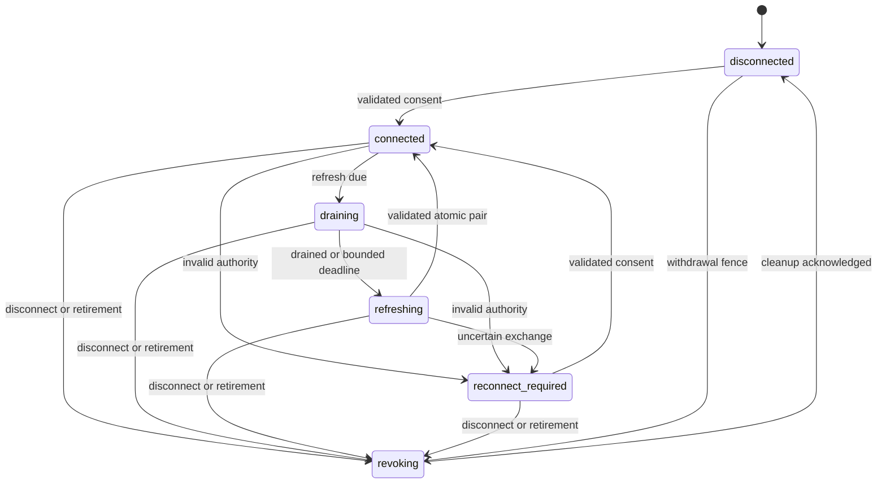

# Supporting services

The shared OpenTelemetry processor uses a fixed 256-entry volatile queue and
bounded batches. Every thirty seconds each application's reviewed Events catalog
publishes four numeric producer-health fields through logs: availability,
pending count, queue drops and export failures. These events bypass trace
admission, so trace saturation remains visible without recursive spans. Producer
restart resets volatile counters; independent spool health records durable
custody and delivery. Grafana presents both boundaries.

## Native FreeBSD and illumos guest services

The `freebsd-v1` and `illumos-v1` image families reserve the existing jail-local
virtio-vsock transport. `lyra.native` now packages nine bootstrap, kernel-probe,
agent, flush, readiness, trust, workspace and SSH helper binaries per OS. The separate
`terminald.native` package cross-links the shared terminal daemon for both OSes.
Their manifests identify all eighteen production Lyra executables and both terminal daemons
by exact bytes, SHA-256, guest interpreter and reviewed native shared libraries;
Linux dependencies, runtime search paths and executable stacks refuse packaging.
FreeBSD uses `/libexec/ld-elf.so.1`; illumos uses `/usr/lib/amd64/ld.so.1`.
The immutable official OmniOS r151050 userland SDK verifies pinned manifests,
compressed/plain payload digests and its final NAR hash. Its build-time fetch
has the documented public fixed-output TLS authentication limitation;
runtime TLS verification remains required.

The [native bootstrap](repo:lyra/src/native_bootstrap.rs) and
[rc.d/SMF definitions](repo:nix/domains/artifacts/guest/native-bootstrap.nix)
configure networking before the native agent supervisor. Root temporarily reaches
MMDS through a link-local address, obtains a fresh MMDSv2 identity, validates its
actual interface MAC, profile, address slot and gateway, then removes temporary
IPv4 state and disables IPv6. It installs the validated /32 address, paired
Inception address where required, and explicit gateway, MMDS, private and default
routes. Only verified resulting interface/netmask/routes permit a mode-0600
volatile identity receipt under a root-owned mode-0700 directory. DNS uses
1.1.1.1 and 9.9.9.9; native TLS uses the OS CA bundle. Three bounded refusal
tests passed. The eighteen-helper Linux/Windows/native tests and native Clippy
build passed in 297 seconds. Actual bootstrap/service execution remains pending.

The rc.d/SMF service definitions describe the complete daemon closure. Linked
executables and service definitions do not establish an integrated native image.
The supervisor starts local listeners before bounded SSH bootstrap retries so
trust installation can unblock roster/certificate HTTPS. No sshd PID marker
exists before bootstrap succeeds, withholding readiness.
Native account utilities follow each OS: FreeBSD uses `pw` and pinned Bash/sudo;
illumos uses `useradd`/`usermod`, `/bin/bash`, `passwd -N` and `/export/home`.
Helpers validate fresh MMDS on every invocation. Host keys, locks, sshd PID and
the fresh SSH-ready marker live under `/var/run/overalls`. Managed sshd uses
`/etc/overalls/sshd_config`, refuses root/password login and forces the current
authorization session helper; stock sshd stays disabled. A two-second roster and
certificate refresh removes readiness on failure. Nine live supervisor PID
markers and the fresh SSH-ready marker are required. A disposable OmniOS QEMU
probe using the production account adapter passed create/retire/reactivate with
exact UID/GID/home/Bash, unusable password authentication, clear active expiry,
retired local lock/noninteractive shell and retained home bytes. OmniOS explicitly
prepares the safe `/export/home` parent, prevents implicit user ZFS datasets,
uses local atomic lock/shell retirement and restores the files repository's
non-password state on activation. This does not execute the complete MMDS-bound
helper or authenticated SSH journey. Actual authentication and expiry journeys
remain separate runtime requirements.
Terminald retains one session engine and boot-bound HELLO protocol; native
adapters supply the MMDS identity, socket ABI and Unix PTY system calls. illumos
PTY creation refuses an infinite or larger-than-1048576 hard descriptor limit
and checks STREAMS terminal setup before exec. A stock OmniOS native probe passed
controlling-terminal identity, shell execution, resize to 101x41 and inherited
descriptor closure after opening the STREAMS slave following `setsid`. This is
isolated PTY adapter evidence; the complete boot-bound terminal protocol remains
pending. Unavailable image-facing kernel
receipts stop image assembly before copying a stock disk, and all native capabilities
remain false under [ADR-0190](repo:docs/architecture/decisions/0190-native-kernel-provenance-and-admission.md).
The intended services must accept only host CID 2 for guest CID 3 and refuse
foreign, malformed or stale boot bindings. Protocol, Marshall and daemon units
are source evidence; cross-link checks prove userland linkage. Native startup,
authenticated terminal journeys, CID enforcement, restart, storage and
network isolation require the pending nested-KVM matrix.

## Audi browser editor and guest workers

Public Audi handles personal editor HTTPS/WebSocket admission through Marshall's
Editor domain and sends the exact grant through Lilly's dedicated connector.
Current write authority, stored login, permanent account and execution/release
bindings are renewed within the thirty-second lease. Exact Origin is required for
unsafe HTTP and WebSockets before guest contact. Authority headers and cookies are
stripped before guest bytes. No generic web permission or URL-selected principal
can select the editor account.

`Audi.HTTP.EditorAssetsPublisher` is an OTP child of the existing public Audi
service, not a separately deployed role. It validates the approved immutable
bootstrap files and proves live serving before each report through a fresh verified
TLS HEAD on its configured local IPv4 listener. The proof has a 1.5-second deadline,
bounded headers and exact hash SNI/Host/current-release matching; missing immutable
headers, wrong trust or suspended acceptors withhold readiness. Healthy publication
runs every two seconds; Marshall receipts expire after five seconds. Unsupported control versions stop publication. Audi serves
only the reviewed index, fake and service-worker bootstrap files from that release
on neutral webview hash hosts. The asset path needs no guest connector or user
credential. Missing/mismatched assets withhold editor discovery.
The actual healthy/wrong-release/wrong-SNI/suspended-listener regression passed
within eight local Audi front checks. Native multi-gateway discovery remains a
separate acceptance boundary.

The guest root broker checks the current boot and roster then starts each native
editor under its personal UID with separate server/extension data and an owner-only
Unix socket. Systemd owns workers independently from the broker. The upstream
extension host supplies language tools, Git, search, filesystem and PTYs. Open VSX
registry VSIXs require the packaged Ed25519 trust keys before extraction; explicit
local imports remain a user operation. See [interactive access](#interactive),
[configuration](#configuration) and [recovery](#recovery).

## Brady

Brady intercepts permitted guest web TCP before NAT. It verifies the HTTP authority
or TLS name and connects to the pinned original destination with independent
upstream TLS verification. Guest identity comes from kernel connection attribution
and a current execution proof, not guest headers.

Only complete anonymous GET responses with explicit public freshness are cached.
Credentials, cookies, query-bearing URLs, private/no-store responses, and unsupported
variation bypass storage. Cache failure can stream through the proxy; proxy failure
must not open a direct-web bypass. QUIC is not a bypass path. The cache lives in a
separate bounded ZFS dataset outside the managed guest parent.

A fresh complete public object may serve a single byte range. A supplied If-Range
must match its strong ETag or Last-Modified value; weak or mismatched validators
go upstream. Range/If-Range bypass new storage admission; they do not remove
credential or other privacy refusals during lookup. Short, overflowing, aborted
or owner-interrupted writes cannot publish. Store restart discards unfinished
writes and recovers complete objects, while new writes await fresh safe pressure.
An active reader pins its object during pressure eviction until close or process
loss; a later observation reclaims it.

[Generated cache histories](repo:docs/architecture/reviews/2026-09-26-cache-history-verification.md)
combine those file/process lifetimes with expiry and current privacy checks using
independent expected public bytes. Their pressure inputs are component fixtures.
Historical native network/ZFS and guest attribution evidence retains its original
revision and separately establishes interception, trust and isolation boundaries.

Configure `services.brady`, its private signer custody, roots, dataset, and limits.
Inspect readiness and bounded cache counters. Cache data is disposable; signing
identity is not. See [Brady design](repo:docs/services/brady-design.md).
When fleet OpenTelemetry is enabled, Brady also writes a mode-0600 numeric SLO
snapshot. Only resolved requests with terminal outcomes enter its denominator;
malformed requests and policy refusals stay outside it. A separate Rust process
validates and exports the snapshot from the host network namespace. Collection
loss never changes proxy results. The local collector socket is group-restricted;
a native request-to-metric check and measured target remain required before
treating the series as a fleet SLO.

## Audi private request monitoring

Audi private verifies TLS service identity and Lilly's current local VM binding
before forwarding guest requests. When fleet OpenTelemetry is enabled, it counts
completed bound requests to Ziggy, Galileo and private SSH as a candidate
transport SLI. An upstream response below 500 is a completed transport; a 5xx
response or stream loss is a failure. Pre-binding denials and guest OTLP uploads
stay outside this denominator. A private numeric snapshot feeds a Rust exporter
through an Audi-private-only collector socket. It carries no account, VM,
service path or payload labels. Collection never grants or extends guest
authority, and process restart can lose counts before export.

## Audi public authoritative DNS monitoring

The separate Audi DNS role counts only ordinary, well-formed questions for its
delegated zone. Authoritative NOERROR and NXDOMAIN replies are successful
completions; stale-publication SERVFAIL and socket send failures are failures.
Malformed packets, out-of-zone refusals, unsupported transfers and truncated
UDP replies stay outside the candidate denominator. Its mode-0600 numeric
snapshot feeds a Rust exporter through an Audi-DNS-only collector socket.
Atomic in-memory counters are published to the snapshot every five seconds;
public query volume does not cause per-request file writes.
Neither DNS answers nor metrics grant VM or gateway access. Restart can lose
unexported counts; the candidate ratio has no target or burn alert.

## Ziggy

Ziggy is the private inference proxy on Lilly hosts. Audi supplies the current guest
binding. Marshall authorizes admission and renewal; Ziggy calls configured providers
and durably delivers usage receipts. Provider secrets stay in Ziggy's private
runtime custody. A guest-provided identity header confers no authority.

The native Anthropic POST routes `/v1/messages` and `/v1/messages/count_tokens`
accept either no query or the literal `beta=true`, including their matching
`/anthropic` prefixes. Ziggy retains a closed query type and appends only the
validated beta query to the upstream URL. Native body bytes and permitted
Anthropic headers are preserved; accounting still uses query-free `messages`
and `count_tokens`. Other query values, duplicates, extra parameters, encoded
aliases, provider-prefix mismatches and queries on OpenAI routes refuse before
provider effects. The [route property](repo:ziggy/test/route_test.exs) checks this
bounded dispatch, rather than establish native transport by itself.

The [installed guest clients](#guests) use these native protocols without API
translation or custom launchers. Production hosts continue selecting only
OpenAI. Disabled Anthropic routes return `provider_unavailable` before authority,
spool admission or provider effects; client configuration cannot enable them.
Fixture-provider acceptance and production provider availability remain separate
in [coverage](#coverage).

Generated [spool receipt histories](repo:ziggy/test/spool_test.exs) verify that
completed usage receipts occupy bounded durable slots until exact acknowledgement,
survive Ziggy process restart and free only acknowledged capacity. The focused
suite passed six checks, including one property, after correcting generated IDs
to satisfy the protocol's canonical UUID requirement. This local property does
not measure delivery timing during a Marshall outage.
An exact Marshall 409 `completion_conflict` now stays distinct in Ziggy's control
client and reporter diagnostic reason; the disputed receipt remains in the spool
for operator recovery. A generated reply-class property checks the local mapping.
It does not prove lost-response replay or reporter recovery against a live
Marshall service.
Generated [reporter histories](repo:ziggy/test/reporter_history_test.exs) additionally
check fixed 2/127/128/129 receipt counts, transient/conflict/wrong-ACK retries,
exact immutable bytes and per-batch attempt sets. Healthy neighbors drain around
one persistent conflict; spool restart retains that receipt and lifetime totals.
The focused property passed seed203368 in7.6seconds. Full Ziggy precommit passed 64
checks (15 properties, 49 tests), seed 521050, in 61.7 seconds. Forced Dialyzer passed
in 5.33 seconds with zero errors, skips or unnecessary skips; terminal exit0.
Controlled initial batches do not establish timer cadence, HTTP lost-reply
recovery, Marshall commit durability or native disk fault recovery.
Ziggy sends its control requests over the verified-TLS shared control WebSocket.
HTTP426 at upgrade, close4001 and an unsupported_version response retain a distinct
version refusal. Pending calls retired as unproven consult the owning stopped
client so close4001 cannot become an outage result.
- **While fenced:** the accounting reporter stops normal-cadence retries without
  acknowledging the durable spool, and the model-call poller stops claiming new
  work.
- **Recovery:** the fence is recoverable (ADR-0140). Only a backed-off probe may
  run, after 30 seconds and doubling to ten minutes, and an accepted probe
  resumes normal operation for response-level refusals on a live socket. An
  upgrade426 or close4001 stops the shared socket until its owner is replaced
  or auto-update restarts the application; the probe cannot revive that owner.
  Generated [version histories](repo:ziggy/test/version_refusal_test.exs)
and verified local TLS replies cover these local boundaries. Marshall's
[closed satellite version property](repo:marshall/test/marshall/control/satellite_version_test.exs)
checks that every Ziggy control op answers an explicit wrong body version with
`unsupported_version`; absent versions still receive `invalid_request`. Galileo
carries no body version: its version refusal is the control socket's 426 at
upgrade or 4001 after hello. A process restart
resets this local fence and can retry the retained receipt before an upgrade;
hosted mixed versions, restart pacing and active provider tasks remain separate
tests.

Galileo reaches Marshall over one control WebSocket (ADR-0142,
`GET /api/control/v1`), sending identity, authorize and renew as `galileo.*`
requests. It classifies a version refusal (HTTP426 at upgrade or close4001)
separately from control unavailability across all three requests, including
pending calls retired as unproven by the stopped owner. Other connection losses
remain authority outages; requests are never retried. The existing lease owner closes the same upstream
attempt after a refused renewal, and each renewal emits one catalogued
`galileo.lease_renewal` outcome. Generated
[local verified-TLS sockets](repo:galileo/test/control_version_test.exs) cover
version refusals, outages and domain refusals for every request. They do not
exercise a hosted version-skew rollout. A separate generated
[pending-call property](repo:galileo/test/pending_version_refusal_property_test.exs)
permutes all three routes, observes healthy correlated replies and distinct
pending IDs, then compares actual4001 with transient4008 over verified TLS.
The original adapter failed pending renewals; the repaired focused suite passed
three checks in3.4seconds. Guard reversion caught the same refusal and restored
property passed2.7seconds. Galileo's current full gate passed32checks
(12properties,20tests),seed512221,100.3seconds and zero-error forced typing.
Remaining consumer gates, real Marshall domain
authentication, packaged upstream fencing and hosted mixed versions remain open.

Ziggy also serves the private guest CLI update manifest and binary on fixed routes.
Its durable spool counts newly completed inference admissions with fixed
cumulative outcomes and duration buckets. Caller-cancelled streams stay out of
the candidate denominator; a recovered interrupted admission remains a failure
with unknown duration. A private mode-0600 numeric file feeds a Rust exporter
through a Ziggy-only collector intake. Its provisional seven-day target and
burn states are described in [monitoring](#monitoring); collection cannot
authorize or replay inference. Durable startup persists an empty source lifetime
before readiness. Recovery folds retained terminal slots before serving callers;
an uncertain checkpoint fences admission, acknowledgement and export. Checkpoint
creation is unconditional; there is no reader-only mode (ADR-0159).
Each delivery requires Marshall's decision for the current VM execution to match the
packaged digest and size exactly. An authority refusal is the only guest-distinguishable
denial (403); a decision/packaging mismatch, absent configured release or an unavailable
control plane all answer 503, and a transient guest-side failure of that kind marks only
the check failed — it never creates, extends or clears the candidate rejection cooldown.
The refusal matrix is pinned by generated histories on both sides per the
[update failure matrix review](repo:docs/architecture/reviews/2026-09-26-update-failure-matrix.md).

Ziggy relays the guest executor's agent RPC routes to Marshall's control
connection with Audi's binding injected; a guest-supplied `binding` is refused.
Agent route bodies are bounded at 12,288 bytes, except
`POST /agent/v1/artifact_chunk`, which admits up to 270,336 bytes (one base64
196,608-byte artifact chunk plus identity fields) and forwards only to control
route `agent_artifact_chunk` ([HTTP](repo:ziggy/lib/ziggy/http.ex)). Chunk
bodies are not inspected beyond JSON object shape and never logged; Marshall
applies the executor lease, fence and staging checks described in
[agents](#agents). [Route tests](repo:ziggy/test/artifact_chunk_test.exs) pin
the bounds and binding refusal.

Set `services.ziggy.enabledProviders` explicitly and supply credentials for each
selected provider. Readiness requires provider catalog and control authority. A failed or partial
provider discovery retries after five seconds, doubling to the fifteen-minute
refresh interval, so an outage at startup cannot keep Ziggy (and the Lilly
private-services readiness that depends on it) unready for the whole interval.
Unknown usage remains unknown. Restart recovers accounting receipts without
replaying model requests. Configure retention through Marshall's inference options.
See [Ziggy configuration](repo:docs/services/ziggy.md).

## Underclass

Each enabled host has an independent subscription account pool. Accounts, SQLite,
tokens, quotas, and sticky bindings do not replicate. Tailscale Serve publishes the
loopback origin to the tailnet; the application still requires separate proxy and
administrative credentials. There is no automatic cross-host failover.

Onboard provider accounts on each selected host. Use `systemctl status underclass
underclass-tailscale-serve`, `tailscale serve status`, and local `utop` for diagnosis.
The local monitor socket exposes bounded metadata without granting account controls.
When fleet telemetry is enabled, a separate Rust probe reads this socket every
15 seconds and exports a fixed 0/1 local monitor readiness gauge. It has no
proxy or administrative credential. The private Grafana candidate requires
fresh, complete observations from both enrolled hosts; it does not measure
tailnet access, authorized proxy completion or provider success.
The separate proxy candidate admits only authorized parsed inference objects with
a nonempty model. A private SQLite journal commits admission before provider
effects and commits one terminal aggregate when the response body finishes.
That journal, `slo-totals.sqlite`, holds one totals record whose single duration
histogram has fifteen finite bounds through twenty-four hours; the retired
seven-bound `slo.sqlite` is never read.
SSE success requires a dispatched completion marker and clean EOF; missing,
malformed or error frames and dropped bodies are failures. Restart turns pending
admissions into failures with unknown duration without repeating provider work.
Journal uncertainty fences admission and publication. Saturated accounting
records the eligible refusal as a failure and refuses provider effects.
The numeric snapshot lives in `/run/underclass/slo`, mode 0640 under a mode-0750
source directory. An independent Rust exporter UID has only the source group
and its separate collector group. It cannot read provider state or credentials.
The monitor role and its public local socket retain their existing boundary.
Native startup, provider TLS and exporter custody passed an isolated fixture; production
activation, power-loss recovery, throughput and complete seven-day history remain
open. This candidate does not establish guest or tailnet availability.
The pool database contains OAuth credentials and needs encrypted recovery custody.
Revision `8c1a38c` retains the existing refresh-token rotation and rotates Codex
refresh tokens after 24 hours, checking at startup
and every 15 minutes. Existing databases gain a rotation timestamp; legacy tokens
are due on the first pass. Failed scheduled refreshes preserve account health and
cooldowns. HTTP 401 and 403 receive one refresh/retry per account per request.
Administrators can enable `auth_error` accounts, while quota cooldowns remain
intact. This pin update has source review only; native migration, provider recovery
and rotation behavior were not tested. Older backups can contain invalidated tokens.
Revision `d0cb274` added manual redemption of one banked Codex reset credit through
`POST /admin/api/accounts/{id}/reset`, the admin page **Use reset** button and the
`underclass reset` command. The route sits behind the admin token; the command
reuses `utop` token resolution and with `--url` requires `UNDERCLASS_UI_TOKEN`.
Without `force` the proxy refuses (409) when upstream says the account is allowed or
a redeemed reset has not restored usage; no credit and non-Codex accounts are never
overridable. The default catalog adds `gpt-6-sol`; usage accounting classifies
`"stream": true` bodies as streaming. Revision `8c1a38c` also records bounded
stream outcomes and sanitized error codes, retains daily statistics rollups for
730 days, and serves administrator-only `/admin/api/stats` and event-import
routes. The `underclass stats` command uses the same token boundary. These
statistics contain no prompts, cache keys or credentials. Source review and an
offline build only; tests were not run for this pin.
Revision `469aff4` always reselects after the saturation reset attempt, so a
throttle cooldown that expires while a request waits on the reset lock no longer
yields a stale 429; requests skip that lock while a Codex account is healthy.
`request.saturated` logs a relative `retry_after_ms` and an absolute `until_ms`.
Upstream Rust tests passed; no dedicated regression test covers the race.
Revision `dbaf7b8` holds a streamed response, for at most 60 seconds or 1 MiB,
until its first output or terminal event. It retries on another pool account when
upstream fails the stream with a capacity code before any output, the case Codex
reports as "Selected model is at capacity". The overloaded account keeps its health
and the sticky session moves to the serving account. When every account overloads,
the original upstream bytes are returned and the SLO journal records one failure.
Policy, quota and post-output errors pass through unchanged. Stream `error` events
now record their nested code, so these failures count as `overloaded`.
Revision `c58a972` disables an account whose subscription plan is `free` and
re-enables it once a known non-free plan returns, recording the cause in a new
`accounts.disabled_reason` column so operator disables are never reverted (upstream
ADR 0025). It also fixes Claude Code accounts that stayed cooling: the account
usage API reports percent utilization, which was read as a fraction, and token
refresh requested an ungranted scope and failed with `invalid_scope`.
Revision `d7a0ccf` adds `POST /admin/api/accounts/{id}/refresh` and
`underclass refresh <account>|--all`, which force one token refresh through the
running server. A successful refresh returns an `auth_error` account to rotation
unless the free-plan gate would disable it; a failed one changes nothing
(upstream ADR 0026).
The current package pin is `d7a0ccf`, with a refreshed source archive hash and
unchanged Cargo lock/vendor hash. The instrumentation patch applies with offsets.
The package builds, and the `underclass-configuration` and `underclass-egress`
checks pass on this pin; live provider behavior and production activation remain
unverified.
Provider egress goes through a dedicated tailnet egress node, optionally via an
exit node (ADR-0185, amended by ADR-0260).
`underclass-egress.service` runs a separate unprivileged userspace `tailscaled`
with its own state and socket, no TUN device and no routes. Its HTTP proxy
listens only on `127.0.0.1:1055`. The enrolled profile sets
`services.underclass.egress = { enable = true; route = true; }` with no exit
node, so provider traffic leaves from the host's own address. Each host's node starts
logged out, and an operator joins it once with `sudo underclass-egress up`,
which always advertises `tag:underclass` (ADR-0245) so tailnet policy can
identify the node.
`egress.route` (implied by `egress.exitNode`) gives Underclass `HTTPS_PROXY`,
confines the unit to loopback through systemd IP filtering, and adds a privileged
start gate. Without an exit node, the gate clears any stale exit-node preference
and refuses to start while the node is logged out or still reports one. With an
exit node, the gate selects it with LAN access disabled and refuses to
start while the node is logged out. Losing the exit node fails provider
requests instead of falling back to the host's address. Underclass still
restarts while the exit node is offline, and resolves provider DNS at the exit
node. The `underclass-egress` machine check verifies these properties on a
headscale tailnet, including the route-only mode. A live request through each
host's egress node remains open; root can change the preference until the next
start.
See [Underclass operations](repo:docs/services/underclass.md).

## Galileo

### Built-in GitHub.com provider

[ADR-0202](repo:docs/architecture/decisions/0202-github-com-owner-integration.md)
accepts `github-com` at `https://com-github.integration.internal`. It resolves
the VM owner's personal connection rather than a globally registered integration
name. Eligible non-Customer owner machines are implicit sources; persistent
detach overrides that default until reattachment. Generic personal integrations
retain their explicit attachment policy below.

Marshall holds sensitive Cloak-encrypted access/refresh credentials and stable
numeric external identity. Active numeric identity is unique across Marshall
accounts. Shared writers use the owner's authority without receiving the token.
An absent, detached, disconnected or reconnect-required connection permits fresh
anonymous public forwarding without a token. Active drain/refresh refuses fresh
admissions. Existing authenticated leases cannot change identity or become
anonymous. GitHub remains responsible for repository, organization,
SAML SSO and consent policy.

GitHub's OAuth App authorization documentation, reviewed on 2026-10-19,
supports the selected `offline_access` model: eight-hour access credentials and
refresh credentials valid for six months without use. `offline_access` need not
appear in the returned permission scopes. Marshall requires an explicit bearer
type and complete expiring pair; incomplete or non-expiring responses refuse.
A successful refresh invalidates both old tokens; invalid or expired refresh
authority requires reconnection. The
[provider guide](repo:docs/services/github-com.md) links the dated primary
sources. Documented capability and source conformance do not establish consent
or rotation by the registered app; GitHub Enterprise Server is outside scope.
The recorded five-test provider focus checks production Req construction and
synthetic replies through `Req.Test`, including complete bearer-pair validation
and no replay after redirects/errors. It does not exercise sockets, TLS or live
provider effects.

Connection progress is an explicit state machine: `disconnected`, `connected`,
`draining`, `refreshing`, `reconnect_required` and `revoking`. OAuth attempts,
refresh attempts and generation-bound request leases remain separate resources.
The `github` queue has concurrency two; AshOban scheduling and ID-only jobs
rediscover due work. Delivery does not replace current durable authority.

These are legal connection phases, not proof of successful provider effects.
Authorization and refresh attempts retain their own one-use/submission phases;
queued delivery, request expiry and provider response are not connection state.

Refresh starts ten minutes before access expiry. Stop new old-generation
admissions, drain existing requests for at most five minutes, then withdraw
remaining leases before exchange. Current-attempt settlement atomically publishes
the replacement pair. Provider waits stay outside database transactions. An
uncertain rotating exchange requires reconnect; duplicate workers, old replies
and revoked callbacks cannot restore a generation.

Provider request-start time anchors expiry. Known late or rejected pairs remain
encrypted in failed attempts until ID-only access-token cleanup clears them;
minute reconciliation rediscovers cleanup. Missing provider replies still require
reconnect. Removing optional OAuth settings withdraws private admission and old
authenticated renewals immediately, leaving new forwarding anonymous and stored
encrypted grants pending operator reconfiguration or revocation. Configuration
removal is not remote grant revocation.

Mutations have no automatic retry or redirect following. GET/HEAD redirects are
limited to three reviewed hops under the same lease; signed storage receives no
OAuth bearer. LFS action headers/URLs stay in short-lived Galileo memory behind
opaque method/execution/generation-bound selectors. Their lifetime is at most
sixty seconds and no later than provider expiry; mutation selectors have one
winner. JSON rewriting stops at eight MiB/thirty-two levels; binary bodies stream.

Managed `gh`, Git HTTPS and LFS, all seven families and retained updates are the
accepted client scope. Exact native image qualification and per-family runtime
evidence remain separate. The [guide](repo:docs/services/github-com.md) describes
operator inputs; the
[review](repo:docs/architecture/reviews/2026-10-18-github-com-integration.md)
records source/tests and remaining provider/native gaps.

Repeated bootstrap polls from the same current executor and fence preserve the
unstarted attempt; replacement authority cannot complete its predecessor.
One-shot bootstrap renewal failures use closed numeric exit categories described
in [monitoring](#monitoring), preserving refusal without retry or added authority.

OAuth form navigation permits the fixed `https://github.com` origin, including
the same-origin start POST's redirect. Script, connection and frame sources
remain same-origin; arbitrary external form origins remain refused.

Native managed Go clients load only the reviewed OS CA bundle (FreeBSD
`/etc/ssl/cert.pem`, illumos `/etc/ssl/cacert.pem`), bounded to two MiB.
Missing or malformed roots refuse dispatch without vendor/environment fallback.
Linux and Windows keep their existing platform trust behavior.

Retained FreeBSD and illumos tool setup validates a completed immutable
workspace source before replacing the historical `/workspace/*` Git ownership
exception with a durable include for that exact checkout. It preserves unrelated
system Git settings and restores the original configuration on setup rollback.
Pending or corrupt sources refuse migration; an absent source leaves the existing
ownership policy unchanged. Tightening after a later checkout requires another
real setup pass; tool installation alone does not establish that migration.

Named integrations forward to reviewed HTTP targets or peer VMs. Marshall owns
attachments, team access, encrypted injected credentials, and renewable admission.
Galileo strips/injects configured headers and cancels forwarding when renewal fails.
Personal integrations require explicit source VM attachments, including owner
machines. Current members of live owning teams retain automatic access. Existing
personal configurations receive no backfill or compatibility exemption.
A verified Marshall `unauthorized` answer is an authorization refusal: Galileo returns guest403
before reading an upload or contacting the origin and emits the reviewed
request-denied event. Invalid/outage exchanges remain guest503;426 retains its
version-refusal class. Response bytes cannot turn a403 into admission or an
outage. A refused renewal still cancels the existing request without retry.
The private HTTP/1 frontend retains Bandit body reads in the stream owner;
the lease guardian closes the ThousandIsland frontend socket when authority
fails, interrupting blocked uploads and response writes while owner cleanup
decrements counters. Idle deadlines do not replace revocation deadlines.
Generated partial-response prefixes pass through lease failure and consumer halt
without late delivery. The packaged fault fixture passed blocked uploads and
partial responses after a successful silent renewal, then refusal, invalid TTL
or renewal stalled beyond expiry. It measures origin EOF/reset, frontend return
and zero active requests within five seconds and independently counts accepted
TLS connections and dispatches. This is isolated Galileo/Bandit evidence with a
synthetic control authority. The corrected real-policy fleet withdrawal and
separate cross-host Galileo fleet checks also passed in one physical KVM failure
domain. Both production hosts activated `7fda1272`, including the subsequent
403 classification correction. Real NixOS direct/peer sources passed unattached
403 without origin traffic, explicit attachment, detach and restoration. One
stalled request survived renewal, then closed its origin and reached zero active
requests within 1.81 seconds after observed fresh refusal. Direct/peer 1 MiB upload
digests and method/query checks passed. Production invalid-TTL/control-timeout,
blocked-upload and partial-response fault permutations remain native-only.
The campaign used verified persistent SSH observations after a separate fresh
SSH admission refusal; it does not establish arbitrary SSH availability.
Both original VM deletion receipts succeeded, both integrations were removed,
all compute/disk holds were released and no matching native datasets/units remain.
Generated 600–700 ms lease histories allow zero or one valid renewal before a
refusal, invalid TTL or renewal delayed past expiry. The verified local TLS
origin sees one stalled request handler, while Galileo cancels without
delivering response bytes. The [lease property](repo:galileo/test/upstream_test.exs)
does not exercise Marshall withdrawal, Audi forwarding, physical dial counts
or hosted network faults.
Generated local TLS uploads now vary source chunk sizes and pull failure points;
the fixture origin counts handler dispatches by unique guest path during a
bounded quiet window. Physical TLS dials, late retries, origin receipt of
partial bytes, response faults and external origins remain unverified.
Peer requests carry bound provenance; a guest cannot assert another VM's identity.
Authorized attempts now feed a fixed cumulative outcome and duration snapshot.
The private host-only `/slo` read and Rust exporter use a Galileo-specific local
collector socket. Guest identities and integration names never become SLO labels;
the packaged and full Firecracker source-to-collector journeys passed, while
live production collection and a measured baseline remain open.

Manage integrations through `/integrations`, `/teams`, or Porsche. Secret values
are write-only and redacted on read. Configure the independent service credentials
and private frontend before attaching workloads. See [Galileo](repo:docs/services/galileo.md).

Live production probes recorded bearer, Basic and static-header injection,
forged Authorization replacement, query preservation and a digest-checked 1 MiB
PUT on fresh NixOS guests. A fresh Ubuntu guest passed the bearer probe; Customer
received refusal. Property-backed management listing, peer-flag, validation and
password-reset repairs passed deployed CLI/Chromium acceptance. Cross-host peer
requests passed in both directions after independently moving source and target.
Actual membership and foreign-owned attachment withdrawal refused fresh requests;
restoration recovered access. Scoped evidence and remaining gaps are tracked in the
[production review](repo:docs/architecture/reviews/2026-10-02-galileo-production.md).
Initial source creation failed ZFS observation and recovered by explicit stop/start;
that recovery does not establish passing initial creation. That historical
campaign preceded ADR-0134's explicit personal attachment policy. Its foreign
attachment fixture does not establish production acceptance of the new owner
attachment rule. The new generated personal histories pass application admission
and renewal checks; the new policy's production rollout remains pending.

Invalid targets, strip prefixes and static headers return their closed protocol
refusal before any integration, header or audit write. The browser keeps its
connected view and shows a generic correction message. Each attempt replaces
password input identities to clear browser-local values as well as server state.
Generated domain and LiveView regressions cover these invalid-input paths;
production Chromium also verified actual DOM input values after refusal/success,
configuration, attachment, a real guest request, detach and removal. These are
bounded synthetic-origin journeys, not arbitrary upstream availability or load
guarantees. All campaign grants and VMs were removed. On 2026-10-03 an explicitly
authorized temporary software passkey completed the empty fixture account's
normal retirement action; its credential and sessions were removed afterwards.

An archived owning team refuses fresh admission, renewal, configuration reads
and management even when membership and attachment rows survive. Pending peer
tokens also refuse without consumption. The generated
[archival property](repo:marshall/test/marshall/galileo/renewal_history_test.exs)
records passing direct/peer and attached/unattached refusal histories using actual
internal Ash archival. There is no public team archival journey; production
archival at two-host rollout `b96443ff` refused real guest forwarding with 503,
CLI show/attachment/removal with forbidden, and an unexpired pending token
without consumption. A live-team bearer control passed immediately beforehand.
Native stalled-stream cancellation timing after team archival remains unmeasured.

Renewal rechecks current VM-owner membership and explicit attachment to the
current named integration. It returns only a bounded TTL: an existing upstream
attempt retains its selected target and credentials and never receives another
peer token. Generated authority/configuration histories and three independent
Marshall token consumers have recorded passing application execution in the
[integration renewal review](repo:docs/architecture/reviews/2026-09-25-integration-renewal-verification.md).
The packaged `integration-renewals` journey passed on captured tree `901d7fd4`
with actual team removal and detach after a successful HTTPS renewal. It verifies
exact current-authority refusal, origin socket closure, unchanged accepted TLS
connection counts and fresh success after restoration. The counters run before
HTTP credential validation. All eight stages passed in 413.94 seconds; the review
preserves the execution revision and cleanup evidence. These local fixtures do
not establish real-provider behavior or independent physical availability.

## Enrico

Enrico admits at most eight active repository refreshes. Additional new attempts
receive unavailable (HTTP 503) before task or measurement admission; current or
retained attempt replay remains available, while conflicting work for an active
repository remains busy. Completion or actual worker death releases one slot.
Generated [admission histories](repo:enrico/test/manager_history_property_test.exs)
hold eight real supervised workers at a controlled Git clone, refuse new work
without state or clone effects, and retry the same attempt after slot release.
All eight focused Manager history properties passed against the source-built
helper, including exact cleanup/removal refusal and restart matrices. Manager and task supervision now
share a restart lifetime, and live task children have the same eight-owner cap.
A native PID probe found a controlled Git shell surviving its BEAM owner.
The native `enrico-git-owner` now retains stable eight-slot command admission
and exclusive writer locks during process-group cleanup. Published reads do not
conflict with writer locks but refuse when all eight command slots are occupied.
Cleanup, publication and administrative removal acquire the same writer gate
before deleting or renaming mirror paths. Caller EOF, timeout and overflow retire the direct child before
successor admission; parent-death fencing and inherited lock descriptors retain
refusal under uncertain descendant cleanup. The repaired local PID history and
ten native helper properties passed, including reaped private descendants,
blocked output, configured 16 MiB/64 MiB output limits and helper SIGKILL with
surviving-descendant lock retention. The source-built helper package passed;
helper SIGKILL does not itself retire surviving grandchildren. Service-cgroup
restart and packaged escaping-descendant acceptance remain open. The existing packaged
service machine check passed clone/read/refresh, isolated authenticated HTTPS,
source-outage preservation and recovery with this helper. Complete Enrico precommit
passed fourteen checks and forced Dialyzer with zero errors. Broader
saturated service restart, physical resources and durable Marshall overload retry
remain pending. See the
[scope and execution](repo:docs/architecture/reviews/2026-10-03-enrico-refresh-admission.md).

Local separate-session ownership now has additional recorded evidence: caller
EOF, deadline and direct completion preserve inherited repository/admission
locks and refusal until actual escaped-child death. A regression exposed the
process-group-only wait selector; cleanup now waits for every adopted child,
retaining its two-second unresolved-cleanup bound. Eleven native properties and
the source-built package passed. Packaged cgroup escape recovery, physical quota
and durable Marshall retry remain open; see the
[escaped-session review](repo:docs/architecture/reviews/2026-10-05-enrico-escaped-session-ownership.md).
The integrated fourteen-check Enrico gate passed at seed344695 in303.0seconds
against the corrected helper; forced Dialyzer reported zero errors in4.54seconds.
This component result adds no service-cgroup or remote pressure acceptance.

Enrico maintains registered GitHub mirrors in a quota-bound ZFS cache. Marshall owns
registration, refresh state, authorization, audit, and the signed-in read-only Git
browser. Enrico runs independently behind private service transport. Mirror cache
availability does not establish upstream freshness; inspect refresh status before
relying on a revision. Configure `services.enrico` and its pinned private TLS trust.
The mirror manager counts unique admitted terminal refresh successes, failures
and fixed duration buckets. Its owner-only Unix health socket supplies a
fixed numeric snapshot to a Rust exporter and Enrico-only collector intake.
The Nix-provisioned Grafana panel is a candidate ratio without a target or
burn alert. Manager restart can lose an unrecorded terminal attempt, and live
collection has not been verified.
See [mirror design](repo:docs/architecture/decisions/0097-enrico-git-mirrors.md).

Required runtime fields are validated before mirror workers or listeners start.
Non-string JSON bind values return fixed configuration refusal and the
catalogued `enrico.startup_rejected` event rather than raising during conversion.
Generated local properties pass 96 fresh refusals across 32 invalid cases and
40 read-only non-string-bind checks. Refusals preserve recursive fixture bytes,
permissions, link counts and ownership, including the fixture root; diagnostics
exclude synthetic credentials and paths. The separate unset control starts an
empty supervisor. These are test-build startup checks; packaged TLS startup,
successful configured serving, concurrent file replacement and hosted config
faults remain open for this property. Valid loading can create the state directory;
the non-string-bind loader property checks refusal before that side effect.

Registration, manual refresh and removal require current administrator authority
and a recent passkey check. ADR-0160's accepted new browser flow uses a fixed
fifteen-minute receipt and retains the exact pending catalog action inline while
an enrolled passkey verifies. No-key administrators visit Security for fresh-email
first enrollment, return, and explicitly resubmit the catalog action. Retry rechecks current
login, role, Cedar, catalog handle and canonical arguments; cancellation, replay,
expiry or substituted input creates no catalog intent. Its new continuation
catalog-specific native evidence remains pending in [scenario coverage](#coverage).
Marshall holds the current actor row through the
audited mutation; demotion, reset, session revocation and retirement cannot pass
that row while a catalog write commits. Refresh/removal also serialize on the
repository row. An already refreshing or removing mirror refuses manual refresh.
An administrator can see mutation controls before elevation; submitting them
opens passkey verification without creating catalog intent. The historical
five-minute redirect tests below do not establish the new inline continuation.
Ordinary accounts
retain the read-only repository browser and cannot mutate the catalog.

Workers retain the published commit during a failed refresh. Each terminal result
in Enrico must match its current local task generation. Completion retires the
monitor before reuse; repository removal clears its queued receipt keys.
Missing or unknown completion generations cannot manufacture an outcome.
Active and retained attempts replay without another fetch, while removal,
capped receipt eviction and restart end local replay retention. Generated
supervised-worker histories passed across the 1,024-receipt cap using controlled
Git replies; real remote/cache pressure and aggregate active admission remain
open in the [generation review](repo:docs/architecture/reviews/2026-10-03-enrico-attempt-generation-histories.md).

Each Marshall terminal result
must still own the current refreshing attempt under the repository lock; a replaced
attempt cannot publish its old head or append another outcome. Removing a mirror
refuses new browsing/raw requests before asynchronous cache deletion completes.
Re-registering the same labels creates a new catalog identity; stale handles do
not gain that identity's access.

Generated public-action histories and six three-process schedules pass for these
database boundaries. The packaged ordinary-browser journey passed on captured
`f4de549a`-based source with virtual passkey elevation, ordinary tree/blob/history
and raw reads, refresh through a source outage, stale-page/raw refusal, audit
attribution and actual cache deletion. Its cache uses an ordinary VM filesystem;
it does not establish ZFS quota behavior. Existing service machine evidence covers
local HTTPS Git clone, update, force-push retention and source outage. Physical
tunnel, cache pressure and large-repository capacity remain separate; see the
[scoped verification review](repo:docs/architecture/reviews/2026-09-25-git-mirror-verification.md).

Live fixture cleanup retains original deletion request IDs. The acceptance helper
waits beyond the server's bounded CLI wait, persists accepted timed-out receipts
and returns pending exit 4 until deletions succeed. Terminal receipts must match
the retained UUID/name and request ID; a deleted VM needs no new live lookup.
The archival campaign's source and target cleanup succeeded under their original
requests after `b9790a5c` activation. Independent storage and reservation audits
passed. The original empty fixture account's session-bound passkey retirement
subsequently completed with zero remaining VMs. ADR-0134 now accepts and implements explicit personal attachments; its later campaign and cleanup have separate evidence above.

## Audi terminal control-version refusal

An explicit version refusal stops automatic DNS refresh, SSH key publication
and wildcard certificate polling/readiness work. Over the control WebSocket
(ADR-0142) the refusal is HTTP 426 at upgrade, close 4001, or a request
answered `unsupported_version`. Polling and readiness stop until an operator repairs compatibility and
restarts the service. Transient failures retain normal retries. Existing DNS
snapshots, local key files and installed certificates keep their original bytes
and expiry; refusal does not renew authority. Fleet retires its temporary
readiness scheduler without waiting for a reply and its active jobs die even
when the scheduler is suspended.

Hints never bypass that fence: a halted DNS replica ignores `dns_snapshot`
hints and a halted gateway worker ignores `fleet_certificate` hints. Before a
refusal, a `dns_snapshot` hint reads a fresh snapshot at once (a burst
coalesces into one read) and a `fleet_certificate` hint fetches the activated
generation at once; the periodic refreshes stay as backstops.

Readiness checks the local worker fence as well as authenticated control and
fresh publication. Restoring control alone cannot make a halted worker ready.
Pending socket work may return unproven while the shared client holds a terminal
version refusal. Audi now preserves that permanent class for the caller; it
does not report domain completion or resend the request. Ordinary idle-close
loss remains transient. Actual verified-TLS close histories observe both pending
identity/DNS requests before closing and independently check the DNS worker's
automatic-work fence, retained snapshot and original five-second expiry.
The focused file passed nine checks in56.6seconds before adding idle controls;
the refined two-property close file passed33.3seconds. Full migrated Audi precommit
passed 182 checks (51 properties, 131 tests), with zero-error forced Dialyzer.
Targeted classifier mutations fail at the early error/work-fence assertions;
they do not establish mutation coverage of later expiry assertions. Other consumer
gates and native gateway acceptance remain open; see the
[pending-close review](repo:docs/architecture/reviews/2026-10-05-audi-pending-version-close.md).
Recorded properties cover verified TLS and actual owner/job death. The packaged
DNS check at the pre-migration revision proves stopped requests, original
five-second expiry, UDP/TCP SERVFAIL and operator restart recovery. It does not
verify the migrated WebSocket fixture or package. Packaged gateway SSH/Fleet refusal and physical
mixed-version deployment remain open; see the
[review](repo:docs/architecture/reviews/2026-10-03-audi-terminal-version-refusal.md).

Actual TLS pending-call properties observe a healthy request and one through
three outstanding requests before close4001 or draining4008. Ziggy preserves
unsupported_version for4001 and authority_unavailable for4008; Porsche preserves
unsupported_version versus transport_error. The original adapters misclassified
pending4001 as outages; the repaired focused files passed3Ziggy and9Porsche checks.
Domain authorization, provider effects, native rollout and hosted mixed-version
acceptance remain separate. See the
[control review](repo:docs/architecture/reviews/2026-10-05-control-first-envelope.md).

## Independent service diagnostics

All Elixir services share the reviewed Events catalog implementation and official
OpenTelemetry SDK through the separate `elixir/diagnostics/` application. Diagnostic
metadata uses typed finite schemas, numeric measurements and validated identifiers;
credentials, arbitrary exception text, provider bodies, command arguments and
terminal bytes are excluded. Host/service provenance comes from authenticated local
producer bindings. Routine export is bounded and asynchronous; physical outcomes
and application commits remain independent of observability acceptance.

Ziggy v2 sends only outcome, token counts, completeness and optional priced
accounting provenance to Marshall. Duration, byte counts, HTTP status and provider
request identity stay in its private local completion. A replayed completion
succeeds only when it exactly equals the stored one; PostgreSQL refuses a stored
completion outside that closed key set, and the legacy-shaped rows were purged
after export (ADR-0159). The final SSH authorization recheck and its security audit remain.
## Guest reflection

Peach serves the bounded, secret-free `reflection.internal` projection for a
currently running guest. Marshall remains the authorization authority and
returns only integrations eligible for the fenced execution.

Peach accepts only bodiless `GET` requests for `/`, `/guest` and `/integrations`
without a query. Unknown paths answer 404 and other methods 405 before any
control request. The single Audi binding header must decode to a protocol-valid
binding for Peach's configured host. Peach then asks Marshall over its dedicated
control link for the projection, validates it with the shared protocol, checks
that the guest ID matches the binding, and answers with `cache-control: no-store`.
A Marshall refusal answers 403; an outage or invalid snapshot answers 503. Peach
never retains or replays an earlier projection. Its diagnostics go through the
`Peach.Events` catalog and carry only host and VM UUIDs and fixed reasons.

## Android display service

Lilly derives the Android display target from the current placement, profile,
slot, capability and emulator generation before opening the fixed relay port.
The display socket is owned by a supervised process and is torn down with the
authenticated host stream or execution generation. Marshall shares one bridge
per machine generation across browser viewers and controllers.
