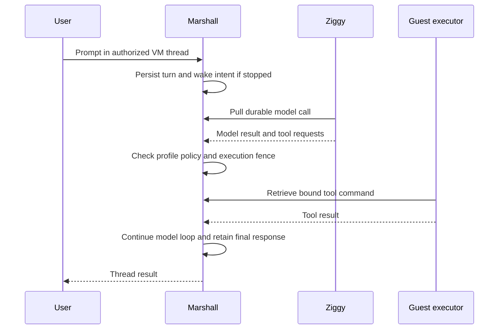
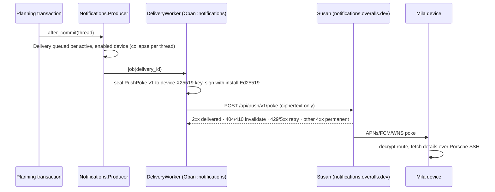
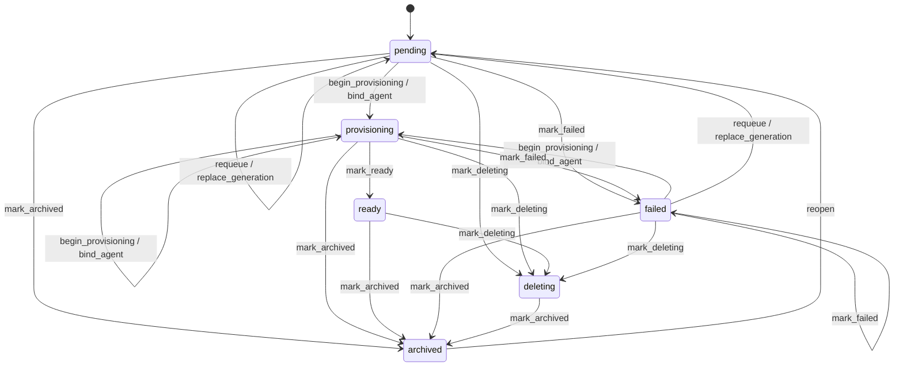

# Agent threads and tools

## Thread attachments

Attachments belong to a user thread and use current thread Cedar authorization.
Malformed actor, thread and attachment IDs refuse before resource queries; a
guest without attachment capability refuses attachment work with one failure receipt. Unexpected
server-tool transaction exceptions emit `agent.server_tool_poll_failed` with a
closed reason and no exception text, stack trace or command data. The transaction
rolls back; permanent-error retry handling remains unfinished.
PostgreSQL stores opaque metadata and lifecycle state while encrypted content is
kept behind a storage adapter. Uploads return metadata and an attachment ID;
the authenticated multipart endpoint `/attachments/threads/:thread_id` accepts
a `file` and `idempotency_key` without putting bytes in model arguments.
Downloads return a short-lived token consumed through a browser POST endpoint. Machine
stop and suspension remove message-board posts without removing attachments.
Upload retry keys are shared by all authorized writers within a thread. Identical
content returns the original attachment and uploader; changed content refuses.
A failed storage write can retry the same attachment with the same content.
Archive retention and deletion cleanup still require integration verification.
An executor upload coordinator now accepts bounded bytes separately from command
arguments, validates a started command against the current lease/fence and running
turn, and rechecks VM and target-thread write authority. Marshall exposes the
closed `agent_attachment_upload` control request with a bounded base64 transport
body and metadata-only response. Ziggy forwarding and Lyra dispatch are not
connected yet.
Model uploads now accept an absolute guest path and require an executor advertising
`attachments-v1`; upload bytes travel only in chunk-transfer requests. Browser multipart uploads use the same encrypted PostgreSQL chunks, publishing all
chunks and metadata in one transaction. They do not require local blob storage;
filenames and supplied media types are discarded and downloads use a fixed binary
filename and content type. Redemption
rechecks thread authority and conditionally consumes a matching token only after
a successful storage read. Storage failures leave the token retryable until expiry.
The server worker locks the attachment target thread before its VM authority
check and claims the command only after rechecking the current running turn.
Token issuance uses the thread lock to serialize with grant changes, checks the
locked attachment state, and defers outcome diagnostics until the outer commit. The
transition property uses an independent model. Generated database upload histories
also compare retry identity, content conflicts and failed-write recovery with an
independent model; independent-connection and native durability checks remain open.
See the attachment security
section for key configuration and remaining access-control gaps.

Chunk-transfer groundwork stores bounded 256 KiB chunks in the Agents domain's
`AttachmentChunk` resource. `Marshall.Vault` encrypts chunk bytes in PostgreSQL
with its tagged keyring; default reads do not decrypt them. Trusted coordinators
must hold the authorized thread and attachment locks. Conflicting offset retries
refuse; assembly verifies contiguous contents, total size and SHA-256. Authorized
begin/chunk/finalize operations publish verified PostgreSQL chunks through the
attachment state machine. Chunk-backed downloads use the existing token and
current-authority checks. Marshall exposes `agent_attachment_transfer` with closed
begin/chunk/finish/read payloads. Every call rechecks the started command and executor
fence; chunk and finish IDs must match its target thread and retry key. Download
reads select only the started command’s attachment, recheck thread read authority
and integrity, and return at most 256 KiB per aligned offset. Ziggy
relays `/agent/v1/attachment/transfer` using the trusted Audi binding, rejecting
guest-supplied bindings and bodies over 352 KiB. Ordinary agent requests retain
their 12 KiB bound. Lyra implements bounded regular-file upload, chunk transmission
and metadata verification with heartbeat checks. Model uploads are admitted to attachment-capable guests. Lyra also implements download-to-file with per-chunk identity checks, final digest
verification and atomic publication without overwriting existing files. Both model operations require absolute guest paths and attachment-capable
executors. Successful begin, chunk write, publication and chunk read operations
write an `AttachmentAudit` receipt in the same transaction; only identifiers,
closed operation/outcome enums and timestamps are persisted. Browser token issuance
and redemption also write receipts in their transactions. A receipt write failure
aborts the operation. Generated upload-phase fault injection verifies rollback
and fresh retry; token fault injection, denial and deletion receipts remain
unverified or unfinished, as does abandoned-upload cleanup.

## Agent thread discovery

The thread tool searches user-thread titles through current-authorized thread
pages, including shared and retained archived threads. Search results contain
user-thread IDs and `/threads/:id` links; objectives and transcript contents are
not searched. A call returns at most 100 matches and scans at most ten authorized
pages; exhausting that budget returns `search_limit_exceeded` rather than a
silently incomplete result. Reads recheck current thread Cedar authority and
resolve the retained agent binding to return up to 100 transcript events. The
JSON-encoded read object is limited to 64 KiB, including metadata and escaping;
larger results return `result_too_large` without partial content. Pending
threads without an agent binding have no events. Internal agent-thread IDs are
not valid user-thread read targets. Subscriptions persist through Ash resources with idempotent active/inactive state
transitions and a `revoked` state for lost read authority. Subscribe and replay lock the user thread and recheck read authority.
The subscription's durable user-thread identity survives machine replacement;
the originating agent-thread identity is retained as provenance. Creating a first
subscription requires a bound agent thread. Existing subscriptions remain usable
during pending replacement. Replay requires an active subscription and
returns ordered notifications strictly after the supplied cursor; a revoked grant
refuses access even when the subscription remains active. Notification cursors
are ordered across all machine generations of a user thread. Agent subscriptions
also register an active/inactive receiver with a durable acknowledged cursor.
Root-agent receivers follow the receiving user thread across replacement; child
agents and machines outside Threads retain their exact agent-thread destination.
Unsubscribing one receiver does not disable other agents for the same account.
Agent replay requires that caller's active receiver as well as the account's
active subscription and current read permission.

The feed carries two content-free kinds: `machine_purged` from board cleanup and
`turn_finished`. Finishing an ordinary turn of a top-level agent thread inserts
`Threads.FeedAppendJob` in the turn-finish transaction; the job appends one
notification holding only the turn ID and closed outcome, under the user
thread's feed lock with the next dense sequence, and appends nothing on retry or
duplicate. Maintenance turns, including subscription-notification turns, and
child threads are not announced, so mutually subscribed threads cannot wake each
other indefinitely. Thread grant changes, team-membership changes (including SCIM
cleanup) and account retirement insert `Threads.SubscriptionRevokeJob` in their
own transaction. It rechecks current Cedar read under the user-thread lock and
moves each subscription whose owner lost read to `revoked`, deactivates its
receivers and records one `thread_subscription_revoked` audit row. A later
authorized subscribe reactivates it; subscribe, replay and delivery still recheck
authority themselves
([ADR-0261](repo:docs/architecture/decisions/0261-thread-feed-turn-notifications-and-subscription-revocation.md)).

The notification worker polls PostgreSQL once per second. It locks target and
receiving user threads in UUID order, then the receiving agent, machine and
receiver. Current target read and destination write permissions are checked before
admission. Permission loss deactivates the receiver. A stopped, unavailable or
pending destination defers for five seconds without requesting a machine wake.
Successful delivery admits one typed system-notification turn and advances its
cursor in the same transaction, using a stable receiver/sequence retry key.
The turn includes only the target thread, notification ID, sequence and closed
notification kind; the model can request authorized replay details. No fabricated
user prompt event is stored. Existing turn-admission audit receipts and content-free
poll failure diagnostics apply. Live provider/guest delivery and independent-node
concurrency acceptance remain unverified. Machine cleanup now deletes posts
and appends content-free per-thread notifications in one PostgreSQL transaction;
post admission and cleanup serialize on the VM. A delayed callback skips a VM
whose current desired and observed states no longer match the unavailable state.

## Thread machine suspension

New `/threads`/Orb provisioning enables a fixed four-hour idle policy. The clock
records tool admission and completion, not model output, heartbeats or the last
human message. Admitted tools and queued/running turns defer capture under the
VM lock. A prompt on a suspended machine requests wake before tool execution.
Successful wake grants a fresh four-hour window. A running prompt or repeated
network request does not extend it. Owner pins prevent automatic suspension;
personal pins held by other users confer no such control.

## Native guest agent boundary

FreeBSD and illumos guests have a closed Lyra protocol shape for readiness,
trust, terminal, workspace, flush, SSH and agent execution. The protocol's
unqualified `freebsd-v1` and `illumos-v1` rows disable every user-facing
capability. The qualified capability function enables those seven capabilities
only for the complete reviewed FreeBSD image identity in the
[compiled registry](repo:protocol/lib/overalls_protocol/native_admission.ex).
OmniOS and changed or incomplete native identities remain refused; editor and
Inception remain false. Lilly still binds host CID 2 to guest CID 3, and each
daemon validates the current boot challenge before responding.
Credentials, terminal bytes, command arguments and Git output stay outside
diagnostics. The capability table does not establish current-boot readiness or
a Marshall fleet result; exact-image runtime evidence remains separate.

## Native agent sets and kernel identity

FreeBSD and OmniOS (`illumos` on the wire) use the explicit v6/v3 native image
contract from [ADR-0190](repo:docs/architecture/decisions/0190-native-kernel-provenance-and-admission.md).
Their bundle carries kernel provenance and the native guest package names the
kernel probe, agent, flush, readiness, trust, workspace and SSH helper
daemons, plus a separately packaged native terminal daemon. Lilly sends no
credentials and does not publish readiness until the
jail-local probe returns an `attested` response matching the current placement,
execution epoch, boot challenge, native OS and kernel digest. The response is
boot-bound and bounded; stale, malformed, placeholder or mismatched evidence
refuses, as does readiness with a different boot ID. The probe binds its
listener, reads the executing transport's read-only build-input token and
compares `/etc/overalls/kernel-build-id` before hashing the configured kernel
file. The expected token must be bounded, root-owned and not a symlink.
FreeBSD embeds the token in the static kernel; illumos checks matching socket
and transport module tokens. This separates loaded build identity from file
bytes, but native boot evidence must still establish the installed kernel/module
set and accepted host-CID path.

The stock native constructors still consume unavailable artifact receipts and
refuse before copying a stock kernel or root disk. Separate candidate builders
carry the complete FreeBSD kernel or the nine linked illumos modules. The
current native userland build links twenty Lyra production helpers, ten per OS
including root-only MMDS/network bootstrap and mounted-root growth, plus both
native terminal daemons. Separate outputs contain the two transport test probes.
The earlier eighteen-helper Linux/Windows/native build passed in 297 seconds;
that historical result does not validate a later payload. Native manifests
validate bounded ELF64 AMD64 executables with the target guest's interpreter,
reviewed shared libraries and a non-executable stack; each records exact output
digests and pinned Rust/compiler/linker/SDK inputs. The illumos SDK is a
userland linker sysroot, not a kernel-module linker or runtime attestation.
Readiness additionally requires live supervisor PID markers for every daemon,
including terminald, sshd and the roster/certificate refresh worker, plus a fresh
volatile SSH-ready marker; marker presence alone cannot grant readiness. Each
supervisor publishes markers through same-directory atomic rename and clears its
known daemon markers, including `sshd-native`, after an interrupted predecessor;
the FreeBSD service-manager pidfile is preserved.

The sealed reviewed FreeBSD disk `5022d714` passed all five native service,
growth, IPv4/router/TAP policy, daemon-recovery and process-SIGKILL recovery
variants with complete service oracles, including workspace, PTY, roster-bound
SSH and guest execution. Its separate immutable promotion and exact registry
entry grant only that image's reviewed subset. Rebuilding changed current
userland does not inherit the sealed image's qualification.

An earlier scoped FreeBSD nested-KVM service gate passed eight
bootstrap/network, current-boot identity, withheld
readiness, trust, flush, workspace-refusal and terminal HELLO/PING checks in
197 seconds. It used a historical candidate before the final kernel/account
payload, and does not establish checkout, SSH, execution, PTY, isolation or
recovery acceptance. A separate FreeBSD transport gate passed with
token/CID/credit-window and ABI refusal assertions. A stock
OmniOS probe passed native PTY shell/controlling-terminal,
resize and inherited-descriptor checks; it does not execute the full terminal
session protocol. The current source-qualified OmniOS image then passed the
complete native service fixture over two clean boots: current-boot identity,
readiness, trust, flush, workspace, terminal, SSH, executor fencing, retained
home and clean shutdown all passed. The runner requires status zero and the
bounded `syncing file systems... done` serial marker before recording a clean
illumos boot. Policy, supervised daemon recovery, physical isolation and image
qualification remain pending. The separate OmniOS abrupt-crash receipt
covers process SIGKILL and same-disk recovery; neither it, the capability table
nor these
service receipts establish fleet acceptance. See the
[native kernel attestation review](repo:docs/architecture/reviews/2026-10-17-native-kernel-attestation.md).

Direct `sis8` diagnostics reached current-boot kernel/network/trust responses
and one executor command, then failed complete readiness. The supervisor's
former `/usr/lib/ssh/sshd` path does not exist in the pinned OmniOS root, so its
configuration check returned 127 despite successful roster and host-certificate
requests. A stock native boot and its SMF method confirmed `/usr/sbin/sshd`, now
used by both native supervisors. OmniOS assembly and booted verification check
that exact path is a bounded root-owned regular executable ELF with safe modes;
`native_ssh_executable_checked` records only that file check. The corrected path
and config are in the final assembled `wz4r` kit; that historical disk remains
outside runtime qualification. The later source-qualified image passed complete
service replay, while these partial diagnostics grant no SSH, terminal or image
qualification.
OmniOS's downstream
PAM policy is always on and its parser rejects explicit `UsePAM yes`; generated
OmniOS config omits that directive while FreeBSD retains it. Native `sshd -t`
and `sshd -T` passed with synthetic volatile host-key/certificate prerequisites,
retaining effective PAM, public-key-only authentication and the authorization
helper/forced command. That check starts no daemon or SSH session.

The previously sealed `wz4r` disk was assembled from a stale cached kit: its
receipt still carries the old `/workspace/*` Git ownership configuration and
pre-fencing workspace receiver. The current source-derived kit is
`/nix/store/w5mg2jw3c2sispdkfg1r9ys5vxm41a97-overalls-omnios-native-image-candidate-kit`
and has not yet been assembled into a replacement disk. Consequently the
historical `wz4r` hashes below do not qualify current workspace, lease, service,
growth or recovery behavior; OmniOS admission remains disabled.

Historical `wz4r` disk SHA256
`e7fc0c04bccb4b443dd4bea2edcdabfa2d1481fee6b683891f4338b399625a41`
passed native nine-module/764-payload assembly, all three SMF validations, the
safe native SSH executable check, read-only receipt extraction/export and clean
shutdown. Its read-only baseline is
`/tmp/overalls-omnios-native-ssh-config-final-artifact/`; clone it before booting.
The [native admission review](repo:docs/architecture/reviews/2026-10-17-native-image-admission.md)
records exact kit/receipt hashes. The historical `wz4r` baseline remains outside
runtime qualification and admission; current source-qualified service, growth and
process-crash receipts are recorded separately. Exact-image lease withdrawal,
transport/reset, isolation and image qualification remain pending.

Application release source now includes `protocol/priv` alongside Protocol's
library and Mix files so its compile-time exact native registry input enters
the release closure. A fresh application release build remains pending; source
inclusion alone grants no native capability or runtime readiness.

Native `exec_command` passes the executor's existing lease/stop callback into
the bounded process runner. It checks before spawning and during every polling
turn; the callback checks host stop requests immediately and renews the lease
at its five-second cadence. A refusal kills the command's process group, reaps
the direct child and discards its result. A scoped collector enforces the child
deadline independently of a blocking lease RPC. Output remains bounded to 4 KiB
per stream and command duration to 20 seconds. This enforces
[ADR-0100](repo:docs/architecture/decisions/0100-pulled-agent-work-over-ziggy-control.md)'s
fenced execution on the native path; a fresh image replay must still prove
lease withdrawal during a running native command. Descendants that deliberately
leave the process group are outside this cleanup guarantee.
All six local process regression tests and the pinned Rust/type/link gates
passed for this collector, including callback refusal and a blocked lease RPC.
Those Linux process tests remain separate from native guest lease withdrawal.

The separately installed `codex` and `claude` commands are user-run guest
processes with native client sessions and guest-local files. Their Ziggy settings
do not attach their history, approvals or tool execution to this Marshall-owned
loop. Guest permissions and private inference admission continue governing them;
see [guest defaults](#guests) and [service boundaries](#services).

Marshall owns per-VM thread history, prompts, model calls, child-agent joins, and
recovery. A user with write access can prompt a stopped VM; the request starts it
through the normal admission path. Deleted or unrunnable machines return an
unavailable result.



Profiles constrain tools at both model and execution boundaries. Guest execution
uses the VM's network and filesystem permissions. `web_fetch` runs inside the
guest, so it reaches local services and Brady through the existing policy.
After a terminal tool result is accepted, Lyra may send fixed, unlabeled
OpenTelemetry counters, a duration histogram and a fixed-name trace through Audi.
One observer thread owns the bounded TLS uploads; the executor only attempts
nonblocking admission to a 16-entry queue after the terminal ACK. Full queues,
failed observer startup and unavailable receivers drop best-effort diagnostics
without delaying the next tool. Later cumulative snapshots include counts from
queue refusals, while individual spans have no durable delivery guarantee. A
guest-controlled process can make the same claim, so these metrics do not enter
fleet SLO arithmetic.
`web_search` is Marshall-owned, uses a configured Serper credential, shared cache,
and credit receipts. Neither path grants general host access.

Global **Threads** is the primary task entry point; the machine navigation no
longer includes an Agents tab. The machine-scoped routes
`/machines/:id/threads` and `/machines/:id/threads/:thread_id` remain available
directly for selecting the root thread, creating a child or submitting a prompt
under existing machine authority. The CLI supports one browser-approved invocation:

```sh
overalls agent --machine MACHINE_UUID
overalls agent --machine MACHINE_UUID --thread THREAD_UUID
```

Enter UTF-8 text interactively or on stdin. Open the printed approval URL, verify
the machine and request code, and approve. Approval lasts one hour, is scoped to
one machine, and is requested for each invocation. The CLI keeps its secret in
memory and transmits it only over HTTPS.

The browser's approval GET changes no authority. Only the explicit form binds
the invocation's digest to the signed-in user and selected machine. Every CLI
request rechecks current account and machine write access; a digest URL cannot
serve as an API bearer. Browser sign-out revokes that browser login. An already
approved CLI invocation has its own one-hour lifetime, still bounded by current
account, sharing and machine state. A different machine or thread, withdrawn
write permission, retired account, deleted machine or expired session refuses
subsequent CLI use. Repeating an identical prompt request key retains its original
turn; changing its payload refuses.

A generated SQL-backed [prompt history](repo:marshall/test/marshall/agents/prompt_test.exs)
starts a stopped synthetic VM, repeats the same prompt key, then submits changed
text under that key. It retains one turn, prompt event, admission and wake audit
receipt, and one agent start operation. Concurrent same-key submissions, lost
replies and physical guest wake are not established by this property.

A generated [model claim history](repo:marshall/test/marshall/agents/model_calls_test.exs)
checks repeated host polls and claims aged on either side of the ten-minute
expiry threshold. A live claim keeps its identity and completes once; an
expired claim becomes uncertain, fails its turn and refuses a late completion.
The test uses local PostgreSQL and a synthetic provider response. Concurrent
claimants, lost network replies and actual provider effects remain unverified.

The [CLI verification review](repo:docs/architecture/reviews/2026-09-25-agent-cli-verification.md)
distinguishes generated HTTP/LiveView histories, existing synthetic HTTPS CLI
coverage and the dedicated ordinary-browser/packaged-CLI/guest journey. The
captured native journey passed explicit consent, exact guest tool completion,
Standard capability refusal and stale approval after sharing withdrawal.
An earlier executor interruption remains unexplained; the passing capture
predates the later Underclass package pin. Deterministic fixture model responses
do not establish live-provider availability or production capacity.

The [lifetime generator repair](repo:docs/architecture/reviews/2026-09-26-cli-history-generator.md)
retains expiry, machine deletion and account retirement in every generated and
shrunk lifetime history. The reproduced duplicate-exhaustion failure occurred
while generating a history, before its authority assertions. These remain
HTTP/LiveView and SQL-backed properties with synthetic execution fixtures;
native execution evidence retains its earlier captured scope.

Generated [approval and expiry histories](repo:marshall/test/marshall/agents/agent_revocation_history_test.exs)
also compare exact CLI session and refusal receipts for repeated, fresh and
owner/member digests after sharing withdrawal. They check that expiry removes
only old sessions with one receipt each and that a second sweep is idempotent.
These are SQL-backed checks, not browser or native CLI transport acceptance.

If a turn stalls, inspect machine readiness, durable turn/model state, Ziggy
readiness, profile capability policy, and the guest executor. Do not replay a tool
by editing receipt rows. A provider timeout can leave an uncertain remote effect;
recovery follows the recorded command identity.
Ziggy's model poller fences after a classified control-version refusal. Its
backed-off probe may recover a response-level refusal on a live socket; upgrade426
and close4001 leave the owning shared client stopped until replacement or update. A generated
[poll history](repo:ziggy/test/version_refusal_test.exs) varies transient errors
before that refusal and verifies that later poll messages start no model task.
The local test does not prove a hosted version-skew rollout or the fate of an
already-active provider task.

Evidence: [agent workflows](repo:docs/development/agent-threads.md),
[pulled model work](repo:docs/architecture/decisions/0100-pulled-agent-work-over-ziggy-control.md),
[profile capability policy](repo:docs/architecture/decisions/0103-profile-scoped-agent-capabilities.md),
[search](repo:docs/architecture/decisions/0107-marshall-owned-agent-web-search.md).

## Executor loss and explicit retry

Replacing an executor invalidates its old lease and retires claimed commands as
cancelled. A started command becomes uncertain and its turn fails with
`tool_uncertain`; it is not dispatched again. A never-started cancellation enters
the normal model tool-result path. Lease expiry refuses old calls; subsequent
registration supplies command retirement and a new fence.

An identical prompt request key retains the original turn. A user who chooses to
retry must submit a new invocation/request identity with current write access.
An old approved CLI session cannot bypass withdrawn sharing. Inspect effects in
the guest before choosing to retry an uncertain operation.

The [executor-loss review](repo:docs/architecture/reviews/2026-09-26-executor-loss-histories.md)
distinguishes generated SQL dispatch histories from the native started-effect
fixture. The native fixture requires real effect, durable start, exact process
loss, actual re-registration and ordinary browser-approved retry. The captured
strict fixture passed once in 675 seconds on the staged branch tree; native
pre-start loss and the earlier unexplained interruption remain explicit gaps.
This fixture does not change the production tool timeout.
## User-level thread modes

The existing agent loop remains the execution authority for user threads. The
high-level thread stores one closed mode (`low`, `medium`, `high`, or `ultra`);
the loop resolves that mode to validated model/reasoning configuration when it
queues each model call. PostgreSQL agent turns, model calls and execution
fences remain authoritative, so a LiveView process or thread URL cannot bypass
the machine's current authority.

## Needs-input push notifications

When a planning turn records a new question or plan proposal, Marshall tells
the people who can act on the thread through Mila, even with the app closed
([ADR-0225](repo:docs/architecture/decisions/0225-marshall-notifications-domain.md)).
The [producer](repo:marshall/lib/marshall/notifications/producer.ex) runs only
after the outer [planning](repo:marshall/lib/marshall/agents/planning.ex)
transaction commits; a rolled-back question produces nothing and a replayed
call creates no second delivery. Recipients are the current thread writers
(owner, creator, operator/manager grants, thread grants and team members) minus
the actor; viewers are never notified.



Each device has at most one open delivery per collapse key; a newer fact while
one is open is recorded as `dropped/coalesced`. Deliveries expire after one
hour and terminal rows and their versions are pruned after seven days.

## Context, compaction and collaboration

[ADR-0178](repo:docs/architecture/decisions/0178-durable-agent-context-and-planning.md)
accepts the following context and collaboration behavior. Its implementation
and execution evidence are being completed in the
[context review](repo:docs/architecture/reviews/2026-10-16-agent-context-and-planning.md);
this section does not establish deployed availability.

Active model context is separate from retained transcript history. An immutable
snapshot identifies applied instructions, their source digests, selected skill
versions, working directory, configuration owner, collaboration mode and
reasoning. A checkpoint summarizes covered eligible work; reconstruction adds
accepted continuation exactly once. Coverage includes the active turn's event
frontier as well as turn eligibility, because a later queued prompt can be
recorded before an active turn's tool result. Tool calls and their results stay
together. Transcript visibility and retention do not change when context is
compacted.

Reconstruction admits at most 4,096 eligible events before requiring an existing
checkpoint. Exceeding that bound returns `context_history_too_large`; it never
silently keeps only the latest events. This is an explicit implementation bound,
not a retention limit on the transcript.

Automatic compaction evaluates the complete projected request before inference
and between tool iterations. It begins at 90% of a configured model input
allowance or 75% of the byte/item limits. The known-limit estimate rounds encoded
request bytes divided by four upward; it is not a provider tokenizer count.
Unknown token limits remain visibly
unknown and use the byte/item limits. `/compact` requests compaction explicitly.
Historical context can be folded through bounded batches; current required
instructions and input that cannot fit return an explicit size refusal.
Compaction consumes ordinary billed model usage. Current context estimates and
cumulative usage describe different quantities.

The default compactor produces a tool-free summary with progress, decisions,
constraints, remaining work and references. The summary has generated-context
provenance and cannot replace trusted application policy. Provider-native
compaction is enabled only for separately verified provider/model capability.
The deployment allowlist is `MARSHALL_AGENT_NATIVE_COMPACTION_CAPABILITIES`, a
JSON array of exact `{provider, model, evidence_digest}` records. Marshall
currently accepts only the `openai` provider, validates model syntax and a
lowercase SHA-256 evidence digest, and matches the complete provider/model pair
at queue and claim time. The legacy global boolean is refused when enabled;
omitting the allowlist leaves native compaction disabled. A digest records the
operator's evidence receipt but does not claim live provider acceptance by
itself, so the decision remains partial until that evidence exists.
Both maintenance request forms disable tools and tool choice, so compaction
cannot execute an ordinary side effect while producing continuation state.
Both paths use durable model calls through the existing Ziggy pull and accounting
route. A complete validated result is published only if its context generation
and frontier still match. Failures, cancellation and stale results leave the
previous checkpoint intact. Ambiguous claimed provider work is never replayed
automatically.

**Plan** and **Work** are collaboration modes; new threads default to Work. The
existing low/medium/high/ultra choices remain reasoning settings. Plan instructs
the agent to explore, clarify and prepare a decision-complete proposal. It is
not a read-only execution sandbox. A repository file, skill or summary cannot
change the persisted mode. Each admitted turn captures it, children inherit it,
and running or unanswered work prevents changing it.

Root planning turns may ask one to three structured questions. Questions and
answers persist across browser reconnect and Marshall restart. Answering
rechecks current write authority and accepts one result for the active request;
identical retries replay the receipt, and competing answers cannot overwrite it.
Cancellation, archival and authority loss invalidate the question request.
A completed proposal presents Implement plan and Revise. Implementation binds
the exact latest completed proposal and admits a Work turn on the same machine;
partial output offers no implementation action.

## Guest instructions and skills

[ADR-0179](repo:docs/architecture/decisions/0179-guest-instructions-and-managed-skills.md)
accepts guest instruction collection and managed skills. Native Linux and
Windows behavior, provider continuation and restart acceptance remain separate
delivery evidence in the context review.

The thread has an explicit working directory, initially a verified source
checkout or otherwise the guest workspace. `/context` reports the directory,
source identities, warnings and usage and offers Reload. Changing working
directory refreshes applicable guidance at a safe boundary. The creator's
durable guest account supplies personal configuration, including Windows
profile lookup; a collaborator does not replace that owner.

Instruction collection reads machine guidance, creator guidance and then
project guidance from repository root to the working directory. Machine
configuration lives in `/etc/overalls` on Linux and `C:\ProgramData\Overalls` on
Windows; creator guidance lives in `.overalls` beneath the resolved guest home.
Global guidance selects the first nonempty `AGENTS.override.md` or `AGENTS.md`.
Project discovery selects the first existing override, standard or configured
fallback file, so an empty selected project file suppresses later candidates.
Fallback filenames are supplied by the creator's bounded `.overalls/config.json`
configuration or typed inventory parameters. The JSON setting
`project_instruction_fallback_filenames` is an array of at most 16 safe filenames;
configuration is limited to 16 KiB and contributes to snapshot provenance.
An explicit nonempty inventory list overrides those defaults. Unknown keys,
malformed JSON and unsafe names return `invalid_configuration`; a changed
configuration changes the inventory digest. Configuration content is provenance,
not an instruction body.
Worktree roots are supported.
Native OmniOS workspace checkout uses a root-controlled exact Git ownership
entry under `/run/overalls-workspace/gitconfig`, regenerated before the durable
checkout completion marker. The pinned Git rejects the broader `/workspace/*`
form; unrelated repositories remain refused. This records checkout ownership,
not native service readiness or admission.
Project guidance has a 32 KiB budget with a visible truncation warning. Guidance
below the selected directory must still be inspected before work in that
subtree. Typed bounded inventory and paginated reads run inside the guest
through the current executor binding; Marshall's own filesystem is not a source.
New turns, Reload and working-directory changes collect fresh sources. Changed
file collection retries twice, then returns `context_changed`. Recorded content
is verified, but collection is not an atomic filesystem snapshot.

The skill catalog combines repository `.agents/skills`, creator `.agents/skills`
and `.overalls/skills`, machine defaults and managed installations. Bounded
traversal detects cycles and retains distinct canonical identities for duplicate
names. Linked instruction paths are rejected; linked skill directories are
skipped with an explicit warning. `SKILL.md` frontmatter supplies name,
description and supported invocation metadata, including `agents/overalls.yaml`.
The catalog admits at most 100 entries and 64 KiB of metadata. Local skill
frontmatter is bounded at 32 KiB; managed installation frontmatter has a 4 KiB
bound to fit the current operation envelope. `/skills` opens the catalog,
and `$` completion selects an exact identity without submitting a prompt.
Explicit selections load before inference; implicit invocation follows the
description and metadata. Catalog metadata is bounded, while selected bodies
load completely through paginated reads. Supporting files resolve relative to
the skill directory. Required content that does not fit returns a refusal
instead of silently shortening the skill. Guidance cannot grant tools or
install unsupported connector dependencies.

Only current thread managers install, update, enable, disable or remove managed
skills; operators may invoke enabled skills. Installation accepts public
GitHub, GitLab, Codeberg and Bitbucket repositories, an optional revision and a
skill subdirectory. The guest resolves a full commit and records its content
digest. It performs bounded credential-free fetching with validated paths and
without hooks, filters, submodules or install scripts. Immutable revisions live
outside repository discovery paths. A failed update keeps the active version;
locally edited files are preserved. Ambiguous results are reconciled through the
original operation's status rather than blindly executing again. Reopen restores
the pinned commit/digest, and admitted turns retain their selected revision.
Managed removal leaves repository and personal files intact.

Managed guest files live under `/workspace/.overalls/skills/<thread>/<installation>`
on Linux and `C:\workspace\.overalls\skills\<thread>\<installation>` on Windows.
Immutable content lives in `revisions/<content-digest>`; bounded operation
receipts live in `operations/<operation-id>.json`. The receipt stores request
fingerprints, identifiers, digests, paths and closed outcomes, not source URLs,
command arguments, provider bodies or Git streams. Status rereads verify current
content; `local_changes` preserves an edited revision. A pending receipt is an
uncertain operation and does not authorize repeating installation.

Every completed installation invocation explicitly releases its local file lock,
including error returns. A process that inherited the same open file description
cannot retain that completed invocation's lock. A deterministic descriptor-lifetime
regression verifies active-owner refusal, subsequent acquisition while the old
duplicate remains open, and continued refusal while the new owner holds its lock.
All twelve focused managed-skill tests passed; this establishes local lock
lifetime and does not establish native Git installation or physical recovery.

Installation extracts ordinary Git blobs without checkout. It rejects symbolic
links, submodules, reparse points, hardlinks, traversal, reserved Windows names
and case collisions. The bounded content set admits at most 512 files and
16 MiB total, with a 1 MiB skill-body bound and 8 MiB supporting-file bound.
The Git scratch area has a monitored 64 MiB limit and a 120-second command-tree deadline;
lease loss terminates the command tree. These are guest-operation bounds, not
kernel disk quotas or claims that a hostile guest administrator is confined by
instruction discovery. Managed paths use portable ASCII names to avoid Windows
alias and case-fold ambiguity. Linux syncs files and directories before
publication; Windows uses synced files and write-through replacement. Neither
mechanism alone establishes native power-loss acceptance.

Incompatible executors return an explicit upgrade-required state. Roll out
compatible consumers and guest executors before enabling operations; use the
existing Linux updater and rebuilt Windows images. No additional listener,
service, private Git credential flow or plugin marketplace is introduced.

## Commit attribution

Marshall supplies a current trusted developer instruction selected by the stable thread configuration owner. Attribution defaults on and requests exactly one Co-authored-by: Overalls <noreply@overalls.dev> trailer while preserving other trailers. Disabling attribution supersedes earlier attribution instructions. Existing commits are not rewritten. This instructional policy does not intercept Git or guarantee model compliance.

## Marshall server tools

[ADR-0255](repo:docs/architecture/decisions/0255-thread-lifecycle-and-server-tool-dispatch.md)
defines how Marshall executes the tools it owns: `thread`, `message_board` and
`artifact` ([ServerTool](repo:marshall/lib/marshall/agents/server_tool.ex)).
`attachment` remains executor-run. The guest executor claim query excludes
`web_search` and every Marshall-owned tool
([executor session](repo:marshall/lib/marshall/agents/executor_session.ex)), so a
guest cannot claim or answer them.

Queuing a Marshall-owned command inserts a
[`ServerToolJob`](repo:marshall/lib/marshall/agents/server_tool_job.ex) in the
same transaction (Oban queue `agent_tools`, unique on command ID); it replaced
the 500 ms polling worker. For `thread` and `message_board` the job runs
[`ThreadToolDispatch`](repo:marshall/lib/marshall/agents/thread_tool_dispatch.ex)
in one transaction with the lock order, authority checks and results described
under "Thread tool and profile boards" below. The typed
`artifact` tool has one parser that validates the model response and is rerun at
execution. For it, the job locks the command and its VM, then rechecks in order:

| Check | Refusal (command status) |
| --- | --- |
| Turn is running and is the agent thread's active turn | `turn_inactive` (cancelled) |
| VM profile capability allows the tool | `capability_denied` (cancelled) |
| Prompting user is current, VM is not archived, Access `write` on the VM, Cedar `write` on the bound user thread | `access_revoked` (cancelled) |
| Arguments parse with the tool's parser | `invalid_arguments` (failed) |

An admitted queued command moves to `claimed` with a server claim ID and a
`tool_dispatched` audit row. The tool runs with the prompting user's authority
(`Turn.actor_id`), never the VM owner's or the guest's. The finish transaction
requires the same claim ID, writes the bounded result (64 KiB JSON, otherwise
`result_too_large`), one `tool_finished` audit row and any tool-specific audit
kind, and touches the VM idle clock on success. A stale claim's result is
discarded. Refusal reasons are a closed vocabulary; any other failure is
`tool_failed`. Database connection errors are re-raised so Oban retries.

[`ServerToolReconciler`](repo:marshall/lib/marshall/agents/server_tool_reconciler.ex)
runs every minute. It re-enqueues server-tool commands still `queued` after
30 seconds; the job's unique key makes this idempotent. A server claim older
than ten minutes with no live job and no staging publish request becomes
`uncertain` (`claim_expired`) with one finish audit row. It is not re-run,
because its effect may already have committed.

## Artifacts

[ADR-0253](repo:docs/architecture/decisions/0253-artifacts-domain.md) adds the
[`Marshall.Artifacts`](repo:marshall/lib/marshall/artifacts.ex) Ash domain:
agent-published HTML or Markdown pages, versioned, private by default and
shared through Cedar roles. Users browse them at `/artifacts`; content renders
only on the isolated content origin
([ADR-0254](repo:docs/architecture/decisions/0254-isolated-artifact-content-origin.md),
see [security](#security)). The domain adds no service: PostgreSQL holds
metadata, content and page storage.

| Resource | Role |
| --- | --- |
| `Artifact` | Head row and AshStateMachine (`active → deleting → deleted`); owner, title, format, current version, totals, moderation reason |
| `Version` | Immutable published version; dense per artifact; unique per originating command |
| `VersionFile` | Path, media type and SHA-256 of one file in a version |
| `Blob` | Content-addressed bytes, stored as 1 MiB PostgreSQL chunks |
| `Grant` / `AccessChange` | Current user or team role (archived on revoke, paper-trailed) and the immutable change record |
| `StorageEntry` / `StorageUsage` | Page storage values and per-scope byte counters |
| `ViewTicket` | Five-minute content capability (`issued → expired | revoked`) |
| `PublishRequest` | Guest-staged upload (`staging → committed | refused | expired`) |
| `AuditEvent` | Payload-free receipt with closed kinds and reasons, retained 90 days |

### Agent artifact tool

The [`artifact` tool](repo:marshall/lib/marshall/artifacts/tool.ex) offers
`publish`, `read`, `list` and `delete`. It is in the standard capability set
and runs as a server tool. Each operation accepts only its closed argument set.
An artifact the user cannot read answers `not_found`, the same as an unknown ID.

`read` returns at most 48 KiB of text per call at a UTF-8 boundary, with
`next_offset` for the next window. `list` pages up to 100 readable artifacts
with an opaque cursor. `delete` needs the Cedar delete role. Repeating a
delete of a `deleting` or `deleted` artifact is a no-op for its owner (or for
an elevated administrator through moderation) and `not_found` for anyone else,
so a repeat reveals nothing to another user.

### Publishing and read-before-write

Every `publish` names `base_version`; `0` creates an artifact. Under the
artifact row lock, any base other than the current version is refused with
`stale_base_version` and the current version. Nothing changes except the
refusal audit row. The model must read the current version and publish again.
Replaying the same originating command returns the version it created.

The page source is exactly one of inline `content` (at most 128 KiB),
`content_path` (staged from the guest) or `edits`. Edits are exact `old_str`
→ `new_str` pairs (at most 64), applied in order, all or none; a missing or
ambiguous match is refused with that edit's index
([edits](repo:marshall/lib/marshall/artifacts/edits.ex)). A `files` manifest
adds, replaces or keeps paths, and `null` removes one. Paths are normalized;
traversal, conflicting keys and changing the page path through `files` are
refused ([paths](repo:marshall/lib/marshall/artifacts/paths.ex),
[manifest](repo:marshall/lib/marshall/artifacts/manifest.ex)).

Limits are inclusive and checked before any blob, version or file row is
written ([limits](repo:marshall/lib/marshall/artifacts/limits.ex)):

| Limit | Value | Refusal |
| --- | --- | --- |
| Page | 16 MiB | `page_too_large` |
| Files sent in one publish | 255 files, 64 MiB | `too_many_files`, `publish_too_large` |
| Resulting version | 511 files, 256 MiB | `too_many_files`, `version_too_large` |
| Inline content | 128 KiB | `invalid_arguments` |

No per-owner quota exists. A successful publish writes one `Version`, its
`VersionFile` rows, any new blobs, the head update and one `published` audit
row in one transaction ([publisher](repo:marshall/lib/marshall/artifacts/publisher.ex)).

### Guest-staged uploads

Content larger than the inline bound is staged from the guest
([staging](repo:marshall/lib/marshall/artifacts/staging.ex)). The job opens a
`PublishRequest` (30-minute expiry) and queues an internal `artifact_stage`
command for executors that advertise `artifacts-v1`. The parent `artifact`
command stays `claimed` (`:pending`) meanwhile. Current Lyra executors register
four capabilities (`artifacts-v1`, `context-v1`, `github-tools-v1`,
`skills-v1`), stored sorted; the executor's capability list admits at most four
distinct known values ([executor](repo:marshall/lib/marshall/agents/executor.ex)).
The earlier three-entry bound refused every current guest registration.

[Lyra's stager](repo:lyra/src/agent/artifact_stage.rs) refuses non-absolute,
symbolic-link, non-regular and over-limit sources before sending anything. It
sends fixed 196,608-byte chunks through the fenced `artifact_chunk` executor
RPC, heartbeats between chunks, and stops on lease loss or any reply other than
`{"accepted": true}`. Ziggy relays that route with a 270,336-byte body bound;
every other agent route keeps 12 KiB ([Ziggy HTTP](repo:ziggy/lib/ziggy/http.ex)).
Marshall accepts chunks only from the current executor lease and fence of the
command's VM, only while `staging`, only for declared files, in dense order and
within limits. An empty file is staged as zero chunks with the empty-content
SHA-256. Promotion recomputes SHA-256 from the stored chunks. Every
terminal state releases staged chunks and resumes the parent command; expiry
fails it closed. Guest failure reasons are closed: `path_invalid`,
`not_regular_file`, `too_large`, `io_error`, `upload_refused`.

### Viewing, storage and moderation

`/artifacts` lists readable artifacts; `/artifacts/:id` shows the current
version in `<iframe sandbox="allow-scripts" credentialless
referrerpolicy="no-referrer">` on the content origin. Each render issues a fresh
view ticket ([tickets](repo:marshall/lib/marshall/artifacts/tickets.ex)); the
ticket travels in the path, never a query string. `/artifacts/:id/versions`
browses immutable versions and `/artifacts/:id/sharing` manages grants, labelled
with the user's email or the team's name. When no
content host is configured the viewer reports that content is unavailable.

Served pages receive an inline helper (`window.marshallStorage`) that sends
storage requests to the parent through `postMessage`
([page helper](repo:marshall/lib/marshall/artifacts/page_helper.ex)).
[The frame bridge](repo:marshall/assets/js/artifact_frame.js) accepts only
messages from the frame's own window with the closed request shape, bounded
UTF-8 keys and values and a known namespace, with at most 16 in flight. The
LiveView then authorizes each request with Cedar
([storage](repo:marshall/lib/marshall/artifacts/storage.ex)). Personal storage
is keyed by artifact and user; shared storage by artifact. Each scope holds at
most 20 MiB of UTF-8 text including 256-byte keys; a refused write changes
nothing but its audit row.

`/admin/artifacts` ([admin view](repo:marshall/lib/marshall_web/live/admin/artifacts_live.ex))
lists active artifacts as metadata only for elevated administrators. Deletion
requires a closed moderation reason (`abuse`, `legal`, `security`,
`owner_request`, `other`) and Cedar `artifact_admin_delete`. It writes an
`Artifacts.AuditEvent` and an `Administration.AuditEvent`. Moderation never
reads page, file or storage content.

### Audit and diagnostics

Audit and diagnostics are separate records. Every mutation writes its
closed-kind `Artifacts.AuditEvent` in the transaction that commits it; a
refusal is audited in its own transaction after rollback. Audit rows hold IDs,
kind, channel (`agent`, `web`, `admin`, `content`, `system`), reason, version
and byte count. They never hold content, storage keys or values, tickets, paths
or tool arguments. Lifecycle transitions also write LifecycleEvents; grants
write AccessChanges and paper trail. Diagnostics are catalogued
`Marshall.Events`, spans and metrics emitted after commit; see
[monitoring](#monitoring).

# Thread tool and profile boards

Marshall exposes typed `thread` operations for authorized metadata search,
bounded reads, subscriptions and nonnegative integer cursor replay. Each operation
rejects fields belonging to other operations. The `message_board` tool exposes
`list` and `post` for Standard and OSS machines. Marshall derives the board account
from the turn actor and the profile and machine attribution from the persisted
execution binding. A linked user thread is derived from that binding; model
arguments cannot supply account, profile, machine or thread identities. Ordinary
machines without a user thread still receive machine-tagged posts.

These commands execute in `ServerToolJob`, under current running-turn and VM
authority, and are excluded from guest command claims. The worker locks a linked
user thread before VM and command locks. Post content is bounded to 64 KiB with a
128-byte retry key. Lists return the latest 100 posts with user-thread links and
refuse encoded arrays above 1 MiB with `result_too_large`; paging older posts is
not implemented. Completion and refusal use content-free tool audit receipts in
the command transaction. Customer and Inception receive no message-board tool;
the requested Work profile mapping remains unresolved.

Profile message boards retain
machine and thread tags; links resolve through the existing thread
authorization boundary. A machine reaching the paused, stopped or deleted
state-machine state purges tagged history and records a redacted replay event.

## Thread status state machine

`Threads.Thread.status` is an AshStateMachine
([thread resource](repo:marshall/lib/marshall/threads/thread.ex)). No action
accepts `status`; callers use named transitions. `record_admitted_machine`
records the admitted VM and is not a transition. Every transition that changes
the row writes one LifecycleEvent in the same transaction; an unchanged replay of
a self-transition writes none. Every transition synchronizes the current
generation row. A transition from a
state not in its source list is refused and changes nothing.



`replace_generation` and `reopen` require a fresh machine key and clear the
archived time, machine, agent root, agent thread and failure reason. The
`threads_status_valid` check constraint bounds stored states. Subscriptions,
receivers and delivery remain those of
[ADR-0252](repo:docs/architecture/decisions/0252-profile-boards-and-thread-subscriptions.md).
