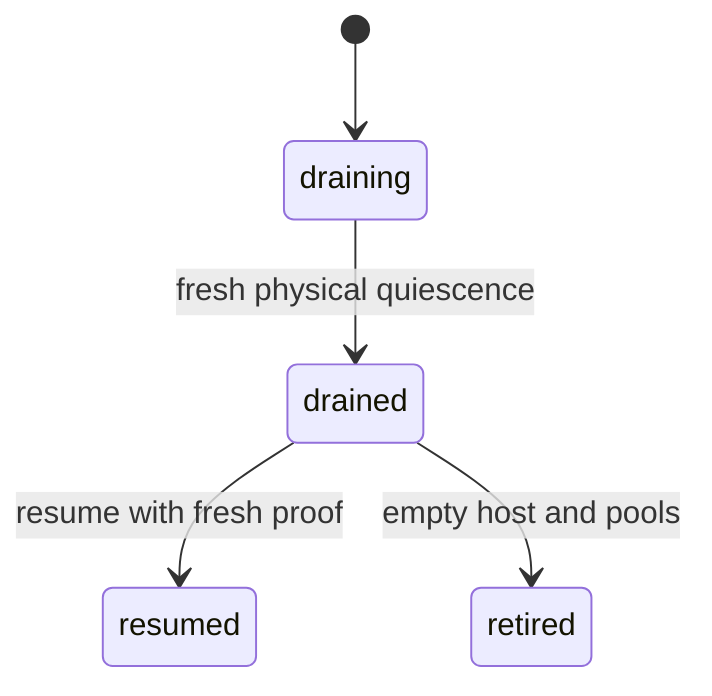

# Routine operations

## GitHub connection and token rotation

Users connect, inspect, disconnect and change machine eligibility through
Integrations. Only the connection owner mutates it. A detached machine stays
excluded across reconnect until reattached. Shared writers use the VM owner's
identity. Without eligible credentials the route can still make anonymous public
requests; it cannot select another user's token. Generic attachments are separate.

Inspect connection phase/expiry without exposing token fields or raw provider
errors. Refresh becomes due ten minutes before access expiry, bounds drain to
five minutes and uses current fenced settlement. `reconnect_required` needs a
new browser consent; restarting a job or copying a token into a guest is not
recovery. Disconnect withdraws authority and completes provider revocation before
another grant is installed. OAuth App registration and provider/organization
consent remain operator/external inputs. See [services](#services),
[recovery](#recovery) and the
[review](repo:docs/architecture/reviews/2026-10-18-github-com-integration.md).

## Experimental Antithesis control fixture

Build the selected source-built context exports, stage them with
`antithesis/build/prepare-contexts.sh`, then validate
`antithesis/config/docker-compose.yaml`. A meaningful local baseline requires
the full Compose build and startup: PostgreSQL migration, both verified HTTPS
Marshall readiness endpoints, actual operator enrollment, authenticated Lilly
Control and a fresh committed host report, then the workload's single
`setup_complete`. Preserve named state volumes only when testing retained-state
restarts; use a fresh Compose project and volumes for an independent baseline.
`antithesis/README.md` gives the local commands and the
[foundation review](repo:docs/architecture/reviews/2026-10-13-antithesis-harness-foundation.md)
tracks their present execution state. A local base control-core setup completed;
its selected manifest has four stale runtime-dependency hashes, so it is not a
frozen hosted baseline. The earlier clean local Compose diagnostic started PostgreSQL migration, both
Marshall HTTPS replicas, enrollment and Lilly health. The non-serving operator
completed three synthetic accounts and three passkeys; read-only SQL found
exactly three of each, and `ss -lnt` found no enrollment listener. The workload
remained at `host_connection_or_report`: its connected v4 host had
`report_sequence` 0 and no `reported_at`. A later fresh diagnostic4 project
reached a connected, fresh v4 report at sequence 44 and logged
`INFO Antithesis setup complete` at 14:33:49 UTC. Six packaged serial Control
commands exited zero and emitted 13 true SDK assertion records; a later SQL
read found fresh report sequence 392. That sequence counts reports, not commands
or physical capacity. See the [foundation review](repo:docs/architecture/reviews/2026-10-13-antithesis-harness-foundation.md)
for the local result and identity limits.

The workload owner alone emits setup. A missing fixture, SQL/TLS failure,
unready endpoint, stale host report, timeout or early stop leaves setup
incomplete. The hosted Lilly publishes no physical pool credit and withholds
execution readiness, so this fixture cannot run an ordinary guest admission.
The guest and storage-router contexts are separate TCG emulator source. The
[local guest boot record](repo:antithesis/verification/guest-boot.md) captures
three ready NixOS boots, including restart on the same qcow2 overlay and offline
retained machine-id verification. It also records the first diagnostic boot's
NIC-name readiness failure and the `net.ifnames=0` repair. The guest runner is
not connected to the default hosted Lilly's fail-closed controlled executor.
The optional integrated host and guest bridge are authored but have no complete
composed execution. A separate
[router TCG smoke](repo:antithesis/verification/storage-boot.md) passed direct
boot, Brady HTTP/HTTPS cache replay, QMP reset and retained ZFS marker/quota
checks. Its container entrypoint and hosted run remain unexercised. Retain KVM
machine checks for native guest and ZFS claims.

Optional origin/SMTP, satellite, Enrico, guest/inner-host and recorder overlays
have separate private state and source-defined health probes. Select only the
fixtures whose source-built images and matching workload/setup probes are ready;
the default bootstrap does not establish these extra services. The authored
Control loopback peer checks pending-window frames and retired replies through
the real shared client, but has no hosted execution record. A peer receipt is
transport evidence, not a Marshall domain effect.
The optional inner host has a [recorded local TCG boot](repo:antithesis/verification/integrated-host-boot.json)
with measured ZFS/cgroup health on its third exact image and a fourth built
private-service image. The fourth boot also completed runtime PKI preparation
and a workspace-source-v2 guest image witness. Its host credential, pool ID
and CA were issued, but Lilly rejected runtime configuration before Control;
the stopped-root journal recorded two invalid-configuration errors. It remained
disconnected and execution-unready. The first two health attempts failed and
were stopped. This record does not include an authenticated Control report,
nested guest readiness or crash
recovery. Inner Audi/Ziggy/Galileo role configuration still awaits runtime
credentials; do not treat the built image or working 9p witness as service
readiness.
The private Docker variant is selected by adding
`compose.inner-private.yaml` after the host-vmm overlay and staging the
`private-host-vmm` context. Its Compose file renders, but no container startup
or inner private-service readiness has been recorded.

## Firecracker native firmware operations

The patched Firecracker build is required for native firmware guests. Its
virtio PCI transport keeps the queue BAR and the MSI-X table/PBA BAR independent,
commits 64-bit relocation only after the high-half write and moves queue
ioevents only after successful registration. Hot-unplug removes both BARs and
all ioevents. During illumos initialization, valid queue size/address writes are
accepted while status is zero; malformed queue state and writes after a
forbidden transition remain refused. Firmware may notify a queue through
PCI configuration space before BAR MMIO registration; the reviewed handler now
signals the same queue eventfd as ordinary MMIO, with bounds and write-width
checks. Firecracker's selected patch tests and common vsock property checks
passed independently of native guest acceptance. Exploratory OmniOS boots with
the modern virtio modules reach userspace in QEMU; the Firecracker scratch boot
and native CID-bound transport remain unresolved. These disposable console
experiments do not establish reproducible image construction, target service
startup, reset safety or recovery.

MSI-X reset state must agree between guest-visible PCI capability and internal
interrupt routing: MSI-X disabled, function mask clear, individual vectors
masked. A pre-enabled capability previously made illumos skip the enable write
while internal routing remained disabled/masked, so completed block requests
never interrupted. The correction retains ordinary enable/mask semantics and
refuses interrupt delivery while MSI-X is disabled. Disposable numeric tracing
and polling identified this fault; neither diagnostic variant belongs in an
accepted guest or VMM artifact.

Native boot diagnostics also exposed a UART transmit-empty interrupt boundary.
FreeBSD fills the16-byte FIFO before enabling transmit interrupts; the pinned
UART previously failed to signal when THR was already empty. The reviewed patch
sets pending THRE and signals only on the disabled-to-enabled transition,
including re-enabling a pending interrupt; an unchanged enable bit and DLAB
divisor writes preserve their existing semantics. A regression through the
production UART API fails on the original dependency and passes the patch.
The production VMM, identity and selected patch gates passed in173seconds;
that source/build evidence requires separate native guest boot and transport
replays. Console silence alone does not identify a blocked guest kernel stack.

The newer FreeBSD transport replay passed in139seconds against the UART-patched
production VMM, retaining exact image/firmware/VMM hashes and admissionfalse.
This establishes token/CID/ABI/refusal/credit-window scope; full services and
OmniOS transport remain separate acceptance work.

Native root growth is an automatic no-argument service before identity/network
bootstrap on every boot. A failed preflight or native command withholds the
volatile root-growth receipt, preventing bootstrap even if rcorder continues.
Do not bypass the receipt or select another disk to repair a refusal. Preserve
the disposable disk and compare its mounted root, assembly pool identity,
physical capacity and both GPT copies before another experiment. Twelve pure
checks and cross-target Clippy passed. Three native FreeBSD QEMU boots passed one
unchanged root followed by two expansions with retained-data, GPT and foreign-disk
verification. The exact canonical-roots/SSH FreeBSD image later passed full
Firecracker service/growth composition over three clean boots and two expansions.
The final reviewed blocking-flush image passed that boundary and all five scoped
services/growth/policy/daemon-recovery/SIGKILL-recovery variants. The current
source-qualified OmniOS service fixture passed two clean boots with the same
current-boot, trust, flush, workspace, terminal, SSH and executor-fencing
oracles. For illumos, a clean result additionally requires process status zero
and the bounded serial marker `syncing file systems... done`; the patched VMM
observes that marker before exiting. The source-qualified OmniOS growth replay is recorded separately; interrupted
expansion remains unexecuted.

OmniOS assembly applies a stock cloud-init/SSH disabling profile to only the
cloned root's offline SMF repository. The exact profile passed native validation
against a scratch stock database, with five false enabled properties and no
live repository mutation. The previous full-kit fresh-boot verifier correctly
refused cloud-init's resolver changes; retain this failure. A newly assembled
image must verify both disabled service state and exact immutable payload before
Firecracker service acceptance. Scoped FreeBSD native IPv4/router/TAP policy
passed two clean boots after the native SSH `UseDNS no` fix; complete OmniOS,
direct peer-VM, jail, physical-host and multi-host isolation remain pending.
The seed-fixed image passed those checks and diagnostic Firecracker transport
after a debugger-only stock pseudo ISA setting restored late serial output.
Persistent assembly now preserves `/etc/system` and `/boot/loader.conf.local`,
appends reviewed pseudo ISA and loader/kernel serial settings, and binds both
complete files/modes for second-boot verification. It removes only an inherited
standalone `-s` from `/boot/transient.conf`, preserving the ZFS root, boot path
and console arguments; second boot rejects any remaining single-user token. The
first formal normal boot
reached ordinary login with persistent serial but
stock physical networking entered maintenance and withheld the required
bootstrap dependency because the remaining plumb-only stock vioif0 file conflicted
with interface initialization. All three Overalls manifests also failed import
on the invalid `Uncommitted` stability enum. Assembly now removes only the four
fixed stock vioif0 address/DHCP files, preserves unrelated interfaces and requires
continued absence in boot verification. The corrected `Unstable` manifests pass
actual native `svccfg validate`; a deliberate old-enum mutant is rejected.
The same native check now gates assembly and booted verification before receipts.
This establishes schema validity, not imported methods or startup ordering.
Decoded native FMD records show ZFS EIO before the later unsupported VMM resets;
the disk-I/O cause remains under investigation. No service receipt exists
for that attempt. Replay the corrected exact image; debugger changes and
diagnostic success cannot replace that evidence.

## Browser editor package and image updates

Update the four extension pins separately from the official Code OSS/runtime pins:

```sh
nix run .#update-vscode-extensions -- --check
nix run .#update-vscode-extensions -- --write
nix run .#update-vscode-extensions -- --write --only rust-lang.rust-analyzer --version 0.3.3073
```

The updater selects compatible stable releases, including paginated results,
then checks manifest, platform, dependencies, archive bounds, packaged Ed25519
signature and upstream engine compatibility. It atomically replaces the lock
only after every selected artifact passes and refuses observed concurrent
destination changes. Validation, resolution and synchronization failures before
rename preserve the old lock. The complete temporary file is synchronized before
rename, then the parent directory afterward. A postrename parent synchronization
failure returns exit2 with `outcome: durability_unknown` and
`reason: publication_durability_unknown`; the complete new lock may already be
visible. Review the visible lock and rerun validation before building new images.
No partial lock bytes are published. The updater emits closed JSON outcomes and
finite selected IDs/versions without paths or registry response contents. It does
not rotate keys, run servers, alter Code OSS pins or deploy.
The final specialized package passed its complete build and installed Chromium
workbench/PTY checks in 234 seconds, with exact release/output/log in the
[review](repo:docs/architecture/reviews/2026-10-10-browser-editor.md). This synthetic
local package fixture does not establish the new defaults or language tools in a
native guest. Fresh standalone and both Firecracker family checks remain required.
The installed-validator maintenance check passed all 19 tests and Ruff/ty in nine
seconds; the packaged wrapper's four-pin check returned current JSON with all
change flags false. The default live `--check` also selected latest compatible
stable versions through bounded pagination, validated complete signed artifacts
with the actual packaged verifier, and returned current with all four unchanged,
exit0. These maintenance results do not prove native language activation.
The final standalone native attempt passed first-terminal proof but failed the
new Native Policy stage. Replay observed its policy marker and EditorConfig
result with no visible AI UI; the exact failed browser assertion remains unknown.
The corrected per-action run later passed the original cold browser journey and
Alice's outside-HOME policy stage, then failed before Bob's HOME invocation when
its command-palette row was absent for 30 seconds. Resolve that discovery failure
and record complete two-account controls/language execution before claiming fresh
extension acceptance; the earlier failure remains separately unexplained.
Built-in AI policy, extension lock and adapters change release identity; retained
machines keep their disks and require a new matching machine for editor access.
Startup/walkthrough defaults also enter the package configuration and release
identity. New matching images carry those defaults; personal settings can
override them. The new actual package and installed-validator maintenance check
passed in 217 and 28 seconds, and a separate fresh-profile manual Chromium smoke
observed no startup Welcome/Get Started/Walkthrough UI after actual workbench
restoration. These scoped results do not establish saved-editor removal,
extension-install walkthrough behavior or user override execution. The later
corrected frozen snapshot passed complete NixOS and Ubuntu Firecracker family
scripts in 805 and 829 seconds total build plus native execution. Standalone
version and real-language failures retain their original scopes. Later strict
scratch both-language success on old startup package 3zz preceded complete final
standalone acceptance in 342 seconds: personal install/reversion, core/System
refusals, actual Rust/Elixir, controls and broker/worker recovery. The final personal-update
package at release 7d2415 passed in 236 seconds, installed-validator maintenance in
seven seconds and both matching guest image builds in 99 seconds. These build
results do not establish native fleet or production runtime. Earlier
package/native/activation records retain their own scope, and these fleet passes
predate the incoming template changes rather than validating periodic sweeps.

Use the [package update procedure](repo:nix/domains/artifacts/vscode-web/README.md) to review
the official source, maintained patches, native ABI and signing keys. Build the
third-party package and its native check before assembling new guest images:

```sh
nix build .#vscode-web
nix build .#checks.x86_64-linux.vscode-web-package
nix build .#checks.x86_64-linux.vscode-web-nixos-fleet
nix build .#checks.x86_64-linux.vscode-web-ubuntu-fleet
nix build .#guest .#ubuntu-guest
```

The native test's trusted browser uses the real package/broker but a synthetic
gateway and roster; its result cannot replace the full authenticated NixOS/Ubuntu
Firecracker journey. Coordinate approved package configuration and image manifests
across Marshall and Audi, then install/register exact image artifacts before
admission. Do not relabel old manifests or infer capability from installed host
software. Existing writable disks remain on their original image capability.

To acquire the editor on an older machine, create a separate machine from the
registered current image with its manifest-derived defaults, including at least
2 GiB RAM and the declared writable disk headroom. Transfer selected project/home
files through authorized guest SSH and verify them and the editor in the new
machine while retaining the original. Restart, resize and clone preserve the old
immutable image; none is an image upgrade. Do not relabel its image record or
replace the new guest root with the old root.

After activation, inspect current Audi asset readiness and exact image identity.
Only gateways with live matching immutable assets publish editor/webview discovery.
The guest `overalls-vscode-web` unit is the broker; personal worker units have their
own systemd ownership and native lifetime. Restarting the broker does not reset
saved editor state or prove that workers exited. See [monitoring](#monitoring) and
[recovery](#recovery) for authority and retention boundaries. Dungarees activated
`0fcab4f6`, then loader correction `849d8022`, healthy with zero updater failures;
this records host activation, not a production editor journey. Overalls build
failed before activation because its
standalone image-ID script omitted the `EditorRelease` dependency required by
manifest v3. The correction loads it before the shared `ImageManifest` validator,
including the Inception standalone fixture. Derive identity from the exact
installed manifest; do not replace its validator or relabel retained images.
The exact corrected Overalls default-image evaluation and later 309-second local
full deployment bundle passed. Overalls subsequently activated `849d8022` healthy
with zero updater failures. Its anonymous machine-code request redirected to
sign-in, proving only deployed unauthenticated route behavior. Keep bundle, host
activation and authenticated editor acceptance as separate evidence in
the [review](repo:docs/architecture/reviews/2026-10-10-browser-editor.md).
Both hosts subsequently activated `af01b4b9` healthy with zero updater failures;
the updater revision and host system closure are separate from a browser-visible
production workbench. Existing VM disks retain their original image capability.

Both hosts later settled healthy at `50021c04`, which contains the editor merge
`058f13d8`, with zero updater failures. Dungarees was separately observed healthy
at `058f13d8`; no intermediate Overalls activation of that revision was
independently recorded. Exact generation/system tuples are in the review. These
read-only rollout observations do not establish a production workbench or upgrade
retained disks. Both fresh native guest-family checks of `058f13d8` failed;
complete current guest/browser acceptance remains required.
Current Overalls closure inspection at `50021c04` found the exact specialized
package and matching protocol/source/release tuples in both installed guest
manifests, plus the four expected builtin extension manifests and policy defaults.
Public readiness returned200 with verified TLS. The four private recurring
fixture/session files were absent, leaving supervisor/browser execution unproved;
running recorders/exporters do not supply those credentials or healthy journeys.

Both hosts subsequently activated exact 63a1443c/release 73ad, independently
observed healthy at 13:00 UTC on 2026-10-10. Installed product/defaults and both
new manifest-v3 guest images match the same protocol/source/release tuple.
The review records exact host-system and image artifacts. This activation does
not establish a new authenticated production editor journey or upgrade retained
guest disks. The recurring fixture absence above belongs to the earlier 12:01
inspection at 50021c04. A separately authorized current existence-only check at
13:06:33 confirmed all four fixture/session files absent on 63a1443c, with both
browser supervisors restarting and request exporters running. Production
browser and recurring history remain unestablished.

The reviewed official-source package passed its complete build and installed
Chromium workbench startup inside the Nix sandbox, as recorded in the
[editor review](repo:docs/architecture/reviews/2026-10-10-browser-editor.md).
The separate standalone NixOS check passed verified TLS, personal worker/terminal
UID and broker/worker recovery with the real package and synthetic roster/bridge.
The pre-observability NixOS fleet passed the actual authenticated Firecracker
journey in 510 seconds; Ubuntu failed initial workbench visibility after
provisioning and expected-origin handoff in 361 seconds. After integration,
obsolete literal prompt matching stopped both first reruns before editor opening.
The corrected merged NixOS snapshot then passed the complete journey in
742 seconds total build plus native execution, including personal UID/webview,
broker and worker recovery, saved stop/start, current physical readiness and
foreign-Origin/sign-out closure. Its source was `849d8022` plus the eligibility,
SSH projection and root-UID fixture changes later committed as `af01b4b9`.
Corrected Ubuntu passed executed root-UID proof, provisioning and authenticated
handoff, then reproduced initial workbench visibility failure in 610 seconds
total build plus execution. Its runtime cause, complete journey and production
editor acceptance remain unproved.
Later diagnostics observed initial bad-gateway with no workbench bootstrap,
Monaco or WebSocket startup; discarded optional worker-health output cannot
establish those fields. Source inspection identified missing store-directory
creation and build-user ownership in Ubuntu closure assembly. The corrected
assembler preserves complete hashed paths and root-custodied configuration with
explicit assertions. The subsequent exact `058f13d8` NixOS and Ubuntu runs passed
their initial cold editor/terminal/custody subtests, then failed real-guest policy.
The later corrected startup-release full NixOS and Ubuntu fleet scripts passed
their policy/control, broker/worker recovery, saved-data restart/current physical
readiness and Origin/sign-out assertions. Standalone version/language, broader
fault histories and production acceptance remain separate.
Keep package, standalone and each distribution's checks separate when approving
a new package/image tuple.
Native command discovery now refreshes the palette's action snapshot within the
original thirty-second deadline and submits a contributed row once. The control
fixture uses origin-keyed private browser profiles and the workbench reload
action; its CORS fixture accepts only the two exact local origins. Composed
Ruff/ty helper checks passed in six seconds, while complete new native execution
is still pending. These fixture changes do not establish historical failure
causes or production/browser-backend persistence.

On a failed journey the browser helper emits closed document-status categories
and bootstrap/error/connection booleans, without URLs, cookies, messages or page
contents. The native fleet may additionally inspect its authenticated current
boot and fixed worker-health/refusal booleans within one 30-second console bound.
These read-only probes do not start an editor, retry browser assertions or turn
failure into acceptance. Their presence is not a recorded diagnostic execution
or an explanation of the Ubuntu failure.

Provision recurring probe credentials privately at the configured runtime paths
using a real completed operator browser sign-in and a reviewed disposable guest
fixture. The helper overwrites only the fixture's declared Markdown probe file;
it verifies the server's unconditional trust-disabled bootstrap without changing
trust storage or using a trust UI action. Native policy checks separately inspect
`workspace.isTrusted`.
Review that workspace and its contents before configuring a disposable fixture;
do not point it at an ordinary project document. Use mode-0600 regular files and
owner-only parent directories, then restart the affected browser-probe unit to
reload systemd credentials. Account/login revocation makes subsequent journeys
fail; renew credentials through the ordinary sign-in flow. Inspect the fixed
independent Prometheus/Grafana diagnostic and coverage state, without printing browser cookies,
fixture bodies or session files. Enabled services with missing credentials retain
unknown health rather than a fabricated baseline.

The shared browser helper creates private writable Chromium configuration/cache
directories and its wrapper supplies pinned Fontconfig/DejaVu for headless hosts.
It preserves HOME and inherited data paths so the native tester's actual NSS
trust database remains authoritative. Provision the required TLS roots through
the reviewed browser trust setup; a package-only startup fixture's temporary
trust bypass cannot establish authenticated native or recurring availability.
The wrapper/closure build passed, while actual recurring browser execution remains
separate acceptance.

## Burn delivery operations

After an approved destination and private runtime files are provisioned, enable
`services.overallsOtelFleet.burnAlerts` on the central telemetry host. Restart
`alertmanager.service` to reload systemd credentials after changing a file.
Inspect service status and the `fleet-burn-delivery` Prometheus job; notification
failure counters indicate failed attempts, while successful requests still need
receiver-side receipt verification. Startup validates HTTPS and the completed
configuration. Non-HTTPS destinations refuse startup. Production currently leaves
this capability disabled while destination provisioning is unresolved.
After correcting a startup refusal, run `systemctl reset-failed alertmanager.service`
and restart the service to clear any systemd start limit.
Ninety-day retention and seven-day objectives are independent.

## Telemetry retention and capacity

`services.overallsOtelFleet.metricsRetentionDays` and `tracesRetentionDays` default
to 90, with a supported range of 7–365. They change store retention independently
of seven-day targets and burns. Inspect oldest available samples, Grafana's
source-status/evidence tables and capacity alerts after activation. The metrics
store has no automatic size-triggered deletion; ten GiB is a warning budget.
Tempo's configured quota still bounds trace storage. Increasing retention never
restores already deleted observations. Resolve capacity pressure by reviewing
volume and storage allocation without silently shortening the declared horizon.

The firewall source registry holds only the Overalls and Dungarees addresses;
operators reach the browser origin, Porsche and administrative SSH through
Tailscale. The disposable Grafana test certificate lasts ten
years to keep cached fixtures usable; production certificate policy is unchanged.

## Public Grafana

Grafana operators use `https://ghuntley.dev:3443/` with the separate `operator`
account. Its generated password is held in `/var/lib/grafana/admin-password`;
handle it privately and never put it in command arguments, logs or Nix options.
`services.overallsOtelFleet.publicGrafana.enable = false` removes the dedicated
HTTPS frontend and its firewall grant on the next configuration activation,
while retaining local Grafana state and credentials. Certificate issuance and
validated reload use the existing Marshall proxy certificate owner. Inspect
public TLS, login refusal and `/api/health` after deployment; a healthy collector
does not establish public Grafana availability.
Certificate publication and cached startup validate both certificate references
when Grafana is enabled, replacing both with the candidate during HAProxy
configuration validation. Zero or more than two references are refused. An
initial production rollout refused the second reference and stopped HAProxy;
the corrected validator preserves trust, hostname, lifetime and key checks.

## Diagnostic outages and queue recovery

Use Grafana's fleet operations dashboard for independent logging health, finite
backup/updater states, resource measurements and trace custody. Missing source or
invalid counters are unavailable observations. Inspect canonical Marshall receipts
and Lilly durable state separately when reconciling lifecycle work. Diagnostic
delivery failure cannot authorize a replacement mutation or cancel a guest.

Each application emits its reviewed `SERVICE.observability_health` log every
30 seconds without admitting a trace for that health observation. Logging preserves
the application log source while projecting four numeric SDK health gauges with
trusted hostname and systemd unit labels and a trusted event timestamp.
`trace_available` describes the local SDK processor; `trace_pending` counts its
volatile spans, and `trace_queue_dropped` and `trace_export_failed` count refused
queue admissions and unsuccessful exports. These counters reset with the process.
They include routine and committed handoff failures but do not establish spool,
Collector or Tempo availability. When fleet telemetry and logging are enabled,
a four-MiB numeric output queue feeds a loopback-only Prometheus exporter on
`services.overallsLogging.sdkMetricsPort` (9468 by default). The host Collector
scrapes it every 30 seconds and supplies trusted host provenance before central
scraping. The event timestamp comes from the journal observation, so repeated
scrapes cannot make retained SDK values fresh. Grafana's SDK health table requires
observations less than 90 seconds old; stale, absent, unavailable, pressured or
refused sources raise separate infrastructure alerts. Missing health logs remain
an unavailable observation; delivery still depends on journal and logging
transport. Independent spool health supplies separate custody evidence.

The same loopback bridge retains the reviewed BEAM and terminal runtime gauges,
with per-unit identity and a separately derived runtime observation timestamp.
Grafana's BEAM memory and run-queue panels show only recent runtime observations.
These diagnostic gauges remain separate from canonical service-level recordings.
Queue refusal, export failure and logging/spool drop alerts use a one-minute
pending period within their five-minute event windows so isolated failures can
surface before they leave the window; persistent health-state alerts wait five
minutes.

When Fluent Bit stops, `overalls-logging-health.service` continues serving filesystem
queue observations on port 9467. Delivery counters become invalid rather than zero.
Inspect source cursors, destination drops, backlog age and disk headroom before
restarting it. Keep shard databases and queued chunks. The startup preflight only
reads shard cursors and never rewrites them. Unsafe or corrupt cursor custody
refuses startup and requires reviewed repair, not generic deletion of the logging
state directory.

Trace archives belong to independent `overalls-trace-INSTANCE.service` units.
The producer runs through an unavailable spool or Collector; refused diagnostics
and storage failures appear in numeric health snapshots. Collector restart retains
its persistent application trace queue. A successful upstream acknowledgment does
not erase the producer archive before retention; ordinary restart sends pending
records only. Explicit replay is an operator action and can duplicate traces.
Never put archive contents, trace payloads, credential files or terminal bytes in
ordinary diagnostic commands or output.

Grafana uses the log-store reader identity through verified fleet TLS. After reader
credential rotation restart `grafana.service` to refresh its systemd credentials,
then verify read success and insert refusal with synthetic isolated evidence.
An unavailable Grafana reader does not stop store ingestion. Store or Tempo quotas
and archive/output budgets need separate review; retention alone cannot prove
outage tolerance or successful backfill.

The observability cutover migration revoked live monitor credentials. Under
ADR-0159 Marshall no longer models the retired monitor hosts, credentials or
per-VM certificate issuance archive; their rows were exported (digest in the
[removal review](repo:docs/architecture/reviews/2026-10-11-legacy-compatibility-removal.md))
before the tables were dropped, and the administrative operations page shows
neither panel. The cutover migration cancelled only `available`, `scheduled`, `executing` and `retryable` jobs belonging
to the retired `Marshall.Fleet.Workers.ExpireHistory` and
`Marshall.Telemetry.Workers.ExpireSummaries` workers. Completed history and jobs
for lifecycle, business or security work remain intact. ADR-0159 pruned the
applied migration file; no rollback restores credential or host authority.

## Updates and migrations

Enrolled hosts may poll the configured Git branch independently. The default branch
is `main`; the normal interval is ten seconds with jitter. The updater builds an
immutable candidate, stages secrets, checks compatibility, applies serialized
migrations, switches, and verifies local role health. It does not coordinate a
fleet rollout, automatically reboot, or roll back database changes.

Inspect `overalls-auto-update` unit status and private phase records under
`/var/lib/overalls-auto-update`. Correct a failed candidate in a new revision after
identifying its failure. Preserve the enrolled receipt and storage baseline.
Topology, disk inventory, firmware and persistent identity changes are maintenance
operations, not ordinary timer updates.

Two custody refusals persist there with deterministic backoff — delays of 30
seconds doubling to a fifteen-minute cap while the failure count caps at sixteen
— and neither expires on its own. A candidate whose environment changes the
serving Marshall database URL, token signing secret, cookie or Cloak custody is
refused at preflight as `coordinated_secret_change`; staging resolves privately
but is never published, consumers never stop and no migration runs. Recovery is
the documented manual cutover from the
[NixOS operations runbook](repo:docs/operations/nixos.md): once the operator has switched
the host to the exact refused closure and re-prepared its bundles, the first
timer run after the persisted retry time finds the active candidate and only
re-verifies live health. It does not re-stage, re-resolve, rerun migrations or
switch again; the verify-only path then records the candidate healthy and clears
the backoff. A bundle whose document no longer names the host recipient while
configuration still selects it instead wedges at staging with failure
`operation_failed` in phase `stage`, retaining the previously published bundle
untouched; restore the document's recipient or remove the bundle selection and
the corrected revision converges without further action. Because the retry time
persists, allow up to one backoff interval after the manual cutover before the
converged status appears.

## Invalid provisioner startup

Lilly rejects a configured invalid private runtime file before starting its
runtime or status listeners. A generated local OTP boot property covers thirteen
file-custody and schema/configuration failures in shuffled histories, with exact
fixed errors, unchanged fixture state and credential-free captured output.
Fresh-process call traces show no named Lilly supervisor, Runtime or
StatusServer start attempt during rejection; the unset control confirms the
supervisor trace fires. The
focused suite passed two checks, including one property. Unset configuration
remains a deliberate application boot without a control runtime or listeners.
These are test-build BEAM processes, not packaged systemd or native host
acceptance. Successful configured startup and the other applications' boot
validation retain separate coverage gaps.

## Provisioning performance acceptance

Lilly sweeps unconfigured image templates at startup and schedules another sweep
ten minutes after each completed attempt. Prewarming can delay a queued retry;
the same exclusive image lease, pool lock and native ownership checks apply.
Inspect the catalogued `lilly.template_sweep_finished` pool UUID, outcome and
first failing stage for contention or unconfirmed cleanup. Other incarnations
are still attempted after one refusal. A diagnostic result does not authorize
forced deletion or establish released capacity; periodic retry execution remains
an explicit native/property coverage gap.

Run the [Porsche-to-SSH benchmark](repo:scripts/provisioning_benchmark.py) only
against the exact baseline or enabled release whose per-host update status has
converged. Supply already verified management, control and guest SSH identities
and known-hosts files; the script does not install trust or read a secret bundle.
It creates a new private evidence directory, fsyncs all creation/deletion IDs
before effects, and never substitutes another mutation ID after an uncertain
reply. Reconcile an unresolved attempt by its original receipt before another
campaign. Ten sequential samples per NixOS/Ubuntu image and four concurrent
samples follow separately recorded prewarm attempts. Guest SSH `ls` must succeed
against the returned `ssh_host`; read-only physical state and independent catalogued logs record
host, pool, timing and cleanup without storing terminal bytes or command output.

The [run protocol](repo:docs/history/ledgers/provisioning-fastpath.md) requires host-load and
native template-identity review before claiming a warm-cache speedup. A dry-run
custody test or completed result file alone does not prove VM isolation, physical
cleanup, or the ≥30% and sub-10-second targets. Failed or uncertain cleanup
retains run-owned request IDs for inspection and blocks a passing result.

## Disable, drain, resume, retire

Run operator commands with the release's protected environment and
`PHX_SERVER=false`. Use `eval` in a separate process, not `rpc` against a serving
node. The operator starts persistence and authority services without consuming jobs.

```sh
bin/marshall eval 'Marshall.Operations.CLI.main()' show HOST_NAME
bin/marshall eval 'Marshall.Operations.CLI.main()' disable HOST_UUID
bin/marshall eval 'Marshall.Operations.CLI.main()' drain HOST_UUID REQUEST_UUID ops:ticket-123
bin/marshall eval 'Marshall.Operations.CLI.main()' drain-status REQUEST_UUID
bin/marshall eval 'Marshall.Operations.CLI.main()' resume-host REQUEST_UUID
```

Disable blocks admission; it does not stop guests. Drain disables starts and stops
guests in bounded batches while retaining their disks and placement. Reuse the same
request UUID and reference after an uncertain response. Require both `drained` and
`currently_quiescent=true` before maintenance. An offline host can remain pending.



Resume leaves guests stopped and re-enables admission. Owners explicitly start them.
Retirement requires an empty drained host, no held allocations or addresses, and
fresh pool evidence:

```sh
bin/marshall eval 'Marshall.Operations.CLI.main()' retire-host REQUEST_UUID
```

Retirement permanently revokes host eligibility and credentials. It does not erase
disks or recycle machine identity. Stale compute and inference credentials of a
retired host are refused by every authenticated transport, and no late exchange
can resurrect them. Use evacuation when guests must move elsewhere first.

## Replace a host

Sequence the replacement next to the retirement: drain and retire the old host,
then enroll replacement hardware under a fresh machine identity, a new name and
its own storage GUIDs. A retired host's name is never recycled; the retained row
is its permanent evidence. Prepare the replacement through the protected SSH
enrollment bridge (`prepare-enrollment` with a unique operation ID, retried with
the same ID for an equal result), deliver the credential envelope only through
the sealed bundle, and activate with the enrolled binding. A replacement starts
disabled: admission refuses to enable it until its real v3 session reports fresh
execution readiness, then ordinary enablement admits guest capacity on fresh
evidence only. Verify a representative guest can reach the private services
again before removing the old hardware's spare credentials from circulation.

The generated enrollment/credential histories and the distributed registration
and retirement schedules behind this procedure are recorded in the
[host replacement review](repo:docs/architecture/reviews/2026-09-27-host-replacement.md).

## Credential and key rotation

Host credential rotation immediately invalidates previous host authority. Prepare
private output custody, rotate, verify the result, publish encrypted material and
restart the consuming service promptly. Preserve guest journals and reservations.
A timeout after issuance requires verification, not blind reissuance.

```sh
bin/marshall eval 'Marshall.Operations.CLI.main()' rotate HOST_UUID 157680000 /private/next.json
bin/marshall eval 'Marshall.Operations.CLI.main()' verify /private/next.json
```

For Cloak, retain old key identifiers while stored ciphertext or retained backups
need them. Stage overlap before changing the write key. Signing keys, release
cookies, database credentials, SSH pins and CA roots have different consumers;
use the relevant coordinated procedure rather than treating them as one secret.

### Reconcile encrypted-document recipients

After reviewing public users and host inventory, use a retained recovery identity:

```sh
nix run .#secrets -- check
nix run .#secrets -- rekey --ssh-key /private/operator-key
nix run .#secrets -- check
```

Check reports drift without modifying documents. Rekey validates every changed
candidate before publishing any; preparation refusal preserves all originals.
Publication is atomic per document. If interrupted, retain the reported completed
and possibly updated names, resolve the failure and explicitly rerun rekey.
Completed documents with current recipients remain byte-identical on retry.
Verify independent recovery before retiring old custody. Recipient removal
cannot erase plaintext or application credentials already learned by a recipient.

[Generated operator histories](repo:docs/architecture/reviews/2026-09-26-secret-recipient-histories.md)
track actual SOPS/age decryption, host/recovery key overlap and removal, explicit
recovery-only custody, all-candidate refusal and bounded publication retry. Their
local CLI evidence is separate from native delivery and coordinated credential
rotation; off-host recovery availability and physical disaster drills remain
operator acceptance. Removing the last host from a document without explicit
`recoveryOnly` custody refuses during inventory validation, before any host can
wedge on it; removal while other hosts remain is valid custody but wedges this
host's updater at staging, as described above.

Candidate activation stages secret bundles privately and binds them to the
complete descriptor by content digest in `/run/overalls-auto-update/handoff.json`.
The new generation's preparation services publish exactly the staged bytes
without re-decrypting, so a concurrent document replacement landing between
staging and the switch cannot change what consumers receive. Stale handoffs
from earlier attempts are retired at staging entry and on refusal cleanup.
The [updater custody histories](repo:docs/architecture/reviews/2026-09-26-custody-updater.md)
execute this handoff against the real SecretSpec/SOPS pipeline and pin the
capped backoff, the verify-only post-rotation recovery and the wedge label.

## Mail and reclamation

Magic links use an encrypted outbox and retryable mail jobs. Configure verified
remote SMTP or explicitly selected loopback relay mode. Check sender identity,
provider TLS and delivery; an accepted SMTP transaction is not inbox evidence.
Never print the token-bearing message to diagnose delivery.

Nix store reclamation is bounded and preserves configured generations. Guest
storage cleanup belongs to Lilly. Brady and Enrico caches have separate quotas.
Do not reclaim a guest dataset with generic cache or Nix garbage-collection tools.

Evidence: [maintenance commands](repo:marshall/lib/marshall/operations/cli.ex),
[host maintenance](repo:docs/operations/host-maintenance.md), [updater contract](repo:nix/domains/system/auto-update/CONTRACTS),
[email](repo:docs/operations/production-email.md), [Nix GC](repo:nix/domains/system/nix-gc.nix).

SSH certificate operations use `porsche-ssh-certificate.timer` and
`audi-ssh-certificate.timer` on gateways and the existing guest sync timer. A
failed renewal retains valid files; expired certificates fail new handshakes and
gateway readiness. Verify the certificate with `ssh-keygen -Lf` on its public
`ssh_host_ed25519_key-cert.pub` file. The ordinary installer must connect without
an authenticity prompt. Never copy the CA private key into a guest to repair
readiness.

A running VM establishes execution, not published route or guest SSH readiness.
Positive integration verification waits for the current verified HTTPS gateway
key and actual SSH success. The native withdrawal fixture shares one ninety-second
budget across route publication and SSH, with forty-five seconds per SSH attempt.
Authority refusal probes remain single attempts and require their exact forbidden
evidence; transport failure or an unpublished route does not establish refusal.

## Memory suspension and ingress handoff rollout

Configure `services.lilly.checkpointImageIds` only with exact immutable images
that have recorded native continuation qualification. The empty default retains
ordinary starts but refuses pause/resume. Converge Lilly reporters and Marshall
consumers on the required `checkpoint_image_ids` host-inventory field before
enabling memory operations; reports missing the field are refused. Stage the VM's
qualified ID on eligible destinations before relocation. Removing qualification
while RAM is retained blocks subsequent memory operations instead of permitting
a cold-boot fallback. The native fixture's candidate image list is test-only.

Deploy the coordinated protocol, Marshall migration, Lilly/hostd and Audi builds
before admitting pause/resume operations. Lilly must retain immutable checkpoint
memory backing until the restored VMM exits. A failed or incompatible restore
must refuse; replacing it with a cold boot loses the promised process state.
The [fleet declarations](repo:fleet/fleet-network.nix) enable the Audi relay on
Overalls and Dungarees through their existing keyed `fleet0` peers. TCP 9445 binds
only `10.90.0.1`/`10.90.0.2`; its firewall permits declared WireGuard peers. It is
not a public listener and does not route guest subnets.

Enablement also requires explicit Marshall gateway enrollment. On the trusted
Marshall operator entry point, use new private output paths and each host's
current enrolled Lilly UUID:

```text
audi-gateway-rotate audi-overalls OVERALLS_HOST_UUID OVERALLS_SERVICE_IPV4 10.90.0.1 9445 /private/overalls-relay.token
audi-gateway-rotate audi-dungarees DUNGAREES_HOST_UUID DUNGAREES_SERVICE_IPV4 10.90.0.2 9445 /private/dungarees-relay.token
audi-gateway-verify /private/overalls-relay.token
audi-gateway-verify /private/dungarees-relay.token
```

Rotation invalidates the previous gateway generation and its browser cookies and
streams. Schedule this credential cutover together, encrypt each new token into
its existing `HOST-audi` SecretSpec document, run `secrets -- check`, then deploy
the matching gateway configuration and restart Audi. Never print tokens or place
plaintext output in the checkout. The four-argument gateway rotation form leaves
relay enrollment disabled; it is insufficient for automatic cross-host wake.
DNS credentials and existing fleet WireGuard keys do not need rotation.

After both gateways report their fresh host key, wildcard installation and
editor assets, verify a VM can pause with CPU/RAM released and resume its existing
process state. Then exhaust its original host's capacity, keep an authorized SSH,
HTTPS or editor connection open to that original gateway, admit a compatible
second host, and verify that same incoming request completes after paused-copy
relocation. Refused credentials and revoked stored logins must end the wait;
capacity alone has no short overall timeout. A wake receipt grants no guest
socket, and discovery or a successful TCP handshake is not memory-retention
evidence. The [fleet scenario](repo:nix/verification/tests/machines/fleet/scenarios/suspension.py)
contains these acceptance operations; test presence does not establish a passing
native run or a production rollout.

Wake admission and terminal outcomes, and relay issue/consume, emit catalogued
events only after the outer database transaction commits. Their metadata contains
resource UUIDs, never capabilities, requests or guest content. Relay admission
and renewal recheck the origin host's enabled, current authority as well as both
gateway generations; retiring or disconnecting that origin ends its authority.
An enabled evacuating origin may keep forwarding while its workloads move.

## Artifacts and server-tool runbook

Background work runs in Oban ([configuration](repo:marshall/config/config.exs)):

| Job | Queue and schedule | Effect |
| --- | --- | --- |
| `Agents.ServerToolJob` | `agent_tools` (limit 10), enqueued with each server-tool command | Claims, executes and finishes one command; up to 5 attempts |
| `Agents.ServerToolReconciler` | `maintenance`, every minute | Re-enqueues server-tool commands queued over 30 s; marks server claims older than 10 minutes `uncertain` |
| `Artifacts.ExpiryJob` | `maintenance`, every minute | Expires tickets and staged publishes (resuming their parent command); deletes retired tickets after a day and audit rows after 90 days, 500 per run |
| `Artifacts.PurgeJob` | `artifacts` (limit 5), enqueued by deletion | Deletes 1,000 content rows per step until done, then `deleted` |
| `Artifacts.SweepJob` | `artifacts`, hourly at :20 | Deletes up to 500 unreferenced blobs older than one hour per run |
| `Artifacts.UsageReconcileJob` | `maintenance`, daily at 03:40 | Corrects storage usage counters from entries |
| `Threads.FeedAppendJob` | `default`, enqueued when an ordinary top-level turn finishes | Appends one `turn_finished` feed notification; up to 10 attempts |
| `Threads.SubscriptionRevokeJob` | `default`, enqueued by thread-grant, team-membership and retirement changes | Revokes subscriptions whose owner lost read, 200 per page; up to 10 attempts |

All jobs are idempotent; re-running one is safe.

Routine actions:

- **Moderate.** An elevated administrator opens `/admin/artifacts`, searches by
  title, and deletes with a closed reason. The list shows metadata only. The
  artifact moves to `deleting`, its tickets are revoked and the purge runs.
  Moderation cannot be undone; versions are purged.
- **Stuck deletion.** An artifact left in `deleting` has a missing or exhausted
  `PurgeJob`. Re-enqueue it with the artifact ID; it resumes where it stopped.
- **Stuck staged publish.** A `PublishRequest` in `staging` expires after 30
  minutes; `ExpiryJob` releases its chunks and fails the parent command closed.
  Do not edit request rows. Check that the guest executor advertises
  `artifacts-v1` and that Ziggy accepts `artifact_chunk`.
- **Uncertain server-tool command.** `uncertain` means the effect may have
  committed. Inspect the artifact's versions or the subscription row before the
  user retries. The model sees `claim_expired` and can read before writing.
- **Storage drift.** `artifact.usage_drift` events name corrected scopes. A
  steady stream indicates a bug in the storage writer, not a capacity problem.
- **Disable the viewer.** Set `services.marshall.artifactContent.host = null`
  and activate. Listing, publishing and moderation continue; content and the
  storage bridge become unavailable. Outstanding tickets expire within five
  minutes.
- **Revoke access quickly.** Unsharing revokes the user's tickets in the same
  transaction; the next content fetch fails. There is no cache to flush.
