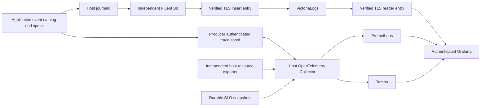

# Monitoring and troubleshooting

## Retained GitHub tool bootstrap diagnostics

The one-shot retained-tool bootstrap reports a heartbeat renewal failure through
a closed numeric exit category. Codes 80–109 identify a fixed HTTPS stage and
error category; 110 identifies request encoding and 111 response JSON decoding.
Other invocation errors remain 1 and malformed invocation remains 64. An
acknowledged poll returns 0; the maintenance row owns the installation outcome.
The [HTTP observer](repo:lyra/src/http.rs) and
[bootstrap](repo:lyra/src/agent/maintenance.rs) expose no URL, error text,
identifiers, credentials, payload or tool output. A failed renewal still withdraws
installation authority; the diagnostic adds no retry or execution permission.

Seven HTTP tests and ten maintenance tests, including generated maintenance
histories, passed on the Linux host; Clippy and contract checks also passed.
These checks establish bounded refusal and mapping behavior, not the cause of
native TLS or retained-image transfer failures. Native runtime acceptance remains
separate in the [GitHub review](repo:docs/architecture/reviews/2026-10-18-github-com-integration.md).

## Native crash and fleet setup diagnostics

The native crash fixture reports fixed phase names and a decimal UFS fsck exit
status bounded to 0–255. The same background snapshot check still requires exit
0; raw filesystem output stays discarded. Eight host boundary tests and pinned
Ruff/ty passed. The added diagnostics have no recorded native outcome and do not
explain the earlier candidate's `external-machine-oracle` failure.

Shared default-OSS setup explicitly starts Audi private services after Ziggy and
Galileo are ready, recovering an earlier dependency-failed start job. Its start
and existing readiness wait remain bounded at 900 seconds; production dependency
and certificate deadlines are unchanged. Ruff, contract format and actual
composed-driver typing passed; corrected fixture runtime remains pending.

## Editor transition evidence

Marshall's Control room audit accepts `kind=editor` and exposes bounded redacted
login, credential and lease transitions under the existing current-user
`admin_read` policy. It carries identifiers and closed action/status projections,
never raw approval proofs, cookies, paths, commands or terminal bytes. Revoked
stored-login readers refuse. PaperTrail audit versions follow the global ninety-day
retention inventory; bounded operational cleanup expires old authority separately.

The reviewed `editor.authority` event follows the outer ledger commit. A nested
successful action whose caller rolls back emits no committed authority outcome.
`editor.assets_ready` records a new immutable asset receipt, without repeated
refresh events. These diagnostics do not authorize connections or prove browser
availability. Missing live asset readiness withholds DNS, while a DNS record alone
cannot prove current user authority. The [scoped review](repo:docs/architecture/reviews/2026-10-10-browser-editor.md)
separates passing local transitions from native and full guest acceptance.

## Recurring authenticated editor journeys

Overalls declares separate `vscode_browser_nixos` and `vscode_browser_ubuntu`
sources. The shared typed Playwright helper uses private real operator storage
state, opens the VM from Marshall, checks its expected personal origin, edits and
saves a fixture Markdown file, closes/reopens it for readback, inspects its isolated
preview and verifies terminal UID/name plus guest OS. It does not mint a synthetic
browser success or bypass authentication. Before using preview/terminal features,
it opens upstream's workspace-trust UI, grants trust to the dedicated reviewed
probe workspace and waits for the actual trusted state. Command execution waits
for the matching palette row instead of assuming contributions are already loaded.
Terminal creation selects the exact command with bounded pre-submit preparation,
checks that its captured input remains connected, visible and focused, and submits
once. One twenty-five-second wait allows initial terminal profile availability.
Output and cleanup remain scoped to the captured terminal, preserving other
visible editor-group terminals. Inspection enables accessibility only when that
terminal's tree is absent. The standalone cold first-use and two-preexisting-
terminal regressions passed; actions use an eight-second default while ordinary
`expect` assertions retain five seconds.
Each probe runs every five minutes;
its Rust supervisor enforces a sixty-second browser deadline and
suppresses private browser output. A dedicated Linux subreaper adopts detached
Chromium descendants, selects targets from kernel-owned child lists and kills
and reaps them before successful settlement. The native subprocess regression
passed with separate middle and leaf process groups; actual NixOS/Firecracker
recurring browser and recorder/collector fault histories remain separate evidence.
Direct native helper execution passed through the complete NixOS fleet. Ubuntu
reached its expected origin but failed initial workbench visibility; fixed closed
substages/categories now identify visibility/folder/trust without private output.
No runtime cause or new native result follows from that diagnostic-only edit.

The helper gives Chromium private writable configuration/cache directories while
preserving HOME and the native tester's NSS trust database. Its wrapper uses pinned
Fontconfig/DejaVu, including on hosts without desktop fonts. The wrapper/closure
build passed; actual authenticated browser completion is required before recording
a successful measurement, irrespective of that package result.

Each source owns a separate durable request recorder and exporter. Five-second
producer heartbeats preserve coverage while idle. Missed intervals/recorder loss
create coverage gaps rather than catch-up journeys or successful synthetic slots.
The `Overalls.RequestAccounting` library centralizes producer custody and the
pure eight-bucket aggregate model. Source adapters still decide eligible work,
classify outcomes and own their storage and publication; missing durations remain
missing rather than becoming synthetic latency samples. Diagnostics loss cannot
grant execution or turn unavailable request-accounting evidence into success.
Exporters have source-read and collector-socket groups only; they cannot read
operator credentials or modify the browser outcome. The collector regroups every
per-source socket directory in its single post-start step. systemd re-applies
runtime-directory ownership whenever it spawns another start command, so an
evaluation assertion refuses a second one; on Overalls the browser probes' own
custody commands had reset every other socket directory and silently cut off
application exporters until 2026-10-13. The browser histogram uses
0.1, 0.5, 1, 5, 10, 30 and 60 second bounds; existing source bounds remain unchanged.

The current declared roster has twenty-four provisional seven-day objectives and
forty-eight burn evaluators. Both browser objectives are 99%, with the existing
minimum-request, warmup, exact-host, fresh-collector and coverage guards. Missing
fixture credentials, recorder or collector coverage yields unknown, not healthy.
Independent Prometheus recordings expose closed fixed-window diagnostics: at least three failures
without a success in fifteen minutes, or no completed journey in ten minutes,
only after matching guarded coverage/warmup. They are observations of those windows,
not a persistent consecutive-failure counter. Seven-day eligibility, private
credential provisioning, production execution and external notification delivery
remain separate acceptance in [scenario coverage](#coverage).
Nix provisions these two families in a guarded browser-observations table in
Grafana. Diagnostic panel IDs derive after the full duration/objective roster,
avoiding collisions when browser objectives are added. Declaration/evaluation
does not establish rendering, retained healthy history or recurring execution.
Marshall's retired SLO reader remains absent. The direct NixOS helper result above
precedes integration with independent observability; merged native and Grafana
browser-panel acceptance remain separately scoped.

Grafana reads fleet diagnostics from Prometheus, Tempo and VictoriaLogs. Marshall
owns desired state, command receipts, authorization, PaperTrail versions and durable
service-level accounting. It no longer accepts a telemetry upload, lifecycle audit
outbox or relocation progress stream through the control protocol. Its retired
`/admin/fleet`, `/admin/logs` and `/admin/slos` views do not provide diagnostic readers.
Protocol v4 retains the bounded host/pool evidence required for admission,
reconciliation and current readiness; those facts remain control authority.

ADR-0149 separates diagnostic delivery from business execution. Stopping a log
exporter, trace spool, Collector or Grafana cannot stop guests, roll back a domain
transaction or make diagnostic acknowledgment a prerequisite for lifecycle progress.
Diagnostic loss is explicit. A trace or log is supporting evidence, never proof that
a command committed or that a disconnected host is dead.

## Diagnostic paths and custody

Each host collects its own logs and sends directly to selected destinations. The
central Overalls role stores metrics, traces and fleet logs; the Dungarees worker
exports over authenticated fleet WireGuard. Grafana, Prometheus and Tempo HTTP
readers bind loopback. Optional public Grafana uses a separate authenticated HTTPS
frontend and account; Marshall sign-in does not confer Grafana access.

Grafana's pinned VictoriaLogs plugin uses `https://logs.fleet.internal:8443`, the
committed CA and reader-only credentials delivered by systemd. Insert identity can
write only `/insert/*`; reader identity can query `/select/*` and health, never
insert. Runtime credential paths enter configuration, their contents do not enter
the Nix store or browser. The store is not a general fleet HTTP proxy.

Application logs pass reviewed event catalogs. Origin, unit and source routing
derive from trusted journal fields. Nonzero lowercase exact-width `trace_id` and
`span_id` identifiers support log-to-Tempo and Tempo-to-log navigation. Catalog
metadata excludes credentials, terminal contents, raw arguments and payloads.
Correlation does not add authorization or control authority.

Reviewed application health events project availability, pending work, queue
refusals and export failures through the logging pipeline's loopback numeric
exporter on port 9468. Projection requires a matching trusted journal unit and
catalog event. Every application uses the shared canonical formatter, which emits
the same versioned envelope and catalog projection; no application-specific
formatter may widen the metadata surface. Values retain finite integer validation,
module/journal identity and the original journal timestamp; payload host names,
units and clocks cannot replace provenance. Application log routing remains
available alongside numeric projection, while a metrics-only reader exports no
application payload.

Application trace intake authenticates the producer account and exact systemd
cgroup before replacing service, host, application-origin and deployment
revision attributes. The revision (`service.version` and
`overalls.deployment.revision`) is the host build's flake source revision from
`system.configurationRevision`, or `unknown`; producers cannot supply it. The
independent spool durably accepts validated bounded spans before acknowledgment,
retains unacknowledged delivery and reports saturation, storage failures and
poisoned state numerically. A full or unavailable spool refuses diagnostics without
changing the application outcome. Collector application and guest trace delivery
use separate 64-entry persistent exporter queues, with `fsync` enabled for every
storage write, unlimited elapsed retry and no asynchronous batch ahead of queue
acknowledgment. Saturation remains an explicit refusal; unlimited retry does not
enlarge the queue. These process/restart guarantees do not establish physical
host power-loss durability.
Trace storage and delivery remain bounded; traces are sampled diagnostics.
Each producer defaults to a two-GiB logical archive and 256-MiB pending admission
budget with ninety-day retention, including batches acknowledged upstream. The
aggregate archive allocation must fit the configured 32-GiB host ceiling. These
logical budgets require additional disk headroom for SQLite/index overhead and do
not reserve physical storage or guarantee ninety days at an unmeasured input rate.

Guest OTLP is a separate untrusted path. Audi supplies the current Lilly binding;
the receiver authenticates the Audi peer, replaces resource provenance, applies
per-VM and host budgets and permits only reviewed guest metric names. Guest spans
keep their own `service.version` (Lyra reports its crate version); the host
collector adds `overalls.host.deployment.revision` for the receiving host build,
under a separate key so a guest cannot claim a host deployment revision. Guest claims
cannot enter authoritative fleet SLO arithmetic. Customer guests remain outside
the private integration zone. The guest path cannot impersonate an application
trace producer or fleet resource exporter.

## Logs, queues and independent health

Fluent Bit uses stable journal shards `applications-a`, `applications-b`, `platform`
and `edge`. Every input keeps at most eight conditional routes, a distinct durable
cursor, and drops unselected sources before routing. Galileo and Underclass have
explicit application sources. Restricted audit and Firecracker tail inputs exist
only when their own sources are selected; ordinary fleet logs exclude both.

Before the reader starts, a read-only preflight checks each existing shard
cursor: it must be a private, singly linked regular file that passes SQLite
`PRAGMA quick_check`. A missing shard cursor starts fresh. No other checkpoint
format is read or converted (ADR-0159). Unsafe or corrupt cursors refuse startup
with `logging.cursor_check_refused`; operators must inspect custody rather than
deleting state to clear the refusal.

Delivery is at least once. Journal event IDs combine machine identity and cursor;
readers should expect retry duplicates. Every destination has an explicit budget.
Native and OTLP platform sources share their destination output queue; CloudWatch
retains separate source queues. Output limits evict old chunks and expose drops.
The queue budget excludes journald, indexes, restricted audit and native VMM files.
Configured bounds are not a promise of outage duration at an unmeasured rate.

`overalls-logging-health.service` reads filesystem metadata and allowed localhost
Fluent Bit counters independently of the logging service. It exposes numeric
queue bytes, oldest chunk age, disk headroom, output budgets/counter validity and
shard checkpoint presence on port 9467. Failed counter reads expose invalidity
and omit unknown counters; they do not invent healthy zeroes. Central Prometheus
scrapes both authenticated host addresses directly. Health remains reachable when
Fluent Bit or its destination is stopped, subject to host/network availability.

Infrastructure alerts cover missing health, invalid delivery counters, backlog,
drops, disk headroom and missing shard cursors. The independent fleet exporter
serves fixed numeric/state families on loopback 9466, with bounded service, host,
VM/dataset, backup and updater observations. Collector host provenance reaches
Prometheus; there are no Marshall credentials or HTTP uploads. Missing, stale and
partial sources remain distinguishable. Finite state labels are not free-form
error text, placement histories or command arguments.

## Retention and capacity

Prometheus and Tempo default to ninety-day retention through separate typed
`metricsRetentionDays` and `tracesRetentionDays` options, supported from 7–365.
VictoriaLogs keeps its separately configured thirty-day retention, minimum-free
space guard and central ZFS quota. Tempo retains trace blocks subject to its
configured twenty-GiB dataset quota. Prometheus has no automatic ten-GiB deletion
policy; ten GiB is a monitored warning budget. Configured horizons do not prove
that those observations already exist.

Grafana's baseline opens ninety days. Its source-status/evidence tables describe
missing or stale sources, warmup, coverage gaps, inactivity, incomplete seven-day
history or volume, incomplete duration accounting and histogram overflow. Missing
and stale sources precede inactivity. Empty or ineligible ratios remain unknown.
Five-minute candidates require every declared source host and the source's own
sampling clock. Retained Collector values cannot establish a live producer.

The fleet scrape cadence is ten seconds: 8,640 samples per day and 60,480 per
seven-day window. Objective coverage and history-day diagnostics share that
cadence definition. The two-minute synthetic long-history fixture deliberately
uses 5,040 samples; it does not redefine production coverage. Retention, display
range and objective windows are independent.

Capacity alerts warn at seventy percent, critically at eighty-five percent, or
projected exhaustion within the retention horizon. Low root headroom, missing
capacity probes and ingestion refusals have separate alerts. Increasing retention
cannot restore deleted observations. Resolve volume or allocation pressure without
silently shortening the declared horizon; see [operations](#operations).

## Durable objectives and measurement authority

Seven-day provisional targets remain 99.9% for the two collectors, 99.5% for public
ingress non-5xx completion and 99% for each named application/workflow candidate
and Underclass monitor readiness. These candidates describe their declared
boundaries, not an end-to-end promise of successful user work. At least one hundred
eligible requests and complete source/collector coverage are required where the
catalog specifies volume. A missing host, fresh source, coverage gap or incomplete
history withholds the objective and its burn state.

| Source | Measured boundary |
| --- | --- |
| Brady | Admitted attributed terminal request completion |
| Galileo | Authorized integration response completion |
| Enrico | Accepted single-flight mirror refresh |
| Porsche dispatch | Canonical SSH command dispatch |
| Ziggy | Durable inference completion |
| Audi private | Current bound private request completion |
| Audi DNS | Ordinary public authoritative answer completion |
| Marshall web | Browser HTTP transport completion |
| Audi SSH | Granted guest socket and exec acknowledgment |
| Underclass proxy | Durable proxy completion, separate from local monitor readiness |
| Marshall ready | Durable creation through exact readiness evidence |
| Lilly physical | Committed physical lifecycle completion |
| Porsche physical, clone, relocate, retry, cancel | Separate durable canonical receipt boundaries |

The [source roster](repo:nix/domains/system/otel-fleet/objectives.nix) binds each source
to all enrolled hosts. Source placement changes must update that roster. The
baseline retains twenty-four objective definitions and forty-eight burn evaluators. Fast
five-minute/one-hour burns consume two percent of a seven-day budget; slow
thirty-minute/six-hour burns consume five percent. Both windows, current coverage
and a fresh objective recording are required. No eligible objective means no
manufactured success or burn rate.

Physical/workflow sources commit admissions and terminal accounting with business
state in PostgreSQL. Original admission clocks, immutable deadlines, canonical
receipts and exact execution bindings fence completions. Retry success requires
both matching physical-running and committed-readiness evidence inside its
original window. Late readiness can update actual state without rewriting a
terminal measurement. Timeout settles accounting only; it cannot cancel work,
release reservations or change guest execution.

Cancellation and supersession exclude the original completion intent; their own
commands have separate confirmed outcomes. Replays cannot reset source identity,
rewrite finished measurements or add repeated totals. Exporters drain overdue
pending accounting before publishing fresh clocks. PaperTrail, authenticated
operation history and public command receipts remain available through Marshall.
Diagnostic collection does not replace them.

Request sources use an independent durable Rust recorder. It authenticates kernel
peer UID and exact cgroup, fences completion by producer identity and immutable
deadline, and uses boot identity, process start ticks and pidfds for death evidence.
Unknown kernel evidence remains unknown. Checkpoint writes fsync file and directory
before acknowledgment; lost/corrupt initialized state refuses. Unknown crash
duration adds no invented latency bucket. Restarting the recorder cannot control
the application or a guest.

The source-owned client retains clean/running/gap markers. Ambiguous admission,
saturation, unclean startup and storage failure report a coverage gap before fresh
coverage resumes. A gap-crossing admission advances coverage conservatively at
settlement. Clean shutdown requires source quiescence and no pending admission or
gap. Source lifetime, durable coverage clock and current sample clock are distinct.
A cached snapshot and producer heartbeat cannot prove complete admissions.

| Source | Measurement horizon | Execution interpretation |
| --- | --- | --- |
| Marshall web, Brady, Galileo, Audi private | 24 hours | Streaming/renewal does not imply a total business timeout |
| Enrico refresh | 3,720 seconds | Bounded fetch/clone and metadata commands |
| Porsche dispatch | 3,660 seconds | Requested waiting plus bounded control calls |
| Audi DNS and Audi SSH | 30 seconds | Bounded answer or initial stream establishment |

Underclass keeps one durable totals record in its admission journal
(`slo-totals.sqlite`). Its single duration histogram has fifteen finite bounds
through twenty-four hours and is the only Underclass p95 source; the exporter
refuses any other bound set. No code reads or converts the retired seven-bound
`slo.sqlite`, so source lifetime and metric continuity restarted with the new
journal. Terminal removal and aggregate changes commit together. Unknown recovery
duration stays unmeasured, and overflow beyond the last finite bucket remains
unavailable.

## Job history and operational readers

Control-room workload, job, operation, access, audit, Git and usage views are
bounded business projections with timestamps. Job retries retain original attempt
history and require current authorization; expected denials, replay and pruning
remain separate from diagnostic traces. Use the canonical receipt and committed
operation state to reconcile an uncertain reply. A diagnostic event may help find
the transaction, but absence of one does not authorize a replacement mutation.

Grafana adds operations, log and Marshall pages dashboards alongside the existing baseline.
Operations show numeric resource/state observations and independent queue health.
The operations dashboard provisions twenty-five stable panels covering fleet and
backup/updater measurements, log queues/retries/refusals, trace custody,
SDK availability/age/refusals/export failures, fresh BEAM memory/run queues,
stuck agent turns, Marshall page refresh duration and query count by view,
mean database query and connection-pool wait time, and LiveView callback
duration and query count by phase, plus the deployed source revision by host,
callers waiting for a Marshall pool connection and failed queries per minute.
Deployment annotations mark the first sample of each host's new revision.
The revision reaches Prometheus only as the separate per-host
`overalls_deployment_info` series (from a dedicated collector pipeline), never
as a label on other series, so roster and exact-count rules keep their identity.
A mean pool wait can look small while the pool is saturated; the waiting-callers
panel divides the per-minute summed wait by sixty seconds, so sustained values
near the pool size identify saturation.
Logs select explicit application/platform sources and expose trace correlation.
Grafana access and reader credential custody remain independent of Marshall
sessions. Optional burn delivery uses private runtime webhook/credential files,
HTTPS-only startup validation and notification health; delivery failure does not
change objective arithmetic. Receiver receipt still requires separate evidence.

## Page load diagnostics

Marshall measures LiveView page refreshes through the shared diagnostics library
([ADR-0256](repo:docs/architecture/decisions/0256-batched-page-authorization-snapshots.md)).
`Marshall.Observability.measure_refresh/2` wraps each refresh of
`/overview`, `/machines`, `/machines/new` and the machine detail pages. It:

- runs the refresh once inside the reviewed `marshall.live.refresh` span with a
  closed `view` label;
- counts the database queries that process issued and annotates the span with
  `query_count`;
- records the `[:marshall, :live, :refresh]` metric.

Every Marshall LiveView callback is also traced by
`MarshallWeb.LiveObservability`. Phoenix's mount, `handle_params` and
`handle_event` Telemetry spans, which include `on_mount` and attached hooks such
as session revalidation, and a `handle_info` span added by
`use MarshallWeb, :live_view`, each become one `marshall.live.callback` span and
one `[:marshall, :live, :callback]` measurement. Labels are only the view's
registered `live_view` label and the `phase`; event names, params, session, URI,
messages and assigns are never recorded. A registry test fails when a LiveView
lacks a label. A handler failure cannot raise into the view or detach the
handler; spans start and finish through the library's fail-open
`Tracing.start/2` and `Tracing.finish/3`.

### Page service levels

The same callbacks are the `marshall_live` service-level source
([ADR-0258](repo:docs/architecture/decisions/0258-marshall-page-service-levels.md)).
Each callback follows this lifecycle:

- it is admitted to `Marshall.LiveRecorder`, a second independent Rust request
  recorder, before it runs;
- it settles once: success on return, failure on raise, throw or exit;
- the recorder settles a callback whose process dies, or that passes the
  60-second deadline, as a failure.

The recorder is isolated from `marshall_web`:

- its socket and marker variables carry the validated `_MARSHALL_LIVE` suffix,
  and evaluation refuses a duplicate unit and suffix pair;
- its exporter writes only to the `overalls-otel-marshall-live` collector socket,
  where the collector sets `service.name="marshall_live"`.

An unavailable recorder leaves callbacks unrecorded; it never changes a result or
manufactures success.

Two provisional seven-day objectives read only this source:

- **Callback completion:** 99%.
- **Callbacks within 1 s:** 99%, using the `latency` objective kind. It divides
  the `le="1"` duration bucket by requests, under the usual minimum-request,
  warmup, host, freshness and coverage guards. A missing duration series yields
  no value.

The **Marshall pages** dashboard (`/d/overalls-marshall-pages`) shows:

- the two objectives;
- the five-minute completion and within-1 s SLIs, the p95 observed duration and
  the admitted rate;
- burn alerts and objective status.

Separately titled diagnostic panels show per-view refresh and per-phase callback
gauges, a Tempo table of `marshall.live.callback` spans slower than 500 ms, and a
Tempo table of failed callbacks by view, phase, closed failure `reason` and
deployed `service.version`.
p95 is a dashboard indicator, not an objective. Periodic `handle_info` ticks count
as interactions.

`Compute.Views` actions run inside `marshall.views.read`, labelled by
`operation`, and annotate `query_count` and `row_count` at the end.
`Tracing.annotate/1` adds only reviewed schema attributes, does nothing without a
recording span, and never raises.

| Signal | Kind | Labels and values |
| --- | --- | --- |
| `marshall.live.refresh` | internal span | `view`; end attribute `query_count` |
| `marshall.views.read` | internal span | `operation`; end attributes `query_count`, `row_count` |
| `marshall.live.refresh` | metric | duration, queries; view |
| `live_<view>_count`, `_duration_us`, `_queries` | `marshall.runtime_metrics` fields | per-minute totals for `overview`, `machines`, `machine_new`, `machine` |
| `marshall.live.callback` | internal span | `live_view`, `phase`; end attribute `query_count`; error status and closed `reason` (`db_unavailable`, `deadlock`, `lock_timeout`, `statement_timeout`, `database_error`, `ash_error`, `exit`, `throw`, `other`) on exception |
| `marshall.live.callback` | metric | duration, queries; live_view, phase |
| `liveview_<phase>_count`, `_duration_us`, `_queries` | `marshall.runtime_metrics` fields | per-minute totals across views for `mount`, `params`, `event`, `info` |
| `overalls_gauge_live_<view>_*`, `overalls_gauge_liveview_<phase>_*`, `overalls_gauge_database_*` | Prometheus gauges | admitted by the SDK health scrape allowlist |

The operations dashboard divides each per-view total by that view's refresh
count, giving mean refresh duration and queries per refresh. Database query time
and pool wait are divided by query count in the same way. Views with no refresh
in an interval stay absent rather than showing zero.

To find a slow page:

1. Open the duration panel and identify the view.
2. Open a `marshall.live.refresh` span for that view in Tempo.
3. Compare `query_count` on its `marshall.views.read` children.

Query text, parameters, users and machines are never recorded. The panels have
not yet been observed with live fleet data.

## Artifact and server-tool diagnostics

Artifacts and server tools keep audit and diagnostics apart. Audit rows
(`Artifacts.AuditEvent`, `Agents.AuditEvent`, `Administration.AuditEvent` for
moderation) are business receipts committed with the mutation and read through
authorized views. Diagnostics are best-effort and emitted after commit through
the [`Marshall.Events`](repo:marshall/lib/marshall/events.ex) catalog and the
shared diagnostics library. They carry UUIDs, integers and closed atoms only:
never content, tickets, paths, storage keys or values, or tool arguments.

| Signal | Kind | Metadata |
| --- | --- | --- |
| `agent.server_tool_finished` | event | VM, command, tool, outcome, optional reason |
| `agent.server_tool_reconciled` | event | requeued and uncertain counts |
| `artifact.published`, `artifact.publish_refused` | event | artifact (optional on refusal), version or reason, channel |
| `artifact.access_changed`, `artifact.deleted`, `artifact.admin_deleted`, `artifact.purged` | event | artifact and operation, channel, moderation reason or outcome |
| `artifact.content_refused` | event | closed reason only |
| `artifact.storage_refused`, `artifact.usage_drift` | event | artifact, namespace, reason |
| `artifact.blobs_swept` | event | count |
| `marshall.agent.server_tool`, `marshall.artifact.publish`, `marshall.cedar.authorize` | internal spans | tool atom where present |
| `marshall.artifact.content` | server span | none |
| `marshall.agents.server_tool` | metric | duration, failed; tool |
| `marshall.artifacts.publish`, `.refusal`, `.content`, `.storage` | metrics | bytes and file count; refusal count by reason; content duration and refused flag; storage bytes and refused flag by namespace |

Content refusals deliberately collapse every ticket failure
into `invalid_ticket` so logs cannot distinguish an expired ticket from a
foreign one. To investigate an artifact, start from its audit rows by artifact
ID; use events only to locate the transaction. A missing event never proves
that a mutation did not commit.

## Verification and remaining acceptance

The following current sources contain acceptance assertions; a declaration or
passing static check is not recorded execution of the whole boundary.

| Evidence | Scope and remaining limit |
| --- | --- |
| [Logging machine](repo:nix/verification/tests/machines/logging/driver.py) | Native journal, outage/restart and unread reboot recovery; isolated provider credentials, no live AWS account |
| [Log-store machine](repo:nix/verification/tests/machines/log-store/driver.py) | Native TLS insert/read separation, Grafana proxy and credential custody, routing/backfill; production activation remains separate |
| [Routing/health checks](repo:nix/verification/tests/evaluation/logging.nix) | Pinned Fluent Bit configuration, source/cursor isolation, independent numeric health and checkpoint migration |
| [Grafana fleet machine](repo:nix/verification/tests/machines/otel-fleet/default.nix) | Collector/store provisioning and authenticated dashboards; seven-day production compliance remains separate |
| [Marshall telemetry machine](repo:nix/verification/tests/machines/otel-marshall/default.nix) | Business application plus durable recorder and removed diagnostic routes; actual source-specific workflows remain separate |
| [SLO rule checks](repo:nix/verification/tests/evaluation/otel-slo-rules.nix) | Eligibility, rosters, gaps, burns and production cadence using synthetic time series |
| [Recorder machine](repo:nix/verification/tests/machines/otel-request-recorder/default.nix) | Kernel producer custody, process/host loss and checkpoint behavior in a disposable VM |

Historical executions remain scoped to the revisions recorded in the
[physical SLO review](repo:docs/architecture/reviews/2026-10-02-durable-physical-slos.md),
[request/backlog review](repo:docs/architecture/reviews/2026-10-02-relocation-and-workflow-backlog-histories.md),
[retention review](repo:docs/architecture/reviews/2026-10-03-telemetry-retention-and-diagnostics.md),
[uncertain acknowledgment review](repo:docs/architecture/reviews/2026-10-05-producer-uncertain-ack.md),
[recorder commit/reply review](repo:docs/architecture/reviews/2026-10-05-recorder-commit-reply-loss.md),
[job-history review](repo:docs/architecture/reviews/2026-09-25-job-history-verification.md),
[structured logging review](repo:docs/architecture/reviews/2026-09-19-structured-logging-fleet.md)
and [public Grafana review](repo:docs/architecture/reviews/2026-10-03-public-grafana.md).
They do not establish activation or runtime acceptance of ADR-0149's replacement
paths. The [decoupling review](repo:docs/architecture/reviews/2026-10-09-observability-decoupling.md)
and [scenario ledger](#coverage) record current checks and remaining boundaries.
Production rollout, physical multi-host recovery, sustained outage capacity,
complete seven-day source history and notification receiver receipt require their
own recorded acceptance.
