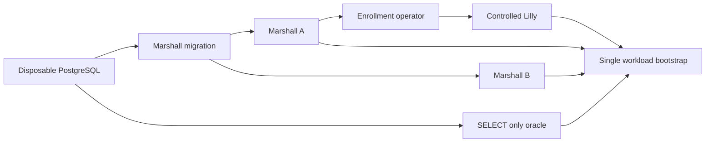

# Verification and reference

The multi-OS guest contract keeps native FreeBSD and OmniOS/illumos image
identities explicit while their capability rows fail closed. Their current
artifacts are agentless firmware images: Lilly omits vsock and native manifests
cannot declare a workspace source until a reviewed guest daemon and machine
evidence exist. Arch and AlmaLinux use the generic Linux runtime closure, with
offline evaluation assertions for the packaged Lyra, terminal, trust and SSH
services; those checks do not establish a native boot.

ADR-0179's managed-skill restoration coordinator is implemented in Marshall's
existing agent loop. It advances a bounded round-robin cursor across replacement
machine generations, suppresses duplicate active or terminal restoration
receipts, and emits catalogued failure outcomes before continuing the scan.
Focused authority and restoration scheduling cases pass; native guest restart,
physical reopen and independent-host recovery remain separate acceptance gaps.

The [browser launcher review](repo:docs/architecture/reviews/2026-10-10-browser-launcher.md)
records Weaver source comparison, current source2/manifest4 and authentication
resume evidence. The replacement minimized immutable browser package/check passed in 10 seconds,
including strict typing, all ten Node tests, deterministic archives, Mozilla lint
and real Chromium four-provider actions with query/hash sentinels removed and
unsupported-click refusal when its URL was initially withheld. A fresh pinned developer build matched archives and
manifest byte for byte. Pinned Firefox 155.0.1 temporarily installed the exact final
immutable XPI and passed settings, metadata and four actual toolbar actions on
fixed local TLS pages with query/hash sentinels and browser certificate bypass.
All launches contained only provider origin/path. ADR-0156 is implemented;
public provider network, permanent signing, Android and production activation
remain outside recorded acceptance. The final privacy correction removes source
query/fragment fields before extension transmission or capture storage/POST and
refuses URL user information. Four pure capture security tests and both source
and test strict TypeScript checks passed. The four regressions are now enforced
by `workspace.check`, whose final test/type invocation passed separately after the
full component gate.
The final check-only removal of an unnecessary HOME override passed a fresh
sandbox check in 9 seconds, preserving the same immutable release and archive
bytes. The exact release's five HTTP/host tests passed again, seed 735823,
including public metadata/byte equality and unsafe-file refusal. These checks
do not establish deployed public HTTPS.

The final focused Marshall source/snapshot/editor set passed 39 checks
(3 properties, 36 tests). Pinned protocol precommit passed 260 checks; the corrected
Lilly full gate passed 549 checks, seed 582375, after the readiness handoff fix.
Both forced Dialyzer runs reported zero errors. Observability precommit passed
11 checks and its current finite schema check passed without regeneration. Rust
passed 123 tests and all-target Clippy. These component results retain their
captured scope; final Marshall full validation is separately recorded.
Marshall full precommit passed 1,454 checks (239 properties, 1,215 tests), seed
80297, with four excluded; forced Dialyzer reported zero errors in 34.61 seconds.
Its verification-only capture-test gate addition was directly run and passed.
The later diagnostic-only ZFS refinement passed 21 focused checks (7 properties,
14 tests), seed 523473, then full Lilly 549 checks, seed 643895, and forced Dialyzer
with zero errors/skips in 13.12 seconds. Observability passed 11 tests, seed 765622,
forced Dialyzer with zero errors/skips in 5.74 seconds and its trace-schema check.
The new identity-bracket event preserves all storage guards and retry behavior;
its missing-path regression establishes fixed metadata/privacy and equal refusal,
not parent-accounting or native healthy-backing proof. Native event evidence must
identify the actual failed predicate before any causal conclusion.

The authorized merge combines prior main `f39d509a` with browser feature
`a3d2b69c`, retaining stopped-only relocation, personal bundled-editor updates and
the canonical shared observability formatter. The exact merged finite vocabulary
was regenerated to restore the diagnostic `pool_identity` atom. Focused merged
Lilly checks passed 34 checks (11 properties, 23 tests), its 104-event logging gate
and structural contracts; Observability passed its schema check and ten formatter/
shared-library tests, seed 957221. Marshall's 164-event logging gate and all
nineteen contract regression tests also passed. These are scoped integration
checks. Browser native captures below retain their immutable feature-source scope;
merged-main native and full component acceptance are separate.

The later guest-editor integration through `9e7f6bd3` regenerates the combined
trace vocabulary with `audi.http_proxy_failed`, closed proxy phases,
`response_state` and bounded `response_events`. The generated additions name
catalogued fields and finite atoms only; no URL, header value, raw error,
credential or terminal payload is admitted. This repairs generated-schema drift
without changing proxy transport or authority.

The earlier corrected Ubuntu native capture passed cross-tab sign-in/required MFA,
four exact initial GitHub checkouts and retained stop/start without re-clone.
Ten additional GitHub/GitLab/Codeberg revision cases passed before Codeberg change
stalled at clone status `cloning`; the run failed after 1,703 seconds. Bitbucket,
public downloads and CLI were not reached;
historical ADR-0128 GitHub results retain their old schema/revision. The corrected
runtime capture predates final frontend privacy and provider/ADR module-comment
corrections.
An exact dnsmasq 2.93/production-code musl probe isolated the fixture DNS failure:
A succeeded but AAAA returned REFUSED; authoritative local-domain configuration
returned an empty NOERROR AAAA answer and API resolution succeeded with the same
captured Ubuntu CA bundle plus a fresh fixture root. All four fixture domains now
answer locally, and fixed guest TLS/schema/fork diagnostics preserve private
terminal bytes. This focused repair is separate from complete guest acceptance.
The repaired NixOS family completed all twelve subtests, exit 0 in 1,352 seconds
(854.61-second test script): all twenty provider/revision combinations, exact
guest-owned HEAD/shallow/done assertions, installed-CA provider API probes,
cross-tab sign-in/required MFA, retained restart, public immutable HTTPS downloads
and packaged CLI/working directory passed. These are fixed local provider fixtures
on the colocated native fleet. The earlier frozen-source Ubuntu run passed browser
sign-in/MFA/dedupe in 23.04 seconds, then failed initial guest startup before any
checkout assertion, exit 1 after 266.734 seconds. Its exact failed predicate remains
unproven. The final complete feature `a3d2b69c` Ubuntu capture passed all twelve
subtests, exit 0 in 1,713 seconds total build/execution, script 1,422.20 seconds:
cross-tab resume/MFA/dedupe in 31.21 seconds, initial four actual checkouts in
22.10 seconds, retained restart in 47.85 seconds and sixteen additional matrix
cases in 964.11 seconds, twenty total. Installed-CA Codeberg/Bitbucket API/fork
assertions, public immutable downloads in 0.36 seconds and real packaged CLI/
command/workdir in 24.28 seconds passed. No identity-probe failure marker occurred;
no readiness or retry behavior changed. ADR-0157 is implemented. NixOS predates
the diagnostic-only addition; neither capture reran merged main. Its scoped
component/schema/contracts/logging checks and Nix HLDD gate passed separately,
the latter in seven seconds. Live
provider network, production activation, Brady interception and installed-extension
authentication/guest composition remain separate validation limits. Normal fragment
capture composed through the final frontend, while browser assertions of sentinel
removal and capture storage/POST contents remain separately unrecorded.
The source2-era NixOS handbook renderer passed all 22
sections, Ash/topology diagrams, navigation/hook removal, themes and revoked-reader
refusal in 388 seconds, before the final documentation and editor SQL corrections.
Editor DNS publication and its native fixture require the same manifest4 as the shared
decoder; exact editor release and current publication authority remain required.

[The browser editor review](repo:docs/architecture/reviews/2026-10-10-browser-editor.md)
records the official/OpenVSCode source comparison and retained historical failures
under [ADR-0153](repo:docs/architecture/decisions/0153-official-source-browser-editor.md).
The corrected startup-release snapshot passed complete NixOS and Ubuntu
Firecracker family scripts in 805 and 829 seconds total build/execution, including
current physical readiness, policy/controls, recovery and Origin/sign-out refusal.
The later final package `7fdh`/release `7d2415` passed complete standalone native
acceptance in 342 seconds, driver 323.30 seconds, including personal install/
reversion, core/System refusal, actual Rust/Elixir and broker/worker recovery.
Its authorizer and TLS relay are fixture adapters. Family results retain earlier
release `73ad` and their pre-template snapshot; final-release family and this
browser-launcher merge's native integration are separately unrecorded. The
`63a1443c`/release `73ad` host activation establishes installed identity rather
than a production browser journey. Periodic template sweeps, production editor
acceptance and recurring browser history remain separate.
Synthetic package bridge/roster evidence cannot be promoted to full service
authentication or guest isolation. Native veth packet-mark acceptance retains its
Linux network scope. Recurring probe declaration does not prove production
credentials, completed browser journeys or seven-day history.

## Evidence levels

| Evidence | Establishes | Does not establish |
| --- | --- | --- |
| Accepted ADR | Intended architecture and rationale | Implementation or deployment |
| Unit/property tests | Tested invariants over their fixture/model scope | Native isolation or provider acceptance |
| Nix evaluation/build | Configuration validity and build reproducibility | Running-service readiness |
| Native machine tests | The specific exercised kernel, storage and network scenarios | Independent physical failure domains or fleet capacity |
| Deployment acceptance | Observed behavior of an identified deployed revision | Untested recovery, load or future revisions |

Consult current ADRs and their linked reviews for feature-specific acceptance.
Several decisions remain partial. Known boundaries include historical database
reconciliation, pre-existing guest image migrations, provider-specific behavior,
physical failure domains, and unmeasured scale. A newer test count is not a broader
guarantee. This handbook's own checks validate documentation and presentation.

The [user-operation verification campaign](repo:docs/history/ledgers/verification-campaign.md)
tracks incremental property and native machine improvements, missing capabilities,
and external acceptance boundaries. Queue entries are planned work; only explicit
execution records establish passing evidence for their named revision and scope.

### Antithesis harness retirement

The [2026-10-13 reset review](repo:docs/architecture/reviews/2026-10-13-antithesis-reset.md)
records removal of the old `antithesis/` tree before a fresh whole-repository
rebuild. Historical harness, research and local mutation artifacts remain linked
at the full captured baseline revision. Their recorded execution and limits are
preserved; they are not current setup instructions or fresh hosted acceptance.
Lilly's existing generated actor and fake-command properties retain their test
paths and assertion names, using an ordinary test-support fixture. The scenario
ledger therefore retains its bounded property evidence and native gaps.
Fresh research, setup, workload execution, hosted baselines and mutation results
must acquire their own source/build identities and execution records. Emulated
guest journeys, hosted user-space services and native Firecracker/ZFS checks
retain separate verification scopes.

The [native prerequisite review](repo:docs/architecture/reviews/2026-10-13-antithesis-prerequisites.md)
records passing source-built Galileo and Enrico release payload checks and a
separate disposable NixOS ZFS I/O run after its failed probe attempt. It also
records two failed expanded service-role attempts: the first at the cookie
pipeline, the retry after Marshall cookie checks when Lilly startup failed and
its owner file did not appear. The runtime-secret fixture has no passing
role-machine capture. The updater replay assertion and five-second ingress catalog decoder
boundary are source/test changes without new execution evidence in this review.
These are prerequisite checks, not a current hosted harness or guest lifecycle
acceptance. The ledger binds passing and failed attempts to their exact
derivations and source hashes.

### Experimental Antithesis foundation

The [foundation review](repo:docs/architecture/reviews/2026-10-13-antithesis-harness-foundation.md)
describes an isolated control fixture. The graph below is its proposed Compose
layout, not the deployed fleet or evidence that all containers have started.
The hosted campaign admits up to 32 active attempts so every selected Compose profile and its replicas can run concurrently; this operational limit does not establish a production deployment or a passing property result.



Runtime secrets stay in private fixture volumes; only the operator enrolls
Lilly through Marshall's reviewed CLI. Bootstrap checks both TLS endpoints,
migration and a fresh authenticated host report before one setup signal.
The SQL witness requires a positive report sequence, a report timestamp within
60 seconds and a durable session matching the host's current session ID, host
ID and epoch. It does not read the retired host `protocol_version` column or
infer a wire version from SQL. Production Execution and the real Control
probes enforce wire v4 separately. Historical local boot captures predate this
current-schema witness; local readiness alone does not establish hosted SDK
ingestion or native effects.
The optional `repository-origin` profile adds a second gate before the same
single setup signal: the operator-issued repository manifest must match the
independent fixture ID, the origin fixture must answer an authenticated state
read, the SELECT-only oracle must find the registration row and a
`pending`/`refreshing`/`ready` phase, and Enrico must answer an authenticated
status read for a never-issued attempt. Marshall commits GitHub sources in
canonical lowercase, so the operator publishes `github/fixture/demo` exactly as
registered and the origin fixture serves that path; an earlier mixed-case
manifest and served path never matched the committed row, and Marshall's own
refresh failed against the origin, so setup stayed incomplete. The probe now
reports each distinct unmet prerequisite once per process by condition token,
observation state, HTTP status or phase, never by credential or payload.
The failed-refresh published-head case was never exercised in hosted runs:
the workload image linked Git into its closure but not onto a fixed path, so
the native blob oracle could not run Git and every attempt stopped before the
force push (run `30a420d501d5d6d22527e679a7f00005-65-0`). The image now links
`/opt/overalls/git`, the oracle calls it explicitly, and each early stop logs a
fixed `Enrico published-head case unexercised` reason.
The 1,025-attempt receipt-cap campaign ran but stopped silently in hosted run
`56a1285564c94413812835f74246cf04-65-0`: it abandoned the campaign on the first
failed fetch, although Enrico retains failed and succeeded receipts alike under
the same cap. It now counts any settled attempt and logs a fixed
`Enrico receipt-cap campaign unexercised` reason at every early stop. Run
`3f76c3f47ad4062ba0d1c37896e5f3e9-65-0` measured about 5.7 s per attempt on its
cleanest timeline, which suggested the campaign could not finish, yet the next
run (`ddd07ab2f16fe84d9cf3020e10a648ce-65-0`) completed it once and hit every
cap assertion (oldest receipt evicted, newest replayable, no second fetch);
Enrico's unit and property tests remain the primary cap evidence. The 3f76c3f4 run produced one
counterexample to the ninth-refresh refusal: a held fetch hit Enrico's 10 s
read timeout under a slowed network, freeing a slot that the ninth refresh then
legitimately took, while a holder snapshot scanned before that change still
matched. The ninth verdict now requires a snapshot whose scan started after the
ninth submission, and the observer stamps each snapshot before it scans.
The optional `recorder-host` profile selects the TCG NixOS recorder VM and the
three recorder commands. The workload waits for the VM health check, then its
own read-only probe requires a fresh all-active unit sample, producer and spool
identities in their reviewed cgroups, a distinct 32–64 MiB archive device, a
checkpoint whose pending admissions name only the current producer PID and
start ticks, a readable SQLite archive and writable request and ledger volumes.
Missing or stale evidence leaves setup incomplete. Its first hosted validation
stopped in initrd emergency mode: the runner's `root=` argument duplicated the
image's own root fstab entry and, without `rw`, left the real root read-only,
so the `/run` bind into it failed. The runner now relies on the image fstab
alone; a direct local QEMU TCG boot of the rebuilt context, outside any
container, reached the runner's health check in 66–96 s. Its first hosted run
(`bbb308949ab76c0f1ce04fd209f1f091-65-0`) failed container setup because the
Antithesis container filesystem refuses O_DIRECT, which QEMU `cache=none`
needs to open the qcow2 backing image. The recorder, host and storage VMM
runners now probe O_DIRECT on every disk and its backing image and fall back to
flush-respecting `cache=writeback` (never `cache=unsafe`), printing the
effective mode. Hosted run `109aecb1aca881ff09e15403e72802cb-65-0` completed
setup but reached no trace spool custody: the guest fixture paths were
context-free strings, so the trace fixtures were absent and the BEAM producer
crashed on every trace request; back-to-back recovery restarts also tripped
systemd's default start limit, and the pressure loop outran the command window.
The fixture paths now carry store context, the producer refuses a failed
request instead of exiting, the two restarted units have no start limit in this
fixture only, and the pressure loop has a 20 s budget. The next run
(`acfe129cf2288d30a7972edcbf9b92cf-65-0`) reached spool custody, recovery and
real ENOSPC on the dedicated archive, but the one write attempted under ENOSPC
committed into already allocated SQLite pages, so no refusal followed; the
command now keeps writing, up to 32 batches, until the exhausted backing
refuses. Archive quota refusal stays out of reach inside the 20 s loop. Run
`10d727fc7a050a9695a0b16e87a47db9-65-0` reached that refusal and the reopen path
and reported two oracle races, not recorder defects: the fresh batch after a
spool restart was sent before the reopened spool had bound ingest (systemd
reports the restart at exec), and the request SDK heartbeat had already
recovered its fsynced `v1:gap` marker to `v1:running` when the saturation
check read it. The reopen check now retries a transport-unavailable reply,
and the saturation check accepts `v1:running` only with the checkpoint's
advanced coverage start as the durable gap. Both acknowledged-custody
checks held throughout. Run `d03118781050d16ad698713ce9fb4d61-65-0` reached
real ENOSPC 25 times and its refusal 18 times without a counterexample, but the
20 s organic loop never filled the 57 MB archive, so its exhausted-backing,
storage-refusal and saturation checks were never evaluated. The ENOSPC path now
evaluates those same checks against its confirmed zero-free backing and
refused write. Run `eb926cce7fee3dfcad1d6d8172b28d29-65-0` then passed 65 of
67 properties; only quota refusal and the hint-loss anchor stayed unreached.
The 60 MiB archive quota exceeds the 57 MB archive device, so ENOSPC always
comes first, and pending custody never drains in this fixture, so the 32 MiB
pending quota needs far more intake than a timeline sends. Each traces command
now ends with a bounded window in which the bridge restarts the real spool on a
fixed configuration whose only change is the minimum pending quota (one body
limit), sends large batches until the production admission check refuses with
`429`, checks that the refusal kept accepted bytes, and restores the default
quota before returning. It proves the pending-quota refusal path, not the
production quota values or the archive-quota branch. The hint-loss anchor
cannot fire under hosted faults: Oban reports `:isolated` only after 120 s with
no notifier ping, beyond any recorded timeline. Its evidence is emulated, not
native.
The 60-minute run `c5b8084588217cfe23b52086caf9e624-65-0` exposed two harness
defects. QEMU's default 1 GiB TCG translation cache plus the 1536 MiB guest
exceeded the VM container's 3 GiB limit under archive pressure; the cgroup
killed QEMU (exit 137), and later traces commands failed their readiness
prerequisite. The recorder VM now caps the cache at 256 MiB. The one-new-batch
checks also compared an acknowledged batch with the bridge's archive copy,
which republishes about every 0.2 s; they now wait up to 5 s for that copy, and
a lost-reply batch no longer re-synchronizes the next check. No product
behavior changed.
Run `f12e00a27739e7abddf565ca2975e449-65-0` confirmed the VM stayed alive but
still failed the one-new-batch checks: each traces command derived producer
sequences from its attempt count plus fixed offsets up to 340, so successive
commands reused sequences, and the spool correctly stored an identical body
once. Each command now reserves a disjoint 400-sequence block from the
workload ledger.
The 60-minute repository-origin run `87b10ca4372b6665c886027b4fd22872-65-0`
recorded one unexpected Enrico container exit: the restart case relaunched the
release during a network partition, it exited before readiness, and the
container supervisor ended the container. Production's unit restarts Enrico
after 5 s and allows a 90 s stop, so the supervisor now mirrors both while the
restart result stays uncertain.
The sequence space is finite: the modulo allocator reuses a 400-value block
after 2,499 reservations. The added unit test checks only the first three
reservations across new client instances; it does not establish uniqueness
across wraparound.
The optional `admission-stub` profile runs the atomic-allocation and key-replay
admission commands on a harness **stub** storage substrate, which is not ZFS.
Only in that profile does the controlled Lilly release report configured stub
pool totals for its enrolled pool identity, measured cgroup memory headroom, a
labelled STUB CPU budget of one core capped by the measured cgroup cores, and a tiny non-bootable image it digest-verifies before advertising;
its manifest declares Git identity version 1 as a labelled STUB because
ADR-0198 admission refuses images without it (run
`219976fe92d70537b4a0e8cca1fa6be3-65-0` refused every admission); the image never
boots, so this is not guest identity evidence;
the enrollment operator registers that image through Marshall's catalog action
and then enables lilly-a through the reviewed CLI `enable` action, which
refuses until Lilly's stub report is fresh and execution-ready. A fully stub-backed report advertises placement readiness, so Marshall's real
admission transaction commits VM, placement, reservation and dispatch rows,
but the controlled executor never launches a guest. A delete settles only
through a labelled **STUB** enabled by this profile's explicit opt-in: the
controlled executor reports the deleted facts for a placement only after
observing a controlled pool, a journal that never recorded it running, only
publication records for it and no native execution state, and writes an
absence attestation; Marshall's real outcome, release and archive path then
runs. Run `a8c0a8e424bc48eb017aa2322795fc68-65-0` left archived-key replay
unreached and later admissions short of vCPU because no delete settled. This
is never cleanup or physical-absence evidence for anything that existed. Setup requires the enabled normal-mode host and those committed report, pool
and image rows in SQL; hosted runs before this check never enabled the host,
so every admission probe stopped at unknown capacity
(`dd4f5f9cd52da22427ae2e5b79c095bf-65-0`). With the host enabled, the next run
still submitted nothing: the pre-submission SQL witness read host and pool from
the VM row, which the placement migration had moved to
`compute_workload_placements`, so every query failed and was reported as
unavailable (`379970e17a2d5312bff3e5c5e2c17369-65-0`). The witness now joins the
current placement, and oracle queries log each failing SQLSTATE class once.
The following run (`642e01a83533ba33f07ba9e3eb4b17fd-65-0`) settled hundreds of
decisions, all refusals, so the acceptance-path assertions held only vacuously;
the refusal reason was invisible because the operator discards evaluation
output. The workload now logs Marshall's closed refusal token once per process,
and the operator names the operation whose result became uncertain. CPU and
memory headroom here are measured over the whole Antithesis VM, so a refusal
for capacity is Marshall's correct decision on a busy host, not a defect.
Catalog headroom below the request shape no longer withholds a request: a
definite `insufficient_capacity` refusal is Marshall's real decision, checked
for absent rows and a bounded one-VM replay. Every stop before a settled
decision logs a fixed `Compute admission unexercised` reason; the first hosted
run reached no admission assertion because those lines were never emitted.
Run `6890e1608b75e9b82fe11382bb4aeefc-65-0` still refused every request for
vCPU: the hosted VM has one logical CPU, so the measured headroom never frees a
whole core, hence the stub CPU budget above. The next run
(`74188918d21886495a53d124a725c7e5-65-0`) admitted requests and failed the
joined-allocation check once in 267 examples: a partition held a provision
operation pending across a minute tick, and AshOban's dispatch scheduler
correctly enqueued a repeat hint, so the oracle counted two dispatch jobs. The
oracle now requires at least one dispatch job; placement, reservation, address
and provision-operation counts remain exact.
The results are admission-logic evidence only, never ZFS, physical-capacity,
KVM or isolation evidence; the measured-capacity command stays in a separate,
unselected template for the measured host graph.
The optional `guest-lifecycle` profile selects the guest lifecycle command with
the guest VMM overlay. Its container Lilly is a separate STUB-storage release:
it reports a fixed synthetic pool with no ZFS and compute headroom for one free
guest-vmm slot, capped by measured cgroup limits, and sets execution readiness
only after a guest-vmm health check and a verified advertised image. The
enrollment operator registers that image manifest through the catalog action
and enables lilly-a through the reviewed CLI `enable` action once its report is
fresh and execution-ready; Marshall's catalog counts no capacity from a disabled
host. Bootstrap adds a third gate: the guest-vmm image identity, read through the
read-only witness bridge, and a Marshall catalog offering that image with known
capacity for its shape. The stub admits one emulated QEMU TCG guest only; it is
not native ZFS, KVM, Firecracker, isolation or capacity evidence. Its first
hosted run (`a2edc265384761d6607df51eac50b29d-65-0`) timed out at
`capacity_unknown` because the host was never enabled; the earlier local pass
had inherited an enabled host from a retained PostgreSQL volume, so local
validations now start from empty volumes. With the host enabled, run
`91c9dfa850d2435808323d8910182d7a-65-0` still admitted no guest: the stub slot
reported exactly the 2 GiB guest memory, while admission reserves guest memory
plus the fixed 64 MiB VMM overhead, so Marshall correctly refused every
provision for insufficient capacity. The slot now reports guest memory plus
that overhead, and the workload capacity gate requires the same sum. Run
`655477db4745f0857c2c0ffcd8571d7a-65-0` then booted real QEMU guests to port 1024
readiness, but no stop ever completed: the guest VMM inventory dropped the
execution epoch and generation once a placement stopped, while the fixture
executor binds a stop to that exact boot, so every stop was deferred until the
driver gave up and later cycles found the slot held. The inventory now reports
the stopped boot tuple from its stop record, and the driver submits a final
stop on every exit after admission. Run `23988c965cff394cc43e5a8553dc12b0-65-0`
logged per-dimension gap reasons: most cycles stopped at
`compute_catalog_unavailable` because each operator request boots a fresh
Marshall BEAM whose cold TLS pool missed the production 3 s handshake under
injected latency, so the evaluation crashed before reaching Compute; a lost
final stop then left the single slot occupied (`capacity_insufficient_vcpu`).
Operator request evaluations now use a harness-only small pool with longer
connect, handshake and queue budgets, reads and `request_key`-idempotent
provision and lifecycle evaluations retry a crashed attempt, the final stop is
resubmitted with one request key, and the driver waits up to 120 s for a reply.
Production Repo settings and the long-lived Marshall nodes are unchanged.
Run `a574538c77694308d6133a2f478b71d2-65-0` then completed 54 verified boots
and about 69 product stops, yet observed no stop: the stopped guest record keeps
the retained boot's generation while the stop operation carries Marshall's
bumped generation, and the driver asked the exactly fenced witness for the
latter. Most other cycles read the catalog once while the last accepted Lilly
report was older than Marshall's 5 s capacity freshness window under injected
Control faults (`capacity_unknown`). The driver now requests the stopped witness
with the provision's tuple, polls the catalog for up to 90 s before
provisioning, and retries an `insufficient_capacity` refusal once after a fresh
wait, logging only the closed refusal token. Marshall's freshness decision is
unchanged.
Run `c011420b1c74f586054654f8d1023683-65-0` showed the operator's witness
fence still required the stop's bumped generation while the guest server keeps
the retained boot's: a `guest.witness` read of a VM desired and observed
stopped now accepts the newest completed provision/start tuple on its
placement. Operator `image_unavailable` refusals (a stale host image report
between catalog and provision) are retried like `insufficient_capacity`, each
catalog read is bounded to 30 s within a 180 s window, and an expired sample
logs its last unmet step.
Run `766b5d3778010731ec34ab191bf48f7c-65-0` reached consistent completed
provisions, yet reported the outcome/VM consistency property as never hit: the
driver evaluated it only when a contradiction occurred. It now evaluates that
assertion for every completed outcome it samples, and resubmits a stop or start
whose reply was lost with the same deduplicated request key up to three times
instead of abandoning the cycle after one lost reply.
In every other profile the host report has unavailable pool capacity and false
execution readiness, so a successful Control connection cannot authorize a
guest placement. The
controlled executor records requests without claiming physical effects; its
default guest callbacks remain unavailable. An optional integrated TCG adapter
is authored with a measured inner ZFS host and emulated guest observation, but
has no recorded composed journey. Its recovery inventory permits only the
fixed `lilly.service` and `lilly-guest-emulator.service` cgroups plus exact
tracked VM units when systemd creates them; unknown or malformed native
inventory fences recovery, while the emulator inventory independently checks
tracked placements. The optional TCG guest context
has a [recorded local boot](repo:antithesis/verification/guest-boot.md): exact
port 1024 readiness on three q35-adapted NixOS guest boots, with one restart
on a retained qcow2 overlay and matching offline machine-id bytes. The
storage-router VM separately passed a
[local direct-run smoke](repo:antithesis/verification/storage-boot.md) with
real ZFS/Brady, origin-off cache replay and retained marker/quota across QMP
reset. The four selected control-context exports
passed at their captured derivations. A later local base Compose project also
emitted setup and passed six serial Control commands; the selected manifest
has four stale runtime-dependency hashes, so no frozen hosted baseline follows.

The static researched catalog contains 104 primary properties. The current
literal scanner finds 164 SDK callsites, 30 matching primary messages and 74
missing primaries, with no duplicate callsite or kind mismatch; none
of the 104 properties is complete as a workload plus independent oracle and
hosted result. The default `control-core` selection now stages 13 commands in
seven templates, six of them one-command terminal singletons: credential
revalidation, dispatch, legacy request, SQL reply loss, host-session successor
and host rotation. Its cross-service dispatch primary binds only a Lilly socket
and counts foreign effect tables; its legacy-document primary observes
Marshall's durable host session, not Lilly's Store or Journal; its 4001
refusal primary drives the shared client against a loopback peer for a bounded
quiet window. None has a hosted run. Local SDK writer probes and unit tests show bounded JSONL
behavior, including short-write refusal across helper restart, but they do not
prove hosted ingestion. BEAM fallback assertions provide no BEAM branch
coverage. The harness-only Marshall hint relay `Reachable` marks an observed
notifier recovery from `:isolated`; it is a search anchor, not evidence that a
lost hint was reconciled or a committed host command progressed. Python catalog scanning provides no source coverage; the C helper is
assertion transport, not SUT instrumentation. The workload image presents the
selection-scoped Python catalog as one `/opt/antithesis/catalog` link to a
single `workload` module tree, so the hosted instrumentor catalogs one root and
every workload process registers every selected assertion; a selected
assertion no command reaches then appears as a zero-example property. A run
whose "Paths found for Antithesis instrumentation" lists more than one Python
path has split the catalog per package: the Python SDK registers one root's
catalog per process, and unreached assertions in the other packages are
absent from the report rather than passing (admission-stub run
`8e582f650dd7092cda983705eb7b0e05-65-0`). Native Rust coverage remains
pending. A local control-core setup completed on diagnostic4 image bytes, but
the selected manifest's four stale dependency hashes prevent a frozen local
or remote baseline claim for that image.

Optional Compose overlays declare separate origin/SMTP fixtures, satellite
roles, a guest VMM, a measured Lilly/ZFS TCG host and a recorder host. Closed
operator requests and witness paths are source-defined; the workload has
authored browser, Control peer, admission, terminal and recovery callsites.
Their presence does not establish that selected images, migration, credentials,
health, independent oracles and one setup owner ran together. The local guest
and router TCG records each have their own artifact identity and never count as
the default control graph's hosted baseline.

| Profile | Overlays after the base | Selected commands | Setup gate beyond the base | Reachable claim |
| --- | --- | --- | --- | --- |
| `backup-restic` | `compose.backup.yaml` | five `backup` commands | production backup operator and pinned Restic present; private fixture volume; a probe Restic file repository initializes and enumerates empty | production prune, inspect, backup and restore against disposable encrypted file repositories, checked by raw Restic and restored hashes; no ZFS capture, S3 or recovery target |
| `satellite-standin` | `compose.origin.yaml`, `compose.satellites.yaml`, `compose.satellite-standin.yaml` | four `satellite` commands | origin fixture state; private-Audi root; guest stand-in receipt of a verified TLS handshake to private Audi | private Audi forwards nothing for a forged request from a source Lilly never bound; VM-dependent commands record unexercised |

The `backup-restic` repository uses Restic's local file backend because the
production operator reports one failure status for an unavailable repository
and for a validator refusal; a network backend would let a fault read as a
refusal. Antithesis does not step the wall clock backward in these runs, so
coordinator publication compatibility uses a labelled **STUB (harness)** for a
small SDK-chosen fraction of cases: the workload preloads the image's pinned
libfaketime into that one coordinator process, and a fixed Restic wrapper steps
its wall clock back 120 seconds when the host-state upload begins, after the
journal recorded `started_at`. Restic, raw oracle reads and the production
modules are unchanged, and every existing `always` check still applies. Hosted
run `6993853fa020fd46ed8e13c6c123ac86-65-0` confirmed the defect the stub
targets: the coordinator recorded `completed_at` before `started_at`, published
a tag-visible manifest and then failed its own retention validator. The
coordinator now publishes `completed_at` no earlier than `started_at`, and the
`backup-operators` evaluation check reproduces the step with a shim-triggered
clock offset and requires a retention-valid, inspectable point. The stub is not evidence of
real kernel or host clock steps, NTP behaviour or production hosts. The `satellite-standin` **guest stand-in** is a labelled harness process
from the workload image that shares only `lilly-a`'s network namespace and
speaks the guest-side TLS protocol to `169.254.254.1`. It is not a guest: it has
no VM, boot, tap, placement or execution authority and mounts no secret. Its
assertions test only private Audi's transport-only attribution with the origin
fixture as effect witness; they say nothing about guest routing or isolation.
The overlay also corrects the private Audi start script, which omitted the
required `connector_uid` and so could not load its configuration, and waited
on the disabled ordinary `audi.sock` instead of Lilly's private-services
`private.sock`. Porsche refuses to listen without a Marshall-signed host
certificate, which Lyra fetches in production; the stand-in start script makes
the same reviewed `/api/ssh/v1/host-certificate` request with the gateway token
held in a private header file. The harness Marshall had no SSH host CA, so that
request returned the opaque unavailable reply; the synthetic secret volume now
carries a generated ed25519 SSH host CA, and both replicas receive
`MARSHALL_SSH_HOST_TRUST` shaped like the NixOS module's. It is test-only key
material, never a production CA. Ziggy
completion, Galileo named origin and the editor login-code race need a current
running VM; the controlled Lilly pool reports unavailable capacity and no Audi
editor gateway, editor release or wildcard is configured, so their primary and
`Sometimes` assertions stay unevaluated; the first hosted run
(`e6bff5d6e4b57e6bb43c7a018384750d-65-0`) confirmed this, and each stop now logs a
fixed `Satellite VM placement unexercised` reason. That run also listed twelve
access assertions as never hit because the satellite drivers imported the
fixture login from the access browser module; the login now lives in the
assertion-free `access/session.py`, so only selected callsites enter the
roster. Ziggy and Galileo issue and
authenticate credentials only for an enabled host, and Marshall's reviewed
enable action requires a fresh execution-ready report that the controlled
`lilly-a` never sends, so satellite enrollment applies a labelled harness
**STUB**: it sets only `lilly-a`'s administrative `enabled` flag through the
Host `:configure` action and verifies it with the operator `show` command. The
stub fabricates no readiness, capacity, pool credit or VM binding, so Marshall
admission still refuses the host; it is not evidence for the readiness gate on
host enablement. A failed satellite operator command reports only the CLI's
fixed atom status line. Both profiles have rendered Compose
graphs that pass the selection validators and unit tests; neither has a local
`compose up` or hosted run.
The [integrated-host record](repo:antithesis/verification/integrated-host-boot.json)
captures two unavailable-health TCG boots and one corrected third-image boot
with actual ZFS and cgroup sampling. A fourth built private-service image
repeated the measurements, completed runtime PKI preparation and produced a
workspace-source-v2 guest image witness. Both measured samples remain
disconnected and execution-unready. A private 9p witness identified the first three images;
focused crash-actuator tests passed nine checks without a QEMU crash. A
boot-bound guest-trust receipt adapter passed twelve tests and forced Dialyzer,
but the full integrated-mode suite failed at 7/559 and private service roles
have no runtime credential or terminal acceptance.
The earlier local base Compose diagnostic passed migration, Marshall A/B, enrollment,
three synthetic account/passkey creations and Lilly health. Read-only SQL
confirmed exactly three users and three account passkeys; the enrollment
operator had no listening socket. The v4 host was connected, but
`report_sequence` was 0 and `reported_at` absent, so setup did not fire in that
project. Diagnostic4 subsequently logged `INFO Antithesis setup complete` after
a fresh v4 report at sequence 44. Six serial commands produced 13 true SDK
assertion records and the final SQL observation found fresh sequence 392;
the [foundation review](repo:docs/architecture/reviews/2026-10-13-antithesis-harness-foundation.md)
records local image IDs and the stale selected-manifest hashes. The controlled
container committed cgroup-derived effective fields while preserving nil pool
capacity and false execution readiness. Raw cgroup files were not independently
compared, and hosted ingestion remains unverified.

The `database-recovery` machine check uses the real release Repo on a separate
machine from PostgreSQL. It requires three observed lock waiters before client
loss, then checks the existing holder and connection reclamation deadlines.
The old settings and a polling-only candidate both missed the 35-second bound.
A captured candidate with one-second active disconnect polling and a 15-second
TCP acknowledgement limit reclaimed all ten connections in 27.719 seconds; its
healthy 20-second query also passed. Its exact captured-source scope and inspected
executable equivalence are retained. Both complete integrated NixOS and Ubuntu
terminal journeys separately passed browser recovery, retained shell effects,
sharing and revocation; their VM-script timers were 702.42 and 683.84 seconds.
Neither result establishes physical/provider recovery or production load. See the
[execution scope](repo:docs/architecture/reviews/2026-09-25-terminal-workspace-verification.md).

The `log-store` machine check exercises classified journald export through
verified TLS and path-scoped credentials, plus Grafana's provisioned read-only
VictoriaLogs datasource. The retired Marshall `/admin/logs`, `/admin/slos` and
fleet history routes return 404. Their pre-cutover browser/client evidence remains
historical; it does not establish current Grafana acceptance. The
[observability decoupling review](repo:docs/architecture/reviews/2026-10-09-observability-decoupling.md)
records native provisioning/query execution and remaining deployment gaps.

Provisioning benchmarks read bounded catalogued host-local transition events over
strict authenticated administrative SSH. Template cost requires one staging and
one ready event for the same host, pool and native record, with ordered timestamps.
Missing, duplicate or mismatched evidence refuses a warm sample. Diagnostic phase
files explicitly report incomplete coverage and never authorize VM cleanup.

## Developer verification

GitHub Actions runs on privileged, cached Namespace runners so Nix builds keep
their sandbox. Every job installs multi-user Nix, starts `nix-daemon` so builds
run as `nixbld` build users as on the fleet, installs the devenv revision pinned
by `devenv.lock`, and publishes what it builds to the `overalls` Cachix cache.
`publish-cache.yml` runs on trunk pushes and pull requests: repository gates,
`mix precommit` for each Elixir project, and every enabled non-machine flake
check. `nixos-machine-tests.yml` runs daily or on dispatch and fans out one job
per NixOS machine test selected from `meta.ci` (Inception is excluded); its
discovery evaluates only that metadata, and each matrix job builds its test.
`nix-upgrades.yml` updates `devenv.lock` weekly and pins the flake's
`buildNixpkgs` to the same nixpkgs. Two further weekly jobs apply security
updates only. `mix-security-upgrades.yml` runs `mix hex.audit` (Hex 2.5.3 or
newer) in every project with a `mix.lock` and updates packages with a security
advisory or security retirement; `cargo-security-upgrades.yml` runs
`cargo audit` against every tracked `Cargo.lock` and updates vulnerable crates
with `cargo update --package NAME@VERSION`. Both resolve affected builds through
the flake's `lib.dependencyPins` registry, which lists each entry's lock files,
the derivation that must build and its fixed-output fetches. Changed entries get
their `dependency-hashes.json` keys faked, rebuilt and filled from the reported
mismatch by drvPath, then must build before the commit is pushed to trunk. Mix
libraries without an entry compile with warnings as errors; a tracked
`Cargo.lock` without an entry stops the Cargo job. A finding with no allowed
fixed version fails the run after fixable updates are pushed. Bot-refreshed
hashes are authenticated by that build, not by human source review, and the
builds use the build nixpkgs rather than every consumer's package set. A run is
execution evidence only for the commit it ran; a selected matrix entry is not a
passing result, and nested-KVM availability on the hosted runners is unverified.

`elixir/request_accounting/` is the shared typed request-accounting library.
`Overalls.RequestAccounting.Producer` performs private quality-marker and local
Unix RPC I/O for durable admission custody. `Aggregate` provides the immutable
counter/histogram model and validates snapshot construction; each application
retains eligibility, classification, concurrency, persistence and publication.
`Config.from_environment/2` and `Producer.children/2` take an optional
environment suffix matching `(_[A-Z0-9]+)*`, so one unit can host independent
recorders; Marshall's `marshall_live` source reads only the `_MARSHALL_LIVE`
socket and marker variables
([ADR-0258](repo:docs/architecture/decisions/0258-marshall-page-service-levels.md)).
The library remains independent of best-effort diagnostics. Protocol measurement
types and codecs remain pure; ADR-0142 confines outbound control WebSocket I/O
to `Control.Client` and `WebSocket.Connection`, with application-owned credentials
and trust. Protocol stores no durable credentials or domain authority.
An unsupported control version is terminal for that client instance: pending
requests settle as unproven, further requests remain disconnected, and recovery
requires a replacement client after the incompatible version is corrected.
The original client's delayed reconnect was reproduced after60.3seconds. The
stopped-phase repair passed the five-check client file in167.3seconds before
the queued-connect and HTTP426 extension. The expanded six-check client
file subsequently passed in288.0seconds. Its generated loopback history
retains a61000ms observation and does not prove arbitrary future absence or
native fleet rollout. The refined queued-connect wire oracle subsequently
passed the six-check file in318.9seconds and caught the targeted retry mutant.
The heartbeat ownership review reproduced early replacement-socket traffic in
10.4seconds. The timer-reference repair passed its focused reconnect property
in47.8seconds before integration. Retired-reference redelivery passed the
integrated property in45.9seconds and caught a ref-matching mutant in6.2seconds.
Protocol249, Lilly503, Marshall1466 and Galileo31-check gates passed with
zero-error forced Dialyzer; the Protocol gate predates the extended test and
is reused only for unchanged production source. Incoming-main integration,
verified TLS reconnect histories and native fleet acceptance remain open.
The loopback test's100ms transit allowance is not a production latency guarantee.
Marshall, Audi, Brady, Porsche, Galileo and Enrico package the explicit
local library inputs. Run its pinned `mix precommit` and each changed consumer's
gate. The native `otel-request-recorder` fixture separately exercises the actual
BEAM producer and Rust recorder; unit/type checks do not establish application
transport acceptance or production history.

```sh
devenv shell
elixir scripts/check_adrs.exs
elixir scripts/check_hldd.exs
elixir scripts/hldd_options.exs --check
cd marshall
mix precommit
```

Run the corresponding application gates for changed consumers and the protocol
library. Shared governance changes also run Marshall's validator tests. Select
native checks from the maintained test catalog; do not run destructive harnesses
against production resources.

Run `mix precommit` in the independent `elixir/diagnostics/` project when reviewed
event catalogs, runtime instrumentation or the SDK change. Its read-only
`mix schema.check` compares production literals with the generated finite trace
vocabulary without starting services or rewriting files. Review vocabulary
changes before regeneration; a synchronized artifact alone does not establish
delivery to the native spool or Tempo.
Schema generation orders object keys explicitly. A fresh-VM regression verifies
that opposing atom-loading orders produce the same reviewed artifact, so the
gate can distinguish source drift from serialization order.

The opt-in [HTTPS egress acceptance](repo:docs/acceptance/egress-acceptance.md) uses three
receipt-bound disposable guests on Overalls and records private command, request
and updater evidence. Its pinned public destination has a positive reachability
control before Customer refusal. Seven runner safety tests cover ownership,
replay, failed responses, approval redaction and local SSH/proxy timeout cleanup;
they cannot establish native isolation. A local timeout does not cancel admitted
VM work: reconcile the original request.
Customer refusal requires connection failure or timeout against the independently
reachable pinned public address; TLS handshake or receive errors fail the probe.
The `brady-network` and
`brady-native-storage` machine checks keep shared-service outages and pressure
faults isolated, including HTTPS full/range recovery with the origin stopped.

### Committed database fixtures

Tests using independent Marshall nodes commit real fixture rows. Public VM
provisioning also creates agent roots, initial threads and audit versions. Raw
job deletion retains redacted job history, and lifecycle records intentionally
outlive their resources. Disposable fixture teardown captures its own VM, root,
thread and job IDs and deletes dependent history in foreign-key order after all
callers finish or stop. Shared image ownership is captured before creation; prior
unreferenced catalog rows and versions survive. Serial job cleanup captures exact
new IDs and preserves completed jobs of the same worker. Catalog registration,
credential and team retirement fixtures dispose their worker jobs by the same
exact returned IDs, and each distributed authority test asserts the complete
public-table inventory around its own execution. Production archival and retained history are unchanged.

Generated cleanup histories compare complete public-table row digests before and
after both successful and deliberately failed assertions, while preserving an
unrelated fixture's automatic histories and unused image catalog entries.
Failures report changed tables and row hashes without payloads. If teardown also
fails, the original
failure remains reported. Historical rows in older verification partitions and
baseline reproduction rows remain available; a clean fixture restores the prior
inventory rather than assuming the database began empty. The
[fixture review](repo:docs/architecture/reviews/2026-09-26-committed-fixture-history.md)
records exact execution and remaining scope; the
[authority fixture review](repo:docs/architecture/reviews/2026-09-26-authority-fixture-history.md)
reproduces and repairs the retained catalog/retirement job histories. This is
test database hygiene, with
no new native isolation or user-scenario acceptance claim.

### Browser helper type gates

NixOS test drivers and separately launched browser helpers have distinct type
checks. Teams, Control room, handbook, MFA login, administration, Git mirrors,
job history, Inception and the fleet's default OSS, resize, account lifecycle,
team resources, terminal, maintenance evacuation, agent CLI, private web, clone
and executor-loss journeys execute copied helper artifacts only after pinned
`ty` passes against their actual Python/Playwright runtime; the fleet client
likewise executes typed Audi and Porsche browser artifacts. The repository's ordinary Python source discovery does not
include machine helpers. Installer trust has no standalone browser script and
retains composed driver typing. Every composed fleet variant driver passes the
framework's `ty` check and ruff lint; no variant skips type checking.

The [artifact review](repo:docs/architecture/reviews/2026-09-25-browser-type-gates.md)
and the [sweep review](repo:docs/architecture/reviews/2026-09-26-browser-typing-sweep.md)
record checker execution separately from historical native runs. Those runs keep
their original source and assertions; this build gate creates no new property,
physical isolation or browser-runtime evidence. Commands for building the
artifacts without machines are in the [test catalog](repo:nix/verification/tests/README.md).

The browser launcher change passed pinned all-files ruff-format, Ruff and ty.
Import sorting explicitly classifies the copied native `browser` helper as local,
keeping checkout and packaged configurations consistent when launcher dependencies
contain vendored Python. This classification and import ordering preserve helper
behavior and provide no new native editor execution evidence.

## Command reference

The management reference below is generated at compilation from the same catalog
as the SSH parser. `--help` and the command grammar remain authoritative for the
invocation being used. Commands operate under current authorization; examples
never supply credentials as arguments.

{{COMMAND_REFERENCE}}

## Native guest protocol reference

FreeBSD and illumos (the OmniOS downstream image) use version-6 image manifests
and version-3 firmware bundles. Their closed agent rows are `freebsd-v1` and
`illumos-v1`; every capability is currently false. The host-only vsock transport
shape remains reserved. Native metadata carries positive kernel bytes, digest,
source revision, patch/configuration hashes and compiler; unavailable receipts
and placeholder kernels cannot enter image construction. A declaration of
`workspace_source_version` 2 does not grant source delivery. Lilly's added probe
path binds kernel-file identity to the current boot fields and requires the
same boot ID from readiness. The read-only `AF_VSOCK` option
`VSOCK_SO_BUILD_ID` (1) returns exactly 65 bytes: 64 lowercase hex build-input
bytes and NUL. The probe compares that loaded token to a root-owned bounded
expected-token file before answering; the separate kernel file hash is still
required. Separate FreeBSD kernel and native userland
cross-builds now pass; illumos has a modern virtio backport and custom socket
sources with object checks. `sys/vsock.h` exposes family 45 on FreeBSD and 40 on
illumos, with the same 16-byte port/CID layout and passive host-only streams.
`overalls-illumos-candidate link OBJECT_BUNDLE BUILD_ID NEW_OUTPUT` performs
target-native nine-module linkage; `install ALTERNATE_ZFS_ROOT LINKED_BUNDLE BUILD_ID`
verifies bytes and rebuilds an alternate root's boot archive. The actual scratch
link/install passed; the command refuses the running root and retains closed
admission. The `native-freebsd-transport` nested-KVM gate passed a scoped
139-second run for exact token/CID, native ABI/buffer/capacity refusals, bounded-refusal/reconnect
and credit-window exchanges. The final ordinary catalog gate passed again in
246 seconds for image `19658a4a`, with immutable receipt and exact token/firmware/
VMM hashes recorded in the native review. The
separate FreeBSD candidate performs two offline QEMU boots and installed-byte,
Git/trust and executing-token verification. `omnios-image-candidate-kit` emits
immutable inputs for native pool assembly and fresh-boot verification as
described in its [operator guide](repo:nix/domains/artifacts/guest/omnios/README.md);
native pool import/clone/link/install/boot-archive/export passed with all nine
modules and payload entries. Seed-fixed QEMU file/Git/trust/resolver/stock-service
checks and diagnostic Firecracker executing-AF40/native Rust transport checks
passed. Final corrected token `985301b4` clean-export assembly passed all nine
native links and 764 payload checks, native validation of three manifests and
the exact four stock-network removals. Read-only receipt extraction and clean
shutdown sealed disk `24318238`; normal persistent-image replay remains pending.
This is a recorded target-native assembly, not a reproducibly Nix-built image.
`omnios-image-candidate` performs the same link/install inside a `kvm` Nix
build and feeds the formal `native-omnios-transport` and `native-omnios-reset`
checks; its assembly receipt reproduces, its raw disk does not, and it keeps
`native_admission=false`.
The completion-corrected `76b8c1ad` object build passed all four host gates,
including 161 source-extracted completion histories and four rejected mutants.
Its separate pristine native assembly passed the same nine-module/764-entry/
schema/network checks and sealed disk `a49255bd`; exact hashes are in the native
review. A paired direct-only QEMU diagnostic reaches console login on `76b8`
under the same no-vsock settings where `9853` panics mounting root. Growth enters
maintenance in this diagnostic; corrected Firecracker service/transport/reset
acceptance remains separate, and the earlier `9853` boot failures stay recorded.
The first corrected-image Firecracker service run stays alive but misses its
240-second first-boot deadline after reaching login with growth in maintenance
and network/identity withheld. Retained serial corrects the earlier wrapper's
blank-output impression; it does not establish service acceptance.
The vendor-base FreeBSD
candidate passed complete services and same-boot daemon recovery over two clean
boots each; later canonical-roots/SSH inputs passed full service oracles in the
growth/isolation runs below. The final reviewed blocking-flush image passed all
five scoped service/growth/policy/daemon-recovery/SIGKILL-recovery variants.
Those original candidate receipts retain false admission flags. A separate
reviewed promotion now activates only the sealed FreeBSD disk `5022d714` and
manifest-derived image `d141e426`; complete image-qualified capability lookup
enables readiness, trust, workspace, terminal, flush, SSH and agents, while
editor and Inception remain false. Unqualified rows, stock or altered images,
the latest rebuilt FreeBSD candidate and all OmniOS identities remain closed.
The promotion verifier binds artifact bytes, the reviewed VMM and all five
scenario receipts. Its recursive NAR input uses signed Overalls substitution;
cache publication has a separate availability/signature/content record. The
FreeBSD results do not establish OmniOS, physical power-loss or fleet acceptance.
See the [activation review](repo:docs/architecture/reviews/2026-10-17-native-image-admission.md).
See [ADR-0190](repo:docs/architecture/decisions/0190-native-kernel-provenance-and-admission.md).

Native growth runs only `overalls-native-grow-root` without arguments. It derives
the mounted root, checks pinned dual-GPT identity/capacity, applies native grow
commands and writes `/var/run/overalls/root-growth.json` before bootstrap may
publish identity. Twelve pure checks and three native FreeBSD QEMU boots passed
one unchanged root plus two expansions with retained home/GPT/foreign-disk checks;
the later exact canonical-roots/SSH image passed 334-second Firecracker growth
with three clean boots, two expansions and full service oracles. A host-direct
Firecracker diagnostic on a disposable OmniOS `76b8` clone reproduced the `s1`
expansion-operand refusal and unsliced whole-disk success. The corrected helper
retains validated `s1` authority and raw `p0` GPT preflight, using the unsliced
disk only for expansion. The typed Rust/Clippy/native build and fresh corrected
kit `d0rd` assembly passed; read-only disk `bea32fe6` has its exact receipt in
the native review. Corrected-helper OmniOS replay and interrupted
expansion remain pending; final blocking-flush FreeBSD replay
passed the same three-boot/two-expansion boundary. The
OmniOS kit's offline SMF profile disables stock cloud-init's four instances and
stock SSH; exact-profile database-copy validation passed without touching the
live repository. Assembly removes the fixed four stock vioif0 address/DHCP files
and binds continued absence into verification. Assembly and booted verification
validate all three exact manifests with native `svccfg validate` before receipts.
The corrected `Unstable` manifests pass actual native validation; the old-enum
mutant refuses. Schema validity does not establish methods or service readiness.
A new assembled image must pass fresh-boot disabled-state and immutable payload
checks. The native isolation fixture's composed driver and
Linux nft smoke pass; the exact canonical-roots/SSH FreeBSD image also passed
two clean native policy boots with sink controls, actual guard drops and source
recovery. OmniOS process-crash recovery is recorded separately; direct native peer-VM,
jail, host isolation and fleet admission remain gaps.

`native-fixture-unit` executes the host parser/refusal/cleanup/Git/FAT boundary
suite with pinned Python, Git, OpenSSH, OpenSSL, FAT and block tools. The recorded
Nix gate passed 59 tests in a four-second build. This is host verification
evidence; no native boot, isolation, growth or recovery follows from it. The
shared service machine accepts an explicit FreeBSD/illumos test image, preserving
the same service/growth/isolation/recovery/crash scenario boundaries without
constructing an admitted production manifest.

`native-reset-probes` cross-builds isolated C probes for FreeBSD and illumos.
`native-freebsd-reset` passed its nested-KVM gate in 232 seconds: a peerless
identity socket fenced and pending accept/read/write operations woke with errors
after a real pause/full-snapshot/resume sequence, with fresh sockets refused until
a new VM. Exact test image/kernel/probe/firmware/VMM receipts are in the native
review. The private Unix fixture API and disposable snapshot/memory do not grant
production authority; this does not establish DMA/race stress, OmniOS, physical,
service or recovery acceptance.

CI metadata reads enabled `config.requiredFeatures` from a lazy NixOS tester when
its wrapper lacks `requiredSystemFeatures`, preserving explicit metadata and
avoiding evaluation of the driver/derivation/image merely to select a builder.
The throw-on-forcing regression and actual metadata checks passed. Native
service/transport/reset tests remain enabled nested-KVM machine checks; the host
fixture remains nonmachine. This corrects test scheduling without changing the
actual nested-KVM requirement or adding runtime acceptance.

## Elixir contract verification

All twelve Elixir applications declare Covenant as a development/test dependency
with `runtime: false`; production releases gain no contract service or runtime
dependency. Each application's `contracts/` tree names obligations, and tagged
tests under `test/contract/` provide executable evidence. Precommit runs
`mix covenant.check --no-run`, while the ordinary ExUnit run retains its existing
formatters and adds `Covenant.Formatter` for runtime results.

Initial module-loadability obligations detect missing or renamed declared modules.
Additional behavior fixtures establish only their asserted BEAM-observable scope.
Coverage percentages and static checks do not establish passing runtime execution,
native Rust/KVM behavior, guest isolation, physical recovery or deployment.
Existing `CONTRACTS`, ADRs and scenario-specific native/machine records remain
separate obligations. See
[ADR-0186](repo:docs/architecture/decisions/0186-covenant-contract-verification.md).

## Elixir property verification

Elixir properties currently use the test-only Hegel frontend ref `b0dec2a`
(`b0dec2abf868c7036950c00256a2ebf5af2929e7`) under
[ADR-0191](repo:docs/architecture/decisions/0191-elixir-hegel-property-verification.md).
Protocol properties run once per declared case count with fixed seeds and no
example database or printed replay blobs. A local draw boundary records literal
labels and redaction markers; generated terminal bytes and payloads do not enter
the native replay printer. Bounded generators retain exact string/collection
constraints, malformed peer shapes and unsigned 64-bit GUIDs through the engine's
signed integer interface. Transport cases release their own listeners, supervised
children and fixture messages before another case or replay.

The current exploration repair restores ordinary successful properties to the
engine's default 100 generated cases and retains existing larger budgets.
Each property has one runner: labelled draws share its case, and nested
`check all` execution options are rejected. Unsupported StreamData options
`max_runs` and `max_shrinking_steps` are rejected rather than silently ignored.
Finite exhaustive matrices may use ordinary tests when every matrix cell and
assertion remains; one-case negative and replay controls are separately scoped.

Generated cases own their SQL sandbox, supervised children, sockets and temporary
files. Cleanup runs before the next case, shrinking attempt or replay. ExUnit
setup runs once per test and cannot substitute for case isolation. Supervised
cleanup checks the original PID before stopping a child, so a reused child ID
does not grant cleanup authority over its replacement. Fresh-VM boot histories
retain the complete mutation matrix and generated exploration. Measured aggregate
budgets can reach three hours; each individual boot retains a 30-second deadline
and a five-second forced-termination allowance.

The pinned native engine's default slow-input check counts full callback wall
time, including fixture setup and real network waits, until ten valid examples
are reached; its early-run threshold is thirty seconds. Extending ExUnit's
aggregate timeout does not change this check. Real fifteen-second silence
histories can therefore fail the health check despite bounded, fast generators.
Keep case counts, real operation deadlines and existing health policies intact;
a fixture repair alone is not evidence that the complete consumer gate passes.
The [GitHub closure review](repo:docs/architecture/reviews/2026-10-18-github-com-integration.md)
records the current fixture repairs and unresolved full-suite execution.

The frontend preserves original BEAM failures when the native engine reports a
flaky run. Its native installer stages and atomically renames the shared library:
compilation must not truncate an inode mapped into another running BEAM. The
upstream native-backed suite and all eight Nix production release checks passed
at `b0dec2a`. A separate test-build probe loaded the packaged NIF without an
override, counted 100 draws and reproduced a deliberate failure. Complete
application-suite qualification remains pending. Every Hegel revision change
requires all eleven Mix declarations and locks plus all eight Nix Mix dependency
hashes. A pin, hash refresh or historical passing suite alone does not qualify
the installed NIF or the current consumers. The
[exploration review](repo:docs/architecture/reviews/2026-10-18-hegel-exploration-and-native-custody.md)
records the repair, exact intermediate results and remaining checks.

### Historical migration evidence

The following records retain their original pins and source scopes. In particular,
the earlier one- and two-case clamps and ignored compatibility options described
below are superseded by the current exploration repair; they are not current
runner guidance. Historical passes do not qualify the current changed tests.

This verifies BEAM codec, refusal and process/socket behavior. It does not
establish native guest execution, TLS, physical isolation, storage recovery or
fleet acceptance. Protocol's workspace-source and View histories use Hegel;
the wider migration remains partial. The recorded 299-test pass
used the previous frontend pin `6a62795`; the `2c9f7a4` merged frontend's complete
gate also passed 299 tests and properties, Covenant 14/14 and Dialyzer with zero
errors or skips. These historical results do not verify the current pin or
changed consumer tests. Standalone `check all` options now propagate, but the
engine uses `test_cases` rather than `max_runs`. The earlier `f1ad336`
map-context/options expansion failed a bounded compilation probe while a plain
control passed. Earlier `08cd428` context forms passed isolated compilation and
runtime checks; tuple bindings, filters and nested compatibility options retain
their narrower consumer repairs.
Narrow consumer repairs retain generated assertions in tagged ordinary tests;
the handbook unknown-ID check uses an explicit bounded silent draw and actual
filter. Current consumer gates retain separate execution records.
Marshall view inventory property constructs actual uppercase module names, and
enrollment GUID generation composes two 32-bit halves to retain the full nonzero
unsigned 64-bit domain. Real TLS silence histories retain three generated cases
and their actual fifteen-second deadlines; separate one-case runs avoid the
native cumulative slow-input health check without claiming a disabled timer or
shrinking setting. Marshall's remaining intended counts use native `test_cases`;
an outer property owns that option when it wraps compatibility `check all`, so
its existing per-case setup/replay boundary remains intact. A native counter
probe confirmed the outer count. The pre-existing distributed-admission
`max_shrinking_steps: 0` knob remains unsupported; no disabled-shrinking claim is
made for it. Full current-source gate results remain separate.
Lilly restores 55 intended counts across 37 files, with 14 tagged ordinary
wrappers letting native checks own their counts. Protocol restores three counts
across two files; each View case and replay creates fresh state and cleans up
its real writer processes. Eight focused protocol tests passed at seed 427219.
Lilly's canonical-pin full precommit passed 610 tests, Covenant 15/15 and forced
Dialyzer with zero errors before these count repairs. Final repaired-source
consumer gates remain pending. The full Lyra Nix gate passed in 224 seconds;
that host/target verification is separate from native guest growth execution.
Both actual-host NixOS toplevel source builds passed in 691 seconds with the
canonical locks and native-growth correction. Their release/build closure is
separate from later handbook-only rebuilds, deployment and live guest readiness.
The subsequent protocol merge serializes its control-client fixture and applies
the CI profile directly to the standalone workspace-source check, retaining all
500 intended native cases. The earlier repaired-count full gate passed 299
tests, Covenant 14/14 and Dialyzer with zero errors or skips; the merged profile
and serialization retain separate results. The merged workspace-source check
passed five tests in 0.1 seconds, seed 926594. The frozen dual-family native
registry passed six focused checks including its 64-case identity-substitution
property; its full protocol precommit then passed 302 checks in 413.6 seconds,
Covenant 14/14 and Dialyzer with zero errors/skips in 3.38 seconds.

The complete repaired-count Marshall scan at seed 634032 passed 1,682 of 1,694
tests, failed 12 and excluded four in 1,342.4 seconds. Covenant passed 24/24,
presentation JavaScript 9/9, Monospace passed and forced Dialyzer passed with
zero errors/skips. Six failures were the native TooSlow heuristic counting real
database/distributed/passkey/SMTP runtime. The scoped CI-profile repairs retain
case counts, clocks and assertions; actual linked-NIF setting getters prove
only the TooSlow suppression bit differs, preserving randomness, seed,
database, phases and backend. Other repairs retain unique per-case ingress/key
ownership, the requested lowercase alphabet, peer range and existing
`image_name` output field. Fresh focused and complete execution remain required;
the failed scan is not a passing consumer gate. The later pair of actual-host
builds at `d388cf91a` passed in 264 seconds; no later deployment or native runtime
result follows from that build record.
Lilly's final repaired-count precommit then passed 610 tests in 66.8 seconds,
seed 991989, Covenant 15/15 and forced Dialyzer with zero errors/skips in 12.46
seconds. Both actual-host toplevel builds on frozen registry/foreign-mode source
and merged `21831915e` passed in 247 seconds. This records corrected count and
build closure evidence, separately from native guest or later deployment claims.
The merged first batch `c420650b2` then passed both actual-host toplevel builds
in 233 seconds and both consumers converged healthy to that exact release.
Its selected catalog still had six entries; the subsequent exact OmniOS alias
activation is a separate source, build, deployment and live-evidence scope.
Both actual-host toplevel builds for the seven-entry catalog at `008a02331`
passed in 291 seconds. That build predates the later caption and crawler-policy
merge; deployment convergence and live OmniOS acceptance remain separate.
Both actual-host builds after the caption/crawler merge at `b17d6beec` then
passed in 263 seconds, and both consumers converged healthy to that exact
release. That deployment record does not establish a live OmniOS journey.
The combined frozen Windows/Linux/oracle source subsequently passed the
multi-target Lyra release build in 318 seconds and actual private Linux
filesystem/manifest plus evaluation gates in 167 seconds. These are build and
offline artifact records; repaired-image runtime and later deployment remain
separate.
The ten-file focused Marshall rerun passed 59/60 tests in 407.4 seconds, seed
393478, clearing all twelve original failures. A sibling four-case retry-window
history hit the same TooSlow heuristic; its scoped profile retains every case
and oracle. That selected test then passed in 46.4 seconds, seed 525114, with
three unrelated tests excluded. The complete final-repair Marshall gate then
passed 1,694 tests with four excluded in 1,540.6 seconds, seed 156566, Covenant
24/24, terminal JavaScript 36/36, presentation JavaScript 9/9 and Monospace.
Forced Dialyzer passed with zero errors/skips in 59.03 seconds; the command
exited zero. It started from `21831915e` with the repairs later committed as
`b84ac6277`, on frontend `02cd8bd`; the later literal caption and handbook
merge does not change that test-source scope. These remain separate focused
and complete records and do not verify the later `f1ad336` frontend pin.
The complete `f1ad336` Marshall scan then failed only the native TooSlow
heuristic in the opposite-source host-lock property: 1,693/1,694 passed, four
excluded, 1,526.1 seconds, seed 770435. Covenant 24/24, both JavaScript suites,
Monospace and forced Dialyzer with zero errors/skips passed. The current scoped
CI-profile repair preserves both cases, every rotation, three real peers,
clocks and SQL/allocation oracles; its selected actual `08cd428` run passed in
26.9 seconds at the same seed. A separate 512 MiB/10-second context probe
passed three forms at seed 454122. The complete current-pin Marshall gate then
passed 1,694 tests with four exclusions in 1,382.3 seconds, seed 325708,
Covenant 24/24, both JavaScript suites, Monospace and forced Dialyzer with zero
errors, skips or unnecessary skips in 49.65 seconds. Its frozen runtime
sources precede the machine-pin integration; final merged-source consumer gates
remain separate. The matrix review records exact log and source-ledger digests.
At the recorded `08cd428` checkpoint, actual Mix resolution normalized all
eleven Hegel locks to that full commit. All eight incoming dependency snapshots were stale, so their hashes
were refreshed from actual fetches. Every new stored lock snapshot equals its
source and every independently computed recursive NAR hash equals its configured
value. This repairs dependency custody without transferring any prior-pin test
or release result. Upstream `cdbc76086` merged byte-identical resolved locks and
hashes, confirmed against the independent proof; both hosts then converged
healthy to that exact revision with zero failures at 10:43 UTC. The exact
custody and convergence scope is in the matrix review.
The later `8fe9786` import again changes eleven pins and eight configured
dependency hashes. At completed merge `0de23e24d`, all eight ordinary-production
outputs were realized from existing caches. Their lock snapshots equal the
immutable evaluated source and checkout locks, and independently computed
recursive NAR hashes equal all eight configured values. Qualified receipt
`/tmp/overalls-8fe-fod-custody.6EMduL/receipt-qualified.json` has SHA-256
`9ab22b9dd67c43eb37c66d38c79defb5093495500718b83baaeab688c6bdc09b`.
This is cached dependency custody, not fresh refetch/reproducibility, release,
native NIF, harness-variant or Cargo acceptance. New consumer checks retain their
exact source scope; older custody and releases do not qualify the new NIF.
At the older pin, the default outer count was 100 even for CI properties;
Audi's stream-guard menu therefore required at least 60–140 seconds of expiry
waits, and its complete 42-mutation role menu scheduled 4,200 fresh OTP starts.
Their aggregate timeouts preserve failures rather than establishing a product
refusal defect. Fixture-budget corrections must retain the per-case closure
and refusal assertions, default exploration and fresh-process boundaries.
The combined `870eecef5` checkpoint also passed both actual-host toplevel builds
in 357 seconds and converged healthy on both hosts at 10:10 UTC. Independent
forced Dungarees rebuilds of the actual Arch/Alma ext4s and wrappers passed
with remote hashes matching local outputs. Later Arch root-policy artifact and
pinned-tmpfiles scratch checks passed; neither is a fresh guest lifecycle.
The subsequent private Alma resolver bundle passed actual filesystem/unit gates
in 44 seconds, and the old exact image was rejected for missing resolver files.
Pinned exact-config sysusers execution created a locked nonroot resolver
identity, preserved every unrelated account row and was byte-idempotent on
repeat. The actual immutable image contains the expected resolver, sysusers and
nologin ELF bytes. Alma's native systemd 257 parser accepted the exact pinned
261 service, two sockets and actual identity unit/drop-in without unknown or
invalid settings or cycles. The extracted scratch retained eight missing
executable diagnostics; parsing does not establish daemon execution or boot.
The matrix review records exact receipts. Fresh repaired-image lifecycle and
production deployment retain separate scopes.
The later incoming Ziggy reporter history explicitly selects one generated
case, and two Galileo boot-refusal histories select two each with the CI
profile. Their remaining inner compatibility `max_runs` options are ignored;
these bounded counts reduce exploration and do not inherit the preserved-count
claim for the Marshall and protocol repairs above.
The later Ziggy context/refusal and Galileo pending/upstream histories also
select bounded one- or two-case CI runs. Their reduced exploration retains
separate execution and does not inherit preserved-count claims.
Porsche's invalid-boot property now selects one generated CI history while
still visiting every configured refusal mutation and preserving its startup,
fixture-custody and diagnostic-secrecy assertions. This reduces randomized
history exploration; it does not establish a new passing execution record.
The later machine-pin integration adds the Access resource and deletion fence,
the protocol `pin`/`unpin` commands and Porsche's closed refusal hints under
[ADR-0193](repo:docs/architecture/decisions/0193-per-user-machine-pins.md).
Its scenario evidence remains partial. Imported execution
reports and the earlier checkout's frozen current-Hegel run do not establish
the combined source's consumer gates. Final frozen `132bc28b5` Marshall
`mix precommit` subsequently passed 1,712 tests with four exclusions in
1,413.8 seconds, seed 576982, Covenant 27/27, terminal/presentation JavaScript
36/36 and 9/9, Monospace and forced Dialyzer with zero errors, skips or
unnecessary skips in 51.78 seconds. The frozen runtime ledger verified
unchanged after exit zero; subsequent fixture-script/CSS corrections retain
separate browser evidence. Lilly and Porsche full consumer gates remain
separate. The matrix review records exact log and ledger digests.
The final `132bc28b5` all-files prek gate passed, including Ruff, Ruff format
and ty. The same source's two evaluated host catalogs and actual manifest
validation match all seven selected immutable image identities. Prior artifact
custody and four completed NixOS, Ubuntu, FreeBSD and OmniOS lifecycle records
remain applicable only to those exact unchanged images and their recorded
execution revisions. This adds no final control-plane runtime or repaired
Arch, AlmaLinux or Windows lifecycle claim; exact receipts are in the matrix
review.
The later fresh sealed Windows `8ca0a11f` fixture completed exact personal-account
CLI SSH, stop with a separate current-owner stopped-state checkpoint, restart,
repeat SSH and terminal deleted cleanup at healthy `132bc28b5`. Its original
warning-only failure remains intact; only the exact stock Windows OpenSSH
three-line post-quantum warning is classified as expected, with no trust or
algorithm change. The matrix review binds all receipts and the 27-test/pinned
Python classifier verification. At that checkpoint five families had separately
scoped lifecycle evidence; the later Arch/Alma outcomes are recorded below.
No all-capability or native isolation claim follows.
The final protocol precommit passed 303 tests in 420.6 seconds, seed 476754,
Covenant 14/14, shared contract tests 19/19 and Dialyzer with zero errors,
skips or unnecessary skips in 2.77 seconds. Its frozen runtime source ledger
checked unchanged; Marshall, Lilly and Porsche retain separate final gates.
Final Lilly execution subsequently passed610 tests in62.1 seconds,
seed132572, Covenant15/15 and zero-error forced Dialyzer in11.43 seconds;
its runtime source ledger remained unchanged. Porsche's final gate passed
100 tests in76.5 seconds, seed486608, Covenant4/4 and zero-error forced
Dialyzer in4.26 seconds; the same ledger verified after all four consumer
gates completed. The original full local browser probe passed
after four narrow CSS, fixture machine-key and palette accessibility repairs,
including153 screenshots and thread/collaborator revocation checks. These
synthetic browser results are separate from guest/package acceptance.
The reviewed PAM helper repair also passes actual image, independent rebuild,
unit parser and isolated root-account nosuid checks for Arch `99fa9876`/Alma
`473f9589`. Both exact images subsequently passed fresh readiness, strict
personal-account SSH, read-only sudo/helper checks, separate current-owner
stopped checkpoints, restart with repeated SSH/checks and completed deletion
in run `114223`. Both retained nosuid runtime mounts and exact pinned helper
custody. The matrix review binds all receipts and explains the isolated VM's
source-ownership overlay. These scoped observations do not establish direct
helper setuid elevation or broader guest capability/isolation acceptance.
Fresh exact-image OmniOS run `122228` then passed create/readiness, strict
initial personal-account SSH, stop with an independent current-owner stopped
checkpoint, same-VM restart, repeated strict SSH and completed deletion. Its
source-health holds retained the same UUID and are separate from OS failures.
The post-deletion 12:43:41 UTC observation records both hosts healthy at exact
`d0eaddbc9`, zero updater failures, passing live checks and the exact selected
seven-image catalog. The matrix review binds all hashes, including the typed
aggregate's 49 stage receipts, four Arch/Alma smoke receipts and 17 separate
historical failures/holds. All seven selected families now satisfy that scoped
SSH/lifecycle milestone at distinct execution revisions. Preparation timestamps
and historical revision context are not exact execution times or observed
activated-host revisions. The result does not establish a simultaneous run or
broader native capability, revocation, isolation, physical recovery, relocation
or reproducible full-image/kernel assembly. ADR-0190 and ADR-0191 remain
accepted/partial; ADR-0171 remains proposed/partial.
The two earlier `101111` diagnostic cleanup requests remain separate from this
aggregate. Guarded manual retirement confirmed the original idle API process,
namespace and open-file holders gone using normal SIGTERM after two fresh
complete idle proofs, with no force, unmount, storage removal or database
writes. Alma's original request then reached deleted. New external rootless
Podman activity created a different namespace before Arch's retry completed;
Arch's original request remains accepted at that checkpoint. No active workload
was stopped and no replacement intent was submitted. The matrix review binds
the retirement journal. These observations do not establish arbitrary automatic
cleanup or completion of the separate old Arch request.
The [testing guide](repo:docs/development/testing-with-hegel.md) and
[verification review](repo:docs/architecture/reviews/2026-10-17-elixir-hegel-property-verification.md)
describe the current API, exact execution evidence and remaining gaps.

The subsequent upstream `d18a6f11e` integration bounds eleven declarations in
three Enrico property files to one generated CI case. Assertions and fixed
restart/saturation/refresh loops remain, but inner compatibility `max_runs`
values do not preserve prior random counts. This reduced exploration has no
new passing Enrico execution record and lies outside the unchanged four-consumer
runtime ledger. Production behavior, service placement and authority are
unchanged; ADR-0191 remains partial.

The subsequent `e5234f67f` import changes only Brady process cleanup,
Porsche/Ziggy Hegel fixture bindings and receipt metadata. Its changed Porsche
strict host-certificate property passed a separate one-property execution with
all four trust cases; the matrix review records its exact log digest. The
prior frozen 100-test Porsche gate does not verify this new test source, and
no new Brady or Ziggy passing execution is claimed. Production/image behavior,
protocol contracts and deployment placement are unchanged.

The later `d0eaddbc9` import broadens only Lilly's refused-SSH unit-test
observation to include the already typed closed consumer-failure atom. Its
zero-progress and transfer-lock reacquisition checks remain. The separate
pinned transfer-file run passed five tests in 1.1 seconds; the matrix review
binds its log digest. The earlier frozen 610-test gate does not verify this
changed test source. No production runtime, native transfer or recovery
behavior changes.

The later `7c323f197` forward checkpoint retains separate rollout and test
evidence. Marshall's Covenant run passed 35 of 36 tests and exposed a callback
replay guard exception; the explicit non-nil attempt repair preserves all
state/login/generation/expiry fences. Pins and Teams generated fixtures now
create a fresh SQL sandbox and authority rows per case and replay, retaining
their 100-case budgets and refusal oracles. The focused timing-only run passed
23 tests, seed 52647, in 419.4 seconds, including the callback, Pins, Teams and
sandbox regressions. It measured the full Teams HTTP history at 30.5206 seconds
and Pins ordered-set history at 276.0067 seconds. Mix implicitly enables
`--trace` for `--slowest 8`, so these results
do not qualify finite ExUnit deadlines. The ordered-set history alone now has
a 600,000-millisecond aggregate timeout; other Pins tests retain the
300,000-millisecond module timeout, each case retains its 120,000-millisecond
SQL ownership deadline, and Teams retains its 60,000-millisecond default.
The required full Marshall `mix precommit` gate without trace/slowest remains
pending and will verify these tests with their finite deadlines. The
[matrix review](repo:docs/architecture/reviews/2026-10-18-guest-os-matrix.md)
records the exact failure scope, successful Marshall catalog structure check
and separate three-test Porsche catalog run. The 22:32:58 UTC production
observation subsequently found both hosts healthy with fresh six-key inventory,
and ordinary Windows CLI routing passed through the normal proxy with strict
certificate trust. These observations do not qualify browser/editor access or
the full native OS matrix. Documentation translation completeness, linguistic
review, isolation and recovery acceptance remain separate; no accepted ADR or
deployment boundary changes.

The later forward verification patch preserves the existing authority and
localization decisions. The Gettext plural adapter keeps plain locale/header
context in generated code and reconstructs the opaque plural value through
Gettext's API at runtime, preserving explicit catalog rules and locale fallback
at the cost of parsing on each plural selection. Viewer attachment retains its
monitored relay state; typed guard and contract-syntax repairs preserve the
existing limits. Native-admission regressions assert the exact 13-key map,
retaining seven qualified native capabilities while editor, Inception and all
four Android flags remain false. Lilly's incoming network changes are
formatting only. The Windows browser fixture accepts inherited SYSTEM-only
receipt grants only beneath a protected SYSTEM-only parent, retaining foreign
access, reparse and ancestor refusals without changing product custody. An
explicit Lilly editor-candidate fixture uses four GiB guest RAM and checks the
exact version-7 image/version-4 bundle editor descriptor through restart;
ordinary Windows expectations and production selection remain separate.
The rebuilt receipt fixture passed native inherited-receipt admission and
foreign-read refusal checks with the installed broker unchanged; this is
separate from PTY, browser or recovery acceptance. Adapter regressions, full
consumer gates and exact candidate native execution remain pending. The
earlier mixed-source asset
build does not verify this forward patch or complete browser behavior. The
[matrix review](repo:docs/architecture/reviews/2026-10-18-guest-os-matrix.md)
records the source scope and remaining native, controller-lease, isolation and
recovery gaps; ADR-0206 remains partial. ADR-0208 now fully supersedes ADR-0200's
Windows candidate decision, with its identity and promotion requirements retained.

The next test-fixture repair gives each generated retention, Enrico HTTPS, SMTP,
terminal attachment and private-ingress case its own SQL/process/environment
custody and cleanup. Private ingress removes duplicate unsupported inner
execution options while retaining its outer CI profile and 12/20-case budgets.
Finite aggregate deadlines accommodate the full 100-case histories without
changing their per-operation timeouts or assertions, including resize and Galileo
renewal histories whose 60-second aggregate limits expired. The ordered-set pin property
uses the pinned Hegel CI profile after the ordinary profile stopped at seven
cases while counting SQL body cost: CI derives deterministic randomness from the
test identity unless a seed is explicit, disables stored-example reuse/persistence
and suppresses only `TooSlow`; shrinking, explicit blob replay, other health
checks and the complete 100-case oracle remain. The firmware admission test now
expects the existing missing-Git-identity refusal with no effects, and constructs
retained pre-identity state only inside its sandbox to test physical-only
measurement. These are test and evidence-scope repairs, not new admission or
native guarantees. The older mixed-source Marshall run already failed; it does
not verify the final repairs, and a complete current-source gate remains pending.

The executor RPC fixture now establishes a real ProvisionerControl session and
accepted execution report through the existing terminal fixture. A capacity-only
host connection with no current session cannot authorize the legacy executor
bootstrap claim. A new assertion disconnects the exact session epoch and expects
`unauthorized`; production authority is unchanged and this repaired test has not
run. Four distributed authentication-mail properties retain 100 cases and fresh
three/four-BEAM fixtures under the same scoped CI settings and finite 1,800-second
aggregate deadlines. Their old runs hit `TooSlow` after three/four cases in
31–39 seconds. Case supervision now owns partial peer startup, and exact captured
outbox/token/job cleanup follows observed peer retirement with exit fallbacks.
Boot/RPC/SMTP/barrier deadlines and all crash/retry assertions remain unchanged;
the repaired full histories still await execution. Earlier recorded mail results
retain their own source/engine scope.

Two Agent CLI histories also use the scoped CI profile after `TooSlow` stopped
them at five/eight cases. All 100 cases, SQL/LiveView authority assertions and
per-operation deadlines remain; the direct/team aggregate stays 900 seconds and
the lifetime aggregate becomes 600 seconds for 300 complete fixtures. Existing
case-owned SQL and exact-PID LiveView cleanup remains, and the third
binding/idempotency property is unchanged. These source repairs await runtime
verification.

The Windows editor custody repair separates two private SYSTEM tasks using the
same pinned executable. The independent custodian owns atomic suspended job-list
launch, complete SID-bound receipts, resume/readiness, exact worker pipes and
kill-on-close handles. Mutual kernel process/SYSTEM/executable checks protect the
fixed physical-boot local pipe. Its registry keeps 64 lifetime account slots,
including empty or quarantined starts; each role independently budgets 128
live/retired pipe reservations. The old stock native fixture reached workbench,
extension, save and PowerShell PTY before failing broker recovery. A bounded
old-design experiment showed final handle loss can remove a job name while its
child remains alive. Neither observation accepts the new design. New installer
evaluation/PowerShell parsing and the strict TypeScript/Python/refusal harness
build pass. Thirty current portable library tests pass retained ownership,
single-flight/64-slot and live-root-probe refusal decisions; Windows all-target
Clippy and pinned executable/test-library links pass. The exact 38-test library
then passed as SYSTEM with process-handle-verified exit zero, no failed/ignored
tests and scratch cleanup. Four new native cases cover a disposable suspended
SYSTEM root's atomic job membership/kill-on-close exit, exclusive SYSTEM pipe
custody, same-test-process mutual identity and forged-creation refusal. Personal
S4U/Code OSS launch, descendants, independent role tasks, capacity/custodian faults
and the complete browser journey remain pending. [ADR-0237](repo:docs/architecture/decisions/0237-windows-custodian-same-boot-recovery.md) adds same-boot
custodian-crash recovery: durable per-boot generations scope jobs, pipes and
version-2 receipts, and an earlier generation's receipt is retired only after
logon-session quiescence. Its 35 host library tests, Windows all-target Clippy
and pinned runtime build pass; no native crash recovery has run. The immutable
old candidate is unqualified and unselected. The
[custodian review](repo:docs/architecture/reviews/2026-10-18-windows-editor-job-custodian.md)
records source reconciliation and the missing exact-image browser/recovery evidence.

## Artifact and server-tool reference

`artifact` tool arguments ([tool](repo:marshall/lib/marshall/artifacts/tool.ex));
unknown keys are refused:

| Operation | Accepted keys |
| --- | --- |
| `publish` | `operation`, `artifact_id` (omit to create), `base_version` (required; `0` creates), `title`, `description`, `format` (`html`, `markdown`), at most one of `content`, `content_path`, `edits`, and `files` |
| `read` | `operation`, `artifact_id`, `version`, `path`, `offset` |
| `list` | `operation`, `query`, `cursor`, `limit` (1–100) |
| `delete` | `operation`, `artifact_id` |

`files` maps a target path to inline bytes, a staged absolute guest path or
`null` (remove); unmentioned paths are kept. Refusal reasons returned to the
model: `stale_base_version` (with the current version), `edit_not_found`,
`edit_ambiguous` (with the edit index), `page_too_large`, `too_many_files`,
`publish_too_large`, `version_too_large`, `invalid_path`, `manifest_conflict`,
`inactive`, `upload_refused`, `staging_unavailable`,
`forbidden`, `not_found`, plus the server-tool reasons `turn_inactive`,
`capability_denied`, `access_revoked`, `invalid_arguments`, `tool_failed`,
`result_too_large` and `claim_expired`.

| Route | Listener | Authority |
| --- | --- | --- |
| `/artifacts`, `/artifacts/:id`, `/artifacts/:id/versions`, `/artifacts/:id/versions/:number`, `/artifacts/:id/sharing` | Browser endpoint | Signed-in user; Cedar per artifact |
| `/admin/artifacts` | Browser endpoint | Elevated administrator; metadata only |
| `GET`/`HEAD /v/<ticket>/[path]` | Content endpoint on `artifactPort` | View ticket plus fresh Cedar read |
| `POST /agent/v1/artifact_chunk` | Ziggy guest agent API | Current executor lease and fence |

Verification of [ADR-0253](repo:docs/architecture/decisions/0253-artifacts-domain.md),
[ADR-0254](repo:docs/architecture/decisions/0254-isolated-artifact-content-origin.md)
[ADR-0255](repo:docs/architecture/decisions/0255-thread-lifecycle-and-server-tool-dispatch.md)
and [ADR-0261](repo:docs/architecture/decisions/0261-thread-feed-turn-notifications-and-subscription-revocation.md):

| Evidence | Kind | Status |
| --- | --- | --- |
| [Edits](repo:marshall/test/marshall/artifacts/edits_property_test.exs), [manifest and limits](repo:marshall/test/marshall/artifacts/manifest_property_test.exs), [tool request parsing](repo:marshall/test/marshall/artifacts/tool_request_property_test.exs), [Markdown escaping](repo:marshall/test/marshall/artifacts/markdown_property_test.exs) | Hegel property | Present; focused Marshall run passed on 2026-10-21 |
| [Versioning model](repo:marshall/test/marshall/artifacts/versioning_state_machine_property_test.exs) (publish, stale base, edits, storage roles, delete), [publish concurrency](repo:marshall/test/marshall/artifacts/publish_concurrency_property_test.exs) (one winner per base) and [storage quota](repo:marshall/test/marshall/artifacts/storage_quota_property_test.exs) (exact cap, namespaces, usage rows) | Hegel property with PostgreSQL | Present; focused Marshall run passed on 2026-10-21 |
| [Thread state machine](repo:marshall/test/marshall/threads/thread_state_machine_property_test.exs) | Hegel property | Present; focused Marshall run passed on 2026-10-21 |
| [Coordinator lifecycle](repo:marshall/test/marshall/threads/coordinator_lifecycle_property_test.exs) (archive, reopen, retry, failure through public interfaces), [authorization freshness](repo:marshall/test/marshall/artifacts/authorization_freshness_property_test.exs) (grants, team grants, membership and tickets), [publish requests](repo:marshall/test/marshall/artifacts/publish_request_state_machine_property_test.exs) (staging transitions and chunk release), [server-tool claims](repo:marshall/test/marshall/agents/server_tool_claim_property_test.exs) (executor exclusion, racing workers, reconciler), [thread tool](repo:marshall/test/marshall/agents/thread_tool_property_test.exs) (Cedar-visible search, dense replay), [feed jobs](repo:marshall/test/marshall/threads/feed_jobs_test.exs) (ADR-0261 `turn_finished` and revocation) and [Oban idempotency](repo:marshall/test/marshall/oban_idempotency_property_test.exs) (reruns, rollbacks, duplicates) | Hegel property with PostgreSQL | Present; focused Marshall run passed on 2026-10-28 |
| [Server-tool end to end](repo:marshall/test/marshall/agents/server_tool_test.exs), including lazy subscription revocation | Unit with PostgreSQL | Present; focused Marshall run passed on 2026-10-21 |
| [Authorization matrix](repo:marshall/test/marshall/artifacts/authorization_matrix_test.exs) (role × action × state, elevated administrators), [content endpoint](repo:marshall/test/marshall_web/artifact_content_endpoint_test.exs) (exact headers, no `Set-Cookie`, refusals, revocation, Markdown escaping, attachment types), [LiveViews](repo:marshall/test/marshall_web/artifacts_live_test.exs), [state-machine actions](repo:marshall/test/marshall/state_machines_test.exs) | Unit | Present; focused Marshall run passed on 2026-10-21 |
| [Ziggy chunk route](repo:ziggy/test/artifact_chunk_test.exs) | Unit | Present |
| [`artifact-origin`](repo:nix/verification/tests/machines/artifact-origin/driver.py) | NixOS machine (proxy, Marshall, Chromium) with Hegel `artifact_escape_payloads_stay_isolated` | Recorded PASS on 2026-10-21: all 8 subtests and the Hegel property ([review](repo:docs/architecture/reviews/2026-10-21-artifacts-and-thread-tool.md)) |
| [`artifact-agent-publish`](repo:nix/verification/tests/machines/artifact-agent-publish/scenario.py) | NixOS machine (fleet with real guest) | Recorded PASS on 2026-10-28: all 15 subtests, including owner deletion, a purge interrupted by stopping every replica and a queued server-tool command across a full restart ([review](repo:docs/architecture/reviews/2026-10-21-artifacts-and-thread-tool.md)) |
| [`thread-tool`](repo:nix/verification/tests/machines/thread-tool/scenario.py) | NixOS machine (fleet with real guest) | Recorded PASS on 2026-10-28: all 10 subtests, including share revocation revoking the subscription ([review](repo:docs/architecture/reviews/2026-10-21-artifacts-and-thread-tool.md)) |

The fleet-based tests (`artifact-agent-publish`, `thread-tool` and
`agent-fleet`) previously failed every guest model call with
`provider_failed`: the [provider fixture](repo:nix/verification/tests/machines/fleet/provider-catalog.py)
sent its Responses SSE stream as `application/json`, and Ziggy collects only
`text/event-stream` bodies. The fixture now sends `text/event-stream`; reruns
are in progress and none of the three is passing yet.

The focused passing runs are local BEAM results without an execution record in
the repository; they do not establish native guest staging, proxy behavior or
browser isolation. See the [review](repo:docs/architecture/reviews/2026-10-21-artifacts-and-thread-tool.md)
and [scenario coverage](#coverage). The state-machine action test records two
pre-existing exceptions that still accept their state attribute:
`Scim.Configuration.create` and `Redaction.Shard.transition`.

## Keeping this handbook current

`/hldd` lists sections. Each `/hldd/SECTION` page loads one chapter; previous and
next links follow handbook order. The contents page sends no chapter bodies, and
section changes remove previous diagrams. Direct section links require the same
current login as the contents page.

Changes to implementation, configuration, protocols, architecture, operations or
verification must use the repository's `hldd-maintenance` skill. Update affected
chapters and diagrams in the same change. When no reader-visible fact changes,
record the specific reason. Never mark a review complete by refreshing hashes
without inspecting the source change.

Describe only mechanisms that exist. When ADR-0159 removes a compatibility path,
the same change deletes its handbook text and scenario evidence rather than
marking it historical; the [removal review](repo:docs/architecture/reviews/2026-10-11-legacy-compatibility-removal.md)
keeps the per-push record and export digests.

The blocking gate compares each source path and chapter against an independent
Markdown review receipt with YAML frontmatter. Stable YAML group definitions map
sources to relevant chapters. A source receipt binds its path, bytes and mapping;
its chapter hashes preserve the documentation inspected at review time. Later
chapter changes require one chapter review, not repeated reviews of every source.
Deleted sources keep explicit tombstones, and restored sources need a new review.
A removed chapter with no remaining mapping uses the catch-all group for deletion
review; a missing chapter still named by a mapping remains an error.
`elixir scripts/check_hldd.exs status` lists exact stale paths. The existing
`record GROUP updated|no-impact RATIONALE` command records only stale targets;
repeatable `--path PATH` selectors limit it to the reviewed change. Current receipts
are untouched. Checks never approve or refresh evidence. `updated` requires a
changed chapter in the selected review when source changes are recorded.

Group definitions live under `docs/hldd/groups/`, source receipts under
`docs/hldd/reviews/sources/`, and chapter receipts under
`docs/hldd/reviews/chapters/`. YAML scenario files are independent by scenario ID;
allowlisted topology snapshots are independent by host. Their generated chapters
remain checked against the source and evaluated Nix placement.

The gate It catches edits, additions, deletions, missing chapters and invalid
references. The Nix check also compares the evaluated option reference. Passing
these checks establishes currency and structure, not factual correctness.
Generated build caches and `.nixos-test-history` are excluded consistently from
Git and packaged-source inventories. Execution claims need an explicit reviewed
record; the generated history file is not an acceptance receipt.
CI-only `.github/` automation and unattended `devenv.lock`/`flake.lock` pin changes
are excluded from review receipts; source configuration such as `devenv.nix`,
`devenv.yaml` and `flake.nix` remains covered.

Property evidence recognizes qualified Elixir `Hegel.check(...)` and
`Hegel.run(...)` calls, plus Rust Hegel's bare `#[hegel::test]` and configured
`#[hegel::test(test_cases = 8)]` attributes, including multiline formatting and
nested settings calls. This is lexical runner recognition: the Rust compiler,
property assertions and scoped execution record establish separate facts. The
checker still requires a local evidence path and the named assertion; recorded
results require their cited text. Recognition does not upgrade a test to native
coverage or a passing execution.

Evidence: [command catalog](repo:protocol/lib/overalls_protocol/ssh_command.ex),
[test catalog](repo:nix/verification/tests/README.md),
[architecture index](repo:docs/architecture/decisions/README.md),
[maintenance skill](repo:.agents/skills/hldd-maintenance/SKILL.md).

Certificate-specific verification includes
`nix build .#checks.x86_64-linux.ssh-host-certificates`, the NixOS and Ubuntu
`user-ssh-journey` fleet checks, protocol certificate properties and Marshall
issuance tests. The current decision is
[unified host CA](repo:docs/architecture/decisions/0124-unified-ssh-host-ca.md);
[operations](repo:docs/operations/porsche-operations.md) describes trust and renewal.

Version-4 kernel manifest validation independently checks optional explicit Linux
or Android agents and editor descriptors, retaining the agent declaration in
immutable identity. The generated Android image catalog entry grants no native
acceptance; the focused composition/refusal property is BEAM-only evidence.
