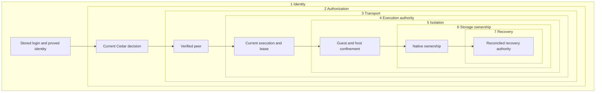
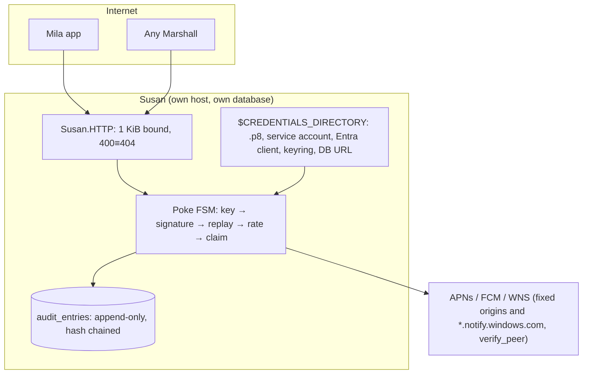
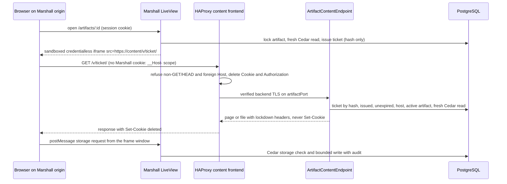

# Security boundaries and sensitive operations

## Attachment storage and access

Attachment support is incomplete and is not deployment-accepted. Upload and
token issuance and redemption check thread authority; redemption conditionally
clears the matching unexpired token only after decrypted bytes match the stored
SHA-256 digest and size. Storage or integrity failure does not consume the token. The browser POST download endpoint requires
a persisted current login and a token in the `x-attachment-token` header. It
returns a no-store binary attachment and runs behind the request privacy filter.
HTTP tests cover successful download, replay refusal and revoked login refusal;
separate-connection revocation races remain unverified. The local store encrypts bytes with an explicitly
configured 32-byte key and refuses missing or malformed keys. It has no hardcoded
fallback. Multipart HTTP upload verifies the persisted login and thread write
authority before persistence; responses contain metadata only. HTTP round-trip
tests pass, but model and guest transfer integration remains unfinished.
Production key provisioning, durable shared storage,
deletion reconciliation and denial audit coverage remain gaps. Model uploads select a guest path and reject inline bytes. Lyra sends bounded
base64 chunks through the fenced transfer RPC; command results contain metadata
only. Marshall validates completion metadata against the selected attachment
identity, size and digest and refuses extra fields or arbitrary failure text before
persisting command results. Guest download-to-file is implemented locally; native
end-to-end acceptance remains pending. Malware scanning and cross-host recovery are unverified.

## Memory suspension and wake authority

Suspension adds sensitive RAM storage and continuation authority. Checkpoint
memory, manifests and hashes never enter ordinary diagnostics, backup/clone
streams or public capabilities. Exact image/VMM/device and CPU/KVM compatibility
must be proven before loading; guest continuation uses the captured boot tuple
inside a separately fenced current placement/epoch. A durable consumed marker
precedes possible execution, and ambiguous execution forbids replay.

Wake admission follows identity and fresh authorization, then durable demand,
capacity admission and physical readiness, and a fresh connection grant. A pin
never grants access. Waiters renew authority; revoked keys, sessions or
publications must stop waiting. Relay capabilities are single-use and bound to
both current gateways and the exact admitted stream over fleet transport.
Disabled, retired or stale origins cannot admit demand or consume/renew relay
authority. Caller input cannot choose arbitrary upstream hosts or ports.

BEAM properties establish admission, coalescing and refusals. Native RAM
continuity, filesystem coherence and multi-node availability need separately
recorded machine evidence in the
[suspension review](repo:docs/architecture/reviews/2026-10-18-memory-suspension.md).

## Terminal peer budget replacement

Authenticated peer transport is bound to the current local stream and the exact
budget process that admitted it. Loss of that budget aborts incoming transport
and retires outgoing peers; successor slots cannot authorize old connections.
A graceful closing state is insufficient because the WebSocket server can still
dispatch application callbacks while closing. The real-TLS regression requires
old owner termination before replacement admission, with unchanged slot counts
and deadlines. The host stream remains synthetic; native guest lifetime and
independent-node recovery require separate evidence.

## Locale is presentation, not authority

Language headers and session values are untrusted, bounded and validated against the supported locale set. Only the current user may persist their override; reset restores browser negotiation. Neither locale nor text direction changes login, Cedar, execution fences, storage ownership or recovery authority. The Porsche envelope carries a canonical locale for human prose, with English fallback for older peers; machine identifiers and terminal byte streams stay unchanged. Bidi isolation protects interpolated identifiers from misleading direction changes. See [ADR-0201](repo:docs/architecture/decisions/0201-localized-human-surfaces.md); native/browser execution and linguistic review remain gaps until recorded.

## Guest reflection and dedicated Peach credentials

Reflection reveals bounded machine metadata and eligible integration descriptors,
never credential values. [ADR-0203](repo:docs/architecture/decisions/0203-guest-reflection.md)
keeps projection and credential authority in Marshall. Peach does not own a
database or retained snapshot authority.

| Layer | Authority and expected refusal |
| --- | --- |
| Identity | Audi supplies the trusted private-service binding; guest-supplied host or VM fields cannot establish identity. Peach requires its configured host. |
| Authorization | Dedicated Peach credentials admit only the Peach control service. Compute/Audi credentials and ordinary user access to credential rows or versions refuse. |
| Transport | Private TLS routing and the local Peach socket preserve the binding. Only Audi, through `peach-proxy`, can connect to the 0660 socket. The packaged service copies its control credential and CA from systemd credentials into a 0700 runtime directory, and refuses group- or world-readable credential files. Tokens remain outside the Nix store and diagnostics. Hostname-verified reflection TLS requires the private leaf reissued with `reflection.internal`; `llm.internal` health does not establish it. |
| Execution | Marshall checks the current host, placement, epoch and completed start operation. Stale, stopped, relocated or retired executions receive unavailable rather than a retained projection. |
| Isolation | Responses contain header names and kinds, without values or secrets. Same-host native network isolation still requires executed machine evidence. |
| Storage | Marshall stores only the random secret digest; rotation serializes on the host, revokes the previous credential and retains secret-free PaperTrail versions. Peach cannot read PostgreSQL directly. |
| Recovery | Current revocation, database-clock expiry and enabled-host checks gate every request. Lost control admission cannot fall back to a cached snapshot; host loss and cross-host recovery remain unverified. |

The focused 40-test Marshall run records credential rotation/revocation and
foreign-user refusal in local database fixtures; the native refusal fixture
remains unexecuted. The recorded focused protocol run covers 100 bounded comment
cases; Audi's 15-test decoder/refusal run and disabled-Peach Nix evaluation cover
optional rollout only. Peach's own suite exercises the HTTP Plug against a verified-TLS
control stub: projection on each path, 404/405/403 refusals before any control
request, foreign and duplicated bindings, Marshall refusal, outage, a snapshot for
a different guest, and serving over a Unix socket. The Galileo fleet machine test
reads the projection from inside a real Firecracker guest through Audi private,
packaged Peach and real Marshall. Generated stale/expired histories and same-host
native isolation remain gaps.

## Agent context and guidance boundaries

[ADR-0178](repo:docs/architecture/decisions/0178-durable-agent-context-and-planning.md)
and [ADR-0179](repo:docs/architecture/decisions/0179-guest-instructions-and-managed-skills.md)
add context checkpoints, collaboration controls and guest guidance. The table
states accepted requirements; final source and executed evidence remain tracked
in the [context review](repo:docs/architecture/reviews/2026-10-16-agent-context-and-planning.md).

| Layer | Allowed operation and expected refusal |
| --- | --- |
| Identity | Current login and account identify the actor; the immutable creator guest identity selects personal configuration. A collaborator cannot switch the thread's configuration owner. |
| Authorization | Current write authority gates mode changes, compaction, question answers and exact proposal implementation. Current management authority gates managed skill configuration. Viewers, stale pages and revoked actors cannot mutate these resources. |
| Transport | Existing authenticated Ziggy and executor paths carry bounded typed operations. Files on the Marshall host and guest-supplied identity claims are not context authority. |
| Execution | Current placement, epoch, lease and executor fence bind guest reads and installations. Generation/frontier comparison rejects stale checkpoint results. Claimed ambiguous provider work is not replayed automatically. |
| Isolation | Plan is an instructional workflow, not a read-only sandbox. Project text, skills and summaries cannot grant tools or bypass VM/profile restrictions. Public fetching has no credentials, hooks, filters, submodules or install scripts. |
| Storage | Agents retains immutable snapshots/checkpoints separately from transcript events. Applied file content, prompts, summaries and skill bodies stay out of diagnostics and accounting. Revisions referenced by admitted work remain retained. |
| Recovery | Restart preserves pending questions and accepted answers. One current answer wins; cancelled, archived or authority-invalid requests refuse. Failed compaction/update preserves the prior checkpoint/revision; pinned restoration and status reconciliation avoid branch drift and blind installation replay. |

Native Linux/Windows path handling, authenticated continuation, live revocation
and independent-host recovery need their own execution evidence. A parser test,
synthetic provider result or browser fixture cannot establish those boundaries.

## Thread sharing and current machine authority

[ADR-0175](repo:docs/architecture/decisions/0175-thread-sharing-and-bound-machine-authority.md)
adds durable task grants that contribute to the currently bound machine's ACL.
Sharing changes must preserve every layer below. No native execution of this new
sharing journey has yet been recorded; focused and historical results retain the
scope in the [sharing review](repo:docs/architecture/reviews/2026-10-16-thread-sharing.md).

| Layer | Authority and required refusal |
| --- | --- |
| Identity | Current stored login and registered, non-retired user identity. Complete case-insensitive email lookup follows thread management authorization; stale login, foreign actor and protected-owner edits refuse. |
| Authorization | Current Cedar viewer/operator/manager thread roles. Only the current binding contributes machine grants. A VM-only recipient cannot read the task; viewers cannot prompt or write, and operators cannot manage thread sharing/lifecycle. VM profile restrictions still apply. |
| Transport | Existing browser TLS, LiveView login hooks and current editor/terminal/SSH/web-ingress admission remain authoritative. A visible link, cached projection or client-supplied role grants no access. |
| Execution | Thread and VM locks serialize sharing with the current binding; machine operations retain execution and host-session fences. An old binding, stale page or retired generation cannot inherit a new share. |
| Isolation | A machine role does not grant another person's terminal session or guest identity. Personal account, editor and shell boundaries remain; sudo-capable writers retain existing guest powers, with no new confidentiality claim inside that VM. |
| Storage | Canonical thread grants and immutable request results are persisted by Threads; VM grants remain separate. Replayed requests cannot restore revoked access, changed inputs conflict, and retired grant/binding history remains retained. |
| Recovery | Grants survive pending/archive/reopen and contribute to a replacement only through its current binding. Revocation removes the thread source; independent VM/team access can remain. Hints accelerate refresh but are not authority or proof of transport closure. |

Thread managers intentionally receive existing VM-management powers, including
creating independent machine grants. Revoking the original thread share does not
revoke those separate grants. Native revocation across active terminal/editor/SSH/web
sessions, cross-node races and physical archive/reopen continuity remain gaps.

The existing terminal viewer rechecks on user/VM hints, input/resize and a
five-second backstop. Editor and SSH renewal use current write authority and
existing thirty-second leases; expiry remains a backstop when hints are lost.
While Lilly reconnects, renewal applies these revocation checks first and only
then answers `unavailable`, so revocation stays conclusive in that window.
These are source-reviewed revocation paths, not a recorded native closure result
for thread sharing.

## Machine pins and the owner-pin deletion fence

[ADR-0193](repo:docs/architecture/decisions/0193-per-user-machine-pins.md) adds a
personal pin that orders lists and, for the owner, fences deletion. The pin is
not an authority: it cannot grant, extend or retain access, and only the owner's
pin changes what any actor may do. Evidence is BEAM-level (generated histories,
LiveView and SSH command tests); no native journey has run.

| Layer | Authority and required refusal |
| --- | --- |
| Identity | Pins belong to the current stored login's user. A compute system actor, a nil actor or any non-user term projects an empty pinned set and a false flag; no path lets one user read or change another user's pins. |
| Authorization | Pinning rechecks current Cedar read access under the VM row lock and refuses deleted intent. Deletion through every path (browser, Fleet workloads, SSH/Porsche `rm`, thread teardown) is refused with `machine_pinned` while the owner holds a live pinned row; shared users' pins never fence, and start/stop are never fenced. |
| Transport | Browser toggles and Porsche `pin`/`unpin` carry only the machine reference and displayed state; the coordinator's idempotent result absorbs a stale state. Refusals cross the SSH control API as closed 409 reasons (`machine_pinned`, `pin_limit`) and Porsche prints fixed hints with no remote text. |
| Execution | Pin, unpin and delete serialize on the VM row lock; a per-user advisory lock serializes one user's pins so the twenty-pin cap holds under concurrency. The guard runs after existing clone/resize/relocation/deleted-intent checks and a refusal rolls the whole request back. |
| Isolation | A pin changes no guest, host or network state. Relocation source cleanup reclaims a copy and is not fenced. |
| Storage | One live row per user/machine (`current_pin` identity, partial index for the guard), PaperTrail versions with actor kind/id and no sensitive attributes. Removal is an archive; both VM archive sites archive every remaining pin in the archive transaction. |
| Recovery | The owner's account deletion archives the owner's own pins in the delete transaction, so a retired account cannot leave an undeletable machine; account cleanup also archives the user's pins elsewhere. A user whose access ended can still unpin. |

Untested boundaries: a live Porsche SSH session or packaged browser driving a
pin natively, and cross-node pin/delete races beyond the shared row lock
argument. Expected refusals: `machine_pinned` on delete, `pin_limit` on the 21st
pin, `vm_deleted` when pinning a deleting machine, `forbidden` for a reader
without access or an unpin without a live row.

## Batched machine-page decision layers

[ADR-0256](repo:docs/architecture/decisions/0256-batched-page-authorization-snapshots.md)
lets one machine-page read share persisted authorization inputs across its rows.
This changes no decision. Cedar still evaluates every row. Only rows that
PostgreSQL guarantees to be identical within one snapshot are read once. Evidence
is BEAM-level: a generated equivalence property, a revocation example and a
query-budget test. No native journey has run.

| Layer | Authority and required refusal |
| --- | --- |
| Identity | The principal (user row, stored-login presence, elevation proof) is read at most once per batch, keyed by user and login JTI, and dropped when the batch ends. A logout, token expiry or retirement committed before a later refresh refuses on that refresh. |
| Authorization | Every row still receives fresh Cedar read/write/manage decisions over current owner state, access grants, bound thread grants and team membership. Batched preloads use filters identical to the per-row reads. A machine that a fresh per-row read decision would refuse is not listed. |
| Transport | Unchanged: LiveView sessions recheck the stored login on mount, events and refresh. Nothing from the batch is sent to the browser beyond the existing view allowlist. |
| Execution | Reuse requires the outermost transaction, set to `REPEATABLE READ, READ ONLY`. A batch nested inside another transaction reuses nothing, and a read-only batch cannot write. Expiry and elevation windows are evaluated once, at the batch's first principal read. |
| Isolation | The reused rows live in the requesting process only and are never shared between processes, users or requests. |
| Storage | Read-only. New partial indexes on current grants and memberships, and owner/team keyset indexes on machines, change plans only. |
| Recovery | A raise or rollback drops the reused rows. The next refresh starts a new snapshot and observes every committed revocation. |

Untested boundaries:

- There is no automated repeatable-read test outside the SQL sandbox. The level
  was verified once against a real connection.
- Concurrent revocation during a refresh is covered by argument only. The refresh
  uses its snapshot and the next refresh refuses.

Expected refusals are unchanged: an ungranted or revoked machine is omitted from
the page, and `forbidden` is returned for direct `get` or `resolve`.

## Time zone preference disclosure layers

[ADR-0195](repo:docs/architecture/decisions/0195-user-time-zones.md) stores one
display preference per account. It is not an authority: it never enters Cedar,
policies, ledger comparisons or any wire contract, and only its owner can write
it. Evidence is BEAM-level (Hegel properties, LiveView and Covenant tests); no
native journey has run.

| Layer | Authority and required refusal |
| --- | --- |
| Identity | The zone belongs to the authenticated user's own row. `set_time_zone` takes no target argument; a forged one is rejected by Ash, a non-user or retired actor is refused, and the browser's zone is used for the viewer's display only and is never persisted by the hook. |
| Authorization | `actor_present()` admits the self-only action; the internal `store_time_zone` update is gated to the compute system actor. A saved zone is disclosed to users who share a team, machine or thread with its owner and to Control room readers, in exactly the projections that already disclose the email; a user without a saved zone discloses nothing. |
| Transport | The browser sends only `timezone` in the LiveView connect params; the server validates it against the compiled database before use. Picker submissions are validated the same way; `invalid_time_zone` is a closed refusal with a fixed flash. SSH `ls`/`show` drop `owner_email`/`owner_time_zone`; `share show` and `team show` omit saved zones from owner, grants and members while preserving their prior response fields. |
| Execution | The write runs inside `Ledger.transaction` under the actor's row lock; refusal rolls back and the event `account.time_zone_changed` (user id only) is emitted after commit. Zone text never enters structured events. |
| Isolation | No guest, host or network state changes; the preference affects rendering in the viewer's browser session only. |
| Storage | One nullable text column on `users`; `ValidTimeZone` refuses an unresolvable identifier even if the coordinator is bypassed. Zone data is compiled into the release from the pinned `tz` package and never fetched at runtime. |
| Recovery | Clearing restores browser-zone display; a stale or unknown saved identifier renders UTC rather than failing the page. Rule changes arrive through a dependency bump and release hash refresh. |

Untested boundaries: the packaged browser sending the connect param, and a
saved zone whose rules change between tz releases. Expected refusals:
`invalid_time_zone` for unknown identifiers, `Forbidden` for non-user actors,
`unauthorized` for retired accounts.

## User-run guest coding CLI layers

Codex and Claude Code are ordinary guest processes, separate from Marshall's
platform executor. System provider settings choose Ziggy and verified public CA
trust. Their native approval prompts and command sandboxes are deliberately
disabled for this isolated guest-image use; the guest OS/VM/network/Marshall
boundaries remain the authority boundary. A client configuration or nonsecret
sentinel is not inference authority.
Guest writers retain existing sudo/root capability. The pinned offline image
closure contains no provider secret and opens no additional listener.

| Layer | Authority and required refusal |
| --- | --- |
| Identity | Lilly derives the current VM binding from the pre-NAT guest connection; guest identity/authentication headers and client sentinel cannot fabricate it. Native terminal/SSH entry still requires the existing personal account authority. |
| Authorization | Marshall admits and renews private inference for the current VM. Customer refuses private inference despite installed commands; a model choice cannot enable disabled Anthropic. |
| Transport | Audi terminates verified `llm.internal` TLS and forwards the derived binding privately. Clients use the current guest CA bundle; wrong roots or hostname must fail instead of disabling verification. Ziggy validates exactly empty queries or `beta=true` on native Anthropic Messages/token counting; malformed aliases or OpenAI beta queries refuse before effects. |
| Execution | Current placement, execution epoch and connection authority remain mandatory. Client startup or session restoration cannot revive stale guest authority; interrupted model requests are not automatically replayed by Ziggy. |
| Isolation | Clients run with their guest user's permissions and ordinary local session state. They gain no host provider credential, listener, Marshall tool fence or Customer network exception. No confidentiality from another sudo-capable guest writer is claimed. |
| Storage | Both pinned clients assemble offline. Ubuntu registers the complete runtime closure and retains it through a GC root; image minima absorb growth. Native sessions remain guest-local and new image publication does not rewrite retained disks. Ziggy's bounded metadata spool/accounting remains separate from client sessions. |
| Recovery | A client restart follows native session behavior; Ziggy recovers receipts without replaying inference. Disabled Anthropic returns `provider_unavailable` before admission or provider effects. Updating a bundled client requires a reviewed image input/rebuild rather than a first-boot download or automatic updater. |

The [coding CLI review](repo:docs/architecture/reviews/2026-10-13-native-guest-coding-clis.md)
and [scenario ledger](#coverage) distinguish route properties, packaged guest
execution and isolated fixture inference from production provider acceptance,
sustained load and physical-host fault behavior. Installing the tools alone
establishes none of those runtime boundaries.

Both hosts activated the published coding-client images, but the first NixOS
production canary timed out without inference admission and was fully cleaned
up; Ubuntu creation was not issued. Separate strict public-chain validation and
isolated client tests expose the legacy leaf's rejected extra SAN. Same-root
preparation and independent encrypted replacements preserve offline issuer
custody and all nonleaf host values; they do not establish commit/push,
live replacement or renewed client
acceptance. TLS verification and native client configuration remain unchanged.

## Fleet address custody and the Susan fleet path

ADR-0233 keeps every fleet public address in one SOPS document and sends
Marshall's Susan pokes over `fleet0`. These sensitive operations are
operator-only: rotating the document (`nix run .#secrets -- encrypt
fleet-addresses --replace`), and rotating a Lilly-protected address, which also
needs the deliberate rebind flow.

| Layer | Authority and required refusal |
| --- | --- |
| Identity | The document's recipients are the recovery users and the enrolled fleet hosts' SSH-derived age keys. WireGuard peer keys, not addresses, identify `fleet0` peers; salopettes has its own key in `salopettes-fleet-network`. |
| Authorization | A runtime grant admits only the reviewed source it names. Geoffrey Huntley's operator sources (ADR-0247: primary, secondary and tertiary grants) reach every TCP and UDP listener on every enrolled host and are held only in the document. Salopettes' handshake is admitted on Panterloons only from its decrypted address, and its tunnel `/32` reaches only its declared TCP ports (443, 9464, 9467). |
| Transport | Salopettes is in the Panterloons tunnel (ADR-0239): Panterloons' Marshall resolves `notifications.overalls.dev` to `10.90.0.3` and still verifies Susan's public certificate inside the tunnel. Overalls, alone in its tunnel, resolves that name through public DNS. Fleet traffic is IPv4 only. |
| Execution | `overalls-fleet-addresses.service` must validate every value before any consumer starts. A malformed, wildcard or missing value refuses the uplink, firewall refill, WireGuard endpoint and service start. |
| Isolation | Runtime rules live in one chain reached by a static jump. The refill unit flushes before validating, so a bad rotation never leaves an earlier address open. Only an optional rule (the installer source of ADR-0234) is skipped when its file is absent; a malformed optional address still closes the chain. |
| Storage | Decrypted values exist only under `/run/overalls-secrets/fleet-addresses/` and in the root-only uplink recovery copy. They never reach the Nix store, the repository or diagnostics. |
| Recovery | A decryption failure keeps a dedicated host addressed from its recovery copy and closes its runtime rules. Installation writes that copy for base systems, and records the installer's source, which alone reaches administrative SSH until the operator deletes it. No machine test boots a base system with that file yet. A lost tunnel only delays notifications. |

Untested boundaries: the production rollout on Overalls and Dungarees,
HAProxy, Porsche, Audi and Lilly starting with runtime addresses in a machine
test, and Cloudflare's proxied-record behaviour. Evidence: the `fleet-addresses`
and `fleet-network` machine checks, plus the `fleet-firewall-configuration` and
`host-planning` checks.

## Underclass provider egress layers

ADR-0185 sends Underclass provider traffic through a dedicated tailnet node,
optionally via an exit node; ADR-0260 runs the enrolled hosts with no exit node,
so traffic leaves from the host's own address. The host's own tailnet node and every
other service keep direct egress. These sensitive operations are root-only:
joining the egress node (`sudo underclass-egress up`) and changing its exit
node.

| Layer | Authority and required refusal |
| --- | --- |
| Identity | Each host has a separate `<host>-underclass-egress` tailnet identity, joined once by an operator; the module holds no Tailscale key. A logged-out or unapproved node makes the start gate refuse to start Underclass. |
| Authorization | Tailnet policy must allow that identity to use the exit node. The egress socket directory is private to the node's dynamic user, so only root can change it. Underclass's proxy and admin bearer tokens are unchanged. |
| Transport | Underclass reaches only the loopback HTTP proxy. HTTPS stays end to end between Underclass and the provider through `CONNECT`, inside WireGuard to the exit node. LAN access through the exit node is disabled. |
| Execution | A privileged start gate re-asserts the configured preference on every start: it selects the configured exit node, or clears a stale one when none is configured. If the preference does not match, Underclass does not start. |
| Isolation | systemd IP filtering allows the Underclass cgroup only loopback addresses, so direct connections fail. The egress node is userspace-only: no TUN device, routes, capabilities or IPv6 sockets. |
| Storage | The node's keys live in `/var/lib/underclass-egress` (mode 0700, dynamic user), separate from the Underclass pool database and the host's own tailnet state. |
| Recovery | With an exit node, losing it fails provider requests, which never use the host's address. Underclass still restarts while the exit node is offline. Node state survives a reboot. Removing `exitNode` while keeping `route` (ADR-0260) clears the preference on the next start and keeps the proxy confinement. |

Untested boundaries: the production Tailscale control plane and tailnet policy,
and activation of the route-only profile. With an exit node configured, root
clearing the preference mid-run leaks until the next start. Evidence: the `underclass-egress` machine
check and the [Underclass operations](repo:docs/services/underclass.md) guide.

## Experimental Antithesis fixture custody

The default control fixture generates synthetic TLS, database, signing,
encryption and host credentials only after container startup into private
runtime volumes. PostgreSQL migration uses the real release; the operator
uses Marshall's reviewed enrollment and rotation CLI for the fixed Lilly
identity. The workload receives a CA, a nonsecret fixture, a read-only Control
credential copy and a SELECT-only PostgreSQL role. Its SQL oracle uses verified
TLS, bound parameters and bounded reads. Missing, malformed or unavailable
oracle replies never count as empty authority state or successful setup.

The identity layer is the generated host identity and enrolled credential;
the authorization layer is Marshall's committed host/session state and the
SELECT-only oracle role. Verified TLS protects Marshall and PostgreSQL reads.
Current v4 Control and fresh report sequence fence the bootstrap claim.
Isolation stops at the controlled container boundary: synthetic pool identities
provide no ZFS ownership or physical capacity, and both controlled and guest
executors refuse unobserved guest and cleanup outcomes. Retained volumes keep
state for restart tests but grant no recovery proof. Setup refuses missing
secrets, failed migration, unavailable endpoint, stale host report, absent
credential or uncertain native effect. The local base control-core setup and
six serial Control commands exercised these fixture layers, with 13 true SDK
assertion records. The stale selected manifest and absence of hosted ingestion
limit that result; native effect refusal and recovery still need separate
evidence in the [foundation review](repo:docs/architecture/reviews/2026-10-13-antithesis-harness-foundation.md).

Optional measured-host enrollment uses a private request and the reviewed
Marshall CLI, binds the issued host/pool identity to the inner ZFS measurement,
and leaves an ambiguous reissue uncertain. Its TCG-specific Lilly ownership
retains root, machine-ID, reserved-UID, global lock and durable host/pool fences
while omitting the native KVM probe. This is source-reviewed only: no composed
Control/guest acceptance follows. The separate router smoke uses a boot-private
release cookie and local ZFS/Brady effects; its loose fixture source filtering
and synthetic peers do not prove production packet attribution.
The private host/guest variant retains no signing key for its public bootstrap
CA; real private roots require same-boot GuestTrust delivery and an exact
durable receipt before private channels can become ready. This is source and
focused adapter-test evidence only. The current measured host sample is
disconnected and execution-unready, with no admitted guest, terminal accounts
or QEMU crash recovery result.
Physical host readiness is measured before private role credentials are issued;
private Ziggy/Audi readiness is checked immediately before a new guest
launch/restart effect. Missing private readiness refuses that effect. Only an
exact matching boot with positive current process proof may be re-observed
without reopening the private readiness gate. This source-reviewed ordering
does not establish a connected private host or a running guest.
The non-serving fixture operator retains the Endpoint only with `server: false`
for WebAuthn origin/RP identity and opened no listener in the recorded diagnostic.
It established three synthetic account/passkey pairs through reviewed Ash
actions; a durable bootstrap marker refuses ambiguous reissue. These credentials
remain private to the fixture and grant no live deployment authority. The
controlled collector reads only its own validated unified cgroup subtree and
ancestors; an unavailable or ambiguous observation withholds the entire report.
The earlier connected host session with zero report sequence could not establish
successful setup. A later project committed a fresh report and emitted setup,
but its nil pool capacity and false execution readiness still refuse guest
admission. The committed effective CPU/memory fields were collector-derived;
raw cgroup file values were not independently compared.

## Privileged administrator continuation layers

ADR-0160 accepts fixed fifteen-minute administrator step-up and exact inline
action continuation for enrolled administrators. No-key administrators visit
Security for first enrollment, return, and explicitly retry. Marshall implements
the fifteen-minute receipt, enrolled-key modal and setup return path. Final
merged packaged checks passed ordinary access, no-key return/explicit retry,
continuation/cancellation/focus restoration and colocated cross-replica revocation.
Native timed expiry and machine-page recovery remain unexecuted. Older tests retain their prior
five-minute/redirect scope. Ordinary signed-in reads remain independent of privileged
authority.

| Layer | Authority and required refusal |
| --- | --- |
| Identity | Current stored login and actor UUID authorize ordinary reads without a passkey. A single-use UV-required ceremony binds login, credential and MFA generation for elevation. Revoked, retired, expired, wrong-session or replayed proof cannot elevate or resume. No-key first enrollment requires email authentication completed within five minutes and grants no administrative action. |
| Authorization | Current persisted administrator role, fixed database-time fifteen-minute receipt and fresh Cedar action after locks. Ordinary users, demoted actors, expired receipts and elevated foreign Customer administrators refuse. Passkey changes require verification of an existing credential; owner-managed SSH keys retain current login and owner checks. |
| Transport | Verified browser TLS, CSRF-protected action capture and fixed ceremony origin/RP. The continuation accepts a canonical server action rather than a caller-supplied event or authority flag; foreign origin, substituted arguments or another tab's continuation cannot authorize it. |
| Execution | One exact actor/login/resource/action/arguments continuation, five-minute expiry and one-use removal before admission; current resource and workflow fences are rechecked. Navigation or reconnect discards it. No-key setup retains only an allowlisted return path; enrollment does not execute the original administrator action. |
| Isolation | Elevation affects only Cedar administrative actions. Customer exact-owner, guest profile, VM placement/boot and host-service separation remain mandatory. Browser step-up never becomes SSH or internal-system authority. |
| Storage | Existing PostgreSQL login, role, credential/account locks and mutation/audit transaction remain authoritative. A pending continuation grants no storage ownership, guest identity or durable-workflow receipt. |
| Recovery | Cancelled, failed, expired or stale continuation refuses without mutation; a new action can begin a new ceremony. An expired non-Customer VM override returns to Fleet workloads with an explanation; resize removes controls and retains its URL draft. Normal owner/sharing access and foreign Customer refusal stay separate. Already committed durable work keeps its existing recovery authority after requester expiry or demotion. Proving-key removal/reset/revocation ends live elevation. |

The [step-up review](repo:docs/architecture/reviews/2026-10-11-privileged-administrator-step-up.md)
records the current evidence boundaries and preferred real-action property plus
NixOS browser acceptance. Hardware authenticators, physical-host separation and
production cutover remain separate. Historical Control room, credential and
Customer tests cannot close the remaining final-snapshot gaps in [coverage](#coverage).

## Browser extension presence layers

The browser extension detector is a local presentation aid, not a security
boundary. It requests optional host access only for the exact normalized
Overalls origin saved by the user. A packaged content script sets a stable
installed marker on that origin; no source page contents, credentials or
telemetry are collected.

| Layer | Authority and refusal |
| --- | --- |
| Identity | The marker carries no account, login, thread or machine identity. Current stored login and GuestAccount checks remain required for every protected page and launch. |
| Authorization | Setup links hide only after a positive marker. A spoofed, stale or absent marker cannot grant a Cedar action, machine visibility, terminal/editor access or repository admission. |
| Transport | Browser permission and registration are restricted to the saved exact origin. Missing, denied or withdrawn access, failed registration and detector outage leave setup visible. |
| Execution | Startup and origin changes reconcile detector registration; a failed change retains the last working configuration. The detector cannot invoke a server mutation. |
| Isolation | The content script is injected only on the configured origin. Provider pages and unrelated origins are outside its host permission scope. |
| Storage | Presence is not stored by Marshall. Browser-local configuration and permission state may disappear; the page then fails open to visible setup. |
| Recovery | Reloading or a LiveView replacement can re-observe the marker. If observation fails, setup remains available and protected actions continue their normal admission checks. |

The marker's positive path and denied/withdrawn permission path require Chrome and
Firefox browser execution evidence. Unit and package checks establish exact
registration and asset shape only; they do not prove browser permission prompts,
Firefox runtime injection or deployed TLS. See the
[presence review](repo:docs/architecture/reviews/2026-10-16-browser-extension-presence.md)
and [coverage](#coverage).

## Personal browser editor layers

The bundled editor permanently refuses built-in AI/Chat capability even under
conflicting settings or direct service calls. All guest folders are trusted by
the worker; users must accept project extension execution before opening them.
Automatic trust does not approve direnv, change egress or grant Marshall access.
The immutable Open VSX baseline is verified and hash-pinned before extraction;
the maintenance updater shares the packaged signature and upstream engine
validators. Failures before lock replacement preserve old bytes; after replacement,
a parent synchronization failure reports durability uncertainty with a complete
new lock potentially visible. It cannot claim rollback or crash durability.
Nineteen recorded developer tests cover artifacts, generated paths/pagination,
closed outputs and this publication boundary with actual source-bundled
signature/engine validation. Native extension execution remains a named gap.
The Nix maintenance gate additionally ran these 19 tests against the final
installed validator and passed Ruff/ty; it still does not prove native isolation.
Per-user controls and separately installed extensions retain their
existing authority. Static package defaults produce no invented audit events.

The new Arch/Alma image packaging uses these same layers. Their earlier
editor-free manifests remain refused, even though CLI SSH succeeds. Final-image
closure checks and a newly displayed editor control cannot substitute for a
recorded personal browser journey. The
[foreign Linux review](repo:docs/architecture/reviews/2026-10-18-foreign-linux-browser-editor.md)
records all twelve passing Alma native browser subtests and both new production
CLI lifecycles separately. The native fixture checks recovery, current-boot
restart, foreign-Origin refusal and sign-out; its private roots and policy files
give it a different immutable image ID. Arch's same-image diagnostic replay
passed all twelve stages, while its earlier broker-restart 502 remains unexplained.
The later trunk merge, production
browser sign-in and physical isolation remain separate evidence boundaries.

| Layer | Authority and refusal |
| --- | --- |
| Identity | Current completed stored login and permanent GuestAccount UUID. One-use exchange, host-only cookie and separate personal origins refuse cross-account/replayed proof; retirement loses old authority. Same-User email changes preserve the guest UUID/UID/name/home and editor origin. |
| Authorization | Current Cedar write, plus exact owner for Customer. Viewer/web/revoked roles and elevated foreign administrators cannot open Customer editors. Generic web/public/peer port authority never grants TCP 4444. |
| Transport | Audi public TLS, service-authenticated control, exact unsafe HTTP/WebSocket Origin and fixed callback host. Same-site sibling origins and caller-supplied identity headers refuse before guest contact. Gallery VSIX authenticity uses packaged Ed25519 keys before extraction; local imports remain a separate user decision. |
| Execution | Thirty-second leases bind service generation, host, VM placement/epoch/generation, account, UID/name, release and origin; admission also needs a live host connection session. Renewal while Lilly reconnects (no session, or a new one not yet reported) is `unavailable` and retried only inside the unchanged lease; sign-out, revoked write, stop, a newer generation and a stale report stay conclusive ([ADR-0192](repo:docs/architecture/decisions/0192-staged-detached-ingress.md)). Expired/closed or changed bindings cannot revive. Lilly binds the dedicated marked gateway path and writes the typed preface. |
| Isolation | Broker binds exact boot IPv4/eth0 and admits only the derived gateway. Worker runs reconciled personal UID on its owner-only Unix socket; no root fallback. Separate browser/webview origins prevent automatic browser-state sharing. Passwordless sudo writers still hold root capability, so no cross-writer OS confidentiality is claimed. |
| Storage | Current manifest v4 binds exact immutable editor package and declared source capability; obsolete/mismatched images refuse. Ubuntu, Arch and Alma register and GC-root their offline editor closures. Personal home/server/extensions data is never automatically inherited by another account incarnation. Disable state uses upstream browser-profile storage on the separate account origin, without a cross-device synchronization promise; shared builtins remain immutable. |
| Recovery | Broker restart retains independent systemd workers and sockets. Authority loss closes communication without claiming process death. Fresh admission can start a lost worker but cannot revive an old lease; upstream native activity governs idle shutdown. |

Machine-page editor eligibility reuses the validated image/release authority
check and exposes only a finite status after current VM read authorization. A
hidden button or upgrade explanation is presentation; direct opening still
requires fresh stored-login/write/account/execution authority. The active link
requires both desired and observed running state. Valid legacy/noncurrent images
show current-image guidance; missing, malformed or wrong-identity data and invalid
release configuration show temporary unavailability and refuse opening. Catalog
disabling prevents new launches without adding revocation of an already running
matching image.
Creating another machine and copying chosen files preserves the original data;
this operation does not rewrite an old disk's immutable image identity.

SQL-backed Marshall properties/fixed histories and protocol/Lilly/Audi component
checks have scoped evidence in the
[editor review](repo:docs/architecture/reviews/2026-10-10-browser-editor.md).
The NixOS browser fixture uses the real package/broker and synthetic roster/bridge.
Its complete Linux UID/socket/refusal/restart and real browser-tool assertions
passed in 60 seconds, including a positive fresh worker PID after loss and changed
origin replacement preserving files. That
record does not establish full service authentication, packet-mark, boot-trust,
Firecracker or Ubuntu execution.
The complete NixOS journey separately passed real service authentication,
Firecracker tools/custody/recovery, unsafe Origin refusal and sign-out closing
established WebSockets with fresh sign-in recovery. The corrected merged NixOS
snapshot passed these stages again with exact current physical readiness;
historical results retain their original revision. Corrected Ubuntu provisioned
and reached the expected origin but reproduced workbench visibility failure
before those assertions, with runtime cause unproved.
Two-writer native separation, multi-gateway failover and physical host faults
remain explicit gaps in [scenario coverage](#coverage).

The full fleet startup fixture extracts only the current Audi service's immutable
configuration path through its privileged wrapper and rechecks the service PID.
The Audi UID validates that bounded canonical path and both real configuration
and listener entrypoints inside the service's mount namespace. The one-label
refusal clone remains private; diagnostics expose only fixed stage names.
This fixture custody preserves product authority. Both gateways passed this
preflight in the complete NixOS run; no broader production claim follows.

Failed browser journeys may emit only closed document categories and validated
bootstrap/error/connection booleans. Browser messages, URLs, headers, cookies,
document text and WebSocket payloads remain private. The native fixture may
additionally observe fixed broker/worker/socket/refusal booleans after proving
the authenticated current boot and executed root UID, sharing one 30-second
console deadline. Native unit metadata, journal bodies, worker arguments and
terminal bytes are withheld; the only personal Node execution is `--version`.
These read-only observations do not launch editors or retry assertions, and
diagnostic refusal preserves the original failed acceptance. Their source
presence does not prove runtime execution or identify the Ubuntu cause.

Recurring probes hold real operator browser storage only through private runtime
credentials. Their closed fixture must identify a reviewed Markdown probe file
because the journey edits/saves it. The current helper positively checks the
server's unconditional trust-disabled bootstrap without trust-storage injection
or a UI approval action; native extension acceptance separately checks
`workspace.isTrusted`. Fixture review selects disposable content and confers no
Marshall authority or direnv approval. Source supervisor, durable recorder, numeric
reader/exporter and collector intake are separate UIDs/groups. Private browser
output is suppressed; no cookie, URL, path, account ID or fixture field becomes a
metric label. Lost recorder/collector coverage and missing credentials withhold
health, while an owned sixty-second deadline and Linux subreaper cleanup kill and
reap browser descendants and forbid late success. Targets come only from owned
child groups and kernel child lists. A native detached-leaf subprocess regression
passed; production credentials and actual NixOS/Firecracker recurring browser
failure/revocation and recorder/collector faults require separate acceptance.

Chromium configuration/cache lives in private writable temporary directories.
The shared native/recurring helper preserves HOME and inherited data paths,
including the native tester's actual NSS certificate trust. Pinned headless fonts
establish reproducible browser startup, not authentication. The separate Nix
package startup fixture uses its own temporary trust bypass; its passing installed
workbench check does not establish verified native TLS or a Marshall login.

## Continuing physical boot adoption

The public Start action retains Marshall authorization and logical generation
fencing. Lilly must own the placement and prove native VMM confinement before
advancing an existing boot journal to the exact current running intent. Placement
and execution epoch must match, generation cannot regress, and the boot challenge
is preserved. Missing or corrupt evidence cannot mint a boot proof. Current
generation trust/readiness and roster checks remain mandatory. Isolated journal
properties and native repeated-start process continuity passed. The latter does
not establish native foreign/corrupt ownership refusal. Native clone cancellation
with occupied transfer custody and an unpublished destination passed accounting,
restoration and cleanup. The full clone matrix later refused ordinary relocation
with source_unavailable; the observational source preflight grants no authority.
The final complete native clone matrix passed in 1539.61 seconds after the
atomic snapshot and RPC-margin fixture corrections. Earlier refusals remain
historical evidence; native foreign/corrupt boot refusal remains open.

## Native execution proof and observation

Lilly's current verified VMM binding governs execution proof; an observer or
diagnostic event cannot grant authority. Negative observations withdraw proof
without suppressing the existing watcher's genuine exit report. Retaining that
watcher does not renew proof. The longer deadline requires the same armed native
target, and a replacement boot target grants roster-only authority until running
readiness is proved. Unavailable target evidence and delayed old-port messages
cannot extend stale authority. See the [lifecycle boundary](#lifecycle) and
[scoped verification](#coverage); actor fixtures alone do not establish pidfd,
kernel isolation or production acceptance.

The readiness-only ZFS identity event accepts a validated placement UUID and fixed
before/after/rejection atoms. Paths, dataset names, native output and commands are
withheld; ordinary identity/capacity/staging probes stay quiet. A
`parent_accounting` reason follows parent policy-shape success and strict policy
rejection, before later mountpoint/root/pool/backing guards. It supplies no healthy
backing proof, retry classification, ownership, readiness or capacity credit.
Original storage success/refusal checks and attempt bounds remain unchanged.

## Host-effects engine boundary

`lilly-hostd` is the privileged executor of every utility Lilly runs under a lease
([ADR-0176](repo:docs/architecture/decisions/0176-host-concurrency-single-writers-and-effects.md)
decision 4). Its boundary:

- **Peers.** The socket is owned by the admitted Lilly service uid (`0600` in a `0711`
  runtime directory). A session needs `SO_PEERCRED` with that uid and a peer process in
  `/system.slice/lilly.service`, then a `Hello` with the exact protocol version.
  Anything else is closed before any lease or command.
- **Closed utilities.** Lilly names a utility by its index in a fixed table. hostd
  resolves each executable once, from its own PATH (Lilly's PATH), runs it with a
  cleared environment and closed stdin, and refuses a mutating utility without a
  lease. Arguments are still Lilly's; typed commands come with the native effects.
- **Paths.** Lock inodes are opened with `openat2(RESOLVE_BENEATH | RESOLVE_NO_SYMLINKS)`
  beneath Lilly's runtime, state and pool roots only. Non-regular, linked,
  wrong-owner or group/world-writable inodes are refused.
- **Diagnostics.** hostd writes no log stream; replies carry closed codes only. Lilly
  emits `lilly.utility_unconfirmed` with the utility, reason, duration and lease id,
  never arguments or output.

- **Unit hardening.** `lilly-hostd.service` and `lilly.service` drop unused
  capabilities from their bounding set (module loading, reboot, clock, syslog,
  audit, MAC, accounting, tty, leases, suspend, immutable files) and set
  `SystemCallArchitectures=native`, `LockPersonality` and `RestrictRealtime`.
  `RestrictSUIDSGID` is deliberately absent: its seccomp filter fails every
  `openat2` with ENOSYS, which refused every hostd lease and kept Lilly from
  starting on both hosts on 2026-10-16. The `lilly-transfer-export@` source
  export workers omit it for the same reason: each starts a private hostd for
  its pool lease, and the filter turned every export into `storage_busy`
  (export-endpoint machine test). Neither unit gets a mount namespace: hostd mounts guest
  datasets for the host, and with the pool recursively private (ADR-0144) a
  Lilly namespace would not see new guest mounts.

- **Unprivileged Lilly (the only mode).** The BEAM always runs as
  `lilly` with no capabilities; there is no root mode or option ([ADR-0182](repo:docs/architecture/decisions/0182-unprivileged-lilly-beam.md)).
  Every socket the BEAM uses is one it created
  ([ADR-0184](repo:docs/architecture/decisions/0184-lilly-owns-every-socket.md)):
  OTP never closes a descriptor it did not create, so the descriptors hostd
  used to pass leaked and Firecracker's API stopped answering after about
  ten connections. For a jail socket Lilly sends hostd its own unconnected
  Unix stream socket. hostd connects it only to `api.sock` or `v.sock`
  beneath pool roots, without symbolic links. For ingress, hostd dials the
  guest inside the VM namespace (tap-bound, marked) and hands that connection
  to `lilly-ingress-bridge`. That helper runs as `lilly` with no
  supplementary groups and `no_new_privs`, splices bytes without reading or
  logging them, and ends when its client closes. Opaque relay bytes after setup
  do not pass through a root process. The editor's preceding setup permits
  hostd to read at most 256 guest bytes for exact ready-frame comparison,
  as described below; it performs no guest JSON or application parsing.

  The bridge's client is Audi's connection itself (op 14) for every
  service: guest SSH and plain web
  ([ADR-0187](repo:docs/architecture/decisions/0187-detached-ingress-bridges.md)),
  and the editor and nested HTTPS
  ([ADR-0192](repo:docs/architecture/decisions/0192-staged-detached-ingress.md)).
  For the last two, hostd first writes a preface Lilly derived from the
  validated binding (a PROXY v2 header naming the Audi-attested client, or
  the framed editor binding) and, for the editor, reads exactly the guest
  broker's ready frame and compares it byte for byte with the frame Lilly
  supplied. hostd interprets neither, reads no guest byte past the frame, and
  starts no bridge on any difference. Lilly's own socket and BEAM relay
  (op 13) remain only as a fallback. hostd accepts Audi's connection only
  as a connected AF_UNIX stream whose peer uid is Audi's, so it never bridges
  a guest to another local service. The bridge runs detached in its own
  `lilly-ingress-<key>.scope` in `lilly_ingress.slice`, with no parent-death
  signal, so it and the session survive restarts of hostd and Lilly. It
  moves no byte until hostd has written Lilly's ready frame to Audi.

  Lilly keeps the execution fence for detached bridges. Before the bridge
  starts, it records the binding under a random key in a private 0700
  directory beside its connector socket. A keeper process then holds an
  ingress guardian for that binding and ends the bridge through hostd
  (`cgroup.kill` on its scope) as soon as the guardian dies. A restarted
  Lilly lists the live scopes. It ends any bridge with no readable record at
  once, and any recorded bridge whose execution is not current within 30
  seconds. While Lilly is down nothing fences, so a revoked execution's live
  session can last the downtime plus 30 seconds. Audi's own account-key
  revocation is unaffected.

  hostd sends Lilly no descriptor. It refuses a received descriptor that is
  not an unconnected, non-listening AF_UNIX stream socket, and it ends the
  session on a descriptor attached to any other request, a missing
  descriptor, more than one descriptor, or truncated or foreign ancillary
  data. Lilly closes each socket once its `gen_tcp` port is down, whether
  the owner closed it, died or handed it on.

  Evidence:
  - hostd fixture tests and Hegel decoding models;
  - bridge process fixtures (the privilege-drop fixture runs only as root);
  - a Lilly custody property test that fails if a socket is not released.
  The namespace dial and the bridge in a real VM namespace are covered only
  by the fleet machine test.

  Services that call Lilly authenticate it by `SO_PEERCRED` as the configured
  Lilly uid, which the NixOS modules fill from `users.users.lilly.uid`:
  - private Audi's guest lookup (`connector_uid`);
  - the Audi gateway's ingress connector (`connectorUid`, which Lilly's module
    asserts);
  - Brady's egress attribution (`attribution_uid`).

  Before 2026-10-17 private Audi and Brady required uid 0. After the
  unprivileged switch, every guest host-certificate and roster lookup was
  refused, so sshd never started and readiness timed out. The fleet machine
  test found this; Brady's attribution failed the same way, reporting
  unresolved.

  `lilly` holds no ZFS delegation: every guest
  dataset `send` and `receive` is a typed hostd stream
  ([ADR-0183](repo:docs/architecture/decisions/0183-guest-dataset-streams-in-hostd.md)).
  Lilly names the placement, pool and peer; hostd derives the `zfs`, `ssh`
  and `cmp` commands with the fixed receive policy (unmounted, read-only,
  no exec, setuid or devices). It runs `ssh` and `cmp` as `lilly`, and only
  the ZFS sides as root. A delegated non-root receive silently dropped those
  properties, so a `lilly` process could have created a setuid- or
  device-bearing dataset. Root-only file effects stay in hostd: `chmod` of files
  the BEAM does not own, removal of jail trees and backup copies, and
  handing new dataset and template roots to `lilly`; everything else Lilly
  writes lives in directories `lilly` owns. At boot, `lilly-ownership` gives
  `lilly` Lilly's state trees, including the transfer state directory (the
  `transfers/` keys and `exports/` permits a root Lilly wrote), the files
  directly in `/var/lib/lilly` (the `owner.json` host binding) and any `<socket>.owner` custody a root Lilly left
  in the shared socket directories. Only the owner changes there, so the
  peer service's group stays. In each pool it also hands over the `vms`,
  `standbys` and `templates` mountpoint parents (owner and mode 0700, which
  Lilly's private-directory check requires) and, for every template a
  root Lilly sealed, the template's root directory alone: it mounts the
  template, lifts `readonly` around that one `chown` and restores it, and
  never touches a sealed file. Lock inodes are left for hostd. The unit's
  pre-start host check alone runs elevated (`+`), because it reads the
  root-only enrollment baseline and SSH host key. On 2026-10-16 the first
  unprivileged activation missed both and kept Lilly down on both hosts until
  they were fixed. The pool directories were missed too: `lilly` could not
  traverse the root-owned `templates` directory, so on both hosts every
  template read, build and retirement failed (`template_unconfirmed`) until
  the next release handed them over. The zfs-guest machine test now rebuilds
  that root-era state and requires a guest to start from it. The updater's preflight accepts the binding only as a
  private 0600 file in a 0700 directory, both owned by root or `lilly`,
  beneath root-owned parents (`lilly-owner-binding-custody`). Its generic
  secret-file check had refused every later update. Secrets arrive as systemd
  credentials (owner-only 0400), and so does the control-plane CA, so a
  root-only CA path still authenticates Marshall; and hostd's socket is owned
  by the admitted uid. Before it admits guest execution, Lilly reads Ziggy's
  proxy health and private Audi's status socket. It holds only those two
  groups: `ziggy-proxy`, which Audi already holds, and `audi-private-status`,
  which shares only the status socket. Audi makes that socket 0660 with the
  directory's group only when its directory is the shared 0750 layout
  (`audi-status-socket-mode`). Credentials stay in a 0700 subdirectory.
  Without these groups, after the unprivileged switch every new guest start on a
  private-services host was deferred `private_services_unavailable`. The
  fleet machine test caught it before any production guest was started. hostd confines what a compromised BEAM can direct: it builds the VM
  unit's command line itself from validated fields (direct `systemd-run` is
  refused); it performs `chmod`, `chown`, `mv`, `rm`, `truncate`, `mkfifo`,
  `sync` and jail bind mounts natively on descriptors resolved beneath
  Lilly's state, pool and `/run/lilly*` roots without following symlinks;
  and every other utility must match the argument shapes Lilly uses (ZFS
  names beneath the pool datasets, `ip`/`sysctl` only on Lilly's devices
  and namespaces, `netns exec` only for `ip`, `nft`, `sysctl` and the flow
  labeller with hostd's own executable, mutating `systemctl` operations only on
  one exact `lilly-vm-UUID.service` unit; slice and wildcard queries remain
  read-only. Host-namespace `nft` rule files may only define Lilly's own
  `lilly_<hex>_filter`/`_nat` tables and are loaded from hostd's checked
  copy). **Residual risks:** Lilly's own tables can still drop or redirect
  host traffic (it is the network policy author); namespace-local rule
  files are not inspected; `lilly-resume-token` receives a peer-supplied
  token checked only by its own parser. The grammar has
  unit tests; every machine test runs the real `lilly.service` as `lilly`.
  `enrollment-operator` drives it (credentials via `LoadCredential`, empty
  capability set) through enrollment and readiness, and `zfs-guest` runs the
  guest journey with the probe BEAM as `lilly`. Root Lilly tools (backups,
  transfer workers, operator `lilly eval`, test probes) are not the service:
  they set `LILLY_SERVICE_UID` (exported system-wide) so they trust state
  only root or the service user wrote. A refusal-focused machine test of the
  hostd grammar is not yet recorded.

Expected refusals: a wrong uid or cgroup, a version mismatch, an unknown utility, a
mutating utility without a lease, a second command on a busy lease, a lease
another session holds, and, for a transfer stream, any field outside its
grammar (a pool that is not a configured pair, a non-UUID placement, a token
outside the resume-token grammar, a relative or expanding path, a local
resume `lilly-resume-token` rejects) or generic `Run` of the stream helper,
`ssh` or `cmp`. Untested gaps: the peer cgroup check reads `/proc/<pid>/cgroup`
after connect rather than through a pidfd; hostd itself runs as root; no
machine test yet records that `zfs receive` as `lilly` is refused on a
deployed pool.

## Retained-state profile rewrite authority

ADR-0159 removed Lilly's one-way retained-profile rewrite after it completed on
both hosts. Lilly reads stored commands only under its live host lock after
persistent command-store host/version validation; a foreign store refuses
startup. No startup step rewrites private state, and the lifecycle envelope
loader validates schema, not all native Dataset bindings.

## Burn notification credentials and refusal

Optional central-host Alertmanager delivery requires an explicitly approved
runtime HTTPS destination. Systemd owns URL and bearer credential loading; private
source files stay outside the Nix store and unprivileged readers must be refused.
Routing requires the reviewed burn name, objective, window, provisional status
and warning severity together. Foreign or mismatched labels select an empty
receiver. Transport verifies system TLS trust, refuses HTTP startup and disables
redirects. Loopback-only HTTP is the local Prometheus-to-Alertmanager boundary;
no cluster listener or public firewall port is opened.

Delivery retries and resolves notifications after receiver recovery. Its custody
does not change guest execution fences, isolation or storage ownership. Upstream
output is suppressed to protect URLs; local metrics expose attempts/failures.
External receipt and survival of central-host failure remain acceptance gaps.
Production destination provisioning is pending; native synthetic fixtures never
become production defaults.

Measurement diagnostics expose only fixed roster identities, numeric counts,
ages and closed status codes. Grafana requires its own operator authentication;
Marshall retains current-session checks for control and security views. Diagnostic
routes and readers are retired from Marshall. Missing/stale source states precede
inactivity, and neither diagnostics nor guest claims authorize execution.
The loopback storage probe uses a separate read-only namespace with only the two
telemetry stores exposed under `/var/lib`; private runtime and configuration are
hidden. It exports aggregate sizes, never names, contents or credentials. Its
root read capability does not confer provider or measurement-writer authority.

Public Grafana at `https://ghuntley.dev:3443/` has a separate operator identity
and authentication boundary. The address-scoped firewall grants reachability;
Grafana login grants dashboard access. Marshall session or VM ownership is not
a Grafana credential. HAProxy requires the configured Host, terminates verified
public TLS, replaces forwarded headers and sends HTTP only over host loopback.
Anonymous dashboard reads and sign-up stay disabled; session cookies are secure.
Private credentials remain in Grafana state, and Prometheus/Tempo are never
exposed directly. Native TLS/login/firewall and production evidence are tracked
in the [public Grafana review](repo:docs/architecture/reviews/2026-10-03-public-grafana.md).

Magic-link email proves mailbox access only when its single-use token reaches
the authenticated POST action. The browser now posts automatically after the
link page connects and requests a remembered credential. A GET-only visitor
does not consume the token; an automated visitor that runs JavaScript may do so.
Stored login, MFA, remembered-login revocation and sign-out remain separate
authority checks. The automatic browser flow has focused HTTP and a recorded
three-replica native browser run; physical-host and real inbox behavior remain
separate acceptance.

Security is enforced in layers. Passing an outer check never substitutes for the
next one. A signed-in user is not automatically a VM owner; an authorized request
is not automatically current execution; a current placement is not proof that a
native disk or process belongs to it.

The nesting describes checks along a sensitive path, not a claim that all services
share one linear call chain. Recovery must reconstruct every relevant layer.
Administrative host root remains a trusted privileged boundary; the guest controls
neither that authority nor the control-plane database.

| Sensitive operation | Required authority and physical boundary | Verification and gap |
| --- | --- | --- |
| Open a magic link and remember this browser | The connected browser submits the single-use token through the CSRF-protected authentication POST; the stored login and remembered credential remain subject to revocation, with passkey proof required separately for privileged operations. Plain GET, invalid and replayed links confer no authority. | [HTTP flow tests](repo:marshall/test/marshall_web/magic_link_flow_test.exs) inspect token preservation, redirect and cookie issuance; the [updated native MFA browser journey](repo:docs/architecture/reviews/2026-10-02-automatic-magic-link.md) passed automatic navigation and remembered-cookie assertion across three colocated replicas under the historical login-MFA policy. Real inbox and JavaScript-capable mail scanners remain outside that run. |
| Deliver fleet diagnostic samples | Retired application ingestion: no route or bearer can grant sample authority, and Marshall keeps no monitor credential or host model (ADR-0159). | A generated [retirement property](repo:marshall/test/marshall_web/diagnostic_retirement_test.exs) asserts 404 without consuming the body. Independent exporter freshness/privacy/native checks are recorded in the [cutover review](repo:docs/architecture/reviews/2026-10-09-observability-decoupling.md); production activation remains separate. |
| Submit guest OpenTelemetry diagnostics | Eligible guest profile reaches Audi private TLS; Audi obtains current Lilly VM/placement/epoch binding and forwards only exact protobuf routes to a Unix socket; Rust receiver checks Audi UID, assigns outer provenance and strips claims before localhost collection. Lyra sends fixed tool counters, duration and an identity-free span only after terminal result acknowledgment. | Audi request-grammar properties, Rust binding/sanitization/chunk properties, Lyra payload properties and the [two-node NixOS test](repo:nix/verification/tests/machines/otel-fleet/default.nix) cover bounded payload shape, socket UID, valid metric forwarding, forged outer-namespace refusal, authenticated collector tunnel, worker scrape loss and queued trace replay after a WireGuard outage. The recorded [real guest journey](repo:nix/verification/tests/machines/fleet/scenarios/agent.py) adds Firecracker guest TLS, current Lilly binding, acknowledged tool result, collector export and an exact trace query at disposable local Tempo. Binding change during upload, customer-profile refusal, guest trace delivery across WireGuard and production collection remain untested. |
| Export Brady candidate SLI | Lilly-derived resolved attribution and validated HTTP admission gate source-owned terminal counters. Brady publishes a private fixed-schema snapshot; a Rust host process checks owner, mode, freshness, arithmetic and monotonicity before OTLP over a restricted local Unix socket. | Brady and Rust generated properties cover outcome arithmetic and file custody. The [NixOS collector fixture](repo:nix/verification/tests/machines/otel-fleet/default.nix) passes exporter delivery, ordinary Brady UID socket refusal and exporter-group trace-queue refusal, but synthesizes the Brady snapshot. A scoped [native Firecracker journey](repo:nix/verification/tests/machines/fleet/scenarios/brady.py) passed request-to-collector export, while its later restart subtest failed; the full gate and measured target remain open, so no fleet compliance rule consumes it. |
| Export Galileo candidate SLI | Marshall authorizes each integration attempt before Galileo counts it. The private Unix `/slo` route exposes fixed cumulative numeric outcomes and duration; a Rust exporter sends them through a Galileo-only collector socket with collector-owned service identity. | A generated [Galileo property](repo:galileo/test/slo_test.exs) checks closed outcome arithmetic and bucket totals. The [service machine test](repo:nix/verification/tests/machines/galileo-service/driver.py) asserts packaged source-to-collector delivery and ordinary UID socket refusal. The full [Firecracker fleet test](repo:nix/verification/tests/machines/fleet/scenarios/galileo.py) passed guest-to-collector export, unchanged denominator after a detached request, relocation and recovery. Failure classification under live revocation, production collection and measured targets remain open. |
| Export Enrico candidate SLI | Enrico counts only unique admitted terminal mirror refreshes in its manager; its owner-only Unix `/slo` route exposes fixed numeric outcomes and duration. A Rust exporter sends them through an Enrico-only collector socket with Nix-owned identity. | A generated [Enrico property](repo:enrico/test/slo_test.exs) checks closed arithmetic and buckets. The [service machine test](repo:nix/verification/tests/machines/enrico-service/driver.py) passed local Git success, duplicate exclusion, outage failure, source-to-collector export and ordinary Enrico UID socket refusal. Cross-host Marshall scheduling, manager-crash accounting, production collection and measured targets remain open. |
| Export Porsche candidate SSH dispatch SLI | Porsche records only eligible terminal SSH command results; invalid and forbidden results are excluded. A mode-0600 private numeric snapshot is read by a Rust exporter and sent through a Porsche-only collector socket with Nix-owned identity. | A generated [Porsche property](repo:porsche/test/slo_test.exs) passed closed arithmetic and refusal exclusion; the [service fixture](repo:nix/verification/tests/machines/porsche-service/default.nix) passed packaged startup, zero-valued snapshot custody, Rust exporter delivery and ordinary UID socket refusal. It has no authorized Marshall-backed command, so full command-to-collector delivery, process-crash accounting, production collection and measured targets remain open. |
| Export Ziggy candidate inference SLI | Durable spool completion is the source outcome; caller cancellations are excluded, and recovered interrupted admissions retain unknown duration. A private numeric snapshot feeds a Rust exporter through a Ziggy-only collector socket with Nix-owned identity. Owned private regular checkpoints preserve totals and source lifetime; invalid schema, arithmetic, custody or uncertain persistence refuses admission and ACKs. Checkpoint creation is unconditional. | Generated [spool histories](repo:ziggy/test/spool_test.exs) preserve acknowledged totals and prevent replay duplication; [checkpoint properties](repo:ziggy/test/slo_checkpoint_test.exs) reject malformed aggregate state. The [service machine fixture](repo:nix/verification/tests/machines/ziggy-service/driver.py) asserts packaged provider responses, source-to-collector export, SIGKILL recovery without provider replay and Audi checkpoint refusal. Native Firecracker, power-loss, live collection and measured targets remain open. |
| Export Audi private candidate transport SLI | Current Lilly binding and TLS identity precede counting. Pre-binding denials and guest OTLP uploads stay outside the denominator. Only a fixed owner-only numeric snapshot enters a Rust exporter and Audi-private-only collector socket with Nix-owned identity. | A generated [Audi property](repo:audi/test/slo_test.exs) checks closed outcomes and fixed buckets; the [two-node fixture](repo:nix/verification/tests/machines/otel-fleet/default.nix) checks exporter delivery and ordinary Audi UID socket refusal using synthetic outcomes. The full native [Galileo machine gate](repo:nix/verification/tests/machines/fleet/scenarios/galileo.py) passed bound source-to-collector delivery, ordinary Audi UID refusal, relocation and recovery. Crash accounting, other private routes and production collection remain open. |
| Export Audi public DNS candidate SLI | Audi DNS alone counts ordinary well-formed in-zone questions after a socket send. Expected NXDOMAIN counts as a completed answer; stale SERVFAIL or send failure does not. The mode-0600 snapshot goes through a DNS-only Rust exporter and collector socket with Nix-owned identity. | Generated [DNS properties](repo:audi/test/dns_server_test.exs) check authoritative and excluded question classes. The [DNS service machine](repo:nix/verification/tests/machines/audi-dns/default.nix) checks real UDP/TCP snapshot accounting and custody; the [two-node collector fixture](repo:nix/verification/tests/machines/otel-fleet/default.nix) checks synthetic export and ordinary DNS UID refusal. Neither test establishes production DNS delivery, crash accounting or measured targets. |
| Export Audi guest SSH candidate SLI | A proved key and valid current Marshall grant precede counting. A failed Lilly connector or guard then counts failure; a connected guest socket and acknowledged SSH exec count success. The public Audi process writes a fixed mode-0640 snapshot for a separate Rust exporter with read-only source-group access and an SSH-only collector socket. | A generated [Audi property](repo:audi/test/slo_test.exs) checks fixed outcome arithmetic. The [two-node fixture](repo:nix/verification/tests/machines/otel-fleet/default.nix) passed synthetic SSH export and ordinary Audi UID socket refusal. The local real-SSH test currently fails in listener setup before its source-boundary assertion. Native authorized guest-to-collector delivery, crash accounting, production collection and measured targets remain open. |
| Export Marshall browser candidate SLI | The browser endpoint counts only requests past privacy, health and early machine-API filters. Its dynamic UID owns a mode-0750 directory and publishes a mode-0640 cumulative snapshot; the static Rust exporter has group read access without directory write, and alone holds the Marshall-only collector group and Nix-supplied replica identity. | A generated [Marshall property and endpoint test](repo:marshall/test/marshall/slo_test.exs) check closed outcomes, private metadata exclusion, health refusal and completed 404 counting. The [two-node collector fixture](repo:nix/verification/tests/machines/otel-fleet/default.nix) tests synthetic export and custody refusal. The [packaged Marshall check](repo:nix/verification/tests/machines/otel-marshall/default.nix) passed a real HTTPS 404 through source snapshot, Rust exporter and collector. Signed-in browser traffic, crash accounting and live collection remain open. |
| Read fleet telemetry objectives | Grafana operator authentication protects Nix-provisioned objectives and burn panels. Prometheus enforces source lifetime, cadence and elapsed retained-history guards. Missing history remains unknown; diagnostics confer no control or accounting authority. Marshall's `/admin/slos` reader is retired. | The [Prometheus fixtures](repo:nix/verification/tests/evaluation/otel-slo-rules.nix) check closed source arithmetic and coverage guards. [Retirement properties](repo:marshall/test/marshall_web/diagnostic_retirement_test.exs) refuse obsolete ingestion. Historical Marshall parser/browser evidence remains scoped to its archived revision; production targets and live dashboard acceptance remain open. |
| Read Grafana candidate dashboard | The Grafana backend binds Overalls loopback; the optional public HTTPS frontend retains a separate Grafana operator identity. Marshall login and guest headers grant no query authority. Candidate panels repeat trusted source/history guards before displaying recordings. | The [two-node NixOS fixture](repo:nix/verification/tests/machines/otel-fleet/default.nix) checks configured operator admission, wrong-password refusal, worker-node loopback refusal and provisioned panels. The [Prometheus fixture](repo:nix/verification/tests/evaluation/otel-slo-rules.nix) withholds a retained ratio during source warmup. External operator login and measured production compliance remain separate. |
| Read handbook sections | Current completed login; administrator membership is unnecessary | Generated chapter histories reject revoked, expired and deleted logins. The native fixture asserts the persisted reader remains ordinary and checks revoked mounted navigation and a fresh deep link; see [execution scope](#coverage). Cross-replica and hardware-authenticator acceptance remain separate. |
| Login, passkey enrollment, elevation, remembered browser resume/revocation | Current login; single-use, session-bound verified ceremony | Generated independent-login histories and signed ceremonies; recorded native virtual-WebAuthn subsequent magic-link and remembered login, administrator revocation across three colocated serving replicas, and copied-cookie refusal for enrolled and no-MFA accounts in the [subsequent-login review](repo:docs/architecture/reviews/2026-09-25-mfa-login-verification.md). Independent physical hosts, hardware authenticators and production rollout remain external acceptance |
| Read fleet metadata / change administration | Signed-in redacted read; separate current admin plus elevation for mutation | Generated current-role/session histories and a recorded native browser read/mutation journey; see the [verification review](repo:docs/architecture/reviews/2026-09-25-control-room-verification.md). Native session revocation across three colocated replicas is recorded in the [subsequent-login review](repo:docs/architecture/reviews/2026-09-25-mfa-login-verification.md); other mutation families and populated drill-down pages remain gaps |
| Change account role, reset MFA or revoke browser authority | Current elevated actor held through audit commit; installation latch, retirement fence and sorted actor/target User rows | Recorded independent histories and three-Marshall schedules cover all five account mutation families, both elevation-lock/sign-out orders, ungated completed revocation and sorted consumer liveness. A generated [Cedar owner-resource property](repo:marshall/test/marshall/authorization/cedar_test.exs) additionally checks that VM, team and integration actions refuse resources missing their owner attribute; it does not exercise database faults at Ash callers. Captured native reset and five stale mounted mutation refusals pass with verified TLS and virtual WebAuthn; see exact source attribution in the [account authority review](repo:docs/architecture/reviews/2026-09-25-admin-account-authority-verification.md). Physical authenticators, production rollout and mail delivery remain separate. |
| Read fleet diagnostic logs | Grafana authentication and reader-only `/select/*` credentials held by its systemd service; verified TLS to the fleet-network store. Restricted host audit, crash and guest classes remain outside this destination. | The [log-store machine test](repo:nix/verification/tests/machines/log-store/default.nix) checks authenticated ingestion, scope refusal, queued backfill and provisioned Grafana reads. Marshall has no reader credential or log route. External Grafana login and CA rotation acceptance remain separate. |
| Inspect and retry background jobs | Signed-in redacted reads; current elevated administrator, actor account and raw-job locks, actor/request receipt | Generated exact history/refusal models and three independent BEAM schedules cover elevation lock, sign-out, demotion, raw transition and pruning. A generated [projection property](repo:marshall/test/marshall/administration/jobs_test.exs) checks exact safe keys and secret exclusion across mixed raw job states, then refuses a revoked ordinary reader. Captured native packaged SMTP/browser execution passed real failed-worker retry, exact receipt, current-authority refusals, retained pruning history and mounted/fresh reader revocation in 65.85 seconds; see the [job-history review](repo:docs/architecture/reviews/2026-09-25-job-history-verification.md). Other projection families, throughput, inbox delivery and production rollout remain separate. |
| Invite and retire accounts | Verified identity; current admin and passkey elevation; typed confirmation; old-UUID physical cleanup; permanent retired GuestAccount UUID/UID reservations | Complete current NixOS and Ubuntu generated-identity lifecycles passed retirement stream closure, fresh same-email/no inheritance, physical cleanup, shared storage/process retention and reserved-home/explicit sharing. Historical email-derived results retain their scope. Retained disks, restore reconciliation and deployment remain separately classified in [coverage](#coverage). SMTP delivery and team overlap retain their existing scopes. |
| Grant/revoke sharing, team transfer | Current Cedar action and persisted ownership/membership | Recorded generated team role/consent histories and NixOS browser transfer/removal reject owner replacement and stale page authority. Full public retirement has mutation-sensitive three-Marshall overlap checks. Recorded ordinary-account native shared SSH/integration transitions verify member use, management/foreign/Customer refusal, retained home after restart and removal/re-addition with exact unauthorized evidence. Terminal/agent-specific team journeys and existing SSH session termination remain separate; see [scenario evidence](#coverage). |
| Create or retry a team | Unique active name and current original-creator ownership | Recorded creation properties, three-node commits and native ordinary-account browser refusals; Recorded HTTP receipt histories also preserve archived identity without restoring membership; recorded packaged CLI execution covers permanent refusals and transfer/removal, while native archival and shared VM/integration access remain separate |
| Install CLI and management SSH trust | HTTPS-delivered operator pin, strict ED25519 management peer, registered-key account proof | Generated malformed/reordered trust properties and focused native Linux bootstrap; final guest connection and macOS remain separate |
| Discover and allocate a guest identity | Current stored User UUID and registered-key management session, or current browser/Cedar terminal authority; immutable guest UUID/UID, `u<uid>` login and `/home/u<uid>`; sorted User locks and permanent reservations | Recorded database/property and migration checks preserve allocation across email edits, retirement reservations and exhaustion refusals. Complete NixOS SSH, both lifecycle journeys and the Ubuntu email-continuity subtest passed canonical-account checks. Complete Ubuntu SSH, native editor continuity and retained-disk/restore acceptance remain separate in the [durable identity review](repo:docs/architecture/reviews/2026-10-10-durable-guest-identities.md). |
| Private guest browser web and team withdrawal | Current stored login, direct grant or team membership, exact host cookie, verified Audi/Lilly transport and current execution with request-start lease | Generated authority histories and a dedicated native original HTTP/WebSocket closure journey are tracked in the [private web review](repo:docs/architecture/reviews/2026-09-25-private-web-verification.md). The native journey observes original closure before re-addition, then checks fresh HTTP recovery and unchanged closed transport counters. Independent physical hosts, direct-grant native withdrawal and production rollout remain separate. |
| Guest SSH, terminal input, web ingress | Current grant plus key/account/boot/placement; terminal creator and issued mode, renewable authority where applicable. The ingress catalog parser refuses a snapshot TTL above five seconds; ordinary web/SSH leases have a separate thirty-second ceiling and nested grants remain publication-bound. | Native SSH, revocation, browser and ingress scenarios retain their captured scope. The catalog decoder has 5,000/5,001/30,000 ms boundary cases in source; its new consumer gates and live route withdrawal are unrecorded. Terminal [attachment histories](repo:docs/architecture/reviews/2026-09-26-terminal-attachment-verification.md) use real WebSock lifetimes and synthetic relay dispatch, with immediate input/resize checks and one-second idle authority checks. Personal-account and retained-disk rollout scope remains separate. |
| Register or approve an SSH key during retirement | Current account admission held through the outer registration/approval transaction; completed cleanup belongs to the retired UUID | Generated same-email histories and three independent local Marshall processes verify both orders, exact audit/approval/session state and explicit fresh fingerprint reuse. Existing native registration and retirement journeys do not establish this concurrent transport schedule; see the [credential review](repo:docs/architecture/reviews/2026-09-25-credential-lifecycle-verification.md). |
| Resize and retry | Current owner/manager, retained generation/request identity, matched physical shape evidence | Generated histories cover revoked manager replays, unknown effects and held allocations; the [browser/guest journey](repo:docs/architecture/reviews/2026-09-25-resize-verification.md) records exact runtime scope and remaining distribution/interruption limits |
| Clone, cancel and retry | Current requester manage/provision permission at admission; persisted physical recovery after admission; publication/cancellation serialization | Generated real-action histories and observed three-Marshall schedules cover stale manager actions, cancellation/retry identity and both commit orders. The [clone review](repo:docs/architecture/reviews/2026-09-25-clone-cancellation-verification.md) distinguishes synthetic receipts from native browser, guest and reclamation scope. Inception, arbitrary interruptions and independent physical failures remain separate. |
| Launch a repository workspace | Extension and capture discard source queries/fragments before transmission or browser storage/POST; URL user information refuses and raw manual authority/path remains strict backend input. Public CSRF capture grants no authority; current ordinary stored login or registered-key Porsche session, ordinary provision authority, source2 provider grammar, egress profile and manifest4 source2 capability precede allocation. Every new provision/start snapshot derives its source from the durable VM and matches its retained immutable image; supplied resize snapshots grant no source or image authority. Lilly delivery binds current placement/epoch/challenge/nonce | Missing/expired capture, revoked login, invalid source and absent/obsolete/mismatched image refuse. Completion clears only matching input after current owner/read check. Unavailable restart capability preserves valid physical proof and reports, releases confirmed compute and retains disk/address; confirmed resize completes with a fixed failure so cleanup remains possible. Incoming frozen browser-feature NixOS passed cross-tab sign-in/MFA under the historical login policy, all twenty local-provider checkout cases, retained restart, public downloads and packaged CLI; Ubuntu and latest combined source2/generated-identity acceptance remain separate in [scenario coverage](#coverage). Fixed installed-CA API diagnostics expose stages/indices/exit/status without terminal or response bytes and supplement authoritative guest done/HEAD assertions. Capture privacy sentinel/storage/POST browser assertions, live provider/Brady interception and production cutover remain separate. Drive-by one-OSS-VM-per-authorized-visit creation remains accepted under ADR-0157. |
| Download a browser launcher | Public fixed-name GET from the selected canonical immutable Nix-store package; real root/bin directories, bounded regular artifacts and matching digest/length metadata. Extension launch requires explicit configured server and toolbar click; only provider origin/path is sent after source query/fragment removal | Unknown names, arbitrary roots, symlink roots/parents/files, malformed metadata, length mismatches and unavailable files return404. Developer packages are unsigned; Firefox permanent installation and current guest/MFA/cross-tab runtime remain separate evidence. No credential, page content or diagnostic source URL is collected. |
| Start, move, delete | Authorized intent plus current fences, native ownership and receipts | State-history properties and native workflow tests; arbitrary interruption sequences and physical-host failures remain gaps |
| Customer traffic / agent tools | Profile policy at admission and execution; network and tool boundaries | Customer and tool-matrix properties plus native paths; combined hostile-tool/native profile matrix is incomplete |
| Recover a failed guest CLI candidate | Immutable seed, saved executable identity, verified staged digest and fresh current VM executor fence | Generated actual-supervisor processes restore prior bytes/inode after failed starts and registration. Synthetic ready receipts establish no transport or Marshall authority. The strict native NixOS journey passed invalid-format/registration-timeout recovery, fresh fences and real shared-operator tool work; direct candidate injection bypasses delivery. Private delivery retains historical NixOS/Ubuntu scope. Ubuntu failure/drain and power-loss/I/O remain gaps. Registration cannot attest guest integrity or authorize semantic rollback. |
| Browser-approved agent CLI | Explicit current-browser digest approval; independent one-hour secret, current account/VM write permission, exact machine/thread, bounded verified HTTPS, then real model/guest fences | Generated histories and a captured ordinary-browser/packaged-CLI/native guest journey passed with exact scope in the [CLI review](repo:docs/architecture/reviews/2026-09-25-agent-cli-verification.md). GET/digest/stale-form and withdrawn/retired/expired authority refuse. Browser sign-out alone does not revoke existing independent CLI authority. An earlier executor interruption remains unexplained; the capture predates the later Underclass pin. Physical hosts, Ubuntu and live providers remain separate. |
| Create with an omitted or explicit profile | Current user, pinned request inputs, persisted profile and native guest filtering | Generated default/retry/draft histories and the [native default-profile journey](repo:docs/architecture/reviews/2026-09-25-default-oss-verification.md) pass ordinary-user browser/Porsche creation, OSS sharing and egress controls, and explicit Customer refusals. Unauthorized admission, hostile tool execution and the broader packet matrix remain separate |
| Integration credentials / peer requests | Write-only secret custody; attachment policy; current provenance token | Native detach, peer and outage cases; external upstream behavior is outside fixture evidence |
| Register, refresh, remove or browse a Git mirror | Current admin/elevation held through catalog mutation; stored browser login and current registration for reads; exact current attempt for publication | Recorded generated public histories and six three-process schedules cover stale authority/results, retained head and removed handles. The captured packaged browser journey passed virtual passkey elevation, ordinary reads, source outage retention, anonymous/stale refusal, audit attribution and cache deletion. Physical tunnel, ZFS quota, cache pressure and physical authenticators remain separate. |
| Host enrollment / key rotation | Pinned administrative transport, authenticated identity, private output custody | Native custody and rotation suites; provider IAM and independent recovery-key custody need deployment drills |
| Unattended host candidate compatibility | Trusted root-owned configuration; retain database/cookie/token authority, active encryption key and every serving process's decryption keys | Recorded generated addition/reorder/refusal/corrected-retry histories run actual compatibility and preflight, including all-serving conjunction and inactive fallback. Closed local seams preserve fixture files but do not establish systemd discovery, staging, migration or activation; see the [updater review](repo:docs/architecture/reviews/2026-09-26-updater-compatibility-histories.md). Historical native update/rotation scopes remain separate. |
| Storage reclamation / backup restore | GUIDs, locks, journals, complete manifests, matching keyring and private empty restore targets | Historical native storage/restore checks retain their scope. The [operator review](repo:docs/architecture/reviews/2026-09-26-backup-operator-verification.md) separately records local encrypted Restic histories for retained-reference refusal, host locks, unsafe/nonempty targets and explicit recovery after partial output. Historical fleet authority reactivation lacks complete automated acceptance. |

Personal integration admission requires an explicit source attachment even for
the owner. Current owning-team membership remains an independent team path.
Neither bypasses owner/team liveness, Customer exclusion or execution fences.
Generated histories verify refused management leaves mutation audit and durable
state unchanged, and actual account retirement/removal withdraw prior admission.
The packaged HTTP/1 lease guardian interrupts blocked frontend I/O by closing
the native socket while preserving request-owner cleanup. Its isolated upload
fault test measures EOF/reset and no retries; production timing and broader
connect/response fault permutations remain distinct gaps.

The [scenario ledger](#coverage) names the exact test artifacts, inspected assertion,
evidence type, execution record where available, scope, and missing preferred tests.
A test's existence is not a passing result. A passing mock or unit test is not proof
that a kernel, TLS endpoint, native VM, or physical recovery boundary held.

The [verification campaign](repo:docs/history/ledgers/verification-campaign.md) tracks a current
base-fleet fixture gap: seven catalog variants select images without an enabled
boot-trust receiver while Lilly requires a trust receipt. Historical passes keep
their original revision and scope; they do not establish current fixture
acceptance. The default-profile journey selects the existing complete private
service fixture. Shared NixOS and Ubuntu fixture repair is campaign 011.

For every changed sensitive operation, document the permitted path and the expected
refusal: unauthorized identity, stale grant, expired lease, wrong boot/generation,
foreign storage, or unavailable authority. Add or update NixOS machine integration
tests and property-based tests where feasible. If either is absent, state why and
name the required next test. Never replace an explicit security gap with “covered”
because nearby tests pass.

SSH host issuance authenticates service credentials or a physically bound guest
boot before signing an authoritative principal. A valid host certificate still
requires the user's proved registered key and current Cedar grant. The shared
CA private key never reaches Audi, Porsche, images or guests. Ephemeral per-boot
leaf keys prevent cloned disks from sharing host identity. Native transport tests
exercise certificate negotiation, rekey, principal rejection and CA revocation;
full installer, reboot, clone and relocation acceptance remains separately
tracked in the scenario ledger.

Integration renewals repeat current source ownership, membership and attachment
checks and return only a TTL. The [supporting services](#services) chapter
records generated/three-replica authority checks and captured native
live membership/attachment withdrawal with actual socket closure and no retry. A peer provenance token remains one-use metadata;
it never grants target ingress admission or routing authority.

Guest identity discovery may durably allocate before the user owns a VM. Repeated
discovery reuses that identity; it grants no VM access. Fresh UUIDs require new
credentials and explicit grants. A distinct username, UID and home prevents
automatic inheritance, while authorized guest writers retain passwordless sudo.
Historical homes are not confidential from newly authorized guest administrators.
Same-User email changes are labels at this boundary and preserve its guest
UUID/UID/name/home. Historical database restore remains unsupported until all
retained reservation and sequence state is reconciled; see [recovery](#recovery).

## Maintenance control authority

Evacuation user controls retain current administrator, login and passkey elevation
through the same transaction as the campaign/item change and redacted audit.
Host, campaign and relevant VM locks precede actor User retention. Already admitted
campaign moves survive later requester demotion; pause blocks new admissions only.
Generated and three-process checks distinguish overlapping revocation from fresh
requests begun after completed revocation. The bounded native browser campaign
also passes ordinary refusal, real passkey elevation, running/stopped movement,
physical source cleanup and fresh-elevation resume. Its capture and wider gaps
remain explicit in [scenario coverage](#coverage).

## Operator encrypted-document custody

Recovery membership authorizes every inventoried document; host membership is
scoped to selected documents. Login-only users and nonselected hosts have no
recipient authority. Rekey requires an explicitly supplied retained recovery
identity, keeps private conversion files outside the checkout/store and cleans
them up after ordinary success or failure. Runtime bundle preparation remains a
separate privileged systemd boundary.

The [recipient-history review](repo:docs/architecture/reviews/2026-09-26-secret-recipient-histories.md)
records independent actual decryption controls and exact refusal/retry inventories.
Bounded interruption may leave completed documents published; a reported possibly
updated document requires inspection and explicit retry. Native custody/rotation
records retain their original scope. These checks cannot revoke previously learned
plaintext or establish recovery-key availability after physical loss.

## Internal service TLS trust

Fleet clients, Porsche, Audi, Lilly and the public proxy verify Marshall's
backend at `ghuntley.dev` (ports 4443/5443) against
`/etc/overalls/service-ca.crt`; Marshall verifies local PostgreSQL (`localhost`)
against the same file. The file holds a single internal CA whose key exists
only in recovery-only custody (`service-ca-recovery`); it signs both leaves.
A client presenting any other name is refused, and nothing trusts the retired
`overalls` CA. Rotation replaces the CA, both leaves and the bundle in one
change, so a host still on the previous bundle cannot verify Marshall until it
activates. No automated test exercises the bundle; live validation is a verified
`openssl s_client` handshake and healthy updater activation on both hosts.

When `MARSHALL_DB_CA_CERTFILE` or `MARSHALL_SMTP_CA_CERTFILE` is absent, Marshall
verifies PostgreSQL and remote SMTP against the operating-system trust store, never
the Hex `castore` bundle, so host-distrusted public roots (the eMudhra roots in the
[public trust module](repo:nix/domains/system/public-trust.nix)) also refuse those
chains. A configured CA file must be an absolute regular file or startup is refused.
[Mailer](repo:marshall/test/marshall/mailer/config_test.exs) and
[runtime configuration](repo:marshall/test/marshall/operations/runtime_config_test.exs)
unit tests check option selection only; no test presents a chain from a distrusted root.

## Fleet build trust layers

Fleet build scheduling ([ADR-0248](repo:docs/architecture/decisions/0248-fleet-build-scheduling.md))
is a privileged trust pool between Panterloons and Dungarees.

| Layer | Allowed | Refused |
| --- | --- | --- |
| Identity | Tribuchet workers present a leaf from the tribuchet CA; grpc peers present `build-NAME` from a separate grpc CA. | A worker certificate from any other CA fails the hub's mTLS handshake; a grpc certificate cannot register as a worker. |
| Authorization | Panterloons' grpc daemon grants `build-dungarees` the `trusted` role (unsigned imports, builds); Dungarees grants `build-panterloons` `read-only`. | Any other CN is denied; the read-only peer cannot import unsigned paths. |
| Transport | Hub 7437 and grpc 50051 are never in `allowedTCPPorts`; only the trusted `tailscale0` interface reaches them, and certificates carry tailnet IP SANs. | Public interfaces drop both ports. |
| Execution | Tribuchet agents run builds in their own namespaces and per-build cgroups under 65536-uid blocks; workers import inputs as the trusted `tribuchet` daemon user. | Workers never delegate, and the scheduler has no build machines, so builds are not forwarded twice. |
| Storage | Keys live only in per-host SOPS documents and the root-only `fleet-builds` bundle; the grpc daemon receives its key through `LoadCredential`. | `nobody` cannot read the bundle; CA private keys are not retained. |
| Recovery | Missing credentials or an unreachable scheduler leave local builds working. | A leaked key cannot be revoked; rotation reissues both CAs. |

Output authenticity rests on the authenticated session: a compromised worker or
a holder of Dungarees' grpc key can place malicious outputs in Panterloons'
store, as ADR-0067 already accepted for `nix-ssh`. Global signature checking
stays enabled for every other substituter. The `fleet-builds` machine check
exercises the CN, read-only and rogue-CA refusals with fixture CAs on a plain
VM network; no test runs over the real tailnet.

## Public HTTP-01 listener

Overalls admits TCP 80 on the proxy address from any source (ADR-0181) so the
public CA can validate `ghuntley.dev`. The listener answers only challenge
lookups for that host and permanent HTTPS redirects; other hosts and paths get
no Marshall route, and it holds no certificate key. HTTPS on 443 and all other
proxy, Porsche and administrative listeners stay limited to reviewed sources,
the tailnet or the fleet tunnel. Expected refusal: a request for any other
`Host` gets 421, and a non-GET challenge request gets 405. Evaluation cases in
`public-grafana-configuration` assert the opt-in rule and built successfully;
live issuance and HAProxy start were observed on 2026-10-16. No machine test
exercises public port 80 yet.

## Search engine exposure

Marshall is a private control plane at the apex `https://ghuntley.dev`; nothing it
serves is meant to appear in a search index. Two independent mechanisms say so:

| Mechanism | Where | Effect |
| --- | --- | --- |
| `robots.txt` (`User-agent: *` / `Disallow: /`) | `marshall/priv/static/robots.txt`, served by `Plug.Static` | Compliant crawlers fetch nothing but the file itself. |
| `X-Robots-Tag: noindex, nofollow, noarchive, nosnippet, noimageindex` | `MarshallWeb.NoIndex`, plugged in the endpoint before health, static files and the early `/api` refusals | Every response from the browser endpoint, including redirects, static assets, health probes, installer downloads and error pages, tells a crawler that does fetch it not to index, follow, cache or snippet it. |
| `<meta name="robots">` with the same directive | Root layout | Repeats the header for crawlers that only read markup. |

The two mechanisms cover different crawlers. A crawler that honours `robots.txt`
never requests a page, so it never sees the `noindex` directive; a URL it already
knows can stay listed from external links. Removal of already-indexed URLs is a
separate action in each search engine's webmaster removal tool. The header and
meta tag cover crawlers that fetch pages regardless of `robots.txt`. Neither
mechanism is an access control: authentication, Cedar authorization and the
public-route allowlist decide what a request may read, and public installer and
documentation routes stay reachable to anyone who knows their URL.

Expected refusals: none, because the directives are advisory to crawlers. The
unit test `marshall/test/marshall_web/public_endpoint_test.exs` ("every browser
endpoint response asks search engines not to index") asserts the header on the
signed-out root redirect, the sign-in page, `robots.txt`, `/health/live` and a
refused `/api` path, and the meta tag on the rendered sign-in page. Crawler
behaviour and search-result removal are not tested; the fleet endpoint on the
provisioner transport serves no browser pages and sends no robots directive.

## Browser response headers, transport and session cookies

Every response of Marshall's browser endpoint, including redirects, static
files, health probes, the early `/api` refusals, the JSON agent API and error
pages, passes `MarshallWeb.SecurityHeaders` before any route runs
([ADR-0194](repo:docs/architecture/decisions/0194-marshall-http-security-headers.md)).
The pipelines no longer set their own headers, so no response carries two
policies.

| Header | Value and purpose |
| --- | --- |
| `content-security-policy` | `default-src 'self'; script-src 'self' 'wasm-unsafe-eval'; style-src 'self' 'unsafe-inline'; img-src 'self' data:; font-src 'self'; connect-src 'self'; object-src 'none'; base-uri 'self'; form-action 'self' https://ghuntley.com https://github.com; frame-ancestors 'self'; frame-src 'self'; worker-src 'self'; manifest-src 'self'`. Scripts, fonts, WebSockets and frames are same-origin only. Forms additionally permit the fixed newsletter fallback origin under ADR-0205 and GitHub OAuth POST redirects under ADR-0202; unrestricted `https:` is refused. `'wasm-unsafe-eval'` admits only WebAssembly compilation, for the vendored xterm image addon's sixel decoder under ADR-0230; JavaScript `eval`, inline and foreign script stay refused. `'unsafe-inline'` applies to styles alone because the vendored xterm.js and Mermaid renderers create `<style>` elements and set `style` attributes, which a nonce cannot authorise; Marshall's own templates contain no inline script, style or `style=` attribute. |
| `permissions-policy` | Sensors, camera, microphone, geolocation, payment, USB, serial, HID, MIDI, autoplay, display capture, idle detection, local fonts, picture-in-picture, wake lock and XR are denied. `clipboard-read` and `clipboard-write` stay allowed for this origin because the terminal pastes from and the copy buttons write to the clipboard. Passkeys and the terminal fullscreen control keep the browser defaults. |
| `cross-origin-opener-policy: same-origin` | A foreign page that opens Marshall keeps no window reference. |
| `cross-origin-resource-policy: same-origin` | Browsers refuse to embed Marshall responses as cross-origin subresources. `curl` and PowerShell installer downloads and extension archive navigations are unaffected. |
| `referrer-policy: strict-origin-when-cross-origin` | Secret-bearing routes tighten this to `no-referrer`. |
| `x-content-type-options: nosniff`, `x-frame-options: SAMEORIGIN`, `x-permitted-cross-domain-policies: none` | Legacy equivalents of the policy above. |
| `strict-transport-security: max-age=63072000; includeSubDomains` | Production only, sent by `force_ssl`; two years, no `preload`. |
| `x-robots-tag` | See the Search engine exposure section of this chapter. |

Development builds (`config :marshall, MarshallWeb.SecurityHeaders,
development_tooling: true`) add inline and `localhost` sources for live reload,
LiveDashboard, Oban Web, AshAdmin and `live_debugger`; test builds compile the
production policy, so the browser probe measures what production sends.

HSTS `includeSubDomains` commits every `ghuntley.dev` name to HTTPS in browsers
that have visited the apex. The names this repository serves: the apex (proxy
TLS, HTTP-01 challenge and permanent redirect on port 80), `*.apps.ghuntley.dev`
(Audi wildcard certificate; HTTP answers `308` to HTTPS for recognised hosts and
`421` otherwise) and `ns1`/`ns2.ghuntley.dev` (DNS only at Audi's address; TLS
fails closed and HTTP answers `421`, so no browser service exists). Ports 4443
and 5443 on the apex serve service-CA TLS to non-browser clients. The apex DNS
zone lives outside the repository; an HTTP-only name created there would stop
working in browsers that visited the apex.

| Layer | Authority and refusal |
| --- | --- |
| Identity | The production session cookie is `__Host-marshall`: Secure, HttpOnly, `Path=/`, no Domain, `SameSite=Lax`, signed and encrypted. The remembered credential is `__Host-remember_me` with the same attributes. Browsers refuse a `__Host-` cookie set by any other host, so a user application on `*.apps.ghuntley.dev` can neither plant nor shadow either cookie. A request that still carries the legacy `_marshall_key` or `remember_me` name receives an expiring `Set-Cookie` for it. |
| Authorization | Headers and cookies grant nothing: stored-login checks and Cedar decide every read and mutation. User applications are same-site with Marshall, so `SameSite` offers no CSRF protection against them; CSRF tokens on every form and the LiveView socket remain the control. |
| Transport | HTTPS is forced with HSTS for the apex and its subdomains; the LiveView and terminal WebSockets are same-origin under `connect-src 'self'`. |
| Execution | `script-src 'self' 'wasm-unsafe-eval'` and `object-src 'none'` refuse injected, inline, evaluated or foreign scripts and plugins while allowing same-origin scripts to compile WebAssembly (the terminal sixel decoder, ADR-0230); `form-action` permits only `'self'`, the fixed `https://ghuntley.com` newsletter fallback origin and `https://github.com` OAuth origin (including the start POST redirect), refusing other form targets. |
| Isolation | `frame-ancestors 'self'` and `frame-src 'self'` allow only Marshall to frame Marshall (the thread page embeds its own terminal route); the opener and resource policies isolate Marshall from foreign pages. |
| Storage | Session contents are encrypted in the cookie; no secret is stored in browser storage, only the appearance preference. |
| Recovery | Changing the cookie names or encryption signs every browser out once; a remembered browser signs in again with one fresh magic link. Legacy cookies expire on the next response. |

Expected refusals: a page with a foreign or inline script reports a
`securitypolicyviolation` and the browser does not run it; a `__Host-` cookie
without `Secure` or with a `Domain` attribute is dropped by the browser; a
cross-site frame of Marshall renders nothing. Evidence:
`marshall/test/marshall_web/security_headers_test.exs` asserts the exact header
set on a page, a redirect, a static file, health, a refused `/api` path and a
JSON API reply; `marshall/test/marshall_web/browser_session_test.exs` and
`remember_me_login_test.exs` assert the cookie attributes and encryption;
`marshall/scripts/monospace_browser_probe.py` fails on any Content-Security-Policy
violation across every route it renders in Chromium. No NixOS machine test yet
asserts these headers over the production TLS path, and the production
deployment has not been observed sending them; see
[scenario coverage](#coverage).

## Sealed image authority

Template-backed image verification relies on trusted host ownership, a local
creation nonce, exact dataset GUID, a read-only ZFS seal, native reader exclusion
and nanosecond artifact identities. File timestamps alone do not prove arbitrary
privileged tampering absent. Warm use refuses changed seals and identities; it
does not trust a path or image name alone. The Rust helper has no setuid bit or
capabilities and receives authority only from Lilly's existing native lock owner.
Lilly accepts its launch guard and boot-log writer only as separate trusted local
executables. Their Nix release links may span multiple packages; executable and
ancestor-directory links must be root-owned and bounded, and the final executable
must have trusted ownership, ancestry and mode. Missing or excessive links
refuse startup. The boot-log writer runs as root, because it forks the guarded
jailer chain, and opens `boot.log` without following a final symlink. It writes
only a single-link 0600 regular file owned by itself or the configured reader.
With an unprivileged Lilly, hostd passes the service uid as `--reader-uid` and
the writer changes the file's owner to it through the open descriptor, so only
Lilly can read console bytes and a planted link or foreign file is refused
(exit 74) before any console byte is written to it.
Browser boot-log access separately rechecks Cedar VM read permission, current
placement/execution and fresh authenticated host-stream authority. Lilly accepts
only its assigned stream caller, validates the newest runnable command and
binds the private file to the retained boot/launch incarnation before returning
at most 16 KiB. Pending/failed guest bootstrap does not grant input or guest
terminal authority; image terminal capability remains independently enforced.
Responses contain no jailed guest socket path or boot challenge, and console
bytes enter no diagnostic event or database payload. Changed, missing or foreign
identity refuses rather than opening another path.
Template diagnostics leave the native postcommit boundary through the independent
observability plane. Validated host/pool/record identities support correlation;
no trace, timestamp or historical event can create a placement, prove current
readiness or release capacity commitments.

The [post-import cache fixture](repo:nix/verification/tests/machines/zfs-guest/template-post-import.exs)
preserves exact sealed identity, including the native device field. A device-only
change must refuse reuse; supported fenced retirement and full hashing produce a
distinct ready incarnation rather than revive a quarantined one. Its cache action
grants no placement, intent, launch-attempt or boot authority and changes no
production recovery or terminal Executor refusal. Retained-state inspection
demonstrated this strict refusal after another import, but did not capture the
original failure instant. The complete corrected Ubuntu suite exercised exact
reuse in the new action; focused current NixOS also passed exact reuse and ordinary
neighbour cleanup in its current packaged prefix. Device-only replacement remains
unexecuted in both runs, as scoped in the
[native guest review](repo:docs/architecture/reviews/2026-10-13-native-guest-coding-clis.md).

## Agent loss and retry authority

Executor replacement fences old results before new work. A started command has
an uncertain outcome after loss and cannot be automatically replayed. Explicit
retry needs a new request identity and current account/VM write authority; a
previous CLI approval is insufficient after sharing withdrawal. The
[executor-loss review](repo:docs/architecture/reviews/2026-09-26-executor-loss-histories.md)
separates synthetic binding/expiry histories from actual guest effect and process
interruption. The captured native started-loss fixture passed once; pre-start
native interruption and the earlier unexplained CLI failure remain outside this
evidence.

### Clone observation diagnostic boundary

Only the disposable clone-cancellation fixture can interpose the ZFS observation
recorder. Its literal argv allowlist contains the public properties used by Lilly's
whole-pool observer and the fixed `zroot/lilly` root. Ownership properties, receive
tokens, other arguments and all mutation commands execute directly without capture.
It retains at most 128 completed samples per host, each with at most 64 KiB from
each stream, explicit byte counts and truncation flags. Files are private beneath
a mode-0700 root, with one bounded staging file during atomic replacement. Native
output and status reach Lilly unchanged; no sample enters application events.

On failure the driver disarms recording, synchronizes publication and copies rings
to private directories outside the Nix output before teardown. Failed-build retention
and private extraction are required to preserve them; successful runs discard rings.
The disposable executable checks cover exclusion, byte/status/signal preservation,
bounds and persistence failure. They do not establish native accounting behavior,
physical isolation or cancellation acceptance. Existing readiness, ownership,
capacity and pool-lock authority remain mandatory.

The recorder's native child inherits the pool lock descriptor and original process
group. A parent-death fence with a parent identity check, bounded signal/pipe-error
reaping and nonblocking persistence preserve custody. Partial arming also cleans
both hosts. A clone-only build seam privately captures the exact validated snapshot
GUID map passed to readiness, bounded to eight bindings and 4096 bytes. Its native
owner.lock device and inode select the context file. The wrapper runs in hostd's
utility path and requires exactly one distinct inherited lock identity; absent or
ambiguous descriptors cannot supply readiness context. Each sample distinguishes
present, missing, invalid and changed context. The unchanged observer runs once with the original
arguments and result, and `after` removes context. Replaying accounting requires
that exact map and frozen pool identity. The recorded instrumented run collected
six complete native reads before a queued activation refusal; every sample lacked
readiness context. It establishes bounded collection, not readiness-map pairing,
accounting replay or cancellation acceptance. After verified process shutdown,
offline analysis used private copies of the retained disposable database and left
the original image unchanged. Only finite failure and predicate projections leave
that boundary. The fixture's new activation wait observes real fresh receipts and
settled operations; it grants no authority and does not relax production guards.

The hostd fixture adaptation passed 15 recorder tests, three context tests and
seven report-rejection tests on 2026-10-21. These local checks do not establish
native descriptor/context pairing; the adapted machine run remains pending.

The ninth native capture failed initial host admission before recording or clone
activation. Its private offline database copy retained three accepted reports,
correct host/storage identities and no VMs or clone requests. Rejected report
bodies and their validation clock were not retained; accepted sample timing does
not establish their failed predicate or overload causality. The original image
remains unchanged; admission and complete cancellation acceptance remain pending.

### Clone report rejection diagnostic boundary

Only the disposable clone-cancellation Marshall release contains the report-guard
instrumenter and private sink. Build-time hashes pin both the authenticated caller
and guarded source; production releases remain unchanged. Original conditions,
short circuits, one evaluation per predicate, database time, rollback and public
refusal results remain intact. The sink records only one of eleven fixed stages
and signed sample age; malformed shape has null age. No report body, host identity,
credential, raw state or committed-outcome event leaves the guard.

Each replica retains its first rejection per stage and armed interval, bounded to
eleven private 160-byte files plus eleven equally bounded staging files under a
mode-0700 runtime directory. The driver arms before admission and around cloning,
then disarms and drains publication before copying failure evidence outside Nix
outputs. This evidence survives rollback but provides neither a rejected-report
timeline nor host attribution. Disabled or failed persistence preserves validation
results. Synthetic authenticated-exchange and concurrent sink tests pass; native
admission, installed artifact qualification and complete cancellation remain pending.

## Foreign and native guest-family boundaries

Arch Linux and AlmaLinux remain Linux guests for authorization and isolation:
their catalog marker changes image identity, not the kernel guest agent, trust,
network guard, storage ownership or recovery boundary. The builder evaluation
does not establish runtime isolation or distribution-native security behavior.

The protocol's native FreeBSD and OmniOS rows (`freebsd-v1` and `illumos-v1`)
are explicit, unqualified all-false capability contracts. Native image
packages and catalog entries exist, and the rolling FreeBSD source endpoint is
retired and replaced by a checksum-pinned archive capture; Nix evaluates the
receipt inputs, but placeholder kernels stop image construction before any
stock disk can be admitted. Complete image qualification separately enables
readiness, trust, terminal, workspace, flush, SSH and agents only for the reviewed
sealed FreeBSD and OmniOS manifests or their exact portable descriptors. Editor
and Inception remain false. A matching kernel, agent name or retained row cannot
qualify an image; altered, missing, foreign or unapproved native identities
refuse new admission. Lilly selects transport from validated
metadata, rejects cross-OS agent sets and preserves the jailer, seccomp,
per-tap guard and ZFS boundaries. OmniOS remains the installable downstream
image while `illumos` is the protocol family.

| Layer | Exact native-image admission boundary |
| --- | --- |
| Identity | Versioned validation plus complete equality to the compiled reviewed manifest or portable descriptor; Marshall also checks its durable row ID. |
| Authorization | Existing user, profile and VM authority remains required. Image qualification grants a bounded capability subset, not user permission. |
| Transport | Existing jail-local vsock and CID 2/3 framing; publication uses ordinary signature-verified cache substitution. |
| Execution | Lilly repeats image admission before fresh launch, then requires current placement, epoch, boot challenge, kernel attestation and readiness. |
| Isolation | Jailer, per-TAP/router policy and ZFS boundaries remain. The native policy evidence uses a Linux sibling sink and does not prove direct native-peer or physical isolation. |
| Storage | Promotion hashes actual disk/firmware and five scenario evidence sets before writing the manifest. Cache input is bound by recursive NAR hash; missing publication fails closed. |
| Recovery | Exact FreeBSD and OmniOS same-disk SIGKILL evidence retains its scope. Separate ADR-0243 native tests cover interrupted growth, dm-log-writes host power-cut replay and two-host ZFS relocation; the promoted FreeBSD image predates the required device cache flush. Physical media and fleet recovery remain separate. Retained stock records remain readable with false capabilities. |

The [activation review](repo:docs/architecture/reviews/2026-10-17-native-image-admission.md)
records the sealed artifact and publication boundary. Current rebuilt native
payloads do not inherit admission from that image. Missing, foreign, replayed or
incomplete promotion evidence refuses; evidence and debugging hooks stay outside
the published image. The candidate's original false admission flags are retained.

These native-family boundaries are also editor boundaries. FreeBSD and OmniOS
have no admitted editor package, broker, descriptor or browser acceptance, and
their explicit false capability rows remain false even where a sealed image has
readiness, terminal, workspace, SSH or agent evidence. Those receipts cannot be
used as a browser-editor result. A future native editor would require a new
reviewed image and kernel/agent contract, protocol capability, broker admission
and browser sign-in/edit/readback/recovery receipt.

All seven selected image identities now bind separately recorded strict
personal-account SSH and current-owner create/readiness, stop, independent
stopped checkpoint, same-VM restart, repeated SSH and completed deletion. The
fresh OmniOS checkpoint is an owner-authorized control-plane observation,
separate from independent physical absence. Those 49 stage receipts establish
the scoped lifecycle journeys at their recorded revisions; they do not establish
every enabled guest capability, revocation, physical isolation or recovery.

Native manifests and workload bundles bind kernel bytes, digest, source
revision, patch/configuration hashes and compiler. Lilly's jail-local probe
compares the native OS, placement, execution epoch, boot challenge and digest,
and requires a canonical boot ID before credentials or readiness. Missing,
stale, malformed, oversized or mismatched responses refuse. Lyra compares a
read-only loaded transport build token with a bounded root-owned expected-token
file, then separately hashes the configured kernel file. Symlinks, group/world-writable or
foreign-owned expected files, malformed tokens and module-token mismatch refuse.
A compiled-input token and a file digest do not substitute for native evidence
that the intended kernel/module set booted. The readiness boot ID must equal the
earlier kernel response's boot ID. A scoped FreeBSD nested-KVM run binds actual
host-CID transport to the executing token, checks native ABI refusals, and crosses
the credit window with exact synthetic-data comparisons. A separately identified
test-only FreeBSD fault kernel injects raw frames through the real receive path.
Under nested KVM and Firecracker it refused twelve wrong-source and
wrong-destination CID frames, including CIDs with upper 32-bit bits set, plus a
length-mismatched frame, with `EBADMSG` and no listener effect. A correctly
addressed control frame reached the listener. In the same run, 64 racing
invalid resets injected through the driver's configuration-change path, during
live receive traffic, fenced the socket domain: the blocked reader woke, new
sockets failed with `ENXIO` and the host could not reconnect. Production kernels
carry neither injection OID. OmniOS wrong-CID injection, malformed DMA, valid
reset events racing traffic, physical-media durability beyond the ADR-0243
host power-cut, growth and relocation tests, and broader isolation evidence
remain gaps; scoped growth/recovery and IPv4/router/TAP results are recorded
separately below. The
[native kernel attestation review](repo:docs/architecture/reviews/2026-10-17-native-kernel-attestation.md)
records these limits.

The native isolation fixture uses the packaged Lilly router and TAP source guard
with validated synthetic identities. Public, sibling, private, protected-uplink,
gateway and unregistered-service TCP sinks must all be reachable before rule
installation. Under policy, public traffic and private SSH authority must remain
usable, forbidden targets must refuse, and a foreign-source attempt must
increment the actual TAP guard's drop counter before the assigned source
recovers. The composed NixOS driver, Linux rule installation/counter smoke,
Ruff/ty and three parser boundary tests passed. The exact canonical-roots/SSH
FreeBSD candidate then passed two clean boots with independent policy receipts,
real sink controls, guard drop counters and assigned-source recovery. This
establishes the stated native IPv4/router/TAP scope; OmniOS, jail, physical-host
and multi-host isolation remain unproven.
The sibling target is a Linux TCP sink behind the test peer uplink; direct
native-VM peer isolation is also unexecuted.

Native root mutation is confined to the actual mounted root and pinned GPT
identities, after read-only dual-header/CRC/capacity validation. OmniOS additionally
binds the assembly dataset/pool GUID and single whole-disk vdev. Growth keeps
that vdev's validated `s1` authority identity and raw `p0` GPT preflight separate
from the unsliced operand required by libzfs expansion. The scoped native
operand diagnostic does not establish corrected-helper or interrupted-growth
acceptance. Root-only
no-argument invocation, an exclusive root-owned lock, bounded utility output and
postflight precede the volatile success receipt required by bootstrap. Pure
parser tests do not establish filesystem growth or interruption recovery.

OmniOS vendor cloud-init and SSH are disabled in the clone's offline SMF
repository so runtime network/SSH authority remains with Overalls. Exact-profile
validation on a scratch stock repository passed without changing the live
repository. Fresh-boot verification must observe those five instances disabled
and every immutable payload unchanged; it continues to refuse resolver changes.
Fresh seed-image assembly and QEMU boot passed those file/service checks after
binding the offline repository environment and importing the exact clone
manifests. Diagnostic Firecracker AF40/file/token verification subsequently
passed under a debugger-only pseudo ISA override. Final persistent-image service
and storage replay remains required. Assembly now removes only the fixed four
stock vioif0 address/DHCP files, preflights every destination and refuses any
restoration during verification. All three corrected manifests pass native
`svccfg validate`, while the old-enum mutant refuses; the same native validator
now gates assembly and verification. These checks preserve MMDS-only network
authority and establish schema validity, not actual service method execution.
No profile validation or installation receipt enables native admission.

Native trust keeps pinned vendor roots in the separate regular
`/etc/overalls/system-ca.pem` and composes only those bytes plus the current
boot-authorized host set. Its managed system destination is never the vendor
base on later boots. Missing or conflicting base/staged bytes and stale
authority refuse before changing the effective bundle; root replacement/removal
must remain idempotent across boots under ADR-0113.

The optional same-boot daemon-recovery fixture must observe the real flush
process killed/reaped and readiness withheld while restart is disabled, then
restore exact mode/bytes under a new supervised PID before current-boot flush
and readiness resume. Four host boundary tests passed. The vendor-base and final
reviewed FreeBSD images both passed the complete two-boot failure/refusal/
restoration boundary with exact per-boot receipts. The distinct abrupt-crash fixture must
observe VMM SIGKILL, new identity, retained bytes, native filesystem checking and
old-authority refusal; its seven host checks pass. Actual crash execution exposed
scheduled-only UFS sync. The corrected native suspension/resume flush passed the
final FreeBSD observed-SIGKILL/same-disk restart boundary with exact retained bytes,
native UFS snapshot fsck and complete service oracles before/after the crash.
The final exact OmniOS image separately passed supervised daemon kill/reap,
three withheld-readiness probes and same-boot restoration, as well as SIGKILL
and same-disk recovery. Those receipts remain distinct from the earlier failed
candidate. Neither fixture establishes physical stable-media/host power-loss
durability or fleet recovery.

[ADR-0243](repo:docs/architecture/decisions/0243-native-guest-durability-verification.md)
makes a flush receipt mean durable across host power loss under Lilly's
Writeback drives. Its power-loss test places the host ZFS pool on
`dm-log-writes`, kills the VMM, marks the journal and boots only the replayed
prefix, so unflushed host and virtual-device writes are discarded. A pre-fix
FreeBSD candidate passed fsck yet lost its acknowledged marker because UFS sends
no device cache flush; the agent now refuses a receipt unless `DIOCGFLUSH`
succeeds. The corrected FreeBSD candidate and promoted OmniOS image each passed
power-cut replay with exact acknowledged bytes and a lost host canary, while
pre-cut flush, workspace and terminal authority was refused. Relocation by ZFS
send/receive booted under a new placement and refused the source placement's
authority. Interrupted growth recovered a consistent root after VMM SIGKILL at
traced growth writes. These are nested-KVM fixtures only: they exercise no
physical disk cache, no Lilly transfer or Marshall relocation, no live-source
split brain and only one kill point per growth stage.

A separate test-only FreeBSD probe passed one actual Firecracker pause,
full-snapshot and resume transport event. An idle socket with no peer lost its
identity authority with `ECONNRESET`; pending accept/read/write operations woke
with errors and fresh sockets refused until a new VM. The native review binds
its distinct test image and transport token. This establishes that one live
socket-fencing history, without granting reset-race/DMA/physical safety,
production-service or fleet acceptance. The separate exact OmniOS `45983bb7`
direct host-KVM reset receipt records its own pause/full-snapshot/resume event,
three API responses 204, current-CID revalidation and idle/read/accept errors
131 plus write error 32. It does not inherit the FreeBSD test image's identity
or establish repeated/racing reset or DMA safety.
The persisted `native-freebsd-reset` nested-KVM gate subsequently passed in
232 seconds with exact test image/kernel/probe/firmware/VMM receipts and the
same observed socket outcomes. The API remains a private fixture Unix socket;
no ordinary guest TCP or production control authority is added.

Illumos activated queue/interrupt/DMA storage now has static lifetime until VM
disposal. Fallible allocations precede `DRIVER_OK`; runtime detach refuses and
unavoidable later activation failures fence readiness, drain workers and retain
the bounded unavailable attachment. A refused VMM device reset cannot authorize
resource reclamation. Independent source review confirms this control flow;
native DMA/reset acceptance remains separate from the correction and from the
unexplained initial ZFS I/O errors.
Source-extracted host fault injection and three rejected lifetime mutants cover
236 preactivation failures and both retained late failures. Separately, direct
block requests are bounded by each request's worst-case data plus two metadata
descriptors, with scatter clamped before DMA attributes; 265,596 extracted-helper
arithmetic/sanitizer vectors passed. These do not establish native DMA safety
or prove the initial disk failure's cause.

The shared C core validates the complete 44-byte little-endian frame, exact
used length, stream type, host/guest CID, nonzero ports, flags and bounded
payload before publication. Credit counters reject acknowledgement of unsent
bytes and data beyond the receive window. Invalid transitions do not mutate
core state; the wrapper must refuse/reset. Generated malformed-frame/state
checks and sanitizers passed for this core on Linux. They do not cover DMA,
socket lifetimes, host hardware isolation or either native kernel wrapper.

FreeBSD root authority and illumos global-zone system-configuration authority
guard the custom socket families. Both wrappers bound sockets/windows/queues,
refuse guest-initiated connections, and fence old sockets on device reset or
configuration changes. Illumos callback unsubscription drains before replacement;
reads retain buffer ownership across user copies and sends recheck shutdown and
credit before publication. Its opt-in listener failure changes preserve ordinary
TCP behavior and prevent blocked accepts from surviving transport failure.
Native stress, malformed DMA, callback races, listener wakeups and recovery
remain machine-test gaps. FreeBSD reset retains static interrupt resources and
requires VM replacement. Neither source inspection nor cross-compilation closes
these security boundaries.

FreeBSD validates accepted-child state before allocation and publishes only
after its bounded response resources exist; failed children are detached and
deallocated before joining listener ownership. Illumos uses preallocated
interrupt-work dispatch so allocation failure cannot strand a completion or
reset fence. Scoped host regressions and native compilation cover these source
repairs; memory-pressure and reset behavior still need native machine evidence.

Native SSH helpers obtain fresh MMDS authority per invocation and keep host keys,
locks and readiness volatile. Separate managed sshd configuration refuses root
and password login and forces the current-authorization session helper. Exact
pinned sudo bytes alone may regain setuid mode during image assembly; extraction
does not activate package privilege. Periodic roster/certificate refresh removes
readiness on failure. Actual authorized SSH, expiry, retained-home and current
session refusal still require target-native journeys.

Foreign Arch/Alma roots explicitly select the same `landlock,yama,bpf` boot
arguments as the evaluated NixOS image. Their assembled roots lack distro
SELinux labels, so no distro SELinux policy is part of this guest boundary.
Root-owned real `/tmp` and `/var/tmp` directories retain mode 01777 after
normalization. Offline actual-image checks cover the arguments and directory
custody; runtime activation and successful repaired-image boot remain separate.
This changes no jailer, per-TAP guard, host storage or protocol authority.
Arch additionally overrides its preserved vendor root tmpfiles policy with
`z / 0755 root root -`. The exact vendor rule changed live root to 0555 and
blocked a capability-free root readiness write. Actual artifact checks and
isolated pinned-tmpfiles execution reproduce that refusal and show successful
write/flush/fsync/unlink under the override with the same empty capability
sets. No capabilities or recursive ownership are added. Fresh repaired-image
runtime and foreign SSH/PAM/sudo acceptance remain separate gaps.
Private Alma images install the exact pinned nonroot resolver service and its
two sockets, D-Bus policy/activation and sysusers configuration. A root oneshot
invokes only that configuration before sysinit/D-Bus/resolver startup; the
resolver requires its successful completion. Existing vendor sysusers
conditions and unrelated account configurations are preserved. Isolated exact
configuration execution creates a locked nonroot identity, preserves unrelated
account rows and is byte-idempotent. Artifact custody and native unit parsing
pass, but new-image resolver/D-Bus behavior, readiness and CLI acceptance still
need a fresh guest journey. This adds no host, transport or protocol authority.

Fresh Arch/Alma fixtures later reached readiness but refused personal SSH.
Arch's boot-bound probe identified PAM account refusal and its absent compiled
shadow helper. Alma shares the immutable omission and SSH symptom; no separate
Alma PAM root probe is recorded. The reviewed helper
oneshot now precedes and is required by the owned SSH listener. Its fixed
root-only, argument-free installer copies only pinned `unix_chkpwd` to the
compiled runtime path with root ownership and mode04755, preserving the
immutable source0555 and refusing unsafe parents/destinations. Existing nosuid
mount flags remain unchanged. Root PAM account checks succeed because the
pinned caller sets real UID0 before helper execution; the runtime inode mode
does not establish unprivileged elevation. Isolated VM checks preserve expired,
password-change and unknown-account refusals. Fresh exact Arch `99fa9876` and
Alma `473f9589` journeys then passed strict personal-account SSH and read-only
sudo/helper checks before and after restart, with independent stopped
checkpoints and completed deletion. Both observed numeric sudo UID 0, approved
policy custody, active helper service, exact root-owned bytes/modes and nosuid
runtime mounts. These are recorded root PAM/sudo paths, not direct helper
setuid elevation. Roster revocation, terminal/executor/workspace, native
isolation and physical recovery remain separate acceptance gaps.

## Customer private-service boundaries

Customer capabilities are a closed set: SSH, terminal and editor. Generic
private-service admission is refused. Owner authorization and the separate
editor gateway remain mandatory; a shared private execution binding is not a
grant to inference, reflection, integrations or telemetry. Audi refuses these
non-SSH services from `10.10/16` before asking Lilly for a binding. The reserved
SSH service retains exact account-pull, boot-roster and host-certificate
purposes; Lilly still requires current local execution authority.

The [fleet follow-up review](repo:docs/architecture/reviews/2026-10-18-fleet-dependency-convergence.md)
records four Protocol policy tests including generated closed-capability
checks, 21 Audi Plug/configuration tests and 18 Lilly execution/bootstrap tests.
These results restore the ADR-0064/0158/0203 boundary in the BEAM. They do not
establish native packet isolation, real guest TLS, Windows editor admission or
production activation. The [Customer scenario](#coverage) retains those gaps.

## Windows guest boundaries

The firmware-booted Windows image ([ADR-0169](repo:docs/architecture/decisions/0169-firmware-booted-windows-guests.md),
[ADR-0170](repo:docs/architecture/decisions/0170-lilly-firmware-guest-launch.md)) can
be launched by Lilly without agents. Current Marshall admission separately
requires explicit Git identity support under
[ADR-0198](repo:docs/architecture/decisions/0198-git-attribution-and-guest-identity.md)
and [ADR-0204](repo:docs/architecture/decisions/0204-git-attribution-and-guest-identity.md).
Agentless manifests cannot advertise it, so new machine creation refuses before
allocation. The recorded Lilly-only launch predates that admission restriction.
Identity: the image carries a documented bootstrap Administrator password and
no account roster; nothing maps it onto GuestAccount identities. The placement
identity (placement, execution epoch, boot challenge, address, gateway, MAC)
reaches the guest through Firecracker's MMDS, seeded from a jail-local
root-owned file before launch; it is the same identity a Linux guest reads from
its kernel command line, so nothing new is exposed. Authorization: the protocol
admits exactly the eight-key version-5 manifest with the agent set `none` or
`windows-v1`; every surface reads one authority, the protocol's capability
table ([ADR-0171](repo:docs/architecture/decisions/0171-windows-guest-agents.md)),
through Marshall's per-capability image facts and Lilly's driver: for `none`
Marshall refuses terminals, agent turns, the agent executor, web search and SSH
connection details and refuses the Inception profile; physical-only measurement
applies to retained agentless executions rather than new admissions. Lilly
refuses readiness, terminals, workspace
sources and Inception and reports the VM running but never `guest_ready`; for
`windows-v1` the same gates open only for the capabilities the table grants
(never the editor or Inception), and readiness, trust, terminals and workspace
delivery still require the guest to answer the boot-bound vsock protocols, so a
guest without working agents earns nothing. A missing, corrupt or mismatched
manifest yields every capability false. Transport: through Lilly the guest runs
under the jailer, seccomp observation and the per-tap nftables guard like any
Linux guest; MMDS frames never leave the VMM; the vsock device exists in the
jail only for an agent set that speaks the protocols, and the guest side is the
virtio-win `viosock` driver whose address family the agents discover rather than
assume. The gate 1 probe runs as SYSTEM, carries no identity or credential
material and publishes only its own log. The gate 2 daemons run as SYSTEM
tasks: the readiness daemon answers only host CID 2 after live probes and
ingests nothing from the peer; the trust daemon installs only a host request
that names this exact boot and whose roots parse and match their digest, writes
the bundle whole before naming it current, and never acknowledges a failed
installation; both re-read MMDS with a fresh session token that is never logged
or persisted, and the per-boot UUID lives only in a volatile registry key. SSH
on a Windows guest (gate 3) is public-key only: the roster agent pulls the
writers' registered keys from Marshall through the private route and writes one
SYSTEM-owned key file per account that only that account can read, so a user's
key opens only that user's account; passwords are random and never recorded;
on a new boot the agent first stops `sshd` and clears prior authorized keys.
It starts a keyless listener only after roster reconciliation and a verified
per-boot host certificate. Readiness requires both current-boot receipts and
a live service on every host poll. Ordinary key delivery still requires the
running execution's completed provision/start operation; bootstrap does not
grant key authority. Same-boot retries preserve current keys. Account
activation requires the SID-bound registered profile after a bounded native
`CreateProfile` call. Unlike Linux, acceptance is not bound to the live Audi session
(Win32-OpenSSH cannot ask per connection); Audi's ingress remains the only path
to port 22 and still authenticates the outer session. Login receipts come
from sshd's file log, matched by fingerprint to the pulled keys and reported to
the same Marshall authority as Linux logins; the bootstrap Administrator is
retired (random unrecorded password, disabled) after successful key delivery to
a nonempty roster, so the SAC serial login of ADR-0169 stops working on guests
with agents. The
terminal daemon (gate 4) keeps the Linux terminald boundaries: host CID only,
a HELLO bound to this boot's challenge, placement and epoch (read from MMDS),
128-bit attach tokens and no terminal bytes in logs. Its `root` session is
LocalSystem, the Windows form of the host-admin PTY; every other session runs
under an S4U logon of an enabled roster account, and an unknown or disabled
name is refused rather than mapped to another identity. Each session's
processes live in a kill-on-close job, so kill and retirement end
descendants too. The operator launcher without those
boundaries remains a spike tool and is not Lilly's path. Execution
fencing and isolation: the VMM patches widen the vCPU seccomp filter by one
ioctl (`KVM_IOEVENTFD`) and add read-only devices and CPUID leaves; the Nix
sandbox keeps the installation offline. Storage: the raw GPT disk fills the
ordinary `rootfs.ext4` slot of a per-VM dataset through the verified copy
path. Recovery: restart adopts from the portable bundle without the image, as
for Linux guests; a broken guest is otherwise discarded.

Sensitive operations and expected refusals: the Special Administration Console
on COM1 accepts an interactive login, unlike the Linux `no-serial-login-shell`
contract. For the agentless image this remains a recorded gap; the `windows-v1`
roster agent rotates the bootstrap Administrator to a random unrecorded password
and disables it after the first activated roster account (ADR-0171 gate 3).
The guest bootstrap runs as SYSTEM, reads
only MMDS, validates every field (including the adapter MAC) and never logs the
session token or boot challenge. The evaluation-ISO build must never be pointed
at production media without the licence review in `iso.json`.

Untested gaps: Hyper-V synthetic timers are not emulated and timekeeping under
load is unobserved; `C:` growth after a host-side extension is only known to
leave a bootable guest. The host policy drops unmarked
traffic between the host and a Customer guest by design, so the machine test's
reachability probe is a test-only allowance for one address, never a product
path or a Marshall observation.

The Windows `windows-v1` contract deliberately excludes the browser editor.
Readiness, roster SSH, ConPTY, workspace and agent evidence therefore remains
scoped to those capabilities. The staged editor runtime/source keeps
`editor_capability = false`; the portable broker model and Win32 launcher add
no authority by their presence.
[ADR-0208](repo:docs/architecture/decisions/0208-windows-editor-job-custodian.md)
fully replaces ADR-0200's Windows candidate design while preserving its source,
identity, immutable image and separate promotion requirements. Its separate
`windows-editor-v1` manifest v7 requires an immutable editor descriptor; bundle v4
retains it across placement-local starts. Existing `windows-v1` stays false and
the candidate remains outside the selected production catalog.

The candidate's layers are current Marshall login/write and immutable release
authority, Audi's renewed transport lease, Lilly's current execution/gateway fence,
the gateway-only TCP 4444 broker preface, and a fixed local SYSTEM-only pipe to an
independent SYSTEM custodian. Both local peers check kernel PID, creation time,
SYSTEM token and the exact pinned executable; both independently validate MMDS
boot/release authority. The custodian runs Lyra's locked roster authorizer,
requires the canonical local SAM SID and matching S4U primary token, checks
profile/package/PATH custody, and owns atomic suspended job-list launch without
inherited handles. Its complete SID-bound receipt precedes resume/live commitment.
No job handle leaves the custodian. Reuse checks the exact root PID/time,
executable, token, job and pipe-server identity. Foreign, stale or incomplete
custody refuses without terminating foreign processes or deleting personal files.

Two fixed private SYSTEM tasks supervise the roles independently, with separate
copied trust bundles and only the broker's gateway-only firewall rule. The
custodian retains at most 64 lifetime account slots, including empty and
quarantined entries. Each role has its own 128-slot budget for live pipes and
undrained cancellation state. Exhaustion must refuse new work while preserving
existing custody. A retained custodian drains its exact job to zero descendants
before replacement only after its held root is verified dead; live-root probe and
process-observation errors refuse without termination. Failed accounting
quarantines. After a custodian crash, [ADR-0237](repo:docs/architecture/decisions/0237-windows-custodian-same-boot-recovery.md) lets a new custodian generation
retire an earlier generation's receipt only when its job name vanished and a
complete snapshot shows no process of the exact account SID and recorded S4U
logon session. Its sole new destructive authority terminates re-verified
stragglers of that session; another account, another session of the same account,
processes older than the recorded root and personal files are outside it, and
ambiguous observation refuses. This is portable-property evidence only; native
crash recovery is unexecuted. Full independent-role peer refusal,
personal launch rollback, sustained cancellation/exhaustion and custodian
death/root-child termination bounds still need native execution.

The native Code OSS bundle passed reviewed import; product policy, signed
extensions, licenses and provenance were checked. Thirty earlier Windows library
tests cover named-pipe timeout/cancellation and ACL descriptor/refusal checks;
thirteen earlier SYSTEM fixture cases cover installer/task custody. The old
stock browser fixture opened the workbench, saved a file and used PowerShell PTY,
then failed broker recovery. The exact new 38-test library passed as SYSTEM with
verified exit zero and scratch cleanup. It includes a disposable suspended SYSTEM
root's atomic-job/kill-on-close case and exclusive-pipe/same-process identity/
forged-time cases; it does not exercise personal S4U Code OSS, descendants or
independently scheduled roles. New two-task installation and harness builds pass
static checks, but no exact-image complete browser acceptance is recorded.
Two-account separation, current revocation and recovery remain explicit
gaps in the [custodian review](repo:docs/architecture/reviews/2026-10-18-windows-editor-job-custodian.md).
These bounded results cannot grant deployed image acceptance or establish
confidentiality from guest Administrators or physical VM isolation.

The approved editor registry is finite and target-specific. A valid Linux tuple
cannot authorize a Windows image or vice versa. Each immutable asset receipt is
bound to its full protocol/commit/release tuple as well as current service
generation and host session. Concurrent reports preserve independent expiries.
Publication requires every approved release on an advertised gateway; a missing,
stale or foreign report cannot leave a neutral webview address that serves only
part of the configured set. SQL-backed tests establish these database rules;
native multi-gateway DNS, TLS and publisher-fault histories remain separate.

## Thread authorization boundary

Thread reads require current creator, team or canonical thread-grant authority. Creation checks
current team membership before Compute admission; prompting, terminal access,
archive and deletion recheck current machine/Cedar authority. A foreign thread
ID, removed team membership, stale mounted session, failed provisioning state or
archived machine must refuse prompt and terminal mutations. A current authorized
reader can still read an archived thread and its transcript;
the transcript helper validates that the retained agent thread belongs to the
bound root before reading events. Archive, delete and reopen require current
thread-management authority, including manager grants. Reopen clears the retired binding and
uses a fresh machine key; stale provision jobs cannot mutate that generation.
Previous transcript generations remain retained and an authorized reader can
select their generation through the read-only `/threads/:id?generation=N` path;
the selected binding repeats root, owner and thread checks and never grants
machine mutation. Thread diagnostics contain only thread identifiers and closed
outcome atoms; objective text, model content,
terminal bytes, machine payloads and credentials remain in authorized data.
Archival invalidates a pending planning barrier with the durable `archived`
reason before lifecycle deletion completes.

## Git identity configuration

Account authorization controls preference updates. Validated identity is inert execution metadata bound to the machine’s admitted snapshot and current boot. Guest services atomically publish protected Git configuration; malformed metadata refuses. Identity values must not enter diagnostics. Guest sudo and Git local configuration retain their existing authority. Native cross-OS and production rollout acceptance remain separate from BEAM property evidence.

## Push notification custody and refusal

Susan learns that a deployment notified some device, never what about
([ADR-0224](repo:docs/architecture/decisions/0224-susan-push-relay.md),
[ADR-0225](repo:docs/architecture/decisions/0225-marshall-notifications-domain.md)).

| Layer | Authority and expected refusal |
| --- | --- |
| Identity | A device is bound to the SSH key of the Porsche session that registered it; a key not owned by the actor refuses `unauthorized`. Each install signs pokes with an Ed25519 identity whose seed is AshCloak-encrypted. |
| Authorization | Only the device owner lists, pauses or removes it; others receive `device_not_found`. Recipients are re-derived from current write authority at production time; viewers and the actor are excluded. More than ten live devices refuse `device_limit`. |
| Transport | Pokes go only to the compiled origin over verified TLS with the system trust store, `retry: false`, no redirects; the canonical signed body is ≤1 KiB. |
| Execution | Delivery attempts are fenced by the `attempts` counter, so a stale job cannot overwrite a newer outcome; expired, revoked, invalidated or preference-off deliveries drop before sending. |
| Isolation | The route is sealed to the device's X25519 key with deployment-bound HKDF; the body carries only ciphertext, an opaque per-install collapse id, the delivery id, deployment host, kind, nonce, issue time and Susan's push key. |
| Storage | The push key is AshCloak-encrypted; versions, receipts and events retain only a 16-hex digest. Events carry enum/int metadata only. |
| Recovery | 429/5xx/transport retry with jittered backoff honouring `Retry-After` (8 attempts); 404/410 invalidates the device; SSH key archive and account retirement revoke devices in the same transaction; a reconciler re-enqueues stuck rows. |

Sensitive operations: `device register` (stdin push key), `device rm`,
`device prefs`, operator disable. Expected refusals: `push_disabled`,
`device_limit`, `device_not_found`, `unauthorized`, `invalid_request`.
Untested: real Susan/APNs/FCM/WNS delivery, Mila-side decryption on hardware,
and the Windows TPM and software-provider key paths.

## SSH terminal attach gateway stream

[ADR-0223](repo:docs/architecture/decisions/0223-porsche-terminal-attach.md)
adds `GET /api/terminal-gateway/v1/stream` on the private fleet listener. It
upgrades into the existing terminal viewer, so every browser terminal
boundary still applies; the rows below are what attach adds.

| Layer | Authority and required refusal |
| --- | --- |
| Identity | Porsche gateway bearer plus the attaching connection's live SSH session token plus a single-use terminal ticket. Missing, malformed or oversized credentials refuse with 401/400 before a socket exists; browser cookies and login tokens grant nothing here. |
| Authorization | The ticket is issued by `terminal attach` only after current registry and Cedar checks for that machine and session (`unknown_session` → 404, `forbidden` → 403). Mode never escalates: rw only for the owner with current write access and without `--read-only`. |
| Transport | TLS on the fleet listener. Tickets are bound to their origin: an SSH-bound ticket refuses on the browser route and a browser ticket refuses here (close 4003). Tickets and tokens are never printed, logged or pinned in receipts. |
| Execution | The viewer rechecks `SSH.Authority.session_live?/2` every 5 seconds and on `:ssh_session`/user control hints; key, approval or session revocation closes 4001 and Porsche exits 3. An unanswered check closes 1011 (exit 5), never continuing on stale authority. |
| Isolation | Read-only attaches never send input or resize; Porsche discards their input before the websocket. Attach joins only registry sessions on the named machine; the guest identity is the session owner's personal account. |
| Storage | Only the ticket row (with `ssh_session_id`) is persisted and it is consumed on upgrade. Terminal bytes, tickets and tokens never reach journals: Porsche attachments are `porsche_private` with redacted status, and events carry enum metadata only. |
| Recovery | A lost control link, gateway stream or 15 seconds of silence ends the attach with exit 5; the guest session survives and can be reattached from a cursor. Output is acknowledged only after local SSH delivery, so replay is never skipped. |

Untested boundaries: the native fleet journey
([scenario](repo:nix/verification/tests/machines/fleet/scenarios/porsche-terminal.py))
has not yet recorded a passing run. Revocation latency while an SSH client
stalls output (a blocked 30-second local send) is not measured.

## Porsche client command payloads and hints

Porsche stdin payloads (prompt, answers, plan revision) are bounded per
command, validated before dispatch and stored only as digests in
`ssh_requests`, with the submitting SSH key id. The Porsche gateway binding
receives all thread, terminal-session and SSH-session hint identifiers; they
carry no content and grant nothing; watch subscriptions are re-authorized
every heartbeat. Expected refusals: `stdin_payload_invalid`,
`stdin_payload_required`, `revision_conflict`, `stale_proposal`,
`thread_busy`, `forbidden` for a stranger's watch.

## Mila client boundaries

Mila holds no account authority; every action is a Porsche command that
Marshall authorizes like any other SSH caller (ADR-0220).

- **Host identity.** Mila accepts only an Ed25519 host certificate from the
  pinned deployment CA that names the management host and is inside its
  validity window. The check runs in key exchange, so an untrusted host never
  receives a device-key signature. No trust-on-first-use, no unsigned
  fallback; a changed CA, host or zone is refused (ADR-0228).
- **Device keys.** One P-256 key per deployment, in the Secure Enclave or
  Android Keystore; the Linux test key is an owner-only `0600` file and a
  readable key file is refused. Keys, signatures and tokens are never logged.
- **Links.** `overalls://` links only navigate; they never send a command,
  add a deployment or approve anything (ADR-0221).
- **Mila push privacy.** Pokes are end-to-end encrypted to a per-deployment
  device X25519 key, so the relay learns only that a deployment poked a
  device. Notification text is fixed, and the route is a validated tap link.
  The push key reaches Porsche only on stdin. The platform token is sent only
  to the fixed relay origin and is never stored.
- **Local data.** Snapshots, settings and keys on Linux are owner-only files;
  the offline snapshot holds machine rows only, never approval links, tokens
  or terminal bytes. The optional app lock hides content from rendering and
  the accessibility tree.
- **Untested:** native iOS and Android builds on devices (Secure Enclave,
  Keystore, notification extension and messaging service, `local_auth`).
- **Mila terminal fencing.** Read-only attachments never send input or
  resizes. The attach header is closed and bounded, and output before it is
  dropped. Terminal bytes never leave memory.
- **Mila payloads.** Prompt, answer and plan-revision text goes only on stdin
  (at most 64 KiB) and never on a command line, in a log or in the cache.
- **Mila web.** Only HTTPS URLs on DNS hosts, without user info or fragment, are
  opened. Private endpoints go to the system browser, so Marshall browser
  credentials never enter a webview. The webview allows only HTTPS navigation.
- **Untested:** the stderr attach header through real OpenSSH (it is merged into
  the PTY there), device builds of the share sheet and webview, and these
  screens in the `mila-desktop` machine test.

## Susan push relay layers

Susan sits outside every Marshall's trust boundary and is designed so that a
compromise of it reveals neither notification content nor routes.

- **Identity.** A poke is authenticated twice. Only Susan can open the push key
  (AEAD under a keyring that never leaves Susan), and the request is signed with
  the Marshall's Ed25519 install key. Both checks always run.
  - Failure answers 404 with the same body as malformed input, and it writes
    nothing.
  - The install fingerprint (SHA-256 of the public key) drives the
    `InstallIdentity` state machine, `unknown → trusted → rate_limited → blocked`.
- **Authorization.**
  - The key's deployment binding must match the poke.
  - The key id must not be on the deny-list.
  - The install must not be blocked.
  - The token must not be in the negative cache of unregistered tokens.
- **Transport.** TLS terminates at the fronting proxy. `X-Forwarded-For` is
  believed only from configured proxies. Egress goes only to the five compiled
  provider origins (APNs production and sandbox, Google OAuth, FCM, Entra ID
  `login.microsoftonline.com`) and to WNS channel URIs, with system trust and
  peer verification ([`Susan.Provider.Finch`](repo:susan/lib/susan/provider/finch.ex)).
  A service account naming another token endpoint is refused at startup.
  A WNS channel's host is chosen per device, so it is admitted only in the
  shape `susan-wns-channel-shape` allows: `https`, port 443, a lower-case
  host under `.notify.windows.com`, a path, no userinfo or fragment, at most
  1024 bytes. The shape is checked at key issuance and again before every
  send, and the URI is sealed inside the push key, never supplied at poke time
  ([`Susan.Provider.wns_channel?/1`](repo:susan/lib/susan/provider.ex), its
  [property test](repo:susan/test/susan/wns_channel_property_test.exs)).
- **Execution fencing.** A `DeliveryReceipt` is unique per install and delivery
  id. Reclaiming a failed or stale `sending` receipt is an atomic conditional
  update, so concurrent retries cannot double-send.
- **Privacy and storage.**
  - Susan has no plaintext content.
  - Source addresses are reduced to an HMAC under a daily random salt held in
    memory.
  - Tokens, envelopes, ciphertext and install keys are never stored or logged.
    `Susan.Events` carries enum and integer metadata only.
  - The audit trail stores closed action and reason enums, the fingerprint, key
    id, provider and delivery id.
  - The audit trail is append-only through a PostgreSQL trigger and REVOKE. It is
    hash chained, and an audited Oban prune removes entries after 90 days.
- **Secrets.** All six secrets arrive as systemd credentials from the host-bound
  `overallsSecrets` bundle, or as a container secrets mount. Each file passes the
  canonical-path, ancestor, single-link, owner and mode checks
  ([`Susan.Credentials`](repo:susan/lib/susan/credentials.ex)). Any failure is
  one fixed startup error.
- **Expected refusals:**
  - 400 malformed, replayed or stale;
  - 404 unknown, expired, deny-listed, mismatched, badly signed or blocked;
  - 410 unregistered;
  - 429 limited or in-flight;
  - the database refuses UPDATE, DELETE and TRUNCATE on audit rows;
  - another host cannot decrypt the bundle.
- **Untested gaps.**
  - WNS is implemented in the release but not enabled in the Nix service
    module (no `wns_app_ids` or Entra credentials are delivered), and no
    machine test fakes a WNS origin; WNS evidence is BEAM unit and property
    tests over the fake transport.
  - Real APNs/FCM acceptance: the machine tests use local fake origins behind a
    private CA.
  - Production hosting and TLS.
  - Multi-instance rate limiting: the buckets are per node and in memory.
  - Keyring rotation resets the negative cache, because the digest key derives
    from the active keyring key.

## Machine creation preset boundaries

| Layer | Authority and refusal |
| --- | --- |
| Identity | A current stored login bound to the actor is required at the account page and inside the preset save transaction. Revocation refuses the write. |
| Authorization | Only the actor's locked live User row and one allowlisted preset can change. No form-supplied owner, Customer or Inception preset can bypass validation. |
| Transport | Existing same-origin authenticated LiveView and CSRF protections carry the form; no new public endpoint or credential is introduced. |
| Execution | Presets supply initial request inputs only. Compute rechecks image identity/capability, profile, account and placement. Launch replay repeats admission with original request/source identity. |
| Isolation | Standard and OSS retain existing guest, network and tool policy. Presets change no Lilly fence or host privilege. |
| Storage | Preferences are account columns; VM image and original admission sizes remain under Compute authority. Saving cannot mutate existing guest disks or release holds. |
| Recovery | Invalid saves preserve all groups. Missing images or invalid saved shapes fall back at resolution. Archived launch identity prevents a repeated visit from allocating another VM. |

The [preset scenario](#coverage) records bounded application evidence. Native
preset execution, physical isolation, production migration and fleet convergence
remain separate acceptance; no browser preference can establish them.

## SCIM provisioning and directory sign-in layers

| Layer | Authority and refusal |
| --- | --- |
| Identity | `/scim/v2` accepts only the current bearer token, compared in constant time against its stored SHA-256 digest; rotation invalidates the previous token at once. OIDC sign-in requires an authorization-code exchange with PKCE and an ID token verified against the provider JWKS (RS256/ES256, exact issuer, audience, bounded time, required nonce); its `sub` must match an active SCIM `externalId`. Magic-link sign-in is refused while SCIM is enabled. |
| Authorization | The SCIM service owner may run only the listed Team/TeamMember SCIM actions while SCIM is enabled and never gains coordinator authority. Native team creation, membership, invitation and transfer are refused while SCIM is enabled and permanently for SCIM-managed teams. Configuration changes require a current administrator with passkey step-up. |
| Transport | SCIM uses the public TLS endpoint with `application/scim+json`; the bearer token and OIDC tokens/claims never enter diagnostics events. |
| Execution | Deactivation or deletion revokes stored logins in its transaction; every live-account check requires `active`, so SSH key sessions, agents, ingress, Galileo and threads refuse a deactivated identity immediately. Owned machines pause inside grace and are deleted only after the deadline. |
| Isolation | Retirement changes no Lilly fence: Compute's lifecycle coordinator performs pause, resume and delete under the SCIM retirement or retiring-team binding. |
| Storage | Only the token digest is stored; the OIDC client secret is still plaintext in the configuration row (open gap). Finalized users keep their UUID with a ghosted `deleted-<uuid>@deleted.invalid` email and cannot be resurrected. |
| Recovery | Oban retries user and team retirement; a per-minute sweep re-enqueues inactive users and open suspensions, and cleanup failures surface so jobs retry rather than silently finishing. |

The [SCIM scenarios](#coverage) record the application and machine evidence.
Administrator handoff of SCIM-managed teams after SCIM is disabled is not
implemented.

## Artifact content origin lockdown

Artifact pages are arbitrary agent-authored HTML, script and SVG.
[ADR-0254](repo:docs/architecture/decisions/0254-isolated-artifact-content-origin.md)
serves them only from a dedicated content host (default
`usercontent.ghuntley.dev`, same-site with Marshall) through
[`ArtifactContentEndpoint`](repo:marshall/lib/marshall_web/artifact_content_endpoint.ex).
It is a separate Bandit listener per Marshall replica with no session, socket,
body parser or browser route. It answers only `GET` and `HEAD` on
`/v/<ticket>/` and `/v/<ticket>/<path>`; every other path, including health,
is an uncached `404` with the lockdown headers.

[`ArtifactContentHeaders`](repo:marshall/lib/marshall_web/artifact_content_headers.ex)
replaces these headers on every response, including refusals:

| Header | Value and purpose |
| --- | --- |
| `content-security-policy` | `sandbox allow-scripts` (opaque origin even on a direct visit: no cookies, storage, forms, popups, top navigation or downloads); `default-src 'none'`; inline and content-origin script and style; images `data:`, `blob:` and the content origin; `connect-src`, `worker-src`, `manifest-src`, `frame-src`, `child-src`, `object-src`, `form-action` and `base-uri` all `'none'`; `frame-ancestors` only Marshall's origin |
| `cross-origin-opener-policy: same-origin`, `cross-origin-embedder-policy: require-corp`, `cross-origin-resource-policy: same-site` | Window and subresource isolation |
| `permissions-policy` | Every listed feature denied, including clipboard, camera, microphone, fullscreen and passkeys |
| `x-content-type-options: nosniff`, `referrer-policy: no-referrer`, `cache-control: private, no-store` | No sniffing, referrer or shared caching |
| `strict-transport-security: max-age=63072000` | No `includeSubDomains` |

The endpoint deletes any `Set-Cookie`. Media types come from a closed
extension allowlist; other files are `attachment` downloads. Markdown is
rendered from its parsed AST ([renderer](repo:marshall/lib/marshall/artifacts/markdown.ex)):
verbatim HTML blocks become escaped preformatted text, inline HTML is escaped,
and `href`/`src` keep only relative, `http`, `https` and `mailto` URLs. Marshall's own CSP `frame-src` adds only the configured
content origin ([security headers](repo:marshall/lib/marshall_web/security_headers.ex)).

| Layer | Authority and refusal |
| --- | --- |
| Identity | Marshall's `__Host-marshall` cookie has no Domain, so browsers never send it to the content host. The content listener reads no session; the ticket names the user, who must still be current and active. |
| Authorization | Ticket issue and every content fetch evaluate Cedar read with fresh grants and require `active`. Unknown, expired, revoked, foreign-host, wrong-version and other users' tickets all receive the same `404`. Storage requests from the frame are authorized again by the LiveView. |
| Transport | HAProxy serves the content host on the existing public listener by SNI and Host with its own single-name certificate. It refuses other methods with `405` and unknown hosts with `421`, routes the content host only to `marshall_artifact_nodes` over verified backend TLS, deletes request `Cookie`, `Authorization` and `Proxy-Authorization` twice and deletes response `Set-Cookie` ([proxy](repo:nix/domains/system/proxy.nix)). Marshall's host never reaches the content backend. |
| Execution | Tickets are 32 random bytes; only the SHA-256 is stored. They live five minutes, are bound to artifact, version, user and content host, travel only in the path and are never logged. Deletion, unsharing and role changes revoke issued tickets. Server-tool calls run under the prompting user's fresh authority; the guest executor cannot claim them and staged chunks need the current executor lease and fence. |
| Isolation | The iframe is `sandbox="allow-scripts" credentialless referrerpolicy="no-referrer"`; the CSP sandbox gives the document an opaque origin, no network and no worker. The postMessage bridge accepts only the frame window's closed message shape. Moderation reads metadata only. |
| Storage | Content and page storage stay in PostgreSQL; personal and shared namespaces are separate, text-only and capped. Audit rows and events contain no content, keys, values, tickets, paths or tool arguments. |
| Recovery | Tickets expire and are deleted after a day, so a restored database cannot revive a usable ticket beyond five minutes from issue. Deletion revokes tickets before purge. |

Expected refusals: a non-GET/HEAD request is `405` at the proxy; a direct Marshall
route on the content host is a locked-down `404`; a page cannot read Marshall's
cookies, frame Marshall, reach the network or submit forms; a viewer's shared
storage write answers `forbidden`. `MARSHALL_ARTIFACT_CONTENT_DEBUG_ECHO`
exposes `/v/<ticket>/__echo` for machine tests only; the Nix module refuses it
without `machineTestFixture`.

The content host is same-site with Marshall until a separate registrable domain
exists, so `SameSite` gives no protection between them; CSRF tokens on
Marshall forms remain the control. The [artifact scenario](#coverage) records
unit and property evidence. The `artifact-origin` NixOS machine test covers
headers, proxy stripping, method and host refusal, MIME handling, ticket
refusal, Chromium opaque-origin isolation and generated hostile payloads. Its
recorded run on 2026-10-21 passed all 8 subtests and the Hegel escape
property; it does not exercise a real guest.

## Server tool authority layers

Marshall server tools (`thread`, `attachment`, `artifact`; ADR-0255) act inside
Marshall, so their authority is the prompting user's, not the guest's.

| Layer | Authority and refusal |
| --- | --- |
| Identity | The actor is `Turn.actor_id`, reloaded at claim; a deleted or inactive account refuses `access_revoked`. |
| Authorization | Each claim rechecks VM profile capability, Access `write` on the VM and Cedar `write` on the bound user thread; each operation then uses Threads or Artifacts Cedar `read`/role checks. Unreadable targets answer `not_found`. |
| Transport | Model arguments never reach the guest; staged artifact bytes arrive only through Ziggy's bounded `artifact_chunk` route with Audi's binding injected and guest-supplied bindings refused. |
| Execution | The command is locked and claimed once with a server claim ID; only that claim may finish it. An inactive turn cancels with `turn_inactive`. The executor claim query excludes every server tool. Stale server claims become `uncertain`, never re-run. |
| Isolation | The guest cannot claim, answer or widen a server tool; a staged path must be a guest-local absolute path to a regular file; Lyra refuses symbolic links and over-limit files before sending any chunk. |
| Storage | Results are bounded to 64 KiB; audit rows (`tool_dispatched`, `tool_finished`, tool-specific kinds) carry IDs and outcomes only. |
| Recovery | Oban retries the job; the reconciler re-enqueues orphaned queued commands and expires stuck claims after ten minutes. |

Expected refusals and evidence are in the [thread tool scenario](#coverage).
