# Deployment topology

## Suspended workloads and gateway relay

Suspension adds no new deployed service. Marshall's existing PostgreSQL stores
wake demand, idle clocks and current execution authority. Lilly retains sealed RAM
and device state in private sibling ZFS datasets beside each owned VM disk, with
host-local single-use journals outside transferred storage. A suspended VM has no
VMM/cgroup compute but still consumes disk/checkpoint capacity.

Audi's fleet-private relay listener joins the existing WireGuard peer topology.
When a sleeping workload moves, its original discovery gateway keeps waiting
connections and forwards one hop using a single-use destination-bound capability.
The receiving Audi connects only to its local Lilly under renewed Marshall
authority. This is neither public relay exposure nor guest-subnet routing.
Full compatible-fleet exhaustion leaves durable demand pending; PostgreSQL,
transport and destination capacity remain separate failure boundaries. Declared
placement does not prove multi-host availability; the suspension fleet test is
the corresponding native acceptance boundary.

## Peach private reflection placement

Peach is a separately packaged local service behind Audi's private Unix-socket
frontend, using its own unprivileged user and host-bound control credential.
Marshall's Peach domain retains only credential digests; it builds each bounded
projection from current Compute and integration authority. Peach/database loss
withholds reflection rather than serving a retained snapshot. Panterloons and
Dungarees enable Peach with dedicated host-bound credentials declared in their
host inventories. Audi's mandatory Lilly, Ziggy and Galileo dependencies remain; disabled
Peach emits a null optional socket and reflection refuses before execution
admission. A configured backend requires a bounded canonical Unix-socket path.
The public placement projection includes the Peach role without serializing its
credential or runtime configuration. Enabled socket access and credential
lifetime still need review and native execution.

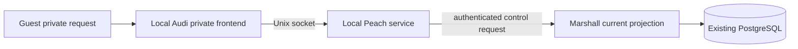

This graph describes the intended local request boundary; it is not evidence of
activated fleet placement or a native guest journey.

## Foreign Linux guest PAM runtime

Arch/Alma's `overalls-pam-helpers.service` is a root oneshot inside each guest,
not a fleet service. It creates the fixed pinned PAM account-helper copy on
volatile runtime storage before the existing owned SSH listener, which requires
its success. Unsafe path custody or installer failure withholds SSH startup;
account expiry, current roster and private login receipt remain independent
refusal boundaries. No host, listener, domain or placement is added. The
isolated VM helper check establishes root account behavior on nosuid storage;
fresh guest SSH/sudo and fleet lifecycle remain separate.

## Agent context remains within existing services

ADR-0178/0179 add no deployable service or listener. Marshall's Agents domain
retains snapshots, checkpoints, planning interactions and managed skill receipts
in its existing PostgreSQL authority. Ziggy's authenticated pull path executes
compaction requests through the same provider admission and accounting boundary.
The existing guest executor performs context reads and skill materialization
through Audi's current VM binding and lease checks. Linux uses the existing
guest updater; Windows receives compatible code through rebuilt images.
Enablement requires compatible consumers and executors, not only an installed
database schema. Declared placement does not establish native or deployed
availability; see the [context review](repo:docs/architecture/reviews/2026-10-16-agent-context-and-planning.md).

## Experimental Antithesis fixture outside deployed placement

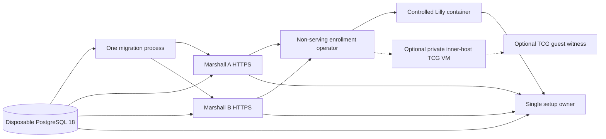

This is the isolated test graph, not physical fleet placement. PostgreSQL owns
committed fixture state; the operator uses Marshall actions and private volumes
to issue credentials, while the workload alone decides whether to emit setup.
The earlier local diagnostic started migration, Marshall A/B, enrollment and
Lilly health, and the operator created three passkey-backed accounts without
opening a listener. The controlled host's connected session had no report.
A later fresh base project published a current v4 report and emitted setup;
six serial Control commands passed locally with 13 SDK assertion records. Its
selected manifest has four stale runtime-dependency hashes, so hosted acceptance
remains open. The optional fourth-image inner host
measured ZFS and cgroups but remained disconnected and execution-unready; its
guest witness and runtime PKI preparation confer no admission authority. Its
recovery inventory admits only the fixed `lilly.service` and
`lilly-guest-emulator.service` cgroups plus exact tracked VM units when
systemd creates them; unknown or malformed native inventory fences recovery,
and emulator inventory independently checks tracked placements.
For the integrated branch, physical ZFS/cgroup and guest-vmm preflight must
precede a current delivered host report. Reviewed enablement and credential
rotation then allow inner Ziggy/Audi to become ready; a new private guest
launch/restart refuses before its runner effect until those roles are ready.
The inspected source moves this private check to GuestExecutor to avoid a
credential/report bootstrap cycle. The current private host still has report
sequence zero, so this ordering is source-reviewed rather than composed
execution evidence.
The separate container `guest-lifecycle` profile instead places a guest-vmm
QEMU TCG container beside a STUB-storage Lilly release: Lilly alone mounts the
mutating guest control socket, enrollment alone mounts the read-only witness
socket and the image catalog share, and the workload reaches both only through
the operator's closed request channel. Its synthetic pool is not ZFS; losing
guest-vmm health, the registered image or the stub catalog withholds setup.
Loss of the fixture database, private credentials, current report or inner-host
measurement withholds the corresponding setup or guest claim.

## Repository launcher and package placement

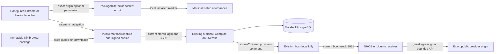

The extension is installed in the user's browser. After the user saves a server
origin, it requests optional access and registers the detector only for that exact
origin. The detector's document marker is local presentation state: it can hide
setup affordances but cannot authorize a request, account, thread or machine.
Missing, denied or withdrawn permission and detector failure leave setup visible.
Marshall's existing package closure and HTTPS service serve its archives; there is
no new listener, host role or signing service. The cookie holds input only and
PostgreSQL owns admitted VM and source identity. Lilly's host-local boot boundary
mediates inert source delivery;
only the guest reaches providers. A provider failure changes checkout status without
failing VM readiness. Cookie expiry/login loss, database admission failure, host
custody loss and provider availability are separate failure boundaries. Declared
package/service placement is not current production launch or native acceptance.

## Browser editor placement and failure boundary

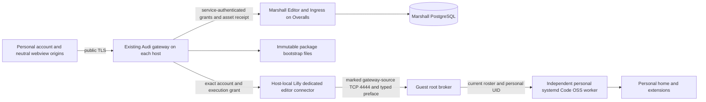

`Audi.HTTP.EditorAssetsPublisher` is an OTP child inside public Audi, not another
fleet role. Marshall and Audi modules default to the same approved source-built
package. Current immutable assets, host/service readiness and image capability
gate editor discovery; per-request Editor grants remain separate. The broker and
workers live inside each NixOS/Ubuntu guest, not on the outer host. Lilly alone
admits the dedicated marked connector, while the broker checks boot/source/account
and personal systemd ownership. Browser communication expires on lost authority;
worker processes and home data have their separate native lifetime.

The separate Windows candidate keeps the same Marshall/Audi/Lilly path and
dedicated gateway-only guest port, with a different native custody boundary:

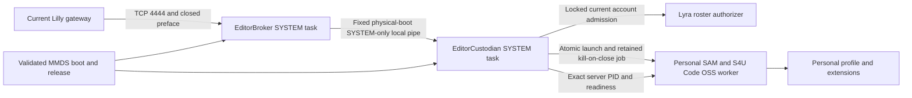

Both fixed SYSTEM tasks run the same pinned executable with separate role
configuration and copied trust bundles. They live inside the candidate Windows
guest; no fleet host, Ash domain, public listener or physical placement role is
added. The local pipe is derived from the current MMDS physical boot state key.
Mutual kernel PID/time, SYSTEM-token and executable checks establish the local
peer; they do not replace independent boot/release/preface/account authorization.
Only the custodian owns worker launch, receipts, resume, worker pipes and job
handles. Broker stream loss preserves those handles. Root loss permits replacement
only after exact-job zero-descendant accounting; failed accounting quarantines.
The custodian has 64 stable lifetime account slots, while each role separately
bounds live/retired pipe state to 128 reservations.

The accepted custodian-death behavior requires bounded descendant termination and
a new worker preserving files. Current source requests kill-on-close and, per
[ADR-0237](repo:docs/architecture/decisions/0237-windows-custodian-same-boot-recovery.md), takes a durable per-boot generation on restart. It replaces an earlier
generation's worker only after logon-session quiescence, without native execution
evidence yet. A new physical boot gets a new namespace.
Independent-task peer/capacity/failure execution and a complete newly bound image's
browser journey remain gaps. The old candidate and its failed broker recovery
cannot qualify this replacement. See
[ADR-0208](repo:docs/architecture/decisions/0208-windows-editor-job-custodian.md)
and its [review](repo:docs/architecture/reviews/2026-10-18-windows-editor-job-custodian.md).

Declared module/image composition does not claim production activation or a
second Marshall failure domain. The dedicated native package test has a synthetic
gateway/roster. Historical NixOS passes and Ubuntu failures retain their revisions.
The corrected startup-release snapshot now passes both complete authenticated
Firecracker family scripts, including policy/control, recovery and Origin/sign-out
refusal. Both hosts later activated exact 63a1443c/release 73ad with matching new
guest manifests; this is installed identity rather than a production browser
journey. The snapshot predates later template changes. Final release 7d2415's
complete standalone real-language/version/control/recovery run passed in
342 seconds within its local authorizer/relay scope; its final-release
Firecracker family, current merged runtime, recurring coverage and multi-gateway
failover remain open in
[scenario coverage](#coverage).

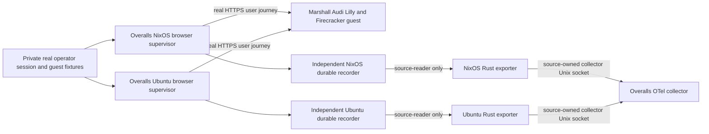

The supervisors own real runtime browser credentials and an independent producer
identity. Exporters read only their fixed numeric recorder publication and reach
their own collector sockets; they cannot alter outcomes or access browser sessions.
Probe, recorder and exporter are distinct services on Overalls. Neither Dungarees
nor guest telemetry duplicates these outer-fleet journey totals. A lost credential,
recorder or collector interrupts coverage and leaves the source unknown. Declared
placement does not claim that a production fixture or completed journey exists.
The 12:01 inspection at revision 50021c04 found all four private fixture/session
files absent. A separately authorized existence-only inspection at 13:06:33 on
current 63a1443c again found all four files absent, with browser supervisors
restarting. Current recurring browser coverage and seven-day history remain
unestablished despite active request exporters.

Optional burn delivery places Alertmanager on the central telemetry host through
`services.overallsOtelFleet.burnAlerts.enable`. Prometheus sends over loopback and
Alertmanager sends to an approved HTTPS webhook using service-local runtime
credentials. No listener is public and clustering is disabled. The deployed hosts
currently have this capability disabled; central-host failure also interrupts
notifications. The placement projection includes Alertmanager when enabled.

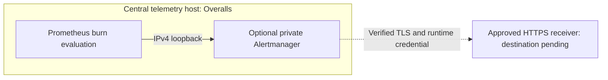

This optional path is disabled in the deployed fleet. The central host owns
evaluation, route configuration and credential custody; the external receiver
owns notification handling and receipt. An unavailable receiver causes retries.
Loss of the central host interrupts both evaluation and sending; this diagram
does not establish independent notification availability.

Overalls runs a separate Rust `telemetryStorageProbe` on IPv4 loopback port9465.
Prometheus scrapes fixed aggregate telemetry-store sizes and root free space.
The root probe receives read-only mounts for Prometheus and Tempo inside an
otherwise empty state/runtime/configuration namespace; it has no provider keys
or application authority. Its memory/CPU/task limits and independent unit keep
capacity collection separate from producers, recorders and admission. Missing
probe metrics raise a capacity-diagnostics alert rather than SLO success.

## Independent diagnostic custody

Each enabled Elixir producer has a separate `overalls-trace-INSTANCE` Rust service.
The shared Events catalog and official OpenTelemetry SDK emit bounded reviewed
spans to that producer's Unix socket. The receiver authenticates the peer UID and
exact systemd cgroup, validates the generated schema, and replaces host/service
provenance from Nix configuration. A same-UID process in another unit cannot
borrow the producer identity. The receiver has no application or database
credentials and cannot mutate guests, accounting or control state.

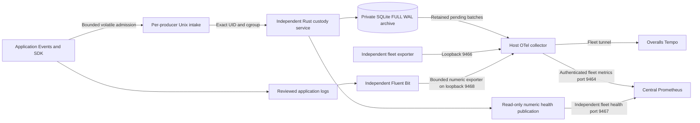

Each archive defaults to 2GiB, with a 256MiB pending admission budget and 90-day
retention even after the upstream acknowledges. Nix rejects producer inventories
above the configured 32GiB aggregate host allocation. A successful spool export
ACK means SQLite FULL-WAL custody; the SDK's bounded queue admission does not. Full, unavailable or invalid custody refuses diagnostics and leaves the
producer running. Explicit replay preserves stored bytes and identities. The
observer has no `Requires`, `BindsTo` or restart propagation to its producer.
Routine sampling is configurable through `traceSpool.traceSampling`; committed
lifecycle observations remain sampled independently of durable SLO accounting.

Lilly publishes state under native locks, then admits diagnostics only after
confirmed lock release. Lifecycle journals accept only v2 envelopes; diagnostics
cannot block state transitions. Host metrics are collected
independently and scraped rather than uploaded to Marshall. Missing observations
remain unknown; they cannot become proof of guest death, capacity or success.

## Durable request sources

The fleet module selects eight request recorders and exporters on Overalls and
five on Dungarees, matching enabled applications. Marshall, Enrico and Porsche
run only on Overalls; Audi's three roles, Brady and Galileo run on both hosts.
The standalone recorder module still defaults to an empty instance set. Both
hosts run their recorders; the 2026-10-11 preflight found every recorder
checkpoint at version 3. Recorders accept only version 3; any other version
refuses startup with a `version` refusal and leaves the checkpoint unchanged
(ADR-0159).
The native crash fixture independently supervises recorders and producers on
one test machine. This is a host-local
accounting boundary, not a separate physical availability domain.

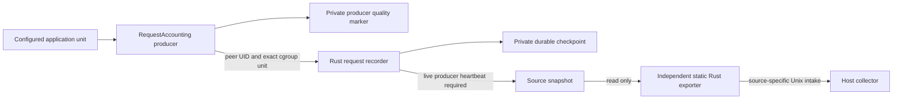

Nix derives bounded recorder/exporter accounts and RPC/reader groups from a
fixed hash of the configured instance name, keeping every Unix name below
NixOS's 32-character boundary. Units and storage paths retain the readable
instance name. Nix assigns the recorder a separate unprivileged user and mode-0700 permanent
state. Its mode-2750 RPC directory uses a producer group inherited by socket
children. A separate mode-0750 publication directory and primary reader group
permit snapshot reading without directory write access. Producers receive only
the RPC group; exporters receive only the reader group and collector access.
The explicit Rust `--recorder-group-source` mode preserves that publication
custody without falling back to application status sockets. Kernel attribution still
distinguishes different application roles sharing a UID. Recorder restart does
not stop the producer, and producer loss does not grant guest execution authority.
Source hooks and the source-local `Overalls.RequestAccounting.Producer` exist. The producer uses private
quality state independently of recorder checkpoints and permanent source lifetime.
The pure aggregate model shares arithmetic and snapshot validation only; application
storage, concurrency and publication remain inside the configured source unit.
Producer marker directories are mode 0700 beneath their systemd state directory;
the inner real directory also works with DynamicUser's private-storage symlink.
Application-owned exporter units no longer exist (ADR-0159); only the static
recorder-group exporters publish request accounting. Application telemetry
handlers and independent database measurements remain. Static
exporters receive no application identity or database credentials. Recorder
restart leaves its producer running; neither requires the other to remain live.
The collector fixes host, source and origin provenance on each restricted
intake. Native fixture execution does not establish actual application outcomes;
the declared application/collector rollout and production activation have
separate acceptance records.

This is the repository's declared fleet, not live health. The placement diagrams
are generated from an allowlisted evaluation of NixOS configurations. They include
the named Overalls services, PostgreSQL, fleet addresses and administrative SSH
ports; they do not enumerate every systemd unit or firewall rule.

## Host responsibilities

| Host | Responsibility and failure boundary |
| --- | --- |
| `overalls` | Control plane and worker: one Marshall instance, local PostgreSQL, public web proxy, Porsche and Enrico, plus provisioner and guest services, diagnostic log store, Prometheus, Tempo and loopback Grafana behind an authenticated public HTTPS frontend on port 3443. Loss of this host removes the declared control-plane authority and both central telemetry query paths; collection on the worker remains independent. |
| `dungarees` | Worker using Overalls authority, with its own Lilly, guest storage, private services and OpenTelemetry collector; also a public Audi gateway and DNS replica. It deliberately has no Marshall, PostgreSQL, web proxy, Porsche or central telemetry store. |
| `panterloons` | Planned second control plane, a separate deployment cloned from Overalls with its own empty Marshall database, to serve `ghuntley.dev` after the operator moves DNS. It is currently a base declaration awaiting installation: no roles, Marshall, PostgreSQL or Lilly yet, and it holds no fleet authority until enrolled. |
| `salopettes` | Hetzner Cloud `hcloud` host (ADR-0231) running only the Susan push relay, its local PostgreSQL and an nginx TLS proxy for `notifications.overalls.dev`. It has no KVM, Lilly, Marshall, Porsche or Audi and holds no fleet authority: Marshall reaches it only as a public HTTPS client, so its loss delays needs-input pokes, which Marshall retries and expires, but affects no guest, session or control-plane state. |

Panterloons and Dungarees also share one build pool (ADR-0248):
`tribuchet-hub` runs only on Panterloons, `tribuchet-worker` and
`nix-grpc-daemon` on both. Loss of Panterloons stops cross-host scheduling;
both hosts then build locally.

## Authority and interactions

```mermaid
flowchart TB
  Browser[Browser HTTPS] --> Proxy[Overalls web proxy]
  CLI[overalls CLI management SSH] --> Porsche[Overalls Porsche]
  Proxy -->|verified backend TLS| Marshall[Overalls Marshall]
  Porsche -->|verified fleet TLS| Marshall
  Marshall -->|signed public host certificates| Porsche
  Marshall -->|signed public host certificates| Audi
  Marshall -->|loopback TLS and SCRAM| DB[(Overalls PostgreSQL)]
  Marshall -->|private browser outcome snapshot| MarshallExporter[Rust Marshall SLO exporter]
  MarshallExporter -->|Marshall-only Unix OTLP| Otel
  Marshall --> Enrico[Overalls Enrico mirror cache]
  subgraph Workers[Both hosts - independent local execution]
    Lilly[Lilly] --> Guests[Firecracker guests and local ZFS]
    Guests --> Private[Audi private]
    Private --> Ziggy[Ziggy]
    Private --> Galileo[Galileo]
    Guests --> Brady[Brady web egress]
    Ziggy --> Underclass[Host-local Underclass pool]
    Underclass -->|read-only local monitor| UnderclassProbe[Rust monitor readiness probe]
    Underclass -->|loopback HTTP proxy only| UnderclassEgress[Userspace Tailscale egress node]
  end
  Lilly -->|verified TLS polling over fleet network| Marshall
  UnderclassEgress -->|direct, or optional WireGuard exit node| ProviderApis[Provider APIs]
  Private -->|current authority| Marshall
  Public[Public DNS and application clients] --> Audi[Audi and DNS on both hosts]
  Audi -->|current placement and access| Marshall
  Audi -->|fenced connector| Lilly
  Collectors[Per-host Fluent Bit collectors] -->|verified OTLP, insert authority| LogStore[(Diagnostic log store on Overalls)]
  Guests -->|OTLP HTTPS private zone| Private
  Private -->|Unix Audi peer and current binding| GuestReceiver[Rust guest OTLP receiver]
  GuestReceiver -->|sanitized localhost OTLP| Otel[Per-host OTel collector]
  Brady -->|private numeric snapshot| BradyExporter[Rust host SLO exporter]
  BradyExporter -->|restricted local Unix OTLP| Otel
  Galileo -->|private cumulative snapshot| GalileoExporter[Rust Galileo SLO exporter]
  GalileoExporter -->|Galileo-only Unix OTLP| Otel
  Enrico -->|private cumulative snapshot| EnricoExporter[Rust Enrico SLO exporter]
  EnricoExporter -->|Enrico-only Unix OTLP| Otel
  Porsche -->|private cumulative SSH dispatch snapshot| PorscheExporter[Rust Porsche SLO exporter]
  PorscheExporter -->|Porsche-only Unix OTLP| Otel
  Ziggy -->|private durable completion snapshot| ZiggyExporter[Rust Ziggy SLO exporter]
  ZiggyExporter -->|Ziggy-only Unix OTLP| Otel
  Private -->|bound non-OTLP completion snapshot| AudiPrivateExporter[Rust Audi private SLO exporter]
  AudiPrivateExporter -->|Audi-private-only Unix OTLP| Otel
  Audi -->|public DNS completion snapshot| AudiDnsExporter[Rust Audi DNS SLO exporter]
  AudiDnsExporter -->|Audi-DNS-only Unix OTLP| Otel
  Audi -->|granted SSH establishment snapshot| AudiSshExporter[Rust Audi SSH SLO exporter]
  AudiSshExporter -->|Audi-SSH-only Unix OTLP| Otel
  UnderclassProbe -->|Underclass-only Unix OTLP| Otel
  Otel -->|fleet tunnel metrics scrape| Prom[(Overalls Prometheus)]
  Otel -->|fleet tunnel trace export| Tempo[(Overalls Tempo)]
  Operator[Public operator with Grafana credentials] -->|HTTPS 3443| GrafanaProxy[Overalls dedicated HAProxy frontend]
  GrafanaProxy -->|Loopback HTTP 3000| Grafana[Overalls loopback Grafana]
  Grafana --> Prom
  Grafana --> Tempo
  Grafana -->|Verified fleet TLS and reader-only credential| LogStore
```

The worker box applies separately to each host. It is not a shared guest disk or
an independently replicated control plane. Domains within Marshall are shown in
[Ash business domains](#domains).

[Overalls services](repo:fleet/roles/control-plane/services.nix) declare one
`marshall-overalls` instance. The public proxy forwards to loopback port 4443
with verified TLS. PostgreSQL is loopback-bound with TLS/SCRAM. Porsche uses
management SSH port 22; administrative OpenSSH uses 2222. Audi and DNS bind
separate public addresses on each host. Enrico is a private quota-bound cache.
[Dungarees assertions](repo:fleet/hosts/dungarees/configuration.nix) enforce its
worker-only control-plane configuration.
[Salopettes assertions](repo:fleet/hosts/salopettes/configuration.nix) enforce
its Susan-only role. Its public listeners are TCP 80 and 443 at its IPv4
address, which arrives only through the shared `fleet-addresses` SOPS document
(ADR-0233). Nginx forwards to Susan's loopback port 4100 without access logs.
It joins `fleet0` as `10.90.0.3` with IPv6 off and peers only with Overalls,
which admits its handshake only from that SOPS-delivered address. Like the
other fleet hosts, it offers a Tailscale exit node.

Only Overalls Marshall receives the dedicated SSH CA private key through an
encrypted runtime bundle and systemd credential. Porsche, both Audi gateways
and guests hold separate leaf keys and public certificates. Guests generate
leaf keys under `/run` on each boot. New SSH readiness depends on issuance;
existing valid certificates permit renewal retries during a control-plane outage.
This signer is independent of physical administrative SSH host keys and TLS CAs.
Inception instances create an independent CA beside their own persistent identities.

[The fleet network](repo:fleet/fleet-network.nix) uses pinned WireGuard peers and
distinct host credentials. Overalls admits fleet TLS APIs on 5443, Enrico on
5445 and the diagnostic log store entry on 8443 (verified TLS, path-scoped
insert/reader credentials; ADR-0127). The tunnel does not replace service TLS
or application authorization. Guest prefixes cannot become host-management
paths. Public ingress, guest private services, fleet APIs and administrator
access are separate boundaries.

The tunnel also admits collector metrics on 9464 and independent collection-health
metrics on 9467 in both directions, and Tempo
trace intake on 4317 at Overalls. The collector's guest OTLP/HTTP intake binds
only local loopback; its application intake uses the restricted Unix socket.
The fleet resource exporter binds loopback 9466 and enters the host collector's
metrics pipeline; it has no fleet-facing listener of its own.
Grafana and Prometheus query APIs also bind loopback. Grafana's provisioned
VictoriaLogs datasource sends server-side queries over verified fleet-entry TLS
with a reader-only runtime credential. Marshall has no diagnostic query credential
or reader dependency.
Overalls exposes only
Grafana through a dedicated authenticated HTTPS proxy frontend on
`OVERALLS_PRIMARY_IPV4:3443`, with a matching destination-scoped perimeter grant.
The proxy reuses its existing public certificate; Grafana login remains the
operator authority boundary. Prometheus and Tempo have no public frontend. The
WireGuard peer key and firewall identify the physical sender, while the Rust
receiver checks the Audi UID and replaces guest metadata. Prometheus scraping
does not buffer missed metrics; trace export uses a bounded on-disk queue.
Each host's Rust Underclass probe reads only the unauthenticated local monitor
socket and emits one fixed readiness bit through an Underclass-only collector
socket. The probe receives neither proxy nor administrator credentials and
cannot authorize a provider request. Collector identity is assigned by Nix.
The candidate rule requires fresh complete probe series from both enrolled
hosts; a failed local monitor returns zero, while lost probe or collector
observations make the candidate unknown. Tailnet publication and provider
completion remain outside this local readiness boundary.
Brady's request exporter runs under its independent static reader account in the
host network namespace, reads the durable recorder's publication and reaches
the collector's group-owned Unix application socket. The collector grants socket
access only to the exporter service and keeps its trace queue owner-only.
Actual request-to-collector acceptance and a measured baseline remain separate
from declared placement.
Each trusted application exporter also sends a fixed source-start-time gauge
from its validated snapshot. Nix recording rules withhold each five-minute
candidate ratio until each matching host/replica lifetime and coverage clock
span the whole window and the sampling clock is fresh. Durable admissions and
settlements preserve acknowledged counts through recorder and producer loss.
Clean application restart preserves coverage; an uncertain recording interval
advances coverage and withholds affected windows. These clocks do not establish
physical availability or power-loss acceptance.
Grafana candidate queries repeat the same guard against retained recordings
after Prometheus restarts; Grafana has no independent outcome authority.
The single Overalls Marshall release writes a mode-0640 browser outcome
snapshot in its dynamic-user-owned, mode-0750 directory. A static Rust exporter
reads the file through the source group but cannot replace it; only the exporter receives the Marshall
collector socket group. Nix supplies the fixed `overalls` replica identity. Exporter or
collector failure cannot stop the browser endpoint, while a Marshall process
restart can lose counts that were not exported.
Each public Audi gateway writes a fixed SSH establishment snapshot after a
validated grant and connector result. A separate Rust exporter reads it through
the source group without directory write access and alone receives the Audi
SSH collector socket group. Invalid keys and denied grants cannot improve the
candidate ratio; source-process restarts can lose unexported counts. The
collector assigns application identity and the candidate rule requires a fresh
counter from both enrolled Audi hosts.
Galileo's Rust exporter reads its fixed cumulative snapshot through the
Galileo-owned Unix frontend. A separate collector socket and group stamp
`service.name=galileo` from configuration. The ordinary Galileo service lacks
that collector group; collection failure does not interrupt integration requests.
Its packaged and full Firecracker source-to-collector journeys passed;
production collection and the target baseline remain open.
Enrico's Rust exporter reads its fixed cumulative snapshot through the
owner-only Unix health frontend. Its separate collector socket assigns
`service.name=enrico`; the ordinary Enrico service cannot connect to that
socket. The packaged source-to-collector journey passed, while cross-host
Marshall scheduling, manager-crash accounting and production collection remain
open.
Porsche's Rust exporter reads only its mode-0600 fixed numeric snapshot and
connects through a Porsche-only collector socket. Nix assigns
`service.name=porsche`; ordinary Porsche processes lack the collector group.
The candidate series measures SSH dispatch results, while physical VM
completion, production collection and a target baseline remain open. The
packaged service fixture passed zero-valued source-to-collector export and
ordinary UID socket refusal, but no authorized Marshall-backed command.
Ziggy's Rust exporter reads only a fixed mode-0600 snapshot produced after
durable spool transitions. Its separate collector socket assigns
`service.name=ziggy`; the ordinary Ziggy service cannot connect to that socket.
Provider calls and accounting remain under Ziggy and Marshall authority;
collection loss cannot replay inference. Live collection and targets remain open.
Underclass's proxy exporter runs under a separate static UID on both hosts.
It reads only the mode-0640 numeric snapshot in the source-owned mode-0750
`/run/underclass/slo` directory and connects to the proxy-only collector intake.
Its source group grants no provider state or credential access; the producer
lacks the collector group. This service remains separate from the tokenless
local monitor probe. Isolated native custody passed; production activation remains
under verification.
Each host's `underclass-egress` node is a second, unprivileged, userspace
tailnet identity with its own state and socket. It has no TUN device or routes,
and the host's own Tailscale node is unchanged. When egress routing is enabled,
Underclass's cgroup can reach only loopback, and provider requests leave through
the egress proxy. The enrolled profile configures no exit node (ADR-0260), so
they leave from the host's own address. If an exit node is configured, requests
leave through it and fail rather than fall back when it is unavailable
(ADR-0185); that exit node is then outside the fleet failure boundary.
Audi private's Rust exporter reads only its mode-0600 numeric snapshot and
connects through a separate group-restricted collector socket. Nix assigns
`service.name=audi_private`. Bound transport completions stay distinct from
guest OTLP diagnostic uploads; this metric does not authorize guest access.
Audi DNS owns a separate mode-0600 numeric snapshot. A Rust process running
as its DNS user reads it and exports through a DNS-only collector socket;
Nix assigns `service.name=audi_dns`. This candidate counts qualified
authoritative responses after socket send, without query-name labels or
gateway authority. Its metrics disappear on collection loss and unexported
counts may disappear on process restart.

[The host profile](repo:nix/platform/hosts/profile.nix) derives Lilly identities, pool GUIDs,
budgets and credential paths from enrollment. Each host owns its ZFS guest data,
Lilly journals, Underclass pool and service caches. A second worker does not make
those disks shared or make PostgreSQL highly available. On authority loss, existing
physical execution and expiring service leases follow their own fences; recovery
must reconcile observed execution before granting new authority.

## Evaluated placement

`lillyHostd` (`lilly-hostd.service`) runs on every Lilly host as the host-effects
engine of [ADR-0176](repo:docs/architecture/decisions/0176-host-concurrency-single-writers-and-effects.md)
decision 4. It holds every Lilly lease's `flock` on the existing lock inodes and runs
every utility Lilly issues under a lease, from a closed utility table resolved from
Lilly's own PATH. It accepts one kind of peer, root processes in `lilly.service`, over
a root-only `SOCK_SEQPACKET` socket, and keeps each command in its own child of its
delegated cgroup. Lilly binds to it: a hostd stop stops Lilly, and a Lilly stop or
crash ends the session, after which hostd kills and reaps that session's commands
before releasing its leases. VMMs are not hostd children; they run as transient
units in `lilly.slice`, so a hostd restart cannot stop a guest. Detached ingress
bridges for guest SSH, plain web, the editor and nested HTTPS run as transient `lilly-ingress-<key>.scope`
units in `lilly_ingress.slice` (bounded at 1 GiB and 1100 tasks, never restarted
on deployment), so the bridge process survives a hostd or Lilly restart.
Editor and ordinary guest SSH/web renewal can keep the unchanged lease across
Lilly reconnect; nested streams still have publication-bound five-second leases
and require re-admission after a Lilly restart
([ADR-0187](repo:docs/architecture/decisions/0187-detached-ingress-bridges.md),
[ADR-0192](repo:docs/architecture/decisions/0192-staged-detached-ingress.md)).

Overalls alone publishes shared-database creation-to-ready, physical lifecycle
and operation-linked SSH completion totals. `marshallReadySloExporter`,
`lillyPhysicalSloExporter` and `porschePhysicalSloExporter` are separate Rust
exporter identities. Each reads one fixed numeric mode-0640 snapshot from the
Marshall source group and can send only through its dedicated collector intake
group. The publisher and database retain measurement authority; snapshots can be
reconstructed after process restart. Exporters cannot write source files and
receive no database, host or provider credentials. Dungarees does not duplicate
these shared totals. Declared placement is distinct from recorded live activation.

Four additional Overalls Rust exporter identities publish workflow measurements:
`porscheCloneSloExporter`, `porscheRelocateSloExporter`, `porscheRetrySloExporter`
and `porscheCancelSloExporter`. Each has a distinct restricted collector intake
and reads its own fixed numeric snapshot. The additive migration initializes
their permanent database lifetimes without changing the original three sources.
Process restart cannot reset these database identities. Native extension and
live activation evidence remain pending.

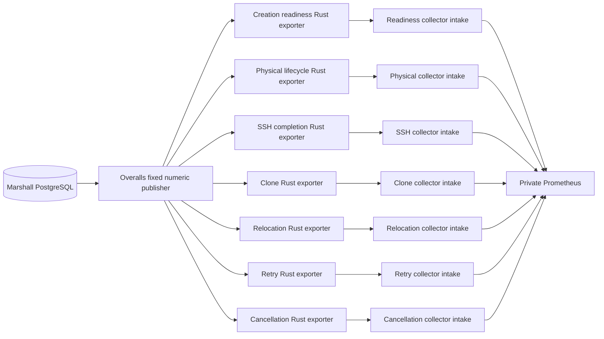

The generator selects each enrolled `NAME` configuration; an inventory host without
one uses `NAME-base` and is marked accordingly. Enrollment-dependent roles remain
disabled in the base profile. The service allowlist lives in
[the projection](repo:scripts/hldd/topology.nix); review it when adding a service.

<!-- hldd:view:start -->
### dungarees

```mermaid
flowchart LR
  host["dungarees"]
  host --> s0["audi"]
  host --> s1["audiDns"]
  host --> s2["audiDnsRequestRecorder"]
  host --> s3["audiDnsSloExporter"]
  host --> s4["audiPrivate"]
  host --> s5["audiPrivateRequestRecorder"]
  host --> s6["audiPrivateSloExporter"]
  host --> s7["audiSshRequestRecorder"]
  host --> s8["audiSshSloExporter"]
  host --> s9["brady"]
  host --> s10["bradyRequestRecorder"]
  host --> s11["bradySloExporter"]
  host --> s12["galileo"]
  host --> s13["galileoRequestRecorder"]
  host --> s14["galileoSloExporter"]
  host --> s15["lilly"]
  host --> s16["lillyHostd"]
  host --> s17["lillyTransfer"]
  host --> s18["nix-grpc-daemon"]
  host --> s19["opentelemetry-collector"]
  host --> s20["overalls-trace-audi"]
  host --> s21["overalls-trace-audi-dns"]
  host --> s22["overalls-trace-audi-private"]
  host --> s23["overalls-trace-brady"]
  host --> s24["overalls-trace-galileo"]
  host --> s25["overalls-trace-lilly"]
  host --> s26["overalls-trace-ziggy"]
  host --> s27["overallsAutoUpdate"]
  host --> s28["overallsFleetExporter"]
  host --> s29["overallsLogging"]
  host --> s30["overallsOtelFleet"]
  host --> s31["overallsOtelGuest"]
  host --> s32["peach"]
  host --> s33["tribuchet-worker"]
  host --> s34["underclass"]
  host --> s35["underclassEgress"]
  host --> s36["underclassMonitorProbe"]
  host --> s37["underclassProxySloExporter"]
  host --> s38["ziggy"]
  host --> s39["ziggySloExporter"]
```

Arrows mean configured service placement. Configuration: `dungarees`. Marshall instances: none. Fleet address: `10.90.0.2`. Fleet peers: `panterloons`. Administrative SSH ports: 2222.

### panterloons

```mermaid
flowchart LR
  host["panterloons"]
  host --> s0["audi"]
  host --> s1["audiDns"]
  host --> s2["audiDnsRequestRecorder"]
  host --> s3["audiDnsSloExporter"]
  host --> s4["audiPrivate"]
  host --> s5["audiPrivateRequestRecorder"]
  host --> s6["audiPrivateSloExporter"]
  host --> s7["audiSshRequestRecorder"]
  host --> s8["audiSshSloExporter"]
  host --> s9["brady"]
  host --> s10["bradyRequestRecorder"]
  host --> s11["bradySloExporter"]
  host --> s12["enrico"]
  host --> s13["enricoRequestRecorder"]
  host --> s14["enricoSloExporter"]
  host --> s15["galileo"]
  host --> s16["galileoRequestRecorder"]
  host --> s17["galileoSloExporter"]
  host --> s18["grafana"]
  host --> s19["grafanaPublicProxy"]
  host --> s20["lilly"]
  host --> s21["lillyHostd"]
  host --> s22["lillyPhysicalSloExporter"]
  host --> s23["lillyTransfer"]
  host --> s24["marshall"]
  host --> s25["marshallProxy"]
  host --> s26["marshallReadySloExporter"]
  host --> s27["marshallRequestRecorder"]
  host --> s28["marshallSloExporter"]
  host --> s29["nix-grpc-daemon"]
  host --> s30["opentelemetry-collector"]
  host --> s31["overalls-trace-audi"]
  host --> s32["overalls-trace-audi-dns"]
  host --> s33["overalls-trace-audi-private"]
  host --> s34["overalls-trace-brady"]
  host --> s35["overalls-trace-enrico"]
  host --> s36["overalls-trace-galileo"]
  host --> s37["overalls-trace-lilly"]
  host --> s38["overalls-trace-marshall-overalls"]
  host --> s39["overalls-trace-porsche"]
  host --> s40["overalls-trace-ziggy"]
  host --> s41["overallsAutoUpdate"]
  host --> s42["overallsFleetExporter"]
  host --> s43["overallsLogStore"]
  host --> s44["overallsLogging"]
  host --> s45["overallsOtelFleet"]
  host --> s46["overallsOtelGuest"]
  host --> s47["peach"]
  host --> s48["porsche"]
  host --> s49["porscheCancelSloExporter"]
  host --> s50["porscheCloneSloExporter"]
  host --> s51["porschePhysicalSloExporter"]
  host --> s52["porscheRelocateSloExporter"]
  host --> s53["porscheRequestRecorder"]
  host --> s54["porscheRetrySloExporter"]
  host --> s55["porscheSloExporter"]
  host --> s56["postgresql"]
  host --> s57["prometheus"]
  host --> s58["telemetryStorageProbe"]
  host --> s59["tempo"]
  host --> s60["tribuchet-hub"]
  host --> s61["tribuchet-worker"]
  host --> s62["underclass"]
  host --> s63["underclassEgress"]
  host --> s64["underclassMonitorProbe"]
  host --> s65["underclassProxySloExporter"]
  host --> s66["vscodeBrowserNixosExporter"]
  host --> s67["vscodeBrowserNixosProbe"]
  host --> s68["vscodeBrowserNixosRequestRecorder"]
  host --> s69["vscodeBrowserUbuntuExporter"]
  host --> s70["vscodeBrowserUbuntuProbe"]
  host --> s71["vscodeBrowserUbuntuRequestRecorder"]
  host --> s72["ziggy"]
  host --> s73["ziggySloExporter"]
```

Arrows mean configured service placement. Configuration: `panterloons`. Marshall instances: `overalls`. Fleet address: `10.90.0.1`. Fleet peers: `dungarees`, `salopettes`. Administrative SSH ports: 2222.

### salopettes

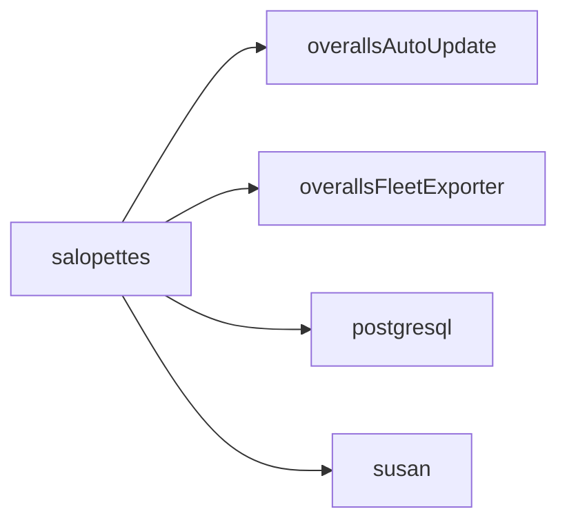

Arrows mean configured service placement. Configuration: `salopettes`. Marshall instances: none. Fleet address: `10.90.0.3`. Fleet peers: `panterloons`. Administrative SSH ports: 22.
<!-- hldd:view:end -->

## Artifact content listener placement

The artifact content origin
([ADR-0254](repo:docs/architecture/decisions/0254-isolated-artifact-content-origin.md))
adds no host or service unit. When `services.marshall.artifactContent.host` is
set, each Marshall instance starts a second Bandit listener on its
`artifactPort` (default 6443) at its backend address, and the colocated public
proxy serves the content host on its existing HTTPS listener by SNI and Host,
with a second ACME certificate and a `marshall_artifact_nodes` backend.

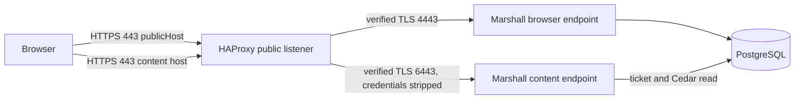

No enrolled host sets the content host yet, so the evaluated placement below is
unchanged and the content listener is not in the topology projection. The
listener shares the Marshall process, certificate files and failure boundary:
losing an instance removes both its browser and content backends, and content
health follows the browser port's readiness check. Guest staging uses the
existing Ziggy and Audi path; it opens no new fleet port.

## Configuration and change procedure

Edit `fleet/hosts/NAME/host.json` for reviewed identity and budgets, the host's
`configuration.nix` and imports for service placement, and shared modules for role
behavior. Keep credentials in the encrypted/runtime custody flow. Do not put
private environment values into this projection. Follow [configuration](#configuration)
and [deployment](#deployment) for installation, enrollment, builds and activation.

```sh
elixir scripts/hldd_views.exs --write
nix build .#checks.x86_64-linux.hldd
nix build .#checks.x86_64-linux.module-configuration
```

Review both the generated placement diff and the interaction diagram. Changing
replicas, storage, listeners or authority paths requires updating the explanation
and affected scenario evidence. A generated map cannot infer failure semantics.

## Verification and gaps

[The HLDD Nix check](repo:flake.nix) compares evaluated service placement with the
committed public projection and rendered view. [Properties and units](repo:marshall/test/architecture/hldd_views_test.exs)
reject host/role drift and missing explanations. The [native browser](repo:nix/verification/tests/machines/hldd/browser.py)
checks that the deployed release fixture renders both visual sections individually.
These checks do not contact or establish the health of either physical host.

[Fleet-network tests](repo:nix/verification/tests/machines/fleet-network/default.nix) exercise
tunnel reachability and forbidden paths in NixOS machines. The
[host replacement](repo:nix/verification/tests/machines/fleet/scenarios/host-replacement.py)
journey retires one test provisioner and enrolls its replacement (fresh machine
identity, name and storage GUIDs) through the protected SOPS/SSH path on the same
fixture topology. The
[fleet scenarios](repo:nix/verification/tests/machines/fleet/default.nix) use a separate test
topology, including three Marshall instances; that fixture is not this fleet's
replica count. Prefer native NixOS allowed/refused traffic tests and generated
authority histories for changes to these boundaries. Production failure-domain,
public DNS/gateway failover and host-loss acceptance require separately recorded
evidence. See [scenario coverage](#coverage) and [recovery](#recovery) for the
remaining security and recovery gaps.

### Notifications ownership

[`Marshall.Notifications`](repo:marshall/lib/marshall/notifications.ex) owns
devices, deliveries and the install identity. It reads SSH keys, accounts and
agent threads but never writes them; SSH and Accounts call its revocation
functions inside their own transactions. Susan is an external service at
`notifications.overalls.dev`, outside every Overalls host; its outage only
delays notifications and Mila's watch stream still works while open.

## Susan placement and fixed egress

Susan is a separate deployment that shares no authority with Marshall hosts.
ADR-0231 places it alone on the Hetzner Cloud host `salopettes`, as the NixOS
service [`services.susan`](repo:nix/domains/system/susan.nix) with a local
PostgreSQL behind an nginx proxy that terminates ACME HTTP-01 TLS for
`notifications.overalls.dev` ([host role](repo:fleet/hosts/salopettes/configuration.nix)).
Salopettes is enrolled like every fleet host, so the trunk auto-updater deploys
Susan, and it decrypts `overalls-susan` with its own host recipient. Its public
address comes from the shared `fleet-addresses` document (ADR-0233); the
repository holds no address literal for it. Marshall on Overalls resolves
`notifications.overalls.dev` to salopettes' `fleet0` address `10.90.0.3`, so its
pokes cross the authenticated tunnel to TCP 443 and still verify the public
certificate. Mila devices use the public origin, which needs the DNS record to
stay unproxied. The OCI
image [`image-susan`](repo:nix/domains/artifacts/susan-image.nix) remains a
packaging artifact with no registry: streamLayeredImage with uid 65532, no
shell, a read-only root, tmpfs `/tmp` and a fixed creation time. Migrations
run as a separate release command.

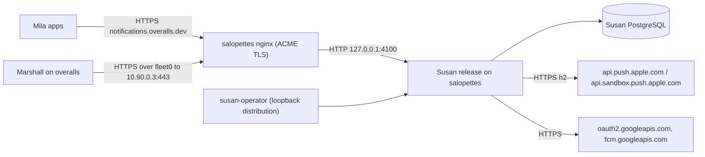

These are the failure boundaries:

- When Susan is down, notifications are delayed. Marshall's watch stream still
  works.
- When PostgreSQL is down, `/healthz` answers 503 and pokes answer 503.
- When a provider has an outage, pokes answer 503 with that provider's
  Retry-After.
- When the `fleet0` tunnel to salopettes is down, or its address document
  fails to decrypt on either side, Marshall's pokes fail and are retried; the
  public origin for Mila devices is unaffected.

Egress is fixed in code, not configuration. Susan's WNS provider (ADR-0236)
would add Entra ID `login.microsoftonline.com` and per-device
`*.notify.windows.com` channel hosts; the deployed service module does not yet
enable it, so salopettes makes no Microsoft egress. The container uses a
loopback-only, epmd-less distribution ([`Susan.Epmd`](repo:susan/lib/susan/epmd.ex))
because it has no shell from which to start epmd.
