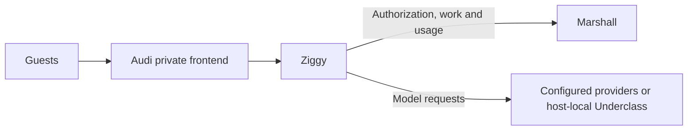

# Ziggy

Ziggy is Overalls' Elixir inference proxy and agent model worker on Lilly hosts.
It handles guest inference and pulls agent model work under Marshall's authority,
keeps provider credentials outside guests, and durably reports usage.

See [Ziggy configuration](../docs/services/ziggy.md).
